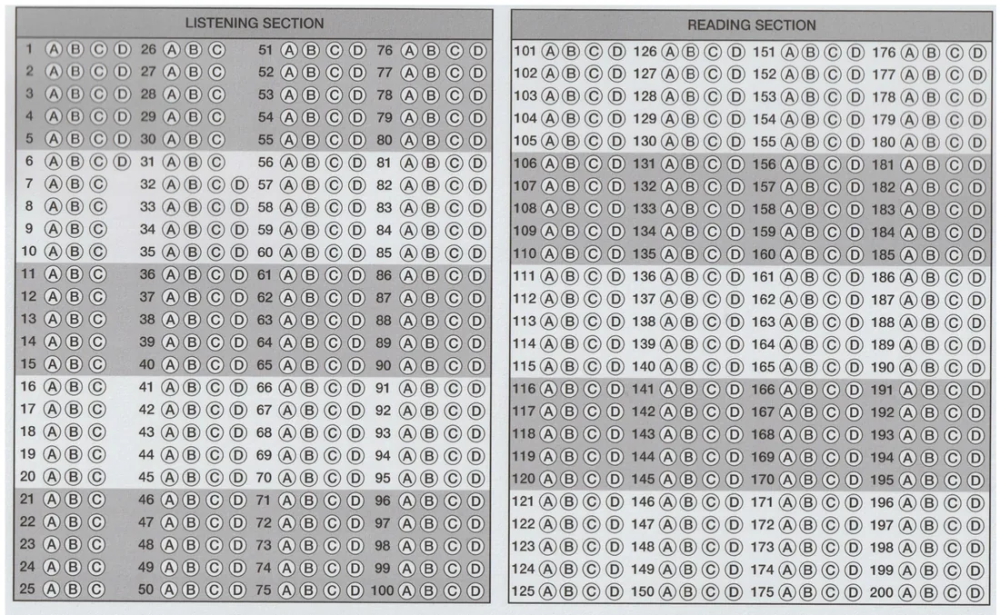
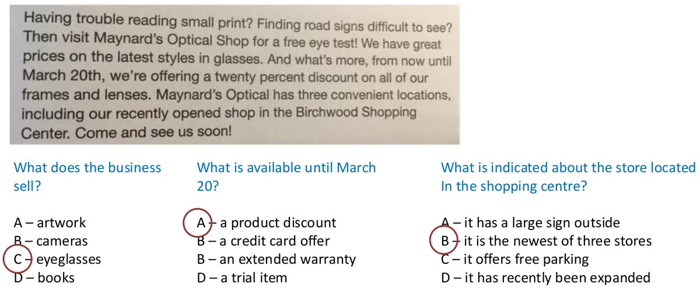
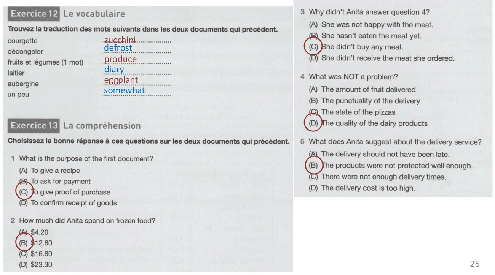
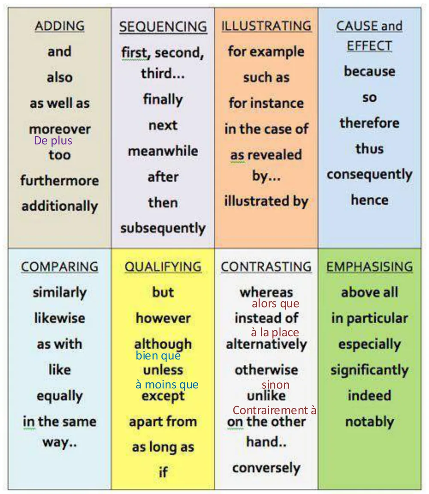

# Le TOEIC, les faux amis et les mots de liaison

Première séance du cours d'anglais professionnel : on découvre le **TOEIC** (le test que l'on prépare toute l'année), puis on révise du vocabulaire, les **mots de liaison** et les **faux amis**.

## 1. Le TOEIC en bref

**TOEIC** = *Test of English for International Communication*. C'est un test d'anglais **professionnel** : toutes les situations se passent au travail, en voyage d'affaires ou dans la vie de tous les jours.

| | Listening (écoute) | Reading (lecture) |
|---|---|---|
| Questions | 100 | 100 |
| Durée | 45 min | 75 min |
| Note | de 5 à 495 | de 5 à 495 |

- **200 questions** en QCM, sur papier, en **2 heures**.
- Score total : de **10 à 990** points.
- À l'ESGI, il faut **750 points** pour réussir son TOEIC.

> [!info] L'évaluation du cours
> - 1er semestre : **CC1** = TOEIC Listening en classe (45 min) ; **examen** = TOEIC Reading (75 min).
> - 2e semestre : **CC2** = TOEIC complet en classe ; **examen** = TOEIC officiel.

> [!tip] La règle d'or
> Une mauvaise réponse ne fait **pas** perdre de points : il faut **toujours répondre**, quitte à deviner.

**Exemple résolu : retrouver les chiffres sans les apprendre par cœur.**

Il suffit de retenir trois choses : 2 sections de 100 questions, 2 heures en tout, chaque section notée de 5 à 495.

1. Nombre de questions : 100 + 100 = **200**.
2. Durée du Reading : 2 h = 120 min ; on enlève les 45 min du Listening : 120 - 45 = **75 min**.
3. Score minimum : la plus petite note de chaque section, additionnée : 5 + 5 = **10** (et non 0 : même avec tout faux, on a 5 par section).
4. Score maximum : 495 + 495 = **990** (et non 1 000).

Pourquoi répondre au hasard plutôt que laisser vide ? Avec 4 choix, une réponse au hasard a 1 chance sur 4 d'être juste, et une réponse fausse ne coûte rien. Une case vide rapporte **toujours** zéro.

**À retenir :** une section = 100 questions et 5 à 495 points ; le total s'obtient en additionnant les deux sections.

## 2. Les 7 parties

| Partie | Section | Ce qu'on fait | Questions | Durée |
|---|---|---|---|---|
| 1 | Listening | **Photos** : choisir la phrase (entendue) qui décrit la photo, 4 choix | 6 | ~4 min |
| 2 | Listening | **Questions-réponses** : choisir la bonne réplique, **3 choix** seulement | 25 | ~8 min |
| 3 | Listening | **Conversations** à 2 ou 3 personnes, 3 questions chacune | 39 | ~18 min |
| 4 | Listening | **Exposés, annonces** (une seule personne parle), 3 questions chacun | 30 | ~15 min |
| 5 | Reading | **Phrases à compléter** (grammaire, vocabulaire) | 30 | 10-15 min |
| 6 | Reading | **Textes à compléter** (e-mails, notes de service), 4 trous par texte | 16 | ~8 min |
| 7 | Reading | **Lecture** de 1, 2 ou 3 documents | 54 | 45-50 min |

Voici la vraie **feuille de réponses** : on noircit une bulle par question. Sur l'image : à gauche les questions 1 à 100 (Listening), à droite 101 à 200 (Reading). Les questions 7 à 31 (la partie 2) n'ont que trois bulles A, B, C.

Contrôle : 6 + 25 + 39 + 30 = 100 questions d'écoute, et 30 + 16 + 54 = 100 questions de lecture. Toutes les parties ont **4 choix**, sauf la partie 2 qui n'en a que **3** (A, B, C).

Les thèmes reviennent toujours : vie sociale (restaurant, sport, cinéma), économie, **emploi et RH**, **finance**, industrie et logistique, informatique, marketing, **vente**, **vie de l'entreprise** (réunions, service client, fournitures), **voyages**.

**Exemple résolu : quelle partie ?** « On entend une femme qui explique à ses collègues le programme d'une journée de formation. »

1. On **entend** (on ne lit pas) : c'est le Listening, donc une partie de 1 à 4.
2. Il n'y a pas de photo : ce n'est pas la partie 1.
3. Ce n'est pas une simple question suivie d'une réplique : ce n'est pas la partie 2.
4. **Une seule** personne parle, devant un public : c'est un exposé, donc la **partie 4** (s'il y avait un échange à 2 ou 3 personnes, ce serait la partie 3).

Pour la lecture, même tri : une **phrase seule** avec un trou → partie 5 ; un **texte entier** avec des trous → partie 6 ; des **documents** suivis de questions → partie 7.

**À retenir :** pour trouver la partie, pose-toi trois questions : écoute ou lecture ? combien de personnes parlent ? une phrase, un texte à trous ou des documents ?

### Partie 1 : photos

Les phrases parlent d'**actions** (*He's using a tool*), de **gestes** (*A student is raising his hand*), de **positions** (*They are standing near the table*), de **métiers** ou de l'**environnement de travail** (*Food is being prepared in the kitchen*).

La forme *is being* + participe passé (*is being prepared*, *are being loaded*) veut dire « est en train d'être… » : quelqu'un fait l'action **en ce moment**. S'il n'y a personne pour la faire sur la photo, la phrase est souvent fausse.

> [!tip] Méthode
> Observer la photo **avant** l'écoute : personnes, objets, lieu, actions, positions. La bonne réponse peut décrire un **détail secondaire**, pas l'action principale.

Un vrai exemple du cours. On ne voit que la photo ; les quatre phrases sont dites à l'oral.

")

Pourquoi D ? *A* parle d'un jardin (on est dans une boutique), *B* d'un jardinier qui coupe des fleurs (personne ne coupe), *C* dit que l'ordinateur est fermé (il est ouvert). *D* décrit un **détail secondaire** visible : des fleurs dans le panier, à droite.

**Exemple résolu.** Photo : *une femme est assise à un bureau et tape sur un ordinateur ; à côté de l'écran, une plante verte.*

| Phrase entendue | Traduction | Vrai ? |
|---|---|---|
| *She's typing on a keyboard.* | Elle tape sur un clavier. | **oui** (action principale) |
| *She's watering the plant.* | Elle arrose la plante. | non : la plante est là, mais pas cette action |
| *There's a plant next to the screen.* | Il y a une plante à côté de l'écran. | **oui** (détail secondaire) |
| *She's leaving the office.* | Elle quitte le bureau. | non : elle est assise |
| *The computer is being repaired.* | L'ordinateur est en train d'être réparé. | non : personne ne le répare |

Le piège classique : une phrase qui reprend un **objet visible** (la plante, l'ordinateur) avec une **action fausse**. Autre piège : des mots qui se ressemblent à l'oral (*typing* / *tying*, *walking* / *working*).

**À retenir :** vérifie le **sujet**, puis l'**action**, puis l'**objet** de la phrase entendue : les trois doivent correspondre à la photo.

### Partie 2 : questions-réponses

Une seule écoute, peu de contexte. On y trouve des questions **indirectes** (*Do you know when the train leaves?*), des **question tags** (*You've signed the contract, haven't you?*), des demandes polies (*Would you like some coffee?*), des choix (*either, neither, both*).

Le premier mot de la question dit ce qu'on attend :

| Mot | Sens | Réponse attendue | Exemple de réponse |
|---|---|---|---|
| *Who* | qui | une personne | *The new manager.* |
| *What* | quoi, quel | une chose | *A report on sales.* |
| *When* | quand | un moment | *On Monday.* |
| *Where* | où | un lieu | *In the lobby.* |
| *Why* | pourquoi | une raison | *Because the printer is broken.* |
| *How* | comment | une manière | *By train.* |
| *How much / How many* | combien | une quantité, un prix | *About 20 euros.* |
| *How long* | combien de temps | une durée | *Two hours.* |

- Une question fermée (*Is…? Do…? Have…?*) accepte *yes* / *no*, mais une question en *Wh-* (*When, Why…*) **jamais** : *Yes, it was* ne répond pas à *Why…?*
- Un **question tag** (*…, haven't you?*, *…, isn't it?*) demande une **confirmation** : on répond en confirmant ou en corrigeant (*Yes, this morning* / *Not yet*).
- *Would you like…?* est une **proposition** : on accepte (*Yes, please*) ou on refuse (*No, thank you*).

> [!warning] Le piège du son identique
> *Have you paid the **bill**?* (la facture) → une mauvaise réponse parlera de **Bill** (le prénom) ou d'une **pill** (pilule). La bonne réponse répond au **sens** : *Yes, I paid it this morning.*

**Exemple résolu.** *Where can I find the printer paper?*

1. *Where* = où : on attend un **lieu**.
2. *It's in the second drawer.* (dans le deuxième tiroir) : un lieu, c'est la bonne réponse.
3. *Yes, I printed it.* : *yes* ne répond pas à *where*, et *printed* reprend juste le son de *printer*.
4. *Paper is expensive.* : reprend le mot *paper* sans donner de lieu.

**À retenir :** écoute surtout le **premier mot** de la question, et méfie-toi des réponses qui répètent un mot ou un son de la question.

### Parties 3 et 4 : conversations et annonces

On entend un dialogue ou une annonce, puis on répond à 3 questions écrites : **où** ça se passe, **qui** parle, **ce que** la personne veut ou propose, **ce qui va se passer ensuite**.

> [!tip] Méthode
> **Lire les questions avant l'écoute.** Repérer les mots-clés, les chiffres, les dates. Se méfier des réponses qui reprennent un mot entendu sans avoir le bon sens.

Les questions sont souvent **reformulées** : le texte dit une chose, la bonne réponse la dit avec d'autres mots.

| Dans le texte | Dans la bonne réponse |
|---|---|
| *20 percent off* (20 % de moins) | *a discount* (une réduction) |
| *brand-new* (tout neuf) | *it has just opened* (vient d'ouvrir) |
| *a fee of 5 pounds* (des frais de 5 livres) | *it costs 5 pounds* |
| *bike* | *bicycle* |
| *Why don't you…? / You should… / If you need…, …* | ce que la personne **suggère** |

Un exemple de partie 4 tiré du cours : la publicité d'un opticien, puis trois questions.

Sur l'image : *glasses* (lunettes) devient *eyeglasses* ; *a twenty percent discount* devient *a product discount* ; *our recently opened shop* (notre boutique ouverte récemment, parmi *three locations*) devient *the newest of three stores*.

**Exemple résolu.** Annonce : *Attention, passengers. Flight BA 214 to Dublin will now leave from gate 12 instead of gate 8. Boarding starts at 3:40.*

- *Where are the listeners?* → *flight*, *gate*, *boarding* : dans un **aéroport**.
- *What has changed?* → *instead of gate 8* (au lieu de la porte 8) : la **porte d'embarquement**. Piège : l'heure (3:40) est citée, mais elle n'a pas changé.
- *What will happen at 3:40?* → *Boarding starts* : l'**embarquement** commence.

**À retenir :** lis les questions d'abord, puis cherche dans le texte la phrase qui y répond ; la bonne réponse est souvent une **reformulation**, pas une répétition des mêmes mots.

### Partie 5 : phrases à compléter

Ce qui est testé : la **nature du mot** (nom, verbe, adjectif, adverbe), les temps, les prépositions, les verbes à particule (*look at, look for*), les pronoms relatifs (*who, which, that*), les comparatifs, les modaux (*should, must, can*), le passif, *-ing* ou infinitif, *make* ou *do*, *some / any*, *much / many*.

> [!tip] 30 secondes maximum
> Ne jamais passer plus de 30 secondes sur une phrase de la partie 5.

**Les indices de temps.** Un mot de la phrase impose souvent le temps du verbe :

| Indice | Temps | Exemple |
|---|---|---|
| *next week, tomorrow, in 2030* | futur : *will* + verbe | *Tomorrow, the shop **will open** at 8.* |
| *yesterday, last month, in 2019, ago* | prétérit (passé) | *She **called** yesterday.* |
| *yet, already, ever, never, since, for* | present perfect : *have* + participe | *Have you **finished** yet?* |

Après *will*, *can*, *must*, *should*, le verbe est à la base (*will open*, pas *will opens*). Un infinitif seul (*to open*) ne peut jamais être le verbe principal d'une phrase.

***yet*, *already*, *still*.**

- *yet* : « déjà » dans une **question**, « pas encore » dans une **négation**, toujours en **fin** de phrase : *Has the parcel arrived yet?* - *It hasn't arrived yet.*
- *already* : « déjà » dans une phrase **affirmative**, avant le participe : *The parcel has already arrived.*
- *still* : « encore, toujours » (ça dure) : *I'm still waiting.*

**Les questions indirectes.** Après *Do you know…?*, *Can you tell me…?*, *I wonder…*, la question perd son inversion : on remet **sujet + verbe** dans l'ordre normal, sans *do / does*.

| Question directe | Question indirecte |
|---|---|
| *Where **is the bank**?* | *Do you know where **the bank is**?* |
| *What time **does the shop open**?* | *Can you tell me what time **the shop opens**?* |

Le *-s* de la 3e personne (*opens*) revient, puisque *does* a disparu.

***both… and*, *either… or*, *neither… nor*.** Ces mots vont par paires fixes :

| Paire | Sens | Exemple |
|---|---|---|
| *both… and* | les deux | *Both Paul and Lisa speak Spanish.* |
| *either… or* | soit… soit | *You can pay either by card or in cash.* |
| *neither… nor* | ni… ni | *Neither the bus nor the train was on time.* |

On ne mélange jamais les paires : pas de *neither… or*, ni de *either… nor*.

**Exemple résolu.** *Last week, our team ...... a new client.* (*signs / will sign / signed / signing*)

1. Indice de temps : *Last week* (la semaine dernière), un moment **passé et terminé**.
2. Temps imposé : le prétérit, donc *signed*.
3. Les autres : *signs* est au présent, *will sign* au futur, *signing* n'est pas un verbe conjugué (il lui faudrait *was* devant).

**À retenir :** en partie 5, cherche d'abord **l'indice** de la phrase (un mot de temps, une paire comme *neither*, un *Do you know*), il impose presque toujours la réponse.

### Partie 6 : textes à compléter

Un e-mail ou une note de service avec 4 trous. On choisit le bon **temps**, le bon **mot de liaison**, le bon mot de vocabulaire. Exemple : *Next month, the company will move to new offices. The building ...... a gym and a cafeteria.* → **will have** (on parle du futur, comme dans la phrase d'avant).

Dans un texte, l'indice est souvent **dans une autre phrase** : il faut lire ce qui est autour du trou, pas seulement la ligne du trou.

Le **discours indirect** fait reculer le temps quand le verbe d'introduction est au passé (*said*, *told*, *I was told*) :

| Paroles rapportées | Discours indirect au passé |
|---|---|
| *Tom **lives** in Lyon.* (présent) | *I was told that Tom **lived** in Lyon.* (prétérit) |
| *Tom **is working** today.* | *She said that Tom **was working** that day.* |
| *Tom **will** call you.* | *He said that Tom **would** call me.* |

**Exemple résolu.** *Yesterday, the supplier told us that the parts ...... late.* (*are / were / will be*)

1. Le verbe d'introduction *told* est au passé.
2. Les paroles d'origine étaient *The parts are late* (présent).
3. Le présent recule au prétérit : *were*. Ni *are* ni *will be* ne reculent.

**À retenir :** dans la partie 6, lis la phrase d'avant et celle d'après ; après *said / told* au passé, recule le temps d'un cran (présent → prétérit, *will* → *would*).

### Partie 7 : lecture de documents

Lettres, e-mails, SMS, publicités, articles, formulaires, factures... D'abord un document, puis deux, puis trois à relier.

> [!tip] Gagner du temps
> Lire les **questions d'abord**, puis le titre et la première phrase de chaque paragraphe. Chercher les **mots-clés**, les noms et les dates. Pour plusieurs documents : **faire le lien** entre eux.

> [!warning] Les questions avec NOT
> *What is NOT mentioned?* : trois réponses sont dans le texte, la bonne est celle qui **n'y est pas**.

Pour lire une facture (*invoice*, *bill*) : *2 @ $3.00* veut dire « 2 articles **à** 3 dollars pièce » (donc 6 dollars) ; *subtotal* = sous-total (avant les frais) ; *delivery* = livraison ; *total* = ce qui a été payé au final.

**Exemple résolu.** Une facture : *Notebooks, 3 @ $1.50 : $4.50 - Pens : $2.00 - Subtotal : $6.50 - Shipping : $3.00 - Total : $9.50*. Un e-mail du client : *The parcel arrived on time, but one notebook was torn.* (un cahier était déchiré).

- *How much did the customer pay for the notebooks?* → 3 × 1,50 = **4,50** dollars (pas le total, qui comprend aussi les stylos et l'envoi).
- *Was shipping free?* → non, la ligne *Shipping* coûte 3 dollars.
- *What was NOT a problem?* → on raye ce qui a posé problème : un cahier déchiré. Il reste **le délai de livraison** (*on time* = à l'heure) : c'est la bonne réponse.

**À retenir :** lis la question, trouve la **ligne** du document qui y répond, refais le calcul toi-même ; pour NOT, raye les trois réponses présentes dans le texte.

Un vrai exercice de partie 7 du cours : un **ticket de caisse** (document 1) et un **questionnaire de satisfaction** sur la livraison (document 2), puis les questions corrigées.

 et le questionnaire rempli par la cliente (2)")

Sur l'image, deux réponses à comprendre :

- Question 2 (*frozen food*, les surgelés) : sur le ticket, *Frozen pizza, 3@$4.20* = 3 pizzas à 4,20 dollars, donc 3 × 4,20 = **12,60** dollars (réponse B).
- Question 4 (*NOT a problem*) : la cliente se plaint du retard (*A little late*), des pizzas qui décongèlent et des pommes manquantes ; elle a répondu *Yes* pour les produits laitiers (*dairy products*). Ce qui n'a **pas** posé problème : la qualité des produits laitiers (D).

> [!warning] Attention à l'orthographe
> Dans le corrigé du support, « laitier » est écrit *diary* : c'est une faute. *Dairy* = laitier ; *diary* = journal intime, agenda.

## 3. Les mots de liaison

| Fonction | Mots | Traduction |
|---|---|---|
| **Ajouter** | and, also, as well as, **moreover**, furthermore, additionally, in addition, besides, what's more, too | et, aussi, ainsi que, **de plus**, en outre |
| **Ordonner** | first, then, next, after, meanwhile, subsequently, finally | d'abord, puis, ensuite, après, pendant ce temps, par la suite, enfin |
| **Illustrer** | for example, for instance, such as, in the case of | par exemple, tel que, dans le cas de |
| **Cause et conséquence** | because, so, therefore, thus, consequently, hence, as a result | parce que, donc, par conséquent, ainsi, d'où |
| **Comparer** | similarly, likewise, like, as with, in the same way | de même, comme, de la même façon |
| **Nuancer** | but, however, **although** (even though, though), **unless**, except, apart from, as long as | mais, cependant, **bien que**, **à moins que**, sauf, à part, tant que |
| **Opposer** | **whereas** (while, whilst), **instead of**, **otherwise** (or else), **unlike** (contrary to), on the other hand, conversely | **alors que**, **au lieu de**, **sinon**, **contrairement à**, d'un autre côté, inversement |
| **Insister** | above all, in particular, especially, indeed, notably | surtout, en particulier, en effet, notamment |

Le tableau du cours, avec les mots rangés par couleur selon leur fonction :

Quelques sens à bien comprendre :

- *unless* = *if… not* (« si… ne… pas ») : *Unless it rains, we'll eat outside* = s'il ne pleut pas, on mange dehors.
- *otherwise* = « sinon, dans le cas contraire » : il annonce ce qui arrive si on ne fait pas la chose dite avant.
- *whereas* met **deux faits opposés** côte à côte : *Paul works at night, whereas Anna works during the day.*
- *while* a deux sens : « alors que » (opposition) et « pendant que » (temps).

> [!warning] Construction
> - *although, whereas, because, unless* + **sujet + verbe** : *Although **the train was** late, we arrived on time.*
> - *instead of, unlike, despite, because of* + **nom ou verbe en -ing** : *Instead of **calling**, send an e-mail.* - *Despite **the noise**, I slept well.*

Même sens, construction différente :

| Sens | + sujet + verbe | + nom ou -ing |
|---|---|---|
| bien que / malgré | *although* | *despite* (ou *in spite of*) |
| parce que / à cause de | *because* | *because of* |

**Exemple résolu.** *The office was closed; ......, we worked from home.* (*although / therefore / unless / instead of*)

1. On lit les deux morceaux : « le bureau était fermé » / « on a travaillé de chez nous ».
2. Le lien logique : la fermeture **cause** le télétravail, c'est une **conséquence** (« donc »).
3. Le mot de conséquence de la liste : *therefore*.
4. On élimine les autres : *although* (bien que) dit le contraire du sens ; *unless* (à moins que) pose une condition ; *instead of* (au lieu de) demande un nom ou un -ing.

**Exemple résolu (construction).** *...... the traffic, she arrived early.* (*Although / Despite*)

Après le trou, il y a *the traffic*, un **nom** sans verbe : il faut *Despite* (« malgré les bouchons »). Pour employer *Although*, il faudrait une phrase avec un verbe : *Although the traffic was heavy, she arrived early.*

**À retenir :** pour choisir un mot de liaison, trouve d'abord le **lien logique** entre les deux idées (ajout, conséquence, opposition, condition…), puis vérifie ce qui suit le trou : sujet + verbe, ou nom / -ing.

## 4. Vocabulary review

| Anglais | Français | Anglais | Français |
|---|---|---|---|
| to load | charger | to order | commander |
| coal | charbon | to ship | expédier |
| oil | pétrole ; huile | to forecast | prévoir |
| iron | fer ; fer à repasser | weather forecast | météo |
| steel | acier | invoice | facture |
| a suit | un costume | to suit | convenir |
| lawsuit | procès | warm | chaud, tiède, chaleureux |
| storm | tempête | thunderstorm | orage |
| cool | frais | to weaken | affaiblir |
| until | jusqu'à | to be able to | être capable de |
| fall | chute ; automne (US) | | |

Des petites familles pour retenir plus de mots d'un coup :

- *to load* (charger) → *to unload* (décharger) : *un-* donne le contraire.
- *to order* (commander) → *an order* (une commande) ; *to ship* (expédier) → *a ship* (un navire), *shipping* (l'expédition).
- *weak* (faible) → *to weaken* (affaiblir) ; *strong* (fort) → *to strengthen* (renforcer) : *-en* veut dire « rendre… ».
- *storm* (tempête) + *thunder* (tonnerre) → *thunderstorm* (orage) ; *suit* (costume) + *law* (loi) → *lawsuit* (procès).
- *invoice* et *bill* veulent tous les deux dire « facture ».

> [!warning] Les mots qui se ressemblent
> *coal* (charbon) / *cool* (frais) - *iron* (fer) / *steel* (acier, fabriqué à partir du fer).

**Exemple résolu.** Traduire « Ils renforcent la sécurité ».

1. « renforcer » = « rendre plus fort ».
2. « fort » = *strong* ; « rendre » = suffixe *-en* : *to strengthen*.
3. Résultat : *They strengthen security.*

**À retenir :** apprends les mots par familles (*un-* = contraire, *-en* = rendre, mot composé = deux sens collés), tu retiendras deux mots pour le prix d'un.

### Des mots à bien distinguer

| Mot | Nature | Sens | Exemple |
|---|---|---|---|
| **economic** | adjectif | lié à l'économie | *economic growth* (la croissance économique) |
| **economical** | adjectif | qui fait économiser | *an economical car* (une voiture économique) |
| **economy** | nom | l'économie d'un pays | *The economy is improving.* |
| **economics** | nom | l'économie, la science qu'on étudie | *She studies economics.* |
| **rate** | nom | taux ; tarif (hôtel) | *interest rate*, *room rate* |
| **fare** | nom | prix d'un trajet (transport) | *bus fare*, *taxi fare* |
| **fee** | nom | frais, honoraires, droit d'entrée | *lawyer's fee*, *registration fee* |

**Exemple résolu (economic…).** *This heater is very ......: it uses little electricity.*

1. Nature du mot : après *very*, il faut un **adjectif**. On élimine les noms *economy* et *economics*.
2. Sens : le radiateur consomme peu, il **fait économiser** : *economical*. (*economic* parlerait de l'économie d'un pays.)

**Exemple résolu (rate, fare, fee).** On se demande **ce qu'on paie** :

| Phrase | Ce qu'on paie | Mot |
|---|---|---|
| *The train ...... to London is 40 pounds.* | un **trajet** en transport | *fare* |
| *The museum charges an entrance ......* | un **droit d'entrée** | *fee* |
| *The exchange ...... is good today.* | un **taux** (de change) | *rate* |

**À retenir :** pour *economic…*, regarde d'abord si on veut un nom ou un adjectif, puis le sens (l'économie / faire économiser) ; pour *rate / fare / fee* : taux ou hôtel = *rate*, trajet = *fare*, frais ou honoraires = *fee*.

## 5. Les faux amis

Un faux ami **ressemble** à un mot français mais n'a **pas le même sens**.

| Anglais | Vrai sens | Le mot français se dit... |
|---|---|---|
| actually | en fait | actuellement = **currently** (at the moment, now) |
| eventually | finalement | éventuellement = **possibly** |
| agenda | ordre du jour | un agenda = **a diary** |
| comprehensive | complet, détaillé | compréhensif = **understanding** ; compréhensible = **comprehensible** |
| delay | retard | un délai = **a deadline** |
| complimentary | gratuit, offert | complémentaire = **complementary** |
| fabric | tissu | une fabrique = **a factory** |
| journey | trajet | une journée = **a day** |
| a lecture | une conférence, un cours | une lecture = **reading** |
| library | bibliothèque | une librairie = **a bookshop** (US : bookstore) |
| location | emplacement | une location = **a rental** |
| sensible | raisonnable | sensible = **sensitive** |
| to assist | aider | assister à = **to attend** |
| to deceive | tromper | décevoir = **to disappoint** |
| to demand | exiger | demander = **to ask** |
| to assume | supposer | assumer = **to take responsibility** |
| to pass (an exam) | réussir (un examen) | passer un examen = **to take an exam** |
| hardly | à peine | durement = **hard** |

Exemples : *I could **hardly** hear him because of the noise.* (Je l'entendais à peine à cause du bruit.) - *After a long journey, we **eventually** arrived at the hotel.* (Après un long trajet, nous sommes finalement arrivés à l'hôtel.)

Attention : *to attend* se construit **sans** *to* ni *at* : *to attend a meeting* (assister à une réunion). Et *hard* / *hardly* ne sont pas un adjectif et son adverbe : *I work hard* = je travaille dur ; *I hardly work* = je travaille à peine.

> [!warning] complimentary ou complementary ?
> **complimentary** (avec un i) = gratuit : *complimentary breakfast*. **complementary** (avec un e) = complémentaire. Ils se prononcent pareil !

**Exemple résolu.** Traduire : « Actuellement, je loue un appartement près de la bibliothèque. »

1. « Actuellement » : faux ami. *Actually* veut dire « en fait » ; « actuellement » = *Currently*.
2. « je loue » : *I rent* (la location = *a rental*, et non *a location*, qui veut dire « un emplacement »).
3. « la bibliothèque » : *the library* (là, le mot anglais est le bon ; c'est « librairie » qui se dirait *bookshop*).
4. Résultat : *Currently, I rent a flat near the library.*

**À retenir :** quand un mot anglais **ressemble** à un mot français, méfie-toi : vérifie dans le tableau s'il fait partie des faux amis avant de l'employer.

### Traduire une phrase entière

Quelques différences de construction entre le français et l'anglais reviennent tout le temps :

| Français | Anglais | Exemple |
|---|---|---|
| « bien que » + subjonctif | *although* + verbe normal (pas de subjonctif) | « bien qu'il soit tard » → *although it is late* |
| « préférer A à B » | *prefer A **to** B* | *I prefer tea to coffee.* |
| « a été + participe » (passif) | *has been* / *was* + participe | « le vol a été retardé » → *the flight has been delayed* (ou *was delayed*) |
| « je n'ai pas pu » | *I couldn't* (ou *I wasn't able to*) | *I couldn't come.* |
| « à cause de » + nom | *because of* + nom | *because of the strike* |

**Exemple résolu.** Traduire : « Bien que le vol ait été retardé, je préfère l'avion au bateau. »

1. « Bien que » → *Although*, suivi d'une phrase normale (pas de subjonctif).
2. « le vol ait été retardé » → passif : *the flight was delayed* (ou *has been delayed*).
3. « je préfère l'avion au bateau » → *I prefer the plane to the boat*.
4. Résultat : *Although the flight was delayed, I prefer the plane to the boat.*

**À retenir :** traduis morceau par morceau : d'abord les mots pièges (faux amis, mots de liaison), puis la construction (passif, *prefer… to*, *because of*).

## 6. Pour avoir un bon score

- Apprendre le maximum de **vocabulaire** et revoir la **grammaire de base**.
- Écouter de l'anglais (films, séries, reportages) régulièrement.
- **Gérer son temps** et rester concentré.
- **Répondre à tout**, procéder **par élimination**.
- S'entraîner : *practice makes perfect!* (c'est en forgeant qu'on devient forgeron).
