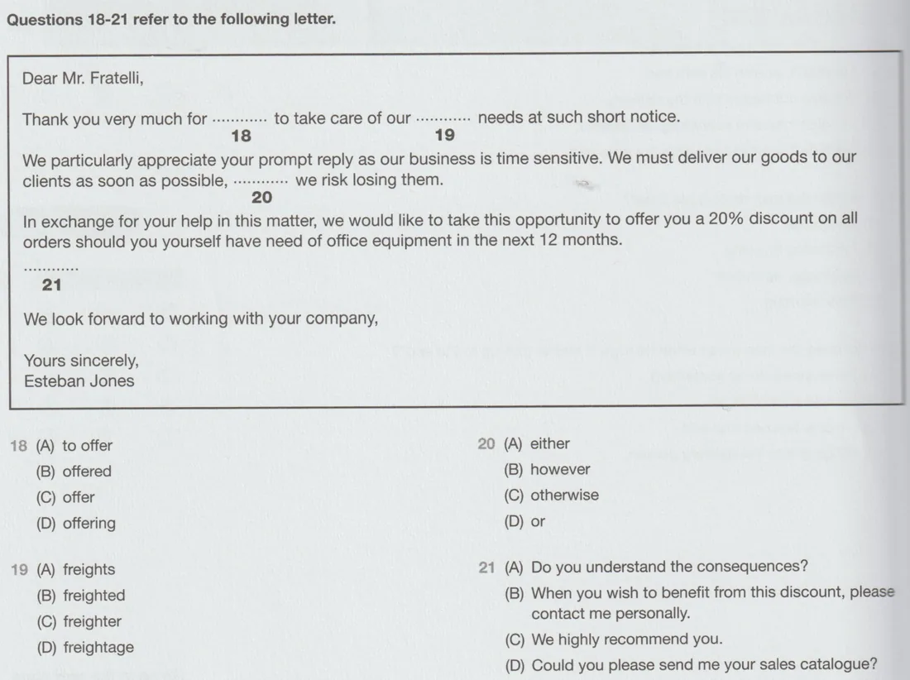
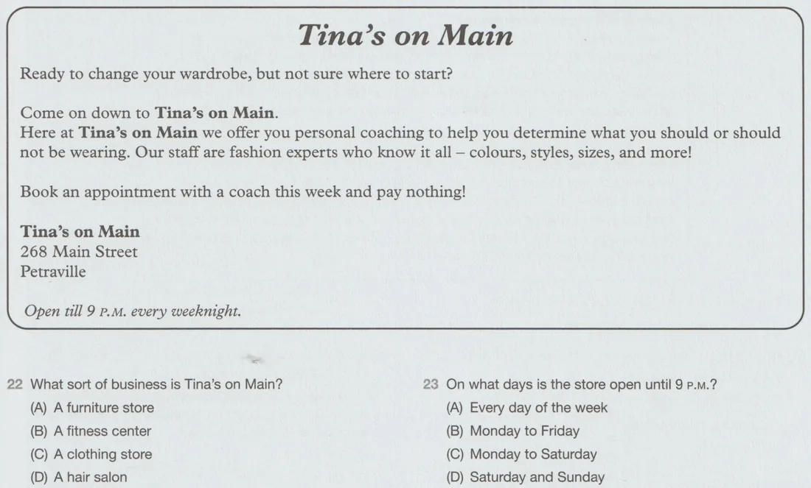
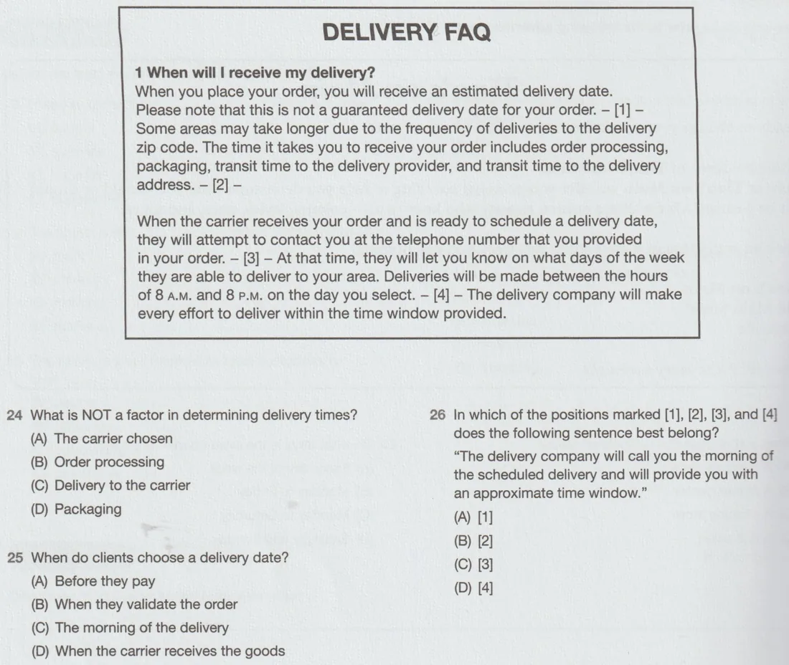

# Mini test TOEIC : Sales

À la fin du chapitre *Sales*, le manuel propose un **mini test** au format TOEIC : 12 questions d'écoute (parties 1 à 4) et 14 questions de lecture (parties 5 à 7). Il n'a **pas été corrigé** en cours. Ce chapitre reprend la **partie lecture** avec des phrases et des textes **écrits pour l'entraînement**, sur le même vocabulaire et avec les mêmes pièges. Chaque méthode est suivie d'un **exemple résolu pas à pas**.

> [!info] Et la partie écoute ?
> Les questions d'écoute ont besoin de l'audio du manuel, qui n'est pas disponible ici. Les exercices « sur papier » reprennent leurs situations (un article qui manque sur une facture, un canapé livré en retard) sous forme de transcriptions.

## 1. Partie 5 : les pièges du mini test

| Piège | Ce qu'il faut voir | Exemple |
|---|---|---|
| **personne ou chose** | *the* + celui qui fournit → **supplier** (et non *supply*) | *Please call the supplier to change the order.* |
| **verbe à particule au passif** | *were* + participe passé + particule | *The prices were marked down by 50%.* |
| **la clientèle fidèle** | *thank customers for their...* → **patronage** (ou *custom*) | *Thank you for your patronage.* |
| **fee / fine** | une **punition** → **fine** (amende) | *You'll get a fine if you park here.* |
| **a + nom** | un pense-bête, un rappel → **reminder** | *I wrote a note as a reminder.* |

> [!warning] patronage
> En anglais, *patronage* veut surtout dire **la fidélité des clients** à un magasin. Ce n'est pas le « patronage » d'un événement (*sponsorship*).

### Trouver la nature du mot qui manque

En partie 5, les 4 choix sont souvent **le même mot sous 4 formes**. On regarde les mots **autour du trou** pour savoir quelle forme il faut.

| Juste avant le trou | Il faut… | Exemple |
|---|---|---|
| *the, a, an, their, our, any other* | un **nom** | *their **patronage***, *any other **offer*** |
| *as a* | un **nom** | *as a **reminder*** |
| *is, was, are, were* (sans participe derrière) | souvent un **adjectif** | *She was **present**.* |
| *can, must, will, should* (modal) | le **verbe de base** | *You can **return** it.* |

Parmi les noms, il faut encore choisir entre une **personne** et une **chose** :

| Verbe | Nom de chose | Nom de personne |
|---|---|---|
| *supply* (fournir) | *supply* (la fourniture, le stock) | *supplier* (le fournisseur) |
| *pay* (payer) | *payment* (le paiement) | *payee* (celui qui reçoit l'argent), *payer* |
| *receive* (recevoir) | *receipt* (le reçu, la réception) | *recipient* (le destinataire) |
| *deliver* (livrer) | *delivery* (la livraison) | *deliverer* (rare : on dit *courier, driver*) |

**Exemple résolu :** *We are still waiting for the ...... of the new desks.* (*deliver / delivered / delivery / deliverer*)

1. Avant le trou : *the* → il faut un **nom**. On élimine *deliver* (verbe) et *delivered* (participe).
2. Il reste deux noms : *delivery* (la livraison, une chose) et *deliverer* (une personne).
3. On attend « la livraison des bureaux », pas « le livreur des bureaux » → **delivery**.

**À retenir :** d'abord la nature (nom, verbe, adjectif) avec les mots autour, puis personne ou chose avec le sens.

### La forme du verbe après un auxiliaire

| Ce qu'il y a avant | Forme du verbe | Exemple |
|---|---|---|
| un modal (*can, must, will, should, may*) | verbe de **base** (sans *to*, sans *-s*) | *Customers can **exchange** the item.* |
| *will be* | verbe en **-ing** (futur continu : action en cours dans le futur) | *We will be **opening** a new branch.* |
| *has been / have been* | **participe passé** (present perfect passif) | *Your parcel has been **sent**.* |
| *was / were* + action subie | **participe passé** (passif au prétérit) | *The goods were **delivered** yesterday.* |
| *were* + verbe à particule | participe + **particule** | *The prices were **marked down**.* |

Le **passif** (*be* + participe passé) s'emploie quand le sujet **subit** l'action : *the parcel* ne s'envoie pas tout seul, quelqu'un l'envoie.

**Exemple résolu :** *The parcel has been ...... to the wrong address.* (*send / sent / sending / sends*)

1. Avant le trou : *has been*.
2. Le colis ne fait pas l'action, il la **subit** (quelqu'un l'a envoyé) → passif.
3. Passif = *be* + **participe passé** : *send* → **sent**.
4. *sending* donnerait un sens actif (« le colis a été en train d'envoyer ») ; *send* et *sends* ne vont jamais après *has been*.

**À retenir :** modal + base ; *will be* + *-ing* ; *has been / was / were* + participe passé quand le sujet subit l'action.

### L'argent payé ou rendu : fee, fine, charge, rebate, refund, discount

| Mot | Sens | Qui paie ? |
|---|---|---|
| *fee* | des **frais** normaux, prévus (inscription, livraison, retard prévu par contrat) | le client, pour un service |
| *charge* | un **coût** facturé | le client |
| *fine* | une **amende** : une **punition** (police, mairie, règlement) | celui qui a enfreint une règle |
| *rebate* | une **remise** remboursée après l'achat | le vendeur rend de l'argent |
| *refund* | un **remboursement** | le vendeur rend de l'argent |
| *discount* | une **réduction** sur le prix | personne : on paie moins |

**Exemple résolu :** *Parking on the pavement may result in a ...... of $80.* (*fee / fine / refund*)

1. Se garer sur le trottoir est **interdit**.
2. L'argent à payer est donc une **punition** → **fine** (amende).
3. *fee* serait des frais normaux pour un service (on ne paie pas un « service » de stationnement interdit) ; *refund* est de l'argent qu'on **reçoit**.

Attention : dans une lettre commerciale, *a late fee* (frais de retard) est le terme habituel, car il est **prévu dans le contrat** ; *fine* est réservé aux sanctions officielles.

**À retenir :** punition officielle → *fine* ; frais prévus → *fee* ; argent rendu → *refund / rebate* ; prix baissé → *discount*.

### Les prépositions de temps

| Préposition | Sens | Exemple |
|---|---|---|
| *within* | dans un délai de (au plus tard au bout de) | *within 30 days* |
| *by* | au plus tard **à** (une date limite) | *by Friday*, *by the end of the month* |
| *until* | jusqu'à (l'action dure jusqu'à ce moment) | *open until 9 p.m.* |
| *since* | depuis (un point de départ passé) | *since 2019* |
| *for* | pendant (une durée) | *for two weeks* |
| *during* | pendant (une période nommée) | *during the meeting* |

**Exemple résolu :** *Please send us your answer ...... Friday.* (*by / since / for*)

1. Vendredi est une **date limite** : la réponse doit arriver au plus tard ce jour-là.
2. Date limite → **by**.
3. *since Friday* voudrait dire « depuis vendredi » (passé), et *for* demande une durée (*for three days*), pas un jour.

Les formes *until to* et *before of* n'existent pas : on dit *until Friday*, *before Friday*.

**À retenir :** délai → *within* + durée ; date limite → *by* + date ; durée → *for* ; point de départ → *since*.

### Despite ou although ?

Les deux veulent dire « malgré / bien que », mais ne se construisent pas pareil :

| Mot | Suivi de | Exemple |
|---|---|---|
| *despite*, *in spite of* | un **nom** (ou un verbe en *-ing*) | *Despite the rain, …* |
| *although*, *even though* | un **sujet + verbe** | *Although it was raining, …* |

**Exemple résolu :** *...... it was raining, the event took place outdoors.* (*Despite / Although*)

1. Après le trou : *it was raining* = un sujet (*it*) + un verbe (*was raining*).
2. Sujet + verbe → **Although**.
3. *Despite it was raining* est faux ; il faudrait *Despite the rain*.

**À retenir :** regarde ce qui suit : un nom → *despite* ; une phrase avec sujet et verbe → *although*.

### Noms toujours pluriels et expressions figées

- ***goods*** (la marchandise) est **toujours pluriel** : *The goods **are** ready*, *the goods **were** sent*. Même chose pour *clothes* (les vêtements) et *premises* (les locaux).
- Expressions à connaître telles quelles : *subject to change **without notice*** (modifiable sans préavis), *free of charge* (gratuit), *at short notice* (au dernier moment), *please **disregard** this letter* (ne tenez pas compte de ce courrier).

**Exemple résolu :** *The goods ...... packed this morning.* (*was / were*)

1. Le sujet est *the goods*.
2. *goods* est toujours pluriel, même s'il se traduit par « la marchandise » (singulier en français).
3. Pluriel au prétérit → **were**.

**À retenir :** *goods* = pluriel ; une expression figée s'apprend en bloc.

## 2. Partie 6 : une lettre à compléter

Dans le mini test, la lettre remerciait un transporteur d'avoir accepté **en urgence** de s'occuper des livraisons de l'entreprise, puis lui offrait une **réduction**. Les réponses dépendaient de :

- ***thank you for*** + verbe en **-ing** : *Thank you for **offering** to help us.*
- un **nom** devant un autre nom : *our **freight** needs* (nos besoins en transport) ;
- un **mot de liaison** : ***otherwise*** = sinon (*We must deliver fast, **otherwise** we lose clients.*) ;
- une **phrase à insérer** : elle doit continuer l'idée d'avant (ici, expliquer comment profiter de la réduction).

La vraie lettre du mini test :

Sur l'image : 18 → ***offering*** (*thank you for* + -ing) ; 20 → ***otherwise*** (livrer vite, **sinon** on perd les clients) ; 21 → la phrase **B** (*this discount* renvoie aux 20 % offerts juste avant). Pour 19, il faut un mot qui décrit *needs* : nos besoins en **transport de marchandises** (*freight*).

> [!tip] Méthode partie 6
> Lire la phrase **avant** et **après** le trou. Pour une phrase entière à choisir, chercher le mot qui fait le **lien** avec le texte (*this discount* renvoie à l'offre de réduction).

### Les règles une par une

**Après une préposition, le verbe est en -ing.** *for, of, about, before, after* sont des prépositions : *thank you for **calling***, *before **leaving***. Jamais *for to call* ni *for call*.

**Un nom peut décrire un autre nom.** En anglais, on met souvent deux noms côte à côte : le premier décrit le second, comme un adjectif, mais **sans changer de forme** : *a **shoe** shop* (un magasin de chaussures), *our **freight** needs*, *a **delivery** date*.

**Les mots de liaison :**

| Mot | Sens | Lien entre les deux parties |
|---|---|---|
| *otherwise* | sinon | ce qui arrive **si on ne fait pas** la 1re chose |
| *therefore*, *as a result* | donc, par conséquent | la 2e partie est la **conséquence** de la 1re |
| *moreover*, *in addition* | de plus | on **ajoute** une idée du même sens |
| *meanwhile* | pendant ce temps | deux choses **en même temps** |
| *however* | cependant | **opposition** |

**Exemple résolu :** *Please book your seat before Monday; ......, we cannot guarantee a place.* (*otherwise / therefore / moreover*)

1. 1re partie : réserve avant lundi (une chose à faire).
2. 2e partie : on ne peut pas garantir une place (ce qui arrive **si tu ne réserves pas**).
3. « Fais ceci, sinon cela » → **otherwise**.
4. *therefore* voudrait dire « tu réserves, **donc** il n'y a pas de place » : absurde. *moreover* ajouterait une 2e consigne.

**À retenir :** « fais X ; sinon Y » → *otherwise* ; « X, donc Y » → *therefore*.

### Choisir la phrase à insérer

La phrase qui manque doit **continuer l'idée d'avant** et garder le **ton** du texte (une lettre de remerciement reste aimable).

**Exemple résolu :** une lettre de remerciement à un client fidèle se termine par *As a thank-you, we are giving you a voucher for $30.* (......) Quelle phrase va dans le trou ?

- *Your account is now closed.*
- *You can use it in any of our stores until 31 December.*
- *Please pay your bill immediately.*

1. Idée juste avant : un **bon d'achat** (*voucher*) offert.
2. La phrase suivante doit parler de ce bon : *it* dans *You can use it* renvoie au *voucher*, et elle dit comment l'utiliser.
3. Les deux autres (compte fermé, facture à payer) cassent le ton de remerciement et n'ont pas de lien avec le bon.

**À retenir :** cherche le mot qui renvoie à l'idée d'avant (*it, this, these*) et vérifie que le ton reste le même.

### Le vocabulaire des relances de facture

Une **relance** (*reminder*) rappelle à un client qu'il n'a pas encore payé.

| Anglais | Sens |
|---|---|
| *the amount due* | la somme due (attention à l'ordre : *amount* puis *due*) |
| *outstanding* | **impayé**, encore dû (une facture *outstanding*) |
| *pending* | en attente (d'une décision, d'une action) |
| *void* | annulé, sans valeur |
| *payable to* | à l'ordre de (*cheques payable to…*) |
| *a late fee* | des frais de retard prévus au contrat |
| *settle an account* | régler un compte, payer |
| *disregard* | ne pas tenir compte de |
| *regarding* | au sujet de, concernant |

**Exemple résolu :** *Our records show that your March invoice is still ......* (*outstanding / void / pending*)

1. *still* (toujours) + une relance : la facture n'est **toujours pas payée**.
2. Impayé → **outstanding**.
3. *void* voudrait dire que la facture est annulée (il n'y aurait rien à payer) ; *pending* veut dire « en attente d'une action » et s'emploie plutôt pour une décision ou une commande qui n'est pas encore traitée.

**À retenir :** facture pas payée → *outstanding* ; déjà payé → *please disregard this reminder*.

## 3. Partie 7 : une publicité et une FAQ

- **Publicité d'une boutique** : on devine le type de magasin grâce aux indices (*wardrobe*, *fashion*, *sizes* → vêtements). Piège : ***weeknight*** = un soir de **semaine** (lundi à vendredi), pas le week-end.
- **FAQ de livraison** : une question **NOT** (quel facteur **n'est pas** cité ?), une question de **moment** (quand choisit-on le jour de livraison ?) et une **phrase à placer** dans le texte.

Les deux documents du mini test :

Sur l'image : *wardrobe* (garde-robe), *fashion experts*, *colours, styles, sizes* → un **magasin de vêtements** (22 : C). *Open till 9 p.m. every weeknight* → les soirs de semaine, donc **du lundi au vendredi** (23 : B).

Sur l'image : le texte cite le traitement de la commande, l'emballage, l'envoi au transporteur et le trajet ; **le choix du transporteur**, jamais (24 : A). Le jour se choisit quand le transporteur **a reçu** la commande et appelle le client (25 : D). La phrase à placer parle d'*an approximate time window* : elle va juste avant *the time window provided*, donc en **[4]** (26 : D).

### Deviner le type de commerce

**Exemple résolu :** une publicité dit *Our new range of laptops and headphones is in store now. Free installation of your software, and a two-year warranty on every screen.* Quel commerce ?

1. Je relève les mots concrets : *laptops* (ordinateurs portables), *headphones* (casques), *software* (logiciels), *screen* (écran).
2. Tous parlent d'**électronique**.
3. Réponse : *an electronics store*. Un seul mot (*installation*) pourrait faire penser à un plombier : on se fie à **l'ensemble** des indices, pas à un seul.

**À retenir :** relève tous les mots concrets et garde le commerce qui les explique **tous**.

### Les jours et les horaires

| Anglais | Sens |
|---|---|
| *weekday* | jour de semaine (lundi à vendredi) |
| *weeknight* | soir de semaine (lundi à vendredi) |
| *weekend* | samedi et dimanche |
| *Monday to Saturday* | du lundi au samedi (donc pas le dimanche) |
| *free of charge* | gratuit |

**Exemple résolu :** *Open 8 a.m. to 10 p.m. on weekdays, 9 a.m. to 1 p.m. on Saturdays.* Peut-on y aller le dimanche ?

1. *weekdays* = du lundi au vendredi.
2. *Saturdays* = le samedi.
3. Le dimanche n'est cité nulle part : le magasin est **fermé** le dimanche.

**À retenir :** *week-* + *day / night* = du lundi au vendredi ; un jour jamais cité est un jour fermé.

### Les questions NOT

> [!warning] Les questions NOT
> Pour *What is NOT mentioned?*, chercher chaque proposition dans le texte et **éliminer** celles qu'on trouve. Attention aux réponses qui reprennent un mot du texte (*carrier*) avec un autre sens (le **choix** du transporteur au lieu de **l'envoi** au transporteur).

**Exemple résolu :** le texte dit *Prices depend on the size of the room, the type of paint and the number of coats.* Question : *What is NOT mentioned as affecting the price?* (*the room size / the paint colour / the type of paint / the number of coats*)

| Proposition | Dans le texte ? |
|---|---|
| *the room size* | oui : *the size of the room* |
| *the paint colour* | **non** : le texte parle du **type** de peinture, pas de sa couleur |
| *the type of paint* | oui |
| *the number of coats* | oui (*coats* = couches) |

On élimine les trois trouvées : la réponse est *the paint colour*. Piège : elle reprend le mot *paint*, présent dans le texte, avec une autre idée.

**À retenir :** coche chaque proposition trouvée dans le texte ; celle qui reste est la réponse, même si elle reprend un mot du texte.

### Placer une phrase dans le texte

> [!tip] Phrase à insérer
> Repérer dans la phrase un mot qui renvoie à quelque chose (*the time window*, *this*, *these*) et trouver l'endroit où ce quelque chose vient d'être dit, ou va être repris juste après.

**Exemple résolu :** texte : *Our café offers lunch menus every day. – [1] – We also sell cakes to take away. – [2] – All of them are baked on site each morning.* Où placer *"Customers can choose from five different flavours."* ?

1. La phrase parle de **parfums** (*flavours*) : cela concerne les **gâteaux**, pas les menus.
2. Les gâteaux sont cités juste avant [2].
3. Après [2], *All of them* reprend bien un groupe de choses : les gâteaux, avec leurs cinq parfums.
4. Réponse : **[2]**. En [1], on parlerait de parfums avant même d'avoir cité les gâteaux.

**À retenir :** la phrase se place juste **après** l'idée qu'elle complète et **avant** le mot qui la reprend.

### Deux documents : relier les informations

Avec deux documents (une facture et un e-mail, par exemple), la réponse vient souvent **des deux** : un chiffre dans l'un, une correction dans l'autre.

**Exemple résolu :** une facture datée du 10 mars compte 3 lampes à 50 $ et des frais de montage de 25 $ (total 175 $). L'e-mail du client, daté du 14 mars, dit : *We received your invoice two days ago. We assembled the lamps ourselves, so please remove the assembly charge.*

1. **Quand la facture est-elle arrivée ?** L'e-mail est du 14 mars et dit *two days ago* (il y a deux jours) : 14 - 2 = **12 mars**. Le 10 mars est la date d'**émission** : piège.
2. **Pourquoi écrit-il ?** Il paie un service (le montage) qu'il n'a pas utilisé.
3. **Nouveau montant ?** On retire les frais de montage : 3 × 50 = 150 $ (ou 175 - 25 = **150** $).

**À retenir :** date de l'e-mail + mot de temps (*yesterday, two days ago*) pour trouver une date ; un montant corrigé = total - ce qui est contesté.

### Les questions de synonyme

*The word "…" is closest in meaning to…* : on cherche le sens du mot **dans cette phrase**, pas son sens le plus courant.

**Exemple résolu :** *Please address all complaints to the customer service desk.* — *address* is closest in meaning to… (*location / send / speech*)

1. Dans la phrase, *address* est un **verbe** (*Please address…*) suivi de *to* : on adresse les plaintes **à** quelqu'un.
2. Sens ici : envoyer, adresser → **send**.
3. *location* correspond au nom *address* (une adresse), et *speech* au nom *an address* (un discours) : bons sens du mot, mais pas dans cette phrase.

**À retenir :** remplace le mot par chaque choix dans la phrase ; garde celui qui ne change pas le sens.

## 4. L'écoute sur papier (parties 2 et 3)

### Partie 2 : propositions, questions-tags et réponses indirectes

En plus des questions en *Wh-* (*When* → un moment, *Why* → une raison, *Where* → un lieu, *How* → une manière), le mini test utilise trois autres formes :

| Forme | Exemple | Réponse logique |
|---|---|---|
| **une proposition** (*Would you like…?*, *Shall I…?*) | *Would you like some help?* | accepter ou refuser poliment : *Yes, please* / *No thanks, I'm fine.* |
| **une question-tag** (affirmation + *didn't it? / isn't it?*) | *The shop closes at six, doesn't it?* | confirmer ou corriger : *Yes, at six.* / *No, at seven today.* |
| **une demande d'information** | *Is this model available in black?* | souvent une réponse **indirecte** : *Let me check.* |

**Exemple résolu :** *The parcel was sent last week, wasn't it?*

- *Yes, it should arrive tomorrow.*
- *I'd like to send a letter.*
- *It's a big parcel.*

1. C'est une **question-tag** : on demande de confirmer que le colis est parti la semaine dernière.
2. *Yes, it should arrive tomorrow* confirme (oui) et ajoute une info logique : bonne réponse.
3. *I'd like to send a letter* reprend *send* (piège), *It's a big parcel* reprend *parcel* sans confirmer quoi que ce soit.

**À retenir :** une question-tag attend un **oui / non** + une précision ; une réponse qui ne fait que répéter un mot est un piège.

### Partie 3 : problème, raison, moment

Dans une conversation, on cherche souvent **le problème**, **sa cause** et **ce qui va se passer**. Piège fréquent : la conversation cite **plusieurs moments** ; il faut prendre celui qui répond à la question.

**Exemple résolu :**

> **Woman** : Hi, I bought a kettle here on Saturday, but it doesn't switch on.
> **Man** : I'm sorry. That model had a faulty batch last month. We'll get new stock on Wednesday, so I can exchange it then, or refund you today.

| Question | Indice | Réponse |
|---|---|---|
| Quel problème ? | *it doesn't switch on* | la bouilloire ne s'allume pas |
| Pourquoi ? | *a faulty batch* (un lot défectueux) | un défaut de fabrication |
| Quand peut-on l'échanger ? | *new stock on Wednesday… exchange it then* | **mercredi** |

Pièges : *Saturday* est le jour de l'achat, *last month* celui du lot défectueux, *today* celui du remboursement, pas de l'échange.

**À retenir :** pour une question de moment, relève **tous** les moments cités et associe chacun à son action.

### Les reformulations à l'écoute

La bonne réponse reprend rarement les mots entendus : *just ignore the letter* devient *disregard the letter* ; *it's out of stock* devient *it's not available* ; *we'll drop it off* devient *we'll deliver it*.

**À retenir :** cherche le **même sens** avec d'autres mots.

## 5. Répondre à un client mécontent

Un e-mail de service client suit toujours le même plan en 5 étapes :

| Étape | Rôle | Phrases utiles |
|---|---|---|
| 1. Remercier | montrer qu'on a lu le message | *Thank you for your message / for contacting us.* |
| 2. S'excuser | reconnaître le désagrément | *Please accept our apologies for…*, *We are sorry that…* (*apologize for* + nom ou *-ing*) |
| 3. Expliquer | dire ce qui s'est passé, sans accuser le client | *I have checked your order, and…* |
| 4. Proposer une solution datée | le client doit savoir **quoi** et **quand** | *We will send / dispatch… by Friday.* |
| 5. Geste et politesse | réparer le tort, finir poliment | *We will refund the delivery fee*, *a 10% discount* ; *Please do not hesitate to contact me.* ; *Kind regards,* |

**Exemple résolu :** un client a reçu des chemises **bleues** au lieu de **blanches**.

1. Remercier : *Thank you for your e-mail.*
2. S'excuser : *I am very sorry that you received the wrong colour.*
3. Expliquer : *Our warehouse made a mistake when packing your order.*
4. Solution datée : *We have dispatched the white shirts today, and they should reach you by Thursday. A courier will collect the blue ones at the same time.*
5. Geste et politesse : *To apologize, we are offering you a 15% discount on your next order. Kind regards, …*

**À retenir :** merci, excuses, explication, solution avec une date, geste commercial et formule de fin.

## 6. Vocabulaire à revoir

| Anglais | Français |
|---|---|
| alter an order | modifier une commande |
| patronage | fidélité de la clientèle |
| an unauthorized parking spot | une place de stationnement interdite |
| at short notice | au dernier moment, en urgence |
| freight needs | besoins en transport de marchandises |
| otherwise | sinon |
| benefit from a discount | profiter d'une réduction |
| wardrobe | garde-robe |
| weeknight | soir de semaine |
| estimated delivery date | date de livraison prévue |
| processing | traitement (d'une commande) |
| time window | créneau horaire |
| sofa bed | canapé-lit |
| give up | abandonner |
| goods | marchandise (toujours pluriel) |
| outstanding | impayé |
| disregard | ne pas tenir compte de |
| issue (an invoice) | émettre (une facture) |
| rush fee | supplément pour livraison express |
| free of charge | gratuit |
| receipt (le *p* est muet) | ticket de caisse, reçu (à ne pas confondre avec *recipe*, une recette de cuisine) |

**Exemple résolu : *give up* ou *give back* ?** *I couldn't fix the printer, so I gave ......*

1. Le sens attendu : j'ai **arrêté d'essayer**.
2. *give up* = abandonner, arrêter → **gave up**.
3. *give back* = rendre (un objet à quelqu'un) : il faudrait un objet et une personne (*I gave the book back to Sam*).

**À retenir :** un verbe à particule change de sens avec la particule : apprends-le en bloc (*give up* = abandonner, *give back* = rendre).
