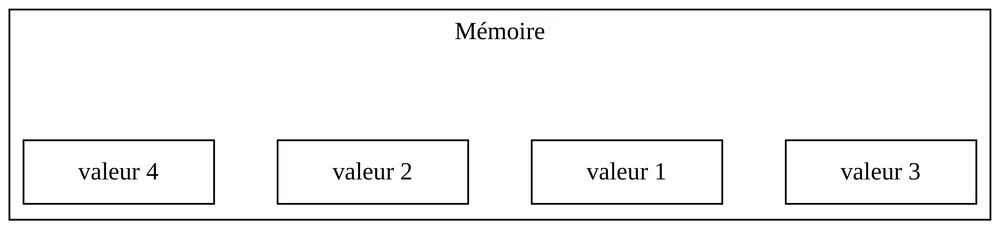
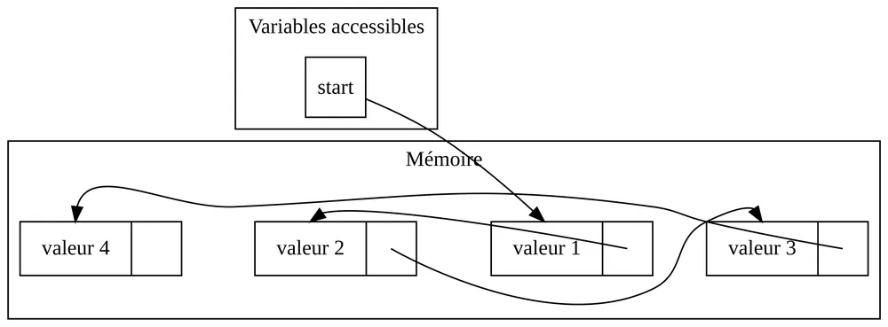
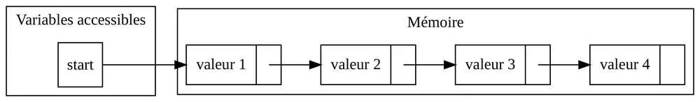
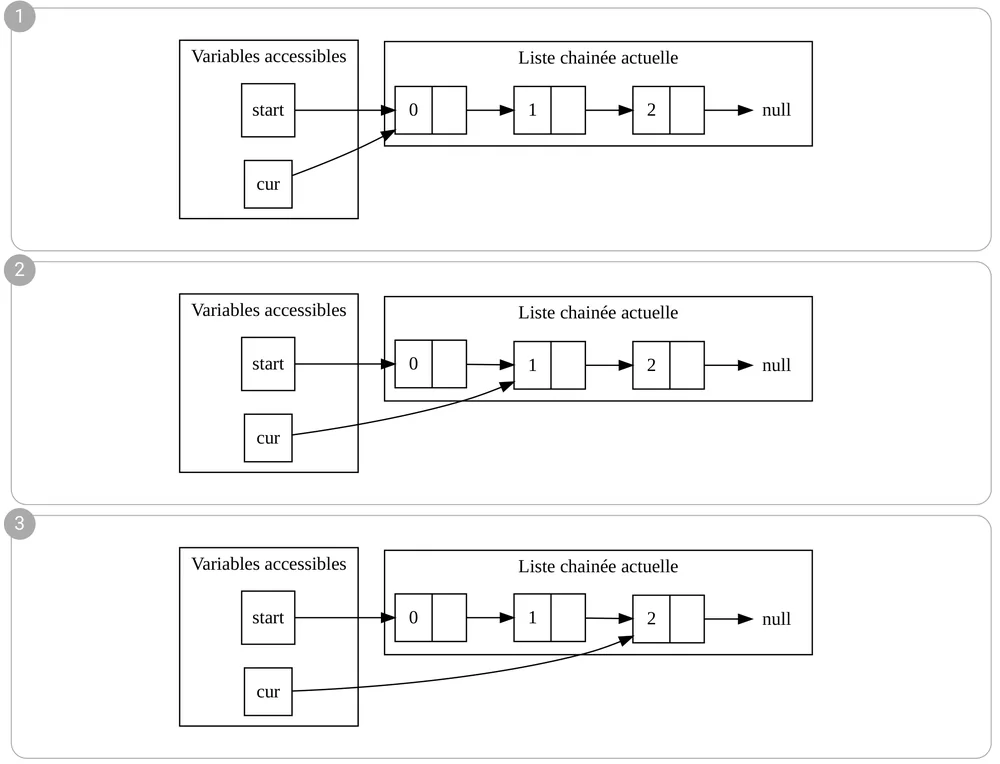
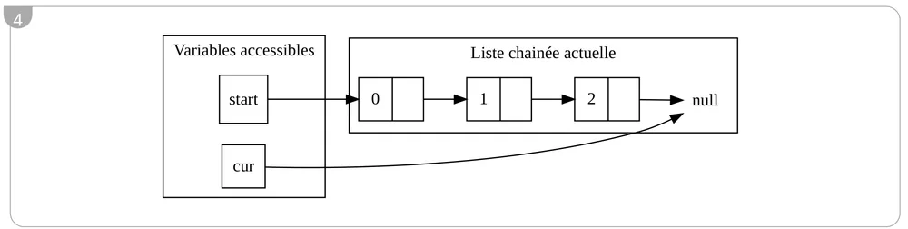
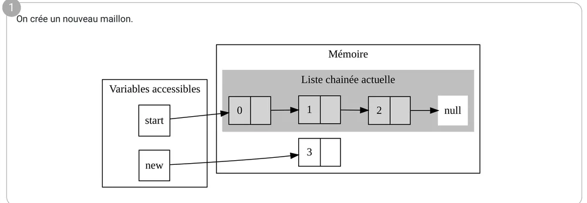
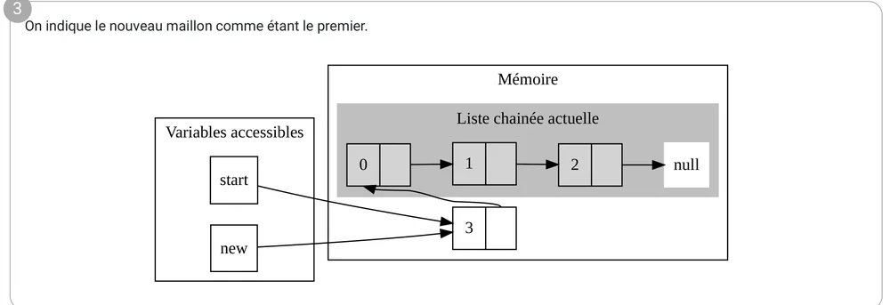
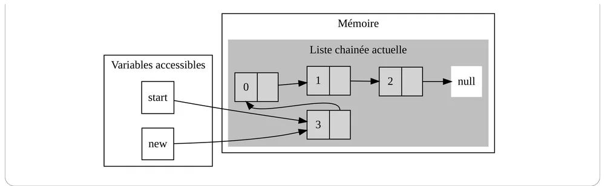

# Listes chaînées

## 1. L'idée

Une **liste chaînée** est une autre façon de ranger une suite de valeurs, à côté du tableau. Comme un tableau, c'est un **conteneur séquentiel** : les valeurs ont un ordre (une première, une suivante... une dernière) et on les repère par leur position.

La grande différence est dans la mémoire :

| | Tableau | Liste chaînée |
|---|---|---|
| Place en mémoire | cases **collées** les unes aux autres | éléments **éparpillés** n'importe où |
| Trouver l'élément suivant | il est juste à côté | on suit un **pointeur** |

Sur l'image : les quatre valeurs sont posées en mémoire dans le désordre (valeur 4, valeur 2, valeur 1, valeur 3). Rien ne dit qui vient après qui.



Puisque les valeurs sont dispersées, chacune emporte avec elle **l'adresse de la suivante**. Les valeurs forment ainsi une **chaîne**.

> [!info] Le maillon
> Chaque élément de la chaîne s'appelle un **maillon** (en anglais *node* ou *cell*). Il contient deux choses : **une valeur** et **un pointeur vers le maillon suivant**.

### En mémoire, pour de vrai

Quatre valeurs rangées dans le désordre (les adresses sont inventées pour l'exemple) :

| Adresse | Valeur | `next` (adresse du suivant) |
|---|---|---|
| `0x100` | 40 | `NULL` |
| `0x200` | 20 | `0x400` |
| `0x300` | 10 | `0x200` |
| `0x400` | 30 | `0x100` |

Une seule variable, `start`, garde l'adresse du **premier** maillon : `0x300`. En suivant les `next` à partir de là : 10, puis 20, puis 30, puis 40, puis `NULL` (fin).

**Le même exemple, pas à pas.** On part de l'adresse rangée dans `start` et, à chaque étape, on va à l'adresse indiquée par le `next` du maillon où l'on est :

| Étape | On est à l'adresse | Valeur lue | Son `next` | On va ensuite à |
|---|---|---|---|---|
| 1 | `0x300` (donnée par `start`) | 10 | `0x200` | `0x200` |
| 2 | `0x200` | 20 | `0x400` | `0x400` |
| 3 | `0x400` | 30 | `0x100` | `0x100` |
| 4 | `0x100` | 40 | `NULL` | nulle part : c'est fini |

L'ordre de la liste (10, 20, 30, 40) n'a rien à voir avec l'ordre des adresses (le maillon `0x100` est le **dernier** de la liste). Seuls les `next` décident de l'ordre.

Le même genre de situation, dessiné par le cours : chaque maillon a maintenant une deuxième case (son `next`) d'où part une flèche. `start` pointe sur valeur 1 ; en suivant les flèches on lit valeur 1, valeur 2, valeur 3, valeur 4, alors qu'en mémoire elles sont dans le désordre.



**À retenir :** pour lire une liste, pars de `start` et suis les `next` un par un jusqu'à `NULL` ; l'emplacement des maillons en mémoire ne compte pas.

### Comment on la dessine

On dessine les maillons dans l'ordre de la chaîne, même si ce n'est pas leur ordre en mémoire :

```text
start --> [10|*] --> [20|*] --> [30|*] --> [40|*] --> NULL
```

`[10|*]` est un maillon : sa valeur à gauche, son pointeur `next` à droite. Le dernier maillon a `next = NULL` : il n'y a rien après.

Le dessin « propre » du cours, avec les maillons remis dans l'ordre de la chaîne :



> [!info] La liste vide
> Une liste vide, c'est simplement `start == NULL` : aucun maillon.

Ne confonds pas les cas de petites listes :

| Situation | Ce qui est vrai |
|---|---|
| liste vide | `start == NULL` (et on n'a **pas le droit** de lire `start->next`) |
| liste d'un seul maillon | `start != NULL` et `start->next == NULL` |
| liste d'au moins deux maillons | `start != NULL` et `start->next != NULL` |

## 2. Représentation en C

```c
typedef struct cell {
    int value;
    struct cell *next;
} Cell;
```

| Code | Sens |
|---|---|
| `int value;` | la valeur portée par le maillon |
| `struct cell *next;` | l'adresse du maillon suivant (`NULL` pour le dernier) |
| `typedef ... Cell;` | le nom court du type : `Cell` |

On manipule les maillons à travers des **pointeurs** (`Cell *`) et la flèche : `cur->value`, `cur->next`.

> [!warning] Dans le pseudo-code du cours
> Les algorithmes écrivent `Cell start` ou `Cell cur`. En C, ce sont des **pointeurs** : `Cell *start`, `Cell *cur`.

> [!tip] Pourquoi un pointeur dans le maillon ?
> Un maillon qui contiendrait un maillon entier contiendrait lui-même un maillon... à l'infini. Un pointeur, lui, a une taille fixe : 8 octets sur une machine 64 bits. Un `Cell` occupe en général 16 octets (l'`int`, un peu de remplissage, le pointeur), contre 4 pour une case `int` de tableau.

### Créer un maillon

Chaque maillon est réservé sur le tas avec `malloc` :

```c
Cell *creerCell(int valeur) {
    Cell *c = malloc(sizeof(Cell));
    if (c == NULL) {
        exit(EXIT_FAILURE);
    }
    c->value = valeur;
    c->next = NULL;
    return c;
}
```

On met `next` à `NULL` tout de suite : `malloc` ne remplit pas la mémoire, et un `next` laissé au hasard ferait partir le programme n'importe où.

### Relier des maillons à la main

`creerCell` fabrique des maillons **isolés** (leur `next` vaut `NULL`). Pour en faire une liste, on remplit les `next` soi-même. Deux façons d'écrire la même chose :

```c
#include <stdio.h>
#include <stdlib.h>

typedef struct cell {
    int value;
    struct cell *next;
} Cell;

Cell *creerCell(int valeur) {
    Cell *c = malloc(sizeof(Cell));
    if (c == NULL) {
        exit(EXIT_FAILURE);
    }
    c->value = valeur;
    c->next = NULL;
    return c;
}

int main(void) {
    Cell *start = creerCell(5);
    start->next = creerCell(6);

    Cell *a = creerCell(8);
    Cell *b = creerCell(9);
    a->next = b;

    printf("%d -> %d -> NULL\n", start->value, start->next->value);
    printf("%d -> %d -> NULL\n", a->value, a->next->value);

    free(start->next);
    free(start);
    free(b);
    free(a);
    return 0;
}
```

**Pas à pas, première façon :**

```text
Cell *start = creerCell(5);       start --> [5|NULL]

start->next = creerCell(6);       start --> [5|*] --> [6|NULL]
```

`start->next` est le champ `next` du premier maillon : on y range l'adresse du nouveau maillon. Pour un troisième maillon, on écrirait de même dans le `next` du **deuxième**, qu'on atteint par `start->next->next`.

**Deuxième façon :** on crée d'abord tous les maillons dans des variables (`a`, `b`), puis on les relie (`a->next = b;`). Le résultat est le même, `a` joue le rôle de `start`.

À la fin, il y a 4 `malloc` (un par `creerCell`) et 4 `free` : aucune fuite. On libère `start->next` **avant** `start` : après `free(start)`, on n'aurait plus le droit de lire `start->next`.

**À retenir :** pour accrocher B derrière A, écris l'adresse de B dans `A->next` ; le dernier maillon garde son `next = NULL`.

## 3. Parcourir une liste

**Parcourir**, c'est passer sur chaque maillon, du premier au dernier. On ne touche **jamais** à `start` : on avance un second pointeur, `cur` (le maillon *courant*).

```text
Algo : Parcours
Entrée : Cell start

Cell cur = start
Tant que cur est différent de null :
    // utiliser cur.value
    cur = cur.next
```

Les étapes sur la liste `0 -> 1 -> 2` :

```text
1)  start --> [0|*] --> [1|*] --> [2|*] --> NULL
               ^
              cur

2)  start --> [0|*] --> [1|*] --> [2|*] --> NULL
                         ^
                        cur

3)  start --> [0|*] --> [1|*] --> [2|*] --> NULL
                                   ^
                                  cur

4)  start --> [0|*] --> [1|*] --> [2|*] --> NULL
                                             ^
                                            cur  (NULL : on s'arrête)
```

Les mêmes étapes, dessinées par le cours. Regarde la flèche de `cur` : elle avance d'un maillon à chaque tour, alors que celle de `start` ne bouge jamais.





Pourquoi `cur` et pas `start` ? `start` est la **seule** variable qui connaît le premier maillon. Si on écrivait `start = start->next` pour avancer, une fois arrivé au bout, plus personne ne connaîtrait l'adresse des maillons déjà passés : impossible de relire la liste ou de la libérer (fuite mémoire). `cur` est une copie qu'on peut user sans risque.

### Exemple : le produit

```c
int produit(Cell *start) {
    int resultat = 1;
    Cell *cur = start;
    while (cur != NULL) {
        resultat = resultat * cur->value;
        cur = cur->next;
    }
    return resultat;
}
```

Sur la liste `2 -> 5 -> 3` :

| Tour | `cur` sur | `resultat` après le tour | Ensuite `cur` passe sur |
|---|---|---|---|
| 1 | 2 | 1 × 2 = 2 | 5 |
| 2 | 5 | 2 × 5 = 10 | 3 |
| 3 | 3 | 10 × 3 = 30 | `NULL` |
| fin | `NULL` | la condition est fausse : on renvoie 30 | |

Le résultat part de **1** et pas de 0 : multiplier par 0 donnerait toujours 0. On choisit la valeur de départ pour qu'elle ne change rien au premier calcul (0 pour une somme, 1 pour un produit). C'est aussi le résultat renvoyé pour une liste vide, puisqu'on n'entre jamais dans la boucle.

**À retenir :** un parcours = `cur = start`, puis tant que `cur != NULL` : utiliser `cur->value`, puis `cur = cur->next`. Seule la ligne « utiliser » change d'une fonction à l'autre.

Le même squelette sert à beaucoup de fonctions, en changeant seulement la variable de départ et la ligne du milieu :

| But | Avant la boucle | À chaque maillon | Liste vide |
|---|---|---|---|
| produit | `resultat = 1` | multiplier par `cur->value` | renvoie 1 |
| somme | `resultat = 0` | ajouter `cur->value` | renvoie 0 |
| compter les maillons (la taille) | `n = 0` | ajouter **1** (la valeur ne compte pas) | renvoie 0 |
| afficher | rien | `printf` de `cur->value` | n'affiche que la fin |

### Exemple : afficher

Un affichage suit le même squelette : on écrit chaque valeur pendant la boucle, et ce qui doit apparaître **une seule fois** (le début ou la fin de la ligne) **en dehors** de la boucle.

```c
void afficherEntreParentheses(Cell *start) {
    printf("( ");
    Cell *cur = start;
    while (cur != NULL) {
        printf("%d ", cur->value);
        cur = cur->next;
    }
    printf(")\n");
}
```

Sur la liste `2 -> 5 -> 3`, ligne obtenue au fur et à mesure :

| Moment | Ce qui est écrit | Ligne à l'écran |
|---|---|---|
| avant la boucle | `( ` | `( ` |
| `cur` sur 2 | `2 ` | `( 2 ` |
| `cur` sur 5 | `5 ` | `( 2 5 ` |
| `cur` sur 3 | `3 ` | `( 2 5 3 ` |
| après la boucle | `)` et le retour à la ligne | `( 2 5 3 )` |

Sur une liste vide, la boucle ne tourne pas : on obtient `( )`. Le format exact (espaces, flèches, retour à la ligne `\n`) compte quand un exercice compare ta sortie à celle attendue.

**À retenir :** dans un affichage, ce qui se répète pour chaque maillon va dans la boucle, ce qui n'apparaît qu'une fois va avant ou après.

**Complexité** : chaque maillon est visité une fois, donc **O(N)** pour N maillons. Une liste chaînée ne stocke pas sa taille : pour la connaître, il faut compter les maillons, en O(N).

### Deux conditions de boucle à connaître

| Condition | Où `cur` s'arrête | Sert à |
|---|---|---|
| `while (cur != NULL)` | **après** le dernier maillon (`cur` vaut `NULL`) | traiter **tous** les maillons : somme, taille, affichage |
| `while (cur->next != NULL)` | **sur** le dernier maillon | modifier le dernier : insérer en fin |

La seconde lit `cur->next` dès le premier tour : avant de l'utiliser, il faut vérifier que la liste n'est pas vide (`cur != NULL`).

```c
Cell *dernier(Cell *start) {
    if (start == NULL) {
        return NULL;
    }
    Cell *cur = start;
    while (cur->next != NULL) {
        cur = cur->next;
    }
    return cur;
}
```

Sur la liste `4 -> 7 -> 1 -> 9` :

| Tour | `cur` sur | `cur->next` vaut | `cur->next != NULL` ? |
|---|---|---|---|
| 1 | 4 | adr. du 7 | oui : on avance |
| 2 | 7 | adr. du 1 | oui : on avance |
| 3 | 1 | adr. du 9 | oui : on avance |
| 4 | 9 | `NULL` | **non** : on s'arrête, `cur` est **sur** le 9 |

La fonction renvoie le maillon 9. Avec `while (cur != NULL)`, on aurait fait un tour de plus et `cur` vaudrait `NULL` : on aurait perdu le dernier maillon.

**À retenir :** `cur != NULL` pour traiter **tous** les maillons ; `cur->next != NULL` pour s'arrêter **sur** le dernier (après avoir écarté la liste vide).

### Regarder plus loin sans planter

Chaque `->` suit un pointeur, et suivre `NULL` fait planter. Avant d'écrire `p->next->next`, il faut donc être sûr que `p` **et** `p->next` ne valent pas `NULL`.

**Exemple : renvoyer le troisième maillon, ou `NULL` si la liste en a moins de trois.**

```c
Cell *troisieme(Cell *start) {
    if (start == NULL || start->next == NULL) {
        return NULL;
    }
    return start->next->next;
}
```

| Liste | `start == NULL` ? | `start->next == NULL` ? | Résultat |
|---|---|---|---|
| vide | **oui** : on s'arrête | (pas lu) | `NULL` |
| `1` | non | **oui** : on s'arrête | `NULL` |
| `1 -> 9` | non | non | `start->next->next` = `NULL` (le `next` du 9) |
| `4 -> 7 -> 1 -> 9` | non | non | le maillon 1 |

Le `||` (« ou ») s'arrête dès que le côté gauche est vrai : si `start` vaut `NULL`, on ne lit jamais `start->next`. C'est ce qui rend la première ligne sûre. L'ordre des deux tests compte : `start->next == NULL || start == NULL` planterait sur la liste vide.

**À retenir :** avant une chaîne de `->`, teste un par un, du plus proche au plus loin, chaque pointeur que tu vas suivre ; et pour une liste « trop courte », renvoie `NULL`.

Même idée pour une boucle qui doit s'arrêter **avant** le dernier maillon : écarte d'abord les listes trop courtes, puis choisis une condition qui ne suit que des pointeurs non `NULL`. Pour savoir si un maillon `cur` est l'avant-dernier, on regarde si `cur->next->next` vaut `NULL`.

### Version récursive

Une liste, c'est **un premier maillon suivi d'une liste plus courte** (le reste). On peut donc traiter le premier maillon, puis laisser la fonction s'appeler elle-même sur le reste.

```text
Algo : ParcoursRec
Entrée : Cell c

Si c vaut null :
    Quitter               // cas d'arrêt : liste vide
// utiliser c.value
ParcoursRec(c.next)       // traiter le reste
```

**Exemple : le produit, en récursif.**

```c
int produitRec(Cell *c) {
    if (c == NULL) {
        return 1;
    }
    return c->value * produitRec(c->next);
}
```

```text
produitRec(2 -> 5 -> 3) = 2 * produitRec(5 -> 3)
                        = 2 * 5 * produitRec(3)
                        = 2 * 5 * 3 * produitRec(NULL)
                        = 2 * 5 * 3 * 1 = 30
```

Ce qui se passe vraiment : chaque appel **attend** le résultat du suivant avant de pouvoir faire sa multiplication.

| Appel | Attend | Reçoit | Renvoie |
|---|---|---|---|
| `produitRec(2 -> 5 -> 3)` | `produitRec(5 -> 3)` | 15 | 2 × 15 = **30** |
| `produitRec(5 -> 3)` | `produitRec(3)` | 3 | 5 × 3 = 15 |
| `produitRec(3)` | `produitRec(NULL)` | 1 | 3 × 1 = 3 |
| `produitRec(NULL)` | rien : cas d'arrêt | | 1 |

On lit la colonne « Renvoie » **de bas en haut** : les résultats remontent du dernier appel vers le premier.

Pour écrire une fonction récursive sur une liste, il faut répondre à deux questions :

| Question | Produit | Somme | Nombre de maillons |
|---|---|---|---|
| Que renvoyer pour la liste vide (`c == NULL`) ? | 1 | 0 | 0 |
| Comment combiner le premier maillon avec le résultat du reste ? | `c->value *` reste | `c->value +` reste | chaque maillon compte pour 1, plus le reste |

**À retenir :** une récursion sur une liste = cas d'arrêt `c == NULL` en premier, puis « premier maillon combiné avec l'appel sur `c->next` », sans aucune boucle.

| | Boucle `while` | Récursif |
|---|---|---|
| Temps | O(N) | O(N) |
| Mémoire en plus | presque rien | un appel en attente par maillon : O(N) |
| Liste d'un million de maillons | aucun souci | risque de **débordement de pile** |

Les appels en attente sont rangés sur la **pile d'appels**, une zone de taille limitée (souvent 1 à 8 Mo). Avec un appel par maillon, une très longue liste la remplit : c'est le débordement de pile, et le programme plante. La boucle, elle, réutilise les mêmes deux ou trois variables du début à la fin.

> [!warning] Le cas d'arrêt d'abord
> Une fonction récursive sur une liste commence **toujours** par le cas `c == NULL`. Sans lui, on finit par lire `c->value` sur `NULL` : erreur de segmentation.

Le compilateur, lui, accepte très bien une fonction sans cas d'arrêt : l'erreur n'apparaît qu'à l'exécution, quand le dernier appel reçoit `NULL`.

## 4. Insérer en début de liste

Ajouter une valeur **devant** le premier maillon ne demande aucun parcours.

```text
Algo : InsertionDebut
Entrée : Cell start, Entier valeur

Cell nouveau = creerCell(valeur)
nouveau.next = start      // le nouveau maillon pointe sur l'ancien premier
start = nouveau           // le nouveau maillon devient le premier
```

Les étapes (on ajoute 3 devant `0 -> 1 -> 2`) :

```text
1) Création du maillon, relié à rien.

   start   --> [0|*] --> [1|*] --> [2|*] --> NULL
   nouveau --> [3| ]

2) nouveau.next = start

   start   --> [0|*] --> [1|*] --> [2|*] --> NULL
                ^
   nouveau --> [3|*]

3) start = nouveau

   start --> [3|*] --> [0|*] --> [1|*] --> [2|*] --> NULL
```

Les mêmes étapes dans les schémas du cours (là, le nouveau maillon s'appelle `new`). La zone grise est la liste telle qu'on la lit depuis `start`.



")





**Complexité** : trois instructions quelle que soit la longueur de la liste : **O(1)**.

Ça marche aussi sur une liste vide : si `start` vaut `NULL`, l'étape 2 met `nouveau.next` à `NULL`, et l'étape 3 donne la liste `3 -> NULL`.

> [!warning] L'ordre des deux dernières lignes compte
> Si on écrit `start = nouveau` **avant** `nouveau->next = start`, le nouveau maillon pointe sur **lui-même** et l'ancienne liste est perdue (plus personne ne connaît son adresse). Règle : **accrocher d'abord**, **déplacer la tête ensuite**.

**Le mauvais ordre, pas à pas** (on ajoute encore 3 devant `0 -> 1 -> 2`) :

```text
1) Création :          start --> [0|*] --> [1|*] --> [2|*] --> NULL
                       nouveau --> [3| ]

2) start = nouveau :   start --> [3| ]       [0|*] --> [1|*] --> [2|*] --> NULL
                                  ^          (plus aucune flèche n'arrive sur le 0)
                       nouveau ---+

3) nouveau.next = start :  start vaut déjà l'adresse du 3, donc

                       start --> [3|*]--+
                                  ^     |
                                  +-----+   le 3 pointe sur lui-même
```

Un parcours de cette liste afficherait `3 3 3 3...` sans fin, et les maillons 0, 1, 2 sont perdus (fuite mémoire). Le symptôme à reconnaître : `start->next == start`.

**À retenir :** quand deux lignes modifient des pointeurs, demande-toi à chaque ligne « quelle valeur a ce pointeur **à ce moment-là** ? » ; on accroche le nouveau maillon **avant** de bouger la tête.

### En C : le piège de la copie

Une fonction C reçoit une **copie** de `start`. Écrire `start = nouveau;` dans la fonction ne modifie que cette copie : le `start` de l'appelant ne bouge pas. Deux solutions.

**Renvoyer le nouveau début** :

```c
Cell *insererDebut(Cell *start, int valeur) {
    Cell *nouveau = creerCell(valeur);
    nouveau->next = start;
    return nouveau;
}
```

Appel : `start = insererDebut(start, 3);` (sans le `start =`, le maillon est créé mais perdu).

Pas à pas de cet appel, avec dans `main` la liste `0 -> 1 -> 2` :

| Étape | `start` de `main` | Dans la fonction |
|---|---|---|
| appel | adr. du 0 | `start` (copie) = adr. du 0 |
| `creerCell(3)` | adr. du 0 | `nouveau` = adr. du 3, son `next` = `NULL` |
| `nouveau->next = start;` | adr. du 0 | le 3 pointe sur le 0 |
| `return nouveau;` | adr. du 0 | la fonction renvoie adr. du 3 |
| `start = ...` (dans `main`) | **adr. du 3** | (la fonction est finie) |

C'est la dernière ligne, côté appelant, qui change vraiment le début de la liste. Écrire `insererDebut(start, 3);` sans `start =` jette le résultat : le maillon 3 existe sur le tas mais personne ne connaît son adresse.

```anim
memoire-pointeurs
scenario: liste
titre: Le piège de la copie, en mémoire
```

**Passer l'adresse de `start`** (un pointeur de pointeur, `Cell **`) :

Une variable `Cell *` est une variable comme une autre : elle a elle-même une adresse. Si on donne à une fonction l'adresse de cette variable (type `Cell **`, « adresse d'un `Cell *` »), la fonction peut la modifier, exactement comme `plusUnAdresse(int *x)` modifiait un `int`.

| Écriture | Sens |
|---|---|
| `Cell **start` | l'adresse de la variable qui contient l'adresse du premier maillon |
| `*start` | cette variable elle-même : on peut la changer |
| `&start` | côté appelant : l'adresse de la variable `start` |

**Exemple : une fonction qui fait avancer un pointeur d'un maillon.**

```c
void avancer(Cell **cur) {
    if (*cur != NULL) {
        *cur = (*cur)->next;
    }
}
```

Appel avec la liste `4 -> 7 -> 1` et `Cell *p = start;` :

| Appel | `p` avant | Dans la fonction | `p` après |
|---|---|---|---|
| `avancer(&p)` | adr. du 4 | `cur` = adr. de `p`, `*cur` = `p` = adr. du 4, son `next` = adr. du 7 | adr. du 7 |
| `avancer(&p)` | adr. du 7 | `*cur = (*cur)->next` | adr. du 1 |
| `avancer(&p)` | adr. du 1 | le `next` du 1 vaut `NULL` | `NULL` |
| `avancer(&p)` | `NULL` | le test `*cur != NULL` est faux : rien | `NULL` |

`start`, lui, n'a jamais bougé : on a passé `&p`, pas `&start`. Les parenthèses de `(*cur)->next` sont obligatoires : la flèche passe avant l'étoile, et `*cur->next` se lirait `*(cur->next)`, ce qui n'a pas de sens car `cur` est un `Cell **`, pas un pointeur vers un maillon.

Pour insérer en début avec un `Cell **start`, on reprend les trois étapes de l'algo `InsertionDebut` en écrivant `*start` partout où l'algo dit `start` (c'est la vraie variable de l'appelant), et l'appel devient `insererDebut(&liste, 3);`.

**À retenir :** pour qu'une fonction change un pointeur de l'appelant, soit elle **renvoie** la nouvelle valeur (`l = f(l, ...)`), soit elle reçoit son **adresse** (`f(&l, ...)` avec un paramètre `Cell **` et `*param = ...` dans la fonction).

```anim
liste-chainee
operations: parcourir, tete
```

### Construire une liste dans le bon ordre

Chaque insertion en début se place **devant** les précédentes : insérer 2, puis 3, puis 4 donne `4 -> 3 -> 2`, l'ordre inverse des appels. Pour obtenir une liste dans l'ordre voulu en n'utilisant que des insertions en début, on insère les valeurs **en commençant par la dernière**.

**Exemple : construire la liste des entiers de `a` à `b`, dans l'ordre croissant.**

```c
Cell *intervalle(int a, int b) {
    Cell *start = NULL;
    for (int v = b; v >= a; v--) {
        start = insererDebut(start, v);
    }
    return start;
}
```

Pas à pas de `intervalle(1, 4)` :

| `v` | Liste après `start = insererDebut(start, v)` |
|---|---|
| (départ) | `NULL` |
| 4 | `4` |
| 3 | `3 -> 4` |
| 2 | `2 -> 3 -> 4` |
| 1 | `1 -> 2 -> 3 -> 4` |

Après `v = 1`, `v--` donne 0, et `0 >= 1` est faux : la boucle s'arrête. Si on avait compté **vers le haut** (`v = a` jusqu'à `b`), on aurait obtenu `4 -> 3 -> 2 -> 1`. Et si `a > b` (par exemple `intervalle(5, 2)`), la boucle ne tourne pas : on renvoie `NULL`, la liste vide.

Même idée pour recopier un tableau `t` de `n` cases dans une liste : on parcourt le tableau **de la fin vers le début**, de l'indice `n - 1` jusqu'à l'indice 0.

Pourquoi ne pas insérer chaque valeur **en fin** ? Parce que chaque insertion en fin doit d'abord trouver le dernier maillon (O(N)). Pour construire une liste de N valeurs, cela fait 0 + 1 + 2 + ... + (N − 1) = N(N − 1)/2 pas : pour 1 000 valeurs, environ 500 000 pas, donc O(N²). Avec des insertions en début, c'est 1 000 fois une opération en O(1) : O(N).

**À retenir :** l'insertion en début inverse l'ordre ; pour garder l'ordre d'origine, insère les valeurs de la dernière à la première.

## 5. Tableau ou liste chaînée ?

| Opération | Tableau | Liste chaînée |
|---|---|---|
| Créer une structure vide | O(1) (O(N) si on remplit chaque case) | O(1) : `start = NULL` |
| Accès au premier élément | O(1) | O(1) |
| Accès au dernier élément | O(1) | O(N) (O(1) avec un pointeur de fin) |
| Accès à la position i (« accès aléatoire ») | O(1) | O(N) |
| Insertion en début | O(N) | O(1) |
| Insertion en fin | O(1) s'il reste de la place, O(N) s'il faut agrandir | O(N) (O(1) avec un pointeur de fin) |
| Suppression en début | O(N) | O(1) |
| Suppression en fin | O(1) | O(N) |
| Parcours | O(N) | O(N) |
| Recherche d'une valeur | O(log N) si trié, O(N) sinon | O(N) |

- **Accès à la position i** : un tableau calcule directement l'adresse de `t[i]`. Une liste doit suivre i flèches depuis `start`. « Aléatoire » veut dire « n'importe quelle position », pas « au hasard ».
- **Insertion / suppression en début** : le tableau doit **décaler toutes ses cases** ; la liste change seulement un ou deux pointeurs.
- **Recherche** : la recherche par dichotomie (couper en deux à chaque étape) a besoin de sauter au milieu d'un coup. C'est impossible sur une liste, même triée : on regarde les maillons un par un. La forcer serait même pire : chaque saut au milieu coûte déjà O(N) pas, et il en faut log N, soit O(N log N) au lieu de O(N).

**Exemple : insérer 5 au début d'un tableau `[8, 2, 6, 1]` (avec une case libre au bout).**

| Étape | Tableau | Opération |
|---|---|---|
| départ | `[8, 2, 6, 1, _]` | |
| 1 | `[8, 2, 6, 1, 1]` | `t[4] = t[3]` |
| 2 | `[8, 2, 6, 6, 1]` | `t[3] = t[2]` |
| 3 | `[8, 2, 2, 6, 1]` | `t[2] = t[1]` |
| 4 | `[8, 8, 2, 6, 1]` | `t[1] = t[0]` |
| 5 | `[5, 8, 2, 6, 1]` | `t[0] = 5` |

4 éléments → 4 décalages, puis une écriture : avec N éléments, N décalages, donc O(N). La même insertion dans la liste `8 -> 2 -> 6 -> 1` ne fait que créer un maillon et changer deux pointeurs, quelle que soit la longueur : O(1).

**Exemple : la dichotomie forcée sur une liste triée de 1 024 maillons.** Couper en deux à chaque étape demande log₂(1 024) = 10 étapes (1 024 → 512 → 256 → ... → 1). Sur un tableau, chaque étape coûte une seule lecture (`t[milieu]`) : 10 lectures en tout. Sur une liste, atteindre le maillon du milieu oblige à suivre les `next` un par un depuis `start` : déjà 512 pas pour le premier milieu, puis des centaines d'autres à chaque étape. On fait bien plus de pas qu'en parcourant simplement la liste une fois (1 024 pas au maximum). En notation O : log N étapes × O(N) chacune = O(N log N), contre O(N) pour la recherche maillon par maillon.

**À retenir :** une opération qui doit « aller à une position » est rapide sur un tableau ; une opération qui ajoute ou retire au début est rapide sur une liste.

- **Insertion en fin d'un tableau** : s'il reste de la place, on écrit dans la case suivante. Sinon, il faut réserver un tableau plus grand ailleurs et tout recopier : O(N). Pour que cela arrive rarement, on prévoit une **capacité** plus grande que la taille utilisée, et on la **double** à chaque agrandissement (8, 16, 32, 64...) : les recopies deviennent de plus en plus espacées.
- **Suppression en fin d'une liste** : il faut atteindre l'**avant-dernier** maillon pour mettre son `next` à `NULL`, donc tout parcourir (voir le chapitre suivant).

**Exemple : 64 ajouts en fin dans un tableau de capacité 8 au départ.**

| Ajout numéro | Capacité avant | Plein ? | Recopie |
|---|---|---|---|
| 1 à 8 | 8 | non | aucune |
| 9 | 8 | oui | 8 éléments recopiés, capacité → 16 |
| 10 à 16 | 16 | non | aucune |
| 17 | 16 | oui | 16 recopiés, capacité → 32 |
| 18 à 32 | 32 | non | aucune |
| 33 | 32 | oui | 32 recopiés, capacité → 64 |
| 34 à 64 | 64 | non | aucune |

Seulement 3 ajouts sur 64 déclenchent une recopie. Si on agrandissait d'**une seule** case à chaque fois, **chaque** ajout après le 8e recopierait tout le tableau (8, puis 9, puis 10... éléments).

**À retenir :** doubler la capacité rend les recopies rares, donc l'ajout en fin presque toujours en O(1).

### Minimum et maximum

| Liste | Minimum | Maximum |
|---|---|---|
| non triée | il peut être n'importe où : on regarde chaque maillon, O(N) | idem, O(N) |
| triée dans l'ordre croissant | sur le **premier** maillon : O(1) | sur le **dernier** maillon : il faut tout parcourir pour l'atteindre, O(N) (O(1) avec un pointeur de fin) |

Dans un tableau trié dans l'ordre croissant, les deux sont en O(1) : le minimum est `t[0]`, le maximum `t[n - 1]`.

**À retenir :** dans une liste, seul le premier maillon est accessible tout de suite ; tout ce qui est « au bout » coûte un parcours.

> [!tip] Comment choisir
> Beaucoup d'accès par position ou de recherches : **tableau** (trié si possible). Beaucoup d'ajouts et de retraits aux bouts, et une taille qui change tout le temps : **liste chaînée**.

### Les variantes de liste chaînée

Il n'y a pas une seule façon de faire une liste chaînée. Selon les besoins, on ajoute des informations :

| Variante | Ce qu'on garde en plus | Ce qu'on y gagne |
|---|---|---|
| Avec pointeur de fin | l'adresse du **dernier** maillon | accès et insertion en fin en O(1) |
| Avec taille | un compteur mis à jour à chaque ajout ou retrait | la taille en O(1) au lieu de O(N) |
| Doublement chaînée | dans chaque maillon, un pointeur vers le **précédent** | on peut reculer : suppression en fin en O(1) |
| Circulaire | le dernier maillon pointe sur le premier au lieu de `NULL` | on peut tourner en boucle sans revenir au début |

Quelques précisions :

- **Pointeur de fin** : pour **insérer** en fin, on accroche le nouveau maillon derrière le dernier (`dernier->next = nouveau`) puis on met à jour le pointeur de fin : O(1). Mais pour **supprimer** le dernier, il faut mettre à `NULL` le `next` de l'**avant-dernier**, qu'on ne connaît pas : il faut toujours parcourir, O(N).
- **Doublement chaînée** : chaque maillon a deux pointeurs, `next` (le suivant) et `prev` (le précédent). Depuis le dernier, `prev` donne directement l'avant-dernier : la suppression en fin devient O(1).

```text
NULL <-- [prev|10|next] <--> [prev|20|next] <--> [prev|30|next] --> NULL
```

- **Circulaire** : il n'y a plus de `NULL` au bout, donc `while (cur != NULL)` tournerait sans fin. On s'arrête quand `cur` **revient** sur le premier maillon.

```text
start --> [10|*] --> [20|*] --> [30|*] --+
           ^                             |
           +-----------------------------+
```

On regroupe souvent ces informations dans une petite structure :

```c
typedef struct {
    Cell *premier;
    Cell *dernier;
    int taille;
} Liste;
```

> [!info] Piles et files
> Une liste chaînée est idéale pour les deux structures des chapitres suivants. Une **pile** ajoute et retire au **même bout** : insertion et suppression en début, O(1). Une **file** ajoute à un bout et retire à l'autre : insertion en fin (avec un pointeur de fin) et suppression en début, O(1). Et contrairement aux versions dans un tableau, elles n'ont pas de taille maximale.

## 6. Programme complet

Ce programme reprend les fonctions du chapitre : il construit une liste, l'affiche, calcule son produit des deux façons, cherche le dernier et le troisième maillon, fait avancer un pointeur, construit un intervalle, puis rend toute la mémoire (la libération est détaillée au chapitre suivant).

```c
#include <stdio.h>
#include <stdlib.h>

typedef struct cell {
    int value;
    struct cell *next;
} Cell;

Cell *creerCell(int valeur) {
    Cell *c = malloc(sizeof(Cell));
    if (c == NULL) {
        exit(EXIT_FAILURE);
    }
    c->value = valeur;
    c->next = NULL;
    return c;
}

Cell *insererDebut(Cell *start, int valeur) {
    Cell *nouveau = creerCell(valeur);
    nouveau->next = start;
    return nouveau;
}

void afficherEntreParentheses(Cell *start) {
    printf("( ");
    Cell *cur = start;
    while (cur != NULL) {
        printf("%d ", cur->value);
        cur = cur->next;
    }
    printf(")\n");
}

int produit(Cell *start) {
    int resultat = 1;
    Cell *cur = start;
    while (cur != NULL) {
        resultat = resultat * cur->value;
        cur = cur->next;
    }
    return resultat;
}

int produitRec(Cell *c) {
    if (c == NULL) {
        return 1;
    }
    return c->value * produitRec(c->next);
}

Cell *dernier(Cell *start) {
    if (start == NULL) {
        return NULL;
    }
    Cell *cur = start;
    while (cur->next != NULL) {
        cur = cur->next;
    }
    return cur;
}

Cell *troisieme(Cell *start) {
    if (start == NULL || start->next == NULL) {
        return NULL;
    }
    return start->next->next;
}

void avancer(Cell **cur) {
    if (*cur != NULL) {
        *cur = (*cur)->next;
    }
}

Cell *intervalle(int a, int b) {
    Cell *start = NULL;
    for (int v = b; v >= a; v--) {
        start = insererDebut(start, v);
    }
    return start;
}

void libererListe(Cell *start) {
    while (start != NULL) {
        Cell *suivant = start->next;
        free(start);
        start = suivant;
    }
}

int main(void) {
    Cell *start = NULL;
    afficherEntreParentheses(start);
    start = insererDebut(start, 6);
    start = insererDebut(start, 4);
    start = insererDebut(start, 3);
    start = insererDebut(start, 2);
    afficherEntreParentheses(start);
    printf("produit = %d, produitRec = %d\n", produit(start), produitRec(start));
    printf("dernier = %d, troisième = %d\n", dernier(start)->value, troisieme(start)->value);

    Cell *p = start;
    avancer(&p);
    printf("après avancer : p sur %d, start sur %d\n", p->value, start->value);

    Cell *l = intervalle(5, 8);
    afficherEntreParentheses(l);

    libererListe(start);
    start = NULL;
    libererListe(l);
    l = NULL;
    return 0;
}
```

Ce que le programme affiche, ligne par ligne :

| Instruction | Affichage | Pourquoi |
|---|---|---|
| premier `afficherEntreParentheses` | `( )` | `start` vaut `NULL` : liste vide |
| 4 insertions en début (6, 4, 3, 2) | | chaque valeur passe devant : la liste devient `2 -> 3 -> 4 -> 6` |
| second `afficherEntreParentheses` | `( 2 3 4 6 )` | |
| `produit` et `produitRec` | `produit = 144, produitRec = 144` | 2 × 3 × 4 × 6 = 144, les deux versions sont d'accord |
| `dernier` et `troisieme` | `dernier = 6, troisième = 4` | |
| `avancer(&p)` | `après avancer : p sur 3, start sur 2` | seul `p` a bougé |
| `intervalle(5, 8)` | `( 5 6 7 8 )` | valeurs insérées de 8 à 5 : ordre croissant |

Remarque : en insérant 6, puis 4, puis 3, puis 2 **en début**, on obtient `2 -> 3 -> 4 -> 6` : l'ordre est inversé par rapport à l'ordre des appels.

> [!info] Un `malloc` par maillon, un `free` par maillon
> Les tests des exercices comptent les `malloc` et les `free` : un maillon créé puis perdu (fuite mémoire) fait échouer la vérification « toute la mémoire allouée a été libérée ».

`libererListe` garde l'adresse du suivant (`suivant = start->next`) **avant** de libérer le maillon courant : après `free(start)`, on n'a plus le droit de lire `start->next`. Ici, 8 maillons ont été créés (4 dans `start`, 4 dans `l`) et les deux appels à `libererListe` font 8 `free`.

## 7. Pièges

> [!warning] Perdre la tête
> Ne jamais avancer `start` pour parcourir : on perd l'accès au début. On utilise un pointeur à part (`cur`).

> [!warning] Suivre `NULL`
> `cur->value` ou `cur->next` avec `cur == NULL` provoque une erreur de segmentation. Vérifier `cur != NULL` avant, et penser à la liste vide.

> [!warning] `next` non initialisé
> Un maillon réservé avec `malloc` sans mettre `next = NULL` peut faire partir le parcours dans une zone mémoire au hasard.

> [!warning] Oublier le `start =`
> `insererDebut(start, 3);` tout seul crée un maillon que plus personne ne connaît (fuite mémoire). C'est `start = insererDebut(start, 3);`.

## À retenir

- Liste chaînée = maillons éparpillés en mémoire ; chaque maillon = **valeur + `next`**.
- `start` pointe sur le premier maillon, le dernier a `next = NULL`, la liste vide est `start == NULL`.
- Relier à la main : `a->next = b` accroche `b` derrière `a`.
- Parcours : `cur = start`, puis `cur = cur->next` tant que `cur != NULL`. O(N). `cur->next != NULL` s'arrête **sur** le dernier.
- Avant une chaîne de `->`, vérifier que chaque pointeur suivi n'est pas `NULL`.
- Version récursive : cas d'arrêt `c == NULL` en premier, puis premier maillon combiné avec l'appel sur `c->next`. Une très longue liste peut faire déborder la pile.
- Insertion en début : créer, `nouveau->next = start`, puis `start = nouveau`. O(1), et l'ordre compte. Elle inverse l'ordre des valeurs insérées.
- Pour changer `start` dans une fonction : **renvoyer** le nouveau début ou passer **`Cell **`**.
- Tableau : accès par position O(1). Liste : insertion et suppression en début O(1), accès et recherche O(N).
