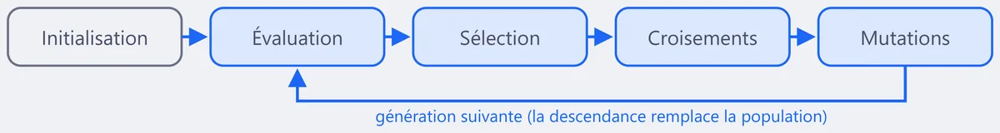
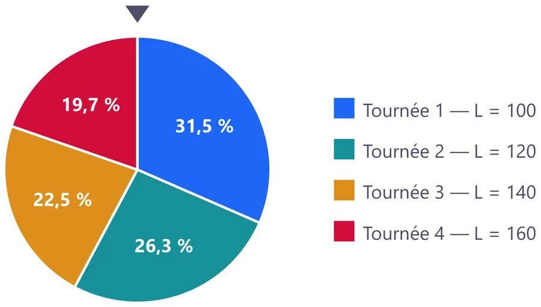
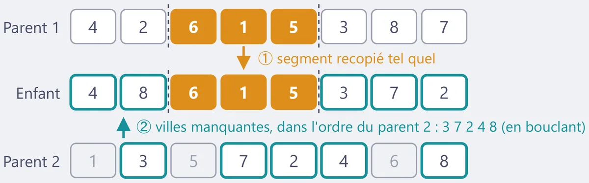
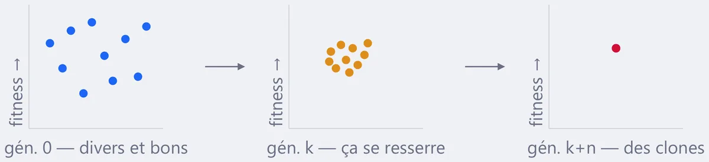

# Les algorithmes génétiques

Après la métallurgie, le vivant. Un **algorithme génétique** (AG) ne fait pas évoluer **une** solution mais toute une **population** de solutions, comme la sélection naturelle décrite par Darwin (*De l'origine des espèces*, 1859) : les mieux adaptés se reproduisent davantage, leurs enfants combinent leurs caractères avec quelques mutations, et génération après génération la population s'adapte… ici, à notre fonction de coût.

Chaque métaheuristique a son image : le **recuit simulé** imite le refroidissement lent d'un métal, les **colonies de fourmis** imitent les traces de phéromones laissées sur les chemins, et l'**algorithme génétique** imite l'évolution des espèces.

> [!info] Un randonneur ou une meute ?
> Recherche locale et recuit simulé : **un** randonneur explore le paysage. Algorithme génétique : **une meute** explore plusieurs pistes à la fois et échange de l'information par les croisements.

**À retenir :** recuit = une seule solution qu'on déplace ; AG = une population entière qui évolue.

## 1. Le cycle d'une génération

```text
Initialisation : créer une population (souvent au hasard)
répéter :
    Évaluation   : calculer la fitness de chaque individu
    Sélection    : choisir les reproducteurs (roulette ou tournoi)
    Croisement   : combiner les reproducteurs (probabilité pc ≈ 0,8)
    Mutation     : modifier un peu quelques enfants (pm ≈ 0,01)
    Remplacement : les enfants forment la nouvelle génération
jusqu'au critère d'arrêt (générations, stagnation, temps)
```



Sur l'image : l'initialisation n'a lieu qu'**une** fois, au tout début. Ensuite, la flèche du bas ramène les enfants à l'évaluation : c'est la boucle qui tourne une fois par génération.

Les deux probabilités se lisent ainsi :

- $p_c \approx 0{,}8$ : pour chaque couple de parents choisi, on fait un croisement avec 80 % de chances ; dans les 20 % restants, les enfants sont de simples copies des parents.
- $p_m \approx 0{,}01$ : chaque enfant a environ 1 % de chances de subir une mutation.

Le croisement est donc **fréquent** (c'est lui qui mélange les bonnes idées) et la mutation **rare** (elle ne doit pas casser les bons individus).

**Exemple résolu : une génération sur un mini-problème.** On cherche un mot de 4 bits avec le plus de `1` possible. Fitness = nombre de `1`.

1. **Initialisation** : population au hasard `1000`, `0110`, `0011`, `1100`.
2. **Évaluation** : fitness 1, 2, 2, 2.
3. **Sélection** : on tire par exemple `0110` et `0011` comme parents (les individus à fitness 2 sont favorisés).
4. **Croisement** (coupure au milieu) : `01|10` et `00|11` donnent `0111` (fitness 3) et `0010` (fitness 1).
5. **Mutation** (rare) : le 1ᵉʳ bit de `0111` est inversé par chance, on obtient `1111` (fitness 4).
6. **Remplacement** : les enfants forment la génération suivante, et on recommence.

Le meilleur individu est passé de fitness 2 à 4 en une génération : le croisement a réuni deux morceaux utiles, la mutation a apporté un `1` qu'aucun parent n'avait à cette place.

**À retenir :** évaluer, sélectionner, croiser (souvent), muter (rarement), remplacer, puis recommencer jusqu'au critère d'arrêt.

## 2. Le vocabulaire

| Terme | Sens dans l'algorithme | Dans le problème |
|---|---|---|
| **Individu** | une solution candidate | une valeur des variables de décision |
| **Gènes** (chromosome) | le codage de la solution (ex. : l'ordre des villes) | la façon d'écrire les variables |
| **Fitness** | la qualité d'un individu, **à maximiser** | la fonction objectif ramenée à un maximum |
| **Individu réalisable** | un individu qu'on a le droit de garder | les contraintes |
| **Population** | un ensemble d'individus traités ensemble | (propre à la méthode) |
| **Génération** | une itération de la boucle | (propre à la méthode) |
| **Sélection** | choisir les parents en favorisant les meilleurs | (propre à la méthode) |
| **Croisement** | combiner deux parents en un ou deux enfants | (propre à la méthode) |
| **Mutation** | perturber rarement un individu | (propre à la méthode) |

Le croisement se dit aussi **crossover** en anglais. Attention aux paires qu'on confond souvent :

- **individu** (une seule solution) ≠ **population** (toutes les solutions de la génération) ;
- **croisement** (deux parents, on mélange) ≠ **mutation** (un seul individu, on le modifie un peu) ;
- **génération** (un tour complet de la boucle) ≠ **mutation** (une des étapes à l'intérieur d'un tour).

**Exemple résolu : le vocabulaire sur un problème d'emploi du temps.** On veut placer 6 cours dans des créneaux.

1. Un **individu** : un emploi du temps complet (chaque cours a un créneau).
2. Ses **gènes** : la liste des 6 créneaux, un par cours, par exemple `(3, 1, 4, 1, 2, 5)`.
3. Sa **fitness** : par exemple 100 moins le nombre de conflits, pour qu'un meilleur emploi du temps ait une fitness plus **grande**.
4. La **population** : 80 emplois du temps traités ensemble.
5. Une **génération** : un tour de boucle qui fabrique 80 nouveaux emplois du temps.

**À retenir :** un individu = une solution, une population = toutes les solutions, une génération = un tour de boucle.

> [!warning] Les contraintes ne se traduisent pas toutes seules
> Un croisement ou une mutation peut fabriquer un individu **interdit** (sac trop lourd, tournée qui oublie une ville). Trois réponses :
> 1. **Pénaliser** : garder l'individu mais baisser sa fitness selon l'importance de la violation.
> 2. **Réparer** : corriger l'individu (retirer des objets jusqu'à repasser sous la capacité).
> 3. **Coder pour que l'interdit n'existe pas** : avec un codage par **permutation**, « chaque ville une fois » est automatique. La meilleure option quand c'est possible.

**Exemple résolu : pénaliser ou réparer un sac à dos.** Objets (poids ; valeur) : P (3 ; 8), Q (6 ; 15), R (5 ; 11), S (4 ; 9). Capacité 12 kg. Un individu est un vecteur de 4 bits dans l'ordre P, Q, R, S (`1` = objet pris).

On regarde l'individu `1110` :

| Position | Objet | Bit | Pris ? | Poids ajouté | Valeur ajoutée |
|---|---|---|---|---|---|
| 1 | P | 1 | oui | 3 | 8 |
| 2 | Q | 1 | oui | 6 | 15 |
| 3 | R | 1 | oui | 5 | 11 |
| 4 | S | 0 | non | 0 | 0 |

1. **Poids** : $3 + 6 + 5 = 14$ kg. **Valeur** : $8 + 15 + 11 = 34$.
2. **Réalisable ?** $14 > 12$ : non, il y a $14 - 12 = 2$ kg en trop.
3. **Pénaliser** avec « fitness = valeur − 5 × (kg en trop) » : $34 - 5 \times 2 = 34 - 10 = 24$. L'individu reste dans la population, mais il est moins bien noté.
4. **Réparer** en retirant R : il reste P et Q, poids $3 + 6 = 9$ kg (sous la capacité), valeur $8 + 15 = 23$. Cette fois l'individu respecte vraiment la contrainte.

Un individu dont le poids est **exactement** égal à la capacité est réalisable : la contrainte est « poids ≤ capacité ».

**À retenir :** lis les bits dans l'ordre des objets, additionne poids et valeurs séparément, compare le poids à la capacité, puis applique la pénalité (sur les kg en trop) ou la réparation (on retire des objets).

## 3. Codage et fitness

| Codage | Problèmes |
|---|---|
| vecteur binaire (0/1) | sac à dos, sélection de variables |
| permutation | voyageur de commerce, ordonnancement |
| vecteur d'entiers | PLNE |

Une **permutation** est une liste qui contient chaque élément **exactement une fois**, dans un certain ordre : `(3, 1, 4, 2)` est une permutation de 1, 2, 3, 4, mais `(3, 1, 3, 2)` n'en est pas une (3 deux fois, 4 absent). Pour le voyageur de commerce, toute permutation des villes est une tournée réalisable : la contrainte « chaque ville une fois » est respectée par construction.

La fitness doit être **à maximiser**. Pour un coût $c$ à minimiser : $f(s) = \dfrac{1}{c(s)}$, ou $f(s) = c_{\max} - c(s)$ (avec $c_{\max}$ le plus grand coût de la population).

**Exemple résolu : les deux formules sur les mêmes coûts.** Quatre tournées de coûts 20, 50, 60 et 80.

| Coût $c$ | $f = 1000/c$ | $f = c_{\max} - c$ (avec $c_{\max} = 80$) |
|---|---|---|
| 20 | $1000/20 = 50$ | $80 - 20 = 60$ |
| 50 | $1000/50 = 20$ | $80 - 50 = 30$ |
| 60 | $1000/60 \approx 16{,}67$ | $80 - 60 = 20$ |
| 80 | $1000/80 = 12{,}5$ | $80 - 80 = 0$ |

Dans les deux cas, le plus petit coût donne la plus **grande** fitness : on a bien transformé une minimisation en maximisation. Avec $c_{\max} - c$, le pire individu (celui dont le coût vaut justement $c_{\max}$) a **toujours** une fitness nulle.

**À retenir :** fitness = « plus c'est grand, mieux c'est » ; un coût se retourne avec $1/c$ (ou $k/c$) ou avec $c_{\max} - c$.

## 4. La sélection

### La roulette (roue de la fortune)

Chaque individu est choisi avec une probabilité **proportionnelle à sa fitness** :

$$P(i) = \frac{f_i}{\sum_j f_j}$$

Le symbole $\sum_j f_j$ veut dire « la somme des fitness de **tous** les individus ». On divise par cette somme, pas par le nombre d'individus.

| Tournée | Longueur $L$ | Fitness $f = 1000/L$ | Probabilité |
|---|---|---|---|
| 1 | 100 | 10,00 | 31,5 % |
| 2 | 120 | 8,33 | 26,3 % |
| 3 | 140 | 7,14 | 22,5 % |
| 4 | 160 | 6,25 | 19,7 % |

La meilleure est favorite, mais la pire garde presque une chance sur cinq : la **diversité** est préservée.



Sur l'image : on fait tourner la roue, et la flèche du haut désigne le parent choisi. La part bleue (la tournée la plus courte) est la plus grande, mais la part rouge (la plus longue) reste bien visible : elle sera tirée environ une fois sur cinq.

**Exemple résolu : une roulette à trois tournées.** Longueurs 50, 100 et 200, fitness $f = 1000/L$.

1. **Fitness** : $1000/50 = 20$, $1000/100 = 10$, $1000/200 = 5$.
2. **Somme** des fitness : $20 + 10 + 5 = 35$ (on n'additionne pas les longueurs).
3. **Probabilités** : $20/35 \approx 0{,}571$, $10/35 \approx 0{,}286$, $5/35 \approx 0{,}143$.
4. **En pourcentage** : on multiplie par 100, soit 57,1 %, 28,6 % et 14,3 %.
5. **Vérification** : $57{,}1 + 28{,}6 + 14{,}3 = 100$ % (aux arrondis près).

Pour tirer au sort, on découpe la roue en parts : $[0 ; 0{,}571[$ pour la 1ʳᵉ, $[0{,}571 ; 0{,}857[$ pour la 2ᵉ, $[0{,}857 ; 1[$ pour la 3ᵉ, puis on tire un nombre au hasard entre 0 et 1 et on regarde dans quelle part il tombe.

Erreur classique : répondre $1/3 \approx 33{,}3$ % pour chacune, comme si tout le monde avait la même chance. C'est la roulette qui donne plus de chances aux meilleurs.

**À retenir :** roulette = fitness de l'individu divisée par la somme de **toutes** les fitness ; les probabilités font 100 % au total.

```anim
roulette
```

### Le tournoi

On tire **$k$ individus au hasard** (avec remise) et on garde le meilleur des $k$. Le paramètre $k$ règle la **pression de sélection** (à quel point on favorise les meilleurs) :

- $k = 1$ : tirage uniforme, aucune pression ;
- $k$ grand : le meilleur gagne presque toujours ;
- $k = 2$ ou $3$ : le compromis habituel.

« Avec remise » veut dire qu'un individu tiré est remis dans le lot : il peut être tiré plusieurs fois dans le même tournoi.

Dans une population de $N$ individus, le meilleur gagne si on le tire au moins une fois :

$$P(\text{le meilleur gagne}) = 1 - \left(\frac{N-1}{N}\right)^k$$

D'où vient cette formule ? À un tirage, la probabilité de **ne pas** tirer le meilleur est $\frac{N-1}{N}$ (il y a $N - 1$ autres individus sur $N$). Les $k$ tirages sont indépendants, donc la probabilité de ne **jamais** le tirer est $\left(\frac{N-1}{N}\right)^k$. Le meilleur gagne dans tous les autres cas : $1 - \left(\frac{N-1}{N}\right)^k$.

| $k$ (avec $N = 10$) | 1 | 2 | 4 | 8 |
|---|---|---|---|---|
| P(le meilleur gagne) | 10 % | 19 % | 34 % | 57 % |

**Exemple résolu : $N = 5$, $k = 3$.**

1. Probabilité de ne pas tirer le meilleur à un tirage : $\frac{5-1}{5} = \frac{4}{5} = 0{,}8$.
2. Ne jamais le tirer en 3 tirages : $0{,}8^3 = 0{,}8 \times 0{,}8 \times 0{,}8 = 0{,}512$.
3. Le meilleur gagne : $1 - 0{,}512 = 0{,}488$, soit **48,8 %**.

Erreurs classiques :

- répondre $k/N = 3/5 = 60$ % : ce serait vrai sans remise (trois individus **différents**), mais ici on peut retomber sur le même ;
- répondre 51,2 % : c'est la probabilité de **ne pas** tirer le meilleur, il faut encore faire $1 - \dots$.

**À retenir :** calcule d'abord « ne jamais le tirer » $= \left(\frac{N-1}{N}\right)^k$, puis prends le contraire avec $1 - \dots$.

```anim
tournoi
```

> [!tip] La fitness règle aussi la pression
> Changer la fonction de fitness, c'est changer la pression de sélection. Exemple avec deux tournées de longueurs 100 et 200 :
> - avec $f = 1000/L$ : fitness 10 et 5, somme 15, probabilités $10/15 \approx 66{,}7$ % et $5/15 \approx 33{,}3$ % ;
> - avec $f = 10^4/L^2$ : fitness $10^4/100^2 = 1$ et $10^4/200^2 = 0{,}25$, somme 1,25, probabilités $1/1{,}25 = 80$ % et $0{,}25/1{,}25 = 20$ %.
>
> En élevant $L$ au carré, la meilleure passe de 66,7 % à 80 % : la pression de sélection a **augmenté**.

**À retenir :** si la meilleure gagne des points de probabilité et la pire en perd, la pression de sélection augmente.

## 5. Croisement et mutation

**Croisement un point** (codage binaire) : on coupe les deux parents au même endroit et on échange les fins.

**Exemple résolu :** parents `101100` et `010011`, coupure après le 2ᵉ bit.

1. On coupe : parent 1 = `10|1100`, parent 2 = `01|0011`.
2. Enfant 1 = début du parent 1 + fin du parent 2 : `10` + `0011` = `100011`.
3. Enfant 2 = début du parent 2 + fin du parent 1 : `01` + `1100` = `011100`.
4. Vérification : chaque enfant a bien 6 bits, autant que les parents.

**À retenir :** croisement un point = même coupure pour les deux parents, puis échange des fins.

**Croisement OX** (permutations) : un croisement naïf produirait des **doublons**. Par exemple, couper `1 2 3 4` et `4 3 2 1` après la 2ᵉ ville et échanger les fins donne `1 2 2 1` : les villes 1 et 2 apparaissent deux fois, 3 et 4 ont disparu. L'OX recopie un segment du parent 1, puis complète avec les villes manquantes **dans l'ordre où elles apparaissent chez le parent 2**, en remplissant à partir de la fin du segment et en revenant au début.

> [!tip] Exemple d'OX (variante du cours, parent 2 lu depuis le début)
> - Parent 1 : `3 7 1 | 8 2 6 | 5 4` ; parent 2 : `2 5 8 4 1 7 3 6`.
> - On recopie le segment `8 2 6` (positions 4 à 6).
> - Villes manquantes dans l'ordre du parent 2 (on saute 8, 2, 6) : `5 4 1 7 3`.
> - On remplit les positions 7, 8 puis 1, 2, 3 : enfant `1 7 3 | 8 2 6 | 5 4`.

**Le même exemple, pas à pas :**

1. On recopie le segment du parent 1 à sa place : `_ _ _ 8 2 6 _ _`.
2. On lit le parent 2 depuis le début et on raye les villes déjà placées :

| Ville du parent 2 | 2 | 5 | 8 | 4 | 1 | 7 | 3 | 6 |
|---|---|---|---|---|---|---|---|---|
| Déjà dans le segment ? | oui | non | oui | non | non | non | non | oui |
| Gardée ? | non | oui | non | oui | oui | oui | oui | non |

Liste à placer, dans cet ordre : `5 4 1 7 3`.

3. On remplit les cases vides **en commençant juste après le segment** : position 7 ← 5, position 8 ← 4, puis on revient au début : position 1 ← 1, position 2 ← 7, position 3 ← 3.
4. Enfant : `1 7 3 8 2 6 5 4`. Vérification : chaque ville de 1 à 8 apparaît une fois.

Erreur classique : remplir à partir de la position 1. On obtiendrait `5 4 1 8 2 6 7 3`, qui est bien une permutation, mais pas celle de l'OX.

**À retenir :** OX = segment du parent 1 en place, liste des villes manquantes dans l'ordre du parent 2, remplissage à partir de la case qui suit le segment, puis retour au début.



Sur l'image, un autre exemple avec la même méthode : (1) le segment orange `6 1 5` descend tel quel dans l'enfant ; (2) on lit le parent 2 de gauche à droite en sautant les villes grisées (1, 5, 6, déjà placées) : `3 7 2 4 8`. On remplit après le segment (`3 7 2`), puis on revient au début (`4 8`). Enfant : `4 8 6 1 5 3 7 2`, chaque ville une seule fois.

**Mutation** : petite perturbation **rare** (environ 1 % des individus) : inverser un bit, échanger deux villes. Son rôle : **maintenir la diversité** et réintroduire des gènes perdus. Elle est aveugle : elle ne cherche pas à améliorer un individu précis.

**Exemple résolu : deux mutations.**

- **Échange** des positions 1 et 5 de `2 6 3 8 1 5 4 7` : en position 1 il y a la ville 2, en position 5 la ville 1. On les échange : `1 6 3 8 2 5 4 7`. On a toujours une permutation (on a seulement changé deux places).
- **Inversion** du 2ᵉ bit de `0110` : on compte les bits à partir de la gauche, le 2ᵉ vaut `1`, il devient `0` : `0010`.
- **Combien de mutants ?** Avec $p_m = 0{,}02$ dans une population de 150, on attend en moyenne $150 \times 0{,}02 = 3$ individus mutés (nombre moyen = taille × probabilité).

**À retenir :** une mutation change une ou deux places seulement, et le nombre moyen de mutants vaut taille de la population × $p_m$.

```anim
croisement
```

## 6. Diversité et convergence prématurée

La richesse d'un AG est **toute sa population** : des individus **divers** et **plutôt bons**. Sans diversité, les croisements ne fabriquent que des copies.



Sur l'image : chaque point est un individu. Tant qu'ils sont éparpillés (à gauche), deux parents différents peuvent donner un enfant nouveau. À droite, tous les individus sont identiques (un seul point) : croiser deux clones redonne le même clone, plus rien ne bouge.

| Phénomène | Cause | Remède |
|---|---|---|
| **Dérive génétique** | le hasard de l'échantillonnage fait disparaître des variantes, surtout dans une **petite** population | augmenter la taille de la population |
| **Convergence prématurée** | une sélection **trop dure** (ex. : garder les « N % meilleurs ») recopie le meilleur partout | adoucir la sélection (roulette, tournoi) |

Les deux mènent à une « **armée de clones** » : l'algorithme stagne, c'est l'équivalent d'un minimum local.

Garder seulement les « N % meilleurs » comme parents s'appelle une sélection par **troncature** : on coupe la population et on jette tout le reste.

**Exemple résolu : reconnaître le phénomène.** On se pose deux questions, dans l'ordre :

1. **La sélection est-elle trop dure** (troncature, $k$ très grand, seul le meilleur se reproduit) ? Si oui : **convergence prématurée**.
2. Sinon, **la population est-elle petite** et des gènes ont-ils disparu par malchance ? Si oui : **dérive génétique**.

| Situation | Sélection trop dure ? | Petite population ? | Phénomène |
|---|---|---|---|
| 300 individus, on ne garde que les 2 % meilleurs comme parents | oui | non | convergence prématurée |
| 6 individus, tournoi à $k = 2$, une bonne variante disparaît en 3 générations | non | oui | dérive génétique |

Erreur classique : croire qu'une grande population protège de tout. Avec une troncature, même 300 individus finissent en clones.

**À retenir :** sélection trop dure → convergence prématurée (on adoucit la sélection) ; hasard dans une petite population → dérive génétique (on agrandit la population).

| Opérateur | Effet sur la diversité |
|---|---|
| garder les « N % meilleurs » | la détruit |
| roulette | les meilleurs dominent, les autres survivent un peu |
| tournoi | pression réglable par $k$ |
| croisement | explore en réutilisant de grands blocs des parents |
| mutation | réinjecte de la diversité |

> [!tip] L'élitisme
> Recopier d'office **quelques** meilleurs individus dans la génération suivante protège le meilleur sans tuer la diversité. C'est le réglage qui coûte le moins et rapporte le plus.

**Exemple résolu : l'élitisme sur une population de 100.** On recopie d'office les 2 meilleurs individus dans la génération suivante, puis on fabrique les 98 autres normalement (sélection, croisement, mutation).

- Le meilleur ne peut plus être perdu : il est recopié tel quel.
- Les 98 autres continuent d'explorer : la diversité reste là.
- À l'inverse, ne garder **que** le meilleur (et le recopier partout) donnerait 100 clones : c'est de la convergence prématurée, pas de l'élitisme.

**À retenir :** élitisme = recopier **quelques** meilleurs, pas tous les remplacer par le meilleur.

**Questions qui fâchent** : rien ne garantit que le meilleur survive (d'où l'élitisme) ; les AG explorent et mélangent plus qu'ils ne « descendent », on les termine souvent par une recherche locale (algorithmes **mémétiques**) ; ils ont beaucoup de paramètres, réglés par expérience.

**Réglages conseillés** : population de 50 à 200, $p_c \approx 0{,}8$, $p_m \approx 0{,}01$, élitisme, recherche locale finale si le budget le permet.

## À retenir

- AG = une **population** qui évolue : évaluation, sélection, croisement, mutation, remplacement.
- Fitness **à maximiser** ; contraintes : pénaliser, réparer ou coder pour les éviter.
- Roulette : $P(i) = f_i / \sum f_j$. Tournoi : le meilleur gagne avec $1 - \left(\frac{N-1}{N}\right)^k$.
- Croisement adapté au codage (OX pour les permutations) ; mutation rare pour la diversité.
- Dérive génétique (hasard) ≠ convergence prématurée (sélection trop dure). Élitisme : garder quelques meilleurs.
