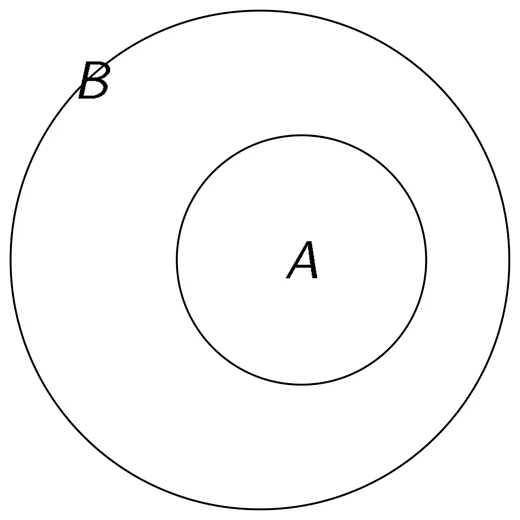
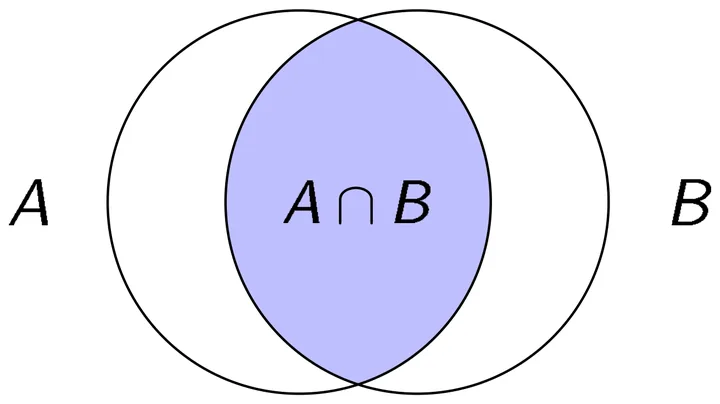

# Ensembles et logique

> [!info] Pourquoi ce chapitre ?
> Une table SQL est un **ensemble de lignes**. Une jointure est une **opération sur des ensembles**. Une clause `WHERE` est une **proposition logique**. Ce chapitre donne le vocabulaire pour manipuler tout ça proprement.

## 1. Les ensembles

Un **ensemble** est une collection d'objets appelés **éléments**, **sans ordre et sans répétition**.

- On l'écrit en **extension** (on liste tout) : $E = \{1, 2, 3\}$.
- Ou en **compréhension** (on donne une propriété) : $E = \{x \in \mathbb{R} \mid x \ge 0\}$, qui se lit « les réels $x$ tels que $x \ge 0$ ».

| Notation | Lecture |
|---|---|
| $x \in E$ | $x$ appartient à $E$ |
| $x \notin E$ | $x$ n'appartient pas à $E$ |
| $\emptyset$ | l'ensemble vide (aucun élément) |
| $A \subset B$ | $A$ est inclus dans $B$ : tout élément de $A$ est aussi dans $B$ |

Le nombre d'éléments d'un ensemble fini s'appelle son **cardinal**, noté $|A|$ ou $\text{card}(A)$.

> [!tip] Sans ordre ni répétition
> $\{1, 2, 3\} = \{3, 1, 2\}$ et $\{1, 1, 2\} = \{1, 2\}$ : ce dernier ensemble a seulement **2** éléments.

**Exemple résolu : combien d'éléments dans $\{a, b, a, c, b, a\}$ ?**

On lit les valeurs une par une et on ne garde que les nouvelles :

| Valeur lue | Déjà vue ? | Ensemble obtenu |
|---|---|---|
| $a$ | non | $\{a\}$ |
| $b$ | non | $\{a, b\}$ |
| $a$ | oui, on l'ignore | $\{a, b\}$ |
| $c$ | non | $\{a, b, c\}$ |
| $b$ | oui, on l'ignore | $\{a, b, c\}$ |
| $a$ | oui, on l'ignore | $\{a, b, c\}$ |

On a écrit 6 valeurs, mais il n'y a que **3** éléments différents : le cardinal vaut 3.

**À retenir :** le cardinal compte les valeurs **différentes**, pas le nombre de fois qu'on les a écrites.

### Passer de la compréhension à l'extension

On lit la propriété morceau par morceau, puis on liste toutes les valeurs qui respectent **tous** les morceaux.

**Exemple résolu :** $F = \{x \in \mathbb{N} \mid 1 \le x \le 20 \text{ et } x \text{ est un multiple de } 6\}$.

1. $x \in \mathbb{N}$ : $x$ est un entier naturel ($0, 1, 2, \dots$).
2. $1 \le x \le 20$ : on garde seulement les entiers de 1 à 20.
3. multiple de 6 : $x = 6 \times k$. On essaie $k = 0, 1, 2, \dots$ : $0$, $6$, $12$, $18$, $24$.
4. On retire ce qui ne respecte pas l'étape 2 : $0$ (trop petit, car il faut $x \ge 1$) et $24$ (plus grand que 20).

Donc $F = \{6, 12, 18\}$.

Si **aucune** valeur ne convient, l'ensemble est **vide**. Exemple : $\{x \in \mathbb{N} \mid x + 5 = 2\}$. Il faudrait $x = -3$, qui n'est pas un entier naturel : l'ensemble est $\emptyset$ (on écrit aussi `{}`).

**À retenir :** vérifie chaque condition sur chaque candidat, et pense aux bords (0, la borne exacte). Aucun candidat : c'est $\emptyset$.

### Vérifier une inclusion

$A \subset B$ veut dire : **chaque** élément de $A$ est dans $B$. $B$ peut avoir des éléments en plus, ça ne gêne pas.



Sur l'image : le cercle $A$ ne déborde jamais du cercle $B$. Tout ce qui est dans $A$ est donc aussi dans $B$. L'anneau autour de $A$, ce sont les éléments « en plus » de $B$.

**Exemple résolu :** a-t-on $\{1, 4\} \subset \{1, 2, 3, 4, 5\}$ ? Et $\{1, 6\} \subset \{1, 2, 3, 4, 5\}$ ?

| Ensemble testé | Élément | Dans $\{1, 2, 3, 4, 5\}$ ? |
|---|---|---|
| $\{1, 4\}$ | 1 | oui |
| $\{1, 4\}$ | 4 | oui |
| $\{1, 6\}$ | 1 | oui |
| $\{1, 6\}$ | 6 | **non** |

- $\{1, 4\} \subset \{1, 2, 3, 4, 5\}$ : tous ses éléments sont présents. Que 2, 3 et 5 soient en plus ne change rien.
- $\{1, 6\} \not\subset \{1, 2, 3, 4, 5\}$ : 6 manque, et **un seul** élément manquant suffit pour que l'inclusion soit fausse.

**À retenir :** pour $A \subset B$, passe en revue les éléments de $A$ (pas ceux de $B$) et vérifie qu'aucun ne manque dans $B$.

### Égalité par double inclusion

Pour montrer que deux ensembles sont égaux, on montre les deux inclusions :

$$A = B \iff A \subset B \text{ et } B \subset A$$

Pour montrer $A \subset B$ : on prend un élément $x$ **quelconque** de $A$ et on montre que $x \in B$.

« Quelconque » veut dire qu'on ne choisit pas une valeur précise : on raisonne sur un $x$ dont on sait seulement qu'il est dans $A$. Comme le raisonnement marche pour ce $x$, il marche pour **tous** les éléments de $A$. Vérifier sur un exemple ne suffit jamais. Avoir le même nombre d'éléments non plus : $\{1\}$ et $\{2\}$ ont chacun un élément, et aucun n'est inclus dans l'autre.

**À retenir :** inclusion = « soit $x$ quelconque dans le premier ensemble, montrons qu'il est dans le second ».

## 2. Les opérations

| Opération | Définition | En SQL |
|---|---|---|
| Union $A \cup B$ | les éléments de $A$ **ou** de $B$ (ou des deux) | `UNION` |
| Intersection $A \cap B$ | les éléments de $A$ **et** de $B$ | `INTERSECT` |
| Différence $A \setminus B$ | les éléments de $A$ qui ne sont **pas** dans $B$ | `EXCEPT` |
| Complémentaire $\overline{A}$ | les éléments de l'ensemble de référence $E$ qui ne sont pas dans $A$ | |



Sur l'image : chaque cercle est un ensemble. La partie coloriée, commune aux deux cercles, c'est $A \cap B$. Tout ce qui est coloré ou non à l'intérieur d'au moins un cercle, c'est $A \cup B$. Le croissant de gauche (dans $A$, hors de la zone coloriée), c'est $A \setminus B$.

Exemple avec $A = \{1, 2, 3, 4\}$ et $B = \{3, 4, 5, 6\}$ :

- $A \cup B = \{1, 2, 3, 4, 5, 6\}$
- $A \cap B = \{3, 4\}$
- $A \setminus B = \{1, 2\}$ et $B \setminus A = \{5, 6\}$

**Le même exemple, pas à pas.** On fait la liste de tous les éléments rencontrés, et pour chacun on note s'il est dans $A$, dans $B$, puis où il va :

| Élément | Dans $A$ ? | Dans $B$ ? | $A \cup B$ (au moins un oui) | $A \cap B$ (deux oui) | $A \setminus B$ (oui puis non) | $B \setminus A$ (non puis oui) |
|---|---|---|---|---|---|---|
| 1 | oui | non | oui | non | oui | non |
| 2 | oui | non | oui | non | oui | non |
| 3 | oui | oui | oui | oui | non | non |
| 4 | oui | oui | oui | oui | non | non |
| 5 | non | oui | oui | non | non | oui |
| 6 | non | oui | oui | non | non | oui |

On lit chaque colonne de résultat : on retrouve les quatre ensembles ci-dessus. Dans l'union, 3 et 4 ne s'écrivent qu'**une** fois (pas de répétition).

**À retenir :** union = au moins un « oui », intersection = deux « oui », $A \setminus B$ = « dans $A$ mais pas dans $B$ ».

> [!warning] La différence n'est pas symétrique
> $A \setminus B$ et $B \setminus A$ sont en général différents.

### Le complémentaire, pas à pas

Le complémentaire dépend toujours de l'**ensemble de référence** $E$ (tous les éléments dont on parle). On part de $E$ et on retire ceux de $A$.

**Exemple résolu :** $E = \{1, 2, 3, 4, 5, 6, 7, 8\}$ et $A = \{1, 2, 3\}$.

- 1, 2, 3 sont dans $A$ : on les retire.
- 4, 5, 6, 7, 8 ne sont pas dans $A$ : on les garde.

Donc $\overline{A} = \{4, 5, 6, 7, 8\}$. On vérifie : $A$ et $\overline{A}$ ne se chevauchent pas, et à eux deux ils redonnent tout $E$.

**À retenir :** $\overline{A}$ = $E$ moins les éléments de $A$. Passe en revue **tout** $E$, sans oublier le dernier élément.

### Les définitions avec $\in$

Dans une preuve, on remplace chaque opération par sa définition, écrite avec $\in$ et $\notin$ :

| Si on sait que… | … cela veut dire |
|---|---|
| $x \in A \cup B$ | $x \in A$ **ou** $x \in B$ |
| $x \in A \cap B$ | $x \in A$ **et** $x \in B$ |
| $x \in A \setminus B$ | $x \in A$ **et** $x \notin B$ |
| $x \in \overline{A}$ | $x \in E$ et $x \notin A$ |

> [!example] Modèle de preuve : $A \cap B \subset B$
> Soit $x \in A \cap B$.
>
> Par définition de l'intersection, $x \in A$ et $x \in B$.
>
> En particulier $x \in B$. Comme $x$ était quelconque, $A \cap B \subset B$.

Cette preuve suit toujours les mêmes quatre temps :

1. **Poser** un élément quelconque du premier ensemble : « Soit $x \in A \cap B$ ».
2. **Traduire** avec le tableau ci-dessus : « $x \in A$ et $x \in B$ ».
3. **Garder** l'information utile : « en particulier $x \in B$ ».
4. **Conclure** : « comme $x$ était quelconque, $A \cap B \subset B$ ».

**À retenir :** une preuve d'inclusion = poser $x$, traduire avec $\in$ / $\notin$, garder ce qui sert, conclure.

### Les lois de De Morgan

Le complémentaire **échange** union et intersection :

$$\overline{A \cup B} = \overline{A} \cap \overline{B} \qquad \overline{A \cap B} = \overline{A} \cup \overline{B}$$

En SQL, c'est la règle pour nier une condition : `NOT (age < 18 OR pays = 'FR')` devient `age >= 18 AND pays <> 'FR'`. Le `OR` devient `AND` et chaque comparaison est inversée.

**Exemple résolu : on vérifie $\overline{A \cup B} = \overline{A} \cap \overline{B}$** avec $E = \{1, 2, 3, 4, 5, 6\}$, $A = \{1, 2, 3\}$ et $B = \{2, 4\}$.

Côté gauche :

1. $A \cup B = \{1, 2, 3, 4\}$ (tout ce qui est dans $A$ ou dans $B$, 2 écrit une seule fois).
2. Son complémentaire dans $E$ : on retire 1, 2, 3, 4, il reste $\{5, 6\}$.

Côté droit :

1. $\overline{A}$ : on retire 1, 2, 3 de $E$, il reste $\{4, 5, 6\}$.
2. $\overline{B}$ : on retire 2 et 4 de $E$, il reste $\{1, 3, 5, 6\}$.
3. $\overline{A} \cap \overline{B}$ : les éléments présents dans les deux, soit $\{5, 6\}$.

Les deux côtés donnent $\{5, 6\}$ : l'égalité est vérifiée. Attention à l'ordre des calculs : dans $\overline{A \cup B}$, on fait d'abord l'union, **puis** le complémentaire.

**À retenir :** quand on passe le complémentaire « à l'intérieur », $\cup$ devient $\cap$ et $\cap$ devient $\cup$.

```anim
venn
```

## 3. Le produit cartésien

Le **produit cartésien** de $A$ et $B$ est l'ensemble de tous les **couples** $(a, b)$ avec $a \in A$ et $b \in B$ :

$$A \times B = \{(a, b) \mid a \in A,\ b \in B\} \qquad |A \times B| = |A| \times |B|$$

Exemple : $\{x, y\} \times \{1, 2\} = \{(x, 1), (x, 2), (y, 1), (y, 2)\}$.

- `CROSS JOIN` en SQL = produit cartésien : 4 lignes croisées avec 3 lignes donnent 12 lignes.
- `INNER JOIN ... ON condition` = produit cartésien **filtré** par la condition.

> [!warning] Les couples sont ordonnés
> $(x, 1) \neq (1, x)$, donc $A \times B \neq B \times A$ en général, même s'ils ont le même nombre d'éléments.

**Exemple résolu :** $A = \{p, q\}$ et $B = \{1, 2, 3\}$.

On prend chaque élément de $A$ et on l'associe à **chaque** élément de $B$ :

| Premier élément (dans $A$) | Couples obtenus |
|---|---|
| $p$ | $(p, 1)$, $(p, 2)$, $(p, 3)$ |
| $q$ | $(q, 1)$, $(q, 2)$, $(q, 3)$ |

- Nombre de couples : 2 lignes de 3 couples, soit $2 \times 3 = 6$. On **multiplie** : additionner ($2 + 3 = 5$) est l'erreur classique.
- Le couple $(2, p)$ est-il dans $A \times B$ ? Non : la **première** place doit venir de $A$, or $2 \notin A$. Ce couple est dans $B \times A$.
- $|B \times A| = 3 \times 2 = 6$ aussi : même nombre de couples, mais ce ne sont pas les mêmes couples, donc $A \times B \neq B \times A$.

**À retenir :** $|A \times B| = |A| \times |B|$, et dans $(a, b)$ la première place vient toujours du premier ensemble.

### Une jointure, pas à pas

**Exemple résolu :** une table `Equipes` (1 Rouge, 2 Bleu) et une table `Joueurs` (Léa dans l'équipe 1, Tom dans l'équipe 1).

1. `Equipes CROSS JOIN Joueurs` construit toutes les paires : $2 \times 2 = 4$ lignes.
2. `INNER JOIN ... ON Equipes.id = Joueurs.id_equipe` teste la condition sur chaque paire :

| Équipe | Joueur | Condition `Equipes.id = Joueurs.id_equipe` | Gardée ? |
|---|---|---|---|
| 1 Rouge | Léa (équipe 1) | $1 = 1$ vraie | oui |
| 1 Rouge | Tom (équipe 1) | $1 = 1$ vraie | oui |
| 2 Bleu | Léa (équipe 1) | $2 = 1$ fausse | non |
| 2 Bleu | Tom (équipe 1) | $2 = 1$ fausse | non |

Résultat : 2 lignes. L'équipe Bleu n'a aucun joueur, aucune paire ne la garde : elle **disparaît** du résultat. Pour la garder (avec des cases vides, `NULL`), on utilise `LEFT JOIN`.

On obtient exactement la même chose avec `FROM Equipes CROSS JOIN Joueurs WHERE Equipes.id = Joueurs.id_equipe` : le `WHERE` joue le rôle du `ON`.

**À retenir :** jointure = produit cartésien (toutes les paires) + filtre (la condition du `ON`).

## 4. Les relations binaires

Une **relation** $R$ sur un ensemble $E$ est un sous-ensemble de $E \times E$. On écrit $x \, R \, y$ quand le couple $(x, y)$ est dans la relation.

| Propriété | Définition | Exemple |
|---|---|---|
| Réflexive | $\forall x,\ x R x$ | « est égal à » |
| Symétrique | $x R y \Rightarrow y R x$ | « est collègue de » |
| Antisymétrique | $(x R y \text{ et } y R x) \Rightarrow x = y$ | $\le$ |
| Transitive | $(x R y \text{ et } y R z) \Rightarrow x R z$ | $\le$, « est ancêtre de » |

Deux familles à connaître :

- **Relation d'équivalence** = réflexive + symétrique + transitive. Elle découpe l'ensemble en **classes** (des groupes d'éléments équivalents). En SQL : `GROUP BY`.
- **Relation d'ordre** = réflexive + antisymétrique + transitive. Elle permet de classer. En SQL : `ORDER BY`.

Il suffit qu'**une seule** des trois propriétés manque pour que ce ne soit pas une équivalence (ou pas un ordre).

### Tester une relation donnée par ses couples

Quand la relation est une liste de couples, on vérifie chaque propriété dans la liste :

- **Réflexive** : chaque $(x, x)$ doit être présent, pour **tous** les $x$ de $E$.
- **Symétrique** : on inverse chaque couple $(x, y)$ en $(y, x)$ et on vérifie qu'il est dans la liste.
- **Antisymétrique** : on cherche deux couples inverses $(x, y)$ et $(y, x)$ avec $x \neq y$. S'il y en a un seul, la relation n'est **pas** antisymétrique.
- **Transitive** : pour chaque enchaînement $(x, y)$ puis $(y, z)$, le raccourci $(x, z)$ doit être présent.

**Exemple résolu :** sur $E = \{a, b, c\}$, $R = \{(a,a), (b,b), (c,c), (a,b), (b,a), (b,c), (c,b)\}$.

1. **Réflexive ?** Il faut $(a,a)$, $(b,b)$ et $(c,c)$ : les trois sont là. Oui.
2. **Symétrique ?**

| Couple | Couple inverse | Présent ? |
|---|---|---|
| $(a,a)$ | $(a,a)$ | oui |
| $(b,b)$ | $(b,b)$ | oui |
| $(c,c)$ | $(c,c)$ | oui |
| $(a,b)$ | $(b,a)$ | oui |
| $(b,a)$ | $(a,b)$ | oui |
| $(b,c)$ | $(c,b)$ | oui |
| $(c,b)$ | $(b,c)$ | oui |

Tous les couples ont leur inverse : oui.

3. **Transitive ?** On enchaîne $(a,b)$ puis $(b,c)$ : il faudrait le raccourci $(a,c)$. Il n'est **pas** dans la liste. Non.
4. **Conclusion :** réflexive et symétrique, mais pas transitive : ce **n'est pas** une relation d'équivalence.

**À retenir :** pour la symétrie, inverse chaque couple et cherche-le ; pour la transitivité, cherche chaque « $x \to y \to z$ » et vérifie que $(x, z)$ existe.

> [!warning] Antisymétrique ne veut pas dire « pas symétrique »
> Sur $\{1, 2\}$, $\{(1,1), (2,2), (1,2)\}$ est antisymétrique mais pas symétrique ($(2,1)$ manque). $\{(1,1), (2,2)\}$ est **à la fois** symétrique et antisymétrique. Ce sont deux tests indépendants.

### Les classes d'équivalence

La **classe** d'un élément $x$, notée $[x]$, est l'ensemble de tous les éléments en relation avec $x$ : $[x] = \{y \in E \mid x \, R \, y\}$. Elle contient toujours $x$ lui-même (réflexivité).

**Exemple résolu :** sur $E = \{1, 2, 3, 4, 5\}$, la relation d'équivalence $R$ formée de $(1,1)$, $(2,2)$, $(3,3)$, $(4,4)$, $(5,5)$, $(1,4)$, $(4,1)$, $(2,5)$, $(5,2)$.

| Élément | Couples qui commencent par lui | Classe |
|---|---|---|
| 1 | $(1,1)$, $(1,4)$ | $[1] = \{1, 4\}$ |
| 2 | $(2,2)$, $(2,5)$ | $[2] = \{2, 5\}$ |
| 3 | $(3,3)$ seulement | $[3] = \{3\}$ |
| 4 | $(4,4)$, $(4,1)$ | $[4] = \{1, 4\}$, la même que $[1]$ |
| 5 | $(5,5)$, $(5,2)$ | $[5] = \{2, 5\}$, la même que $[2]$ |

On enlève les doublons : les classes sont $\{1, 4\}$, $\{2, 5\}$ et $\{3\}$, soit **3 classes**. Un élément seul avec lui-même (ici 3) forme une classe à lui tout seul. Les classes ne se chevauchent jamais et, ensemble, elles contiennent tout $E$.

**À retenir :** calcule la classe de chaque élément, puis enlève les classes en double.

### « Avoir le même reste » : une équivalence très courante

La **division euclidienne** de $a$ par $n$ (avec $n \ge 1$) écrit $a = q \times n + r$ avec un **reste** $r$ tel que $0 \le r < n$. Le reste est donc l'un des nombres $0, 1, \dots, n - 1$ : il y en a exactement $n$.

**Exemple résolu :** reste de 20 dans la division par 6. On cherche combien de fois 6 rentre dans 20 : $3 \times 6 = 18$ et $4 \times 6 = 24$ est trop grand. Donc $20 = 3 \times 6 + 2$, et le reste vaut $2$ (on vérifie $0 \le 2 < 6$).

La relation « $x$ et $y$ ont le même reste dans la division par 6 » est une équivalence :

1. **Réflexive** : $x$ a le même reste que lui-même.
2. **Symétrique** : si $x$ a le même reste que $y$, alors $y$ a le même reste que $x$.
3. **Transitive** : même reste pour $x$ et $y$, et pour $y$ et $z$, donc le même pour $x$ et $z$.

Exemple : $14 = 2 \times 6 + 2$, donc 20 et 14 sont en relation (reste 2 tous les deux). Il y a une classe par reste possible, soit **6 classes** (restes 0, 1, 2, 3, 4, 5). Ne pas oublier la classe du reste 0 : les multiples de 6.

Exemple du cours : « avoir la même parité » sur $\mathbb{Z}$, c'est « même reste dans la division par 2 ». Il y a **2 classes** : les pairs et les impairs.

**À retenir :** « même reste dans la division par $n$ » est une équivalence avec $n$ classes, une par reste de $0$ à $n - 1$.

### Les relations d'ordre

**Exemple résolu : pourquoi $\le$ sur $\mathbb{R}$ est un ordre.**

1. **Réflexive** : $x \le x$ est toujours vrai.
2. **Antisymétrique** : si $x \le y$ et $y \le x$, alors forcément $x = y$.
3. **Transitive** : si $x \le y$ et $y \le z$, alors $x \le z$.

Ce n'est **pas** une équivalence : elle n'est pas symétrique, car $2 \le 5$ est vrai mais $5 \le 2$ est faux.

Exemple d'ordre : « $x$ divise $y$ » sur $\mathbb{N}^*$. C'est un ordre **partiel** : 6 et 10 ne sont pas comparables (aucun ne divise l'autre). Au contraire, $\le$ sur $\mathbb{R}$ est un ordre **total** : deux réels sont toujours comparables.

« $x$ divise $y$ » veut dire qu'il existe un entier $k$ tel que $y = k \times x$ (autrement dit, $y$ est un multiple de $x$). Deux éléments sont **comparables** si l'un est en relation avec l'autre, dans un sens ou dans l'autre.

**Exemple résolu : la divisibilité, pas à pas.**

- **8 et 12 sont-ils comparables ?** $12 = 1{,}5 \times 8$ : $k$ n'est pas entier, donc 8 ne divise pas 12. Et 12 ne divise pas 8 (8 est plus petit que 12, ce n'est pas un multiple de 12). Ils ne sont pas comparables. Un seul couple de ce genre suffit pour que l'ordre soit **partiel**.
- **Les $x$ tels que $x$ divise 12** (les diviseurs de 12) : on écrit 12 comme produit de deux entiers, $12 = 1 \times 12 = 2 \times 6 = 3 \times 4$. Donc $\{1, 2, 3, 4, 6, 12\}$. On n'oublie ni 1 ni 12 lui-même (réflexivité : 12 divise 12).

**À retenir :** un ordre est total si **toutes** les paires sont comparables ; une seule paire non comparable le rend partiel.

> [!warning] $<$ n'est pas une relation d'ordre au sens du cours
> Elle n'est pas réflexive ($x < x$ est faux). On parle d'ordre **strict**.

## 5. Les fonctions

Une **fonction** $f : A \to B$ associe à **chaque** élément de $A$ **exactement une** image dans $B$.

- **Injective** : deux éléments différents ont des images différentes : $f(x_1) = f(x_2) \Rightarrow x_1 = x_2$.
- **Surjective** : tout élément de $B$ est l'image d'au moins un élément de $A$.

L'injectivité s'écrit aussi avec la contraposée, souvent plus parlante :

$$\forall x_1, x_2 \in A,\ x_1 \neq x_2 \Rightarrow f(x_1) \neq f(x_2)$$

**Exemple résolu :** $g : \{1, 2, 3\} \to \{a, b, c, d\}$ avec $g(1) = b$, $g(2) = d$, $g(3) = a$, et $h : \{1, 2, 3\} \to \{a, b\}$ avec $h(1) = a$, $h(2) = a$, $h(3) = b$.

On regarde chaque élément d'**arrivée** et on note qui l'atteint :

| Arrivée | Atteint par (avec $g$) | Atteint par (avec $h$) |
|---|---|---|
| $a$ | 3 | 1 et 2 |
| $b$ | 1 | 3 |
| $c$ | personne | (pas dans l'arrivée) |
| $d$ | 2 | (pas dans l'arrivée) |

- $g$ est **injective** : aucune image n'est atteinte deux fois. Elle n'est **pas surjective** : $c$ n'est atteint par personne.
- $h$ n'est **pas injective** : $h(1) = h(2) = a$ avec $1 \neq 2$, ce seul cas suffit. Elle est **surjective** : $a$ et $b$ sont atteints. Être atteint deux fois ne gêne pas la surjectivité.

**À retenir :** injective = aucune image atteinte deux fois ; surjective = aucune image d'arrivée oubliée.

En base de données : la fonction « employé $\mapsto$ identifiant » est injective grâce à la **clé primaire** (ou une contrainte `UNIQUE`). La fonction « employé $\mapsto$ département » ne l'est pas : plusieurs employés partagent un département.

- `UNIQUE` est une **contrainte** sur la table : elle refuse l'ajout d'une ligne dont la valeur existe déjà dans la colonne.
- `DISTINCT` n'est **pas** une contrainte : il enlève seulement les doublons du résultat d'un `SELECT`, la table peut toujours en contenir.

## 6. La logique

Une **proposition** est un énoncé qui est soit vrai (V), soit faux (F), jamais les deux.

| Connecteur | Notation | Lecture |
|---|---|---|
| Négation | $\neg P$ | non $P$ |
| Conjonction | $P \wedge Q$ | $P$ et $Q$ |
| Disjonction | $P \vee Q$ | $P$ ou $Q$ (ou les deux) |
| Implication | $P \Rightarrow Q$ | si $P$ alors $Q$ |
| Équivalence | $P \Leftrightarrow Q$ | $P$ si et seulement si $Q$ |

### Les tables de vérité

Une **table de vérité** donne la valeur d'une formule dans **tous** les cas possibles. Chaque proposition vaut V ou F : avec 2 propositions il y a $2 \times 2 = 4$ lignes, avec 3 propositions $2 \times 2 \times 2 = 2^3 = 8$ lignes, et avec $n$ propositions $2^n$ lignes.

| $P$ | $Q$ | $\neg P$ | $P \wedge Q$ | $P \vee Q$ |
|---|---|---|---|---|
| V | V | F | V | V |
| V | F | F | F | V |
| F | V | V | F | V |
| F | F | V | F | F |

- « et » ($\wedge$) est vrai seulement quand les **deux** sont vrais.
- « ou » ($\vee$) est faux seulement quand les **deux** sont faux.

### L'implication

| $P$ | $Q$ | $P \Rightarrow Q$ |
|---|---|---|
| V | V | V |
| V | F | **F** |
| F | V | V |
| F | F | V |

$P \Rightarrow Q$ est fausse **uniquement** quand $P$ est vraie et $Q$ fausse.

> [!warning] Une implication est vraie quand $P$ est fausse
> « S'il pleut, je prends mon parapluie » n'est pas contredite un jour sans pluie, quoi que je fasse.

**Exemple résolu :** « si $n$ est un multiple de 4, alors $n$ est pair ». On regarde trois valeurs :

| $n$ | $P$ : multiple de 4 ? | $Q$ : pair ? | $P \Rightarrow Q$ |
|---|---|---|---|
| 8 | V | V | V : la promesse est tenue |
| 6 | F | V | V : $P$ est fausse, rien n'est promis |
| 3 | F | F | V : $P$ est fausse, rien n'est promis |

Pour contredire la phrase, il faudrait un multiple de 4 impair : c'est impossible, donc la phrase est vraie pour tout $n$.

**À retenir :** pour savoir si $P \Rightarrow Q$ est fausse, cherche **uniquement** le cas « $P$ vraie et $Q$ fausse ».

- **Négation** d'une implication : $\neg(P \Rightarrow Q) \equiv P \wedge \neg Q$. On la contredit en trouvant un cas où $P$ est vraie et $Q$ fausse.
- **Contraposée** : $P \Rightarrow Q$ a la même valeur que $\neg Q \Rightarrow \neg P$.
- **Réciproque** : $Q \Rightarrow P$. Elle n'a **rien à voir** : elle peut être fausse quand l'implication est vraie.

**Exemple résolu :** « si c'est un chat, alors c'est un animal » ($P$ = « c'est un chat », $Q$ = « c'est un animal »).

| Nom | Formule | En français | Vraie ? |
|---|---|---|---|
| Phrase de départ | $P \Rightarrow Q$ | si c'est un chat, c'est un animal | oui |
| Contraposée | $\neg Q \Rightarrow \neg P$ | si ce n'est pas un animal, ce n'est pas un chat | oui, toujours comme la phrase de départ |
| Réciproque | $Q \Rightarrow P$ | si c'est un animal, c'est un chat | **non** (un chien) |
| Négation | $P \wedge \neg Q$ | c'est un chat et ce n'est pas un animal | non, l'inverse de la phrase de départ |

Pour la contraposée, on fait **deux** gestes : on inverse le sens et on nie les deux côtés. La réciproque inverse seulement. La négation n'est **pas** une implication : c'est un « et ».

**À retenir :** contraposée = inverser et nier (même valeur) ; réciproque = inverser seulement (valeur libre) ; négation = « $P$ et non $Q$ ».

### Formules équivalentes

Deux formules sont **équivalentes** ($\equiv$) si elles ont la même valeur sur **toutes** les lignes de leur table de vérité. Une seule ligne différente suffit pour qu'elles ne le soient pas.

**Exemple résolu :** $P \Rightarrow Q$ et $\neg P \vee Q$ sont-elles équivalentes ?

| $P$ | $Q$ | $\neg P$ | $\neg P \vee Q$ | $P \Rightarrow Q$ |
|---|---|---|---|---|
| V | V | F | V | V |
| V | F | F | F | F |
| F | V | V | V | V |
| F | F | V | V | V |

Les deux dernières colonnes sont identiques sur les 4 lignes : oui, $P \Rightarrow Q \equiv \neg P \vee Q$.

Pour une formule compliquée, calcule d'abord les morceaux entre parenthèses dans des colonnes à part, puis la formule entière.

**À retenir :** pour comparer deux formules, fais une table avec toutes les lignes ($2^n$) et compare les colonnes ligne par ligne.

### Les lois de De Morgan en logique

$$\neg(P \wedge Q) \equiv \neg P \vee \neg Q \qquad \neg(P \vee Q) \equiv \neg P \wedge \neg Q$$

Pour nier une comparaison, on prend **exactement** le contraire :

| Comparaison | Sa négation |
|---|---|
| $x < a$ | $x \ge a$ |
| $x \le a$ | $x > a$ |
| $x > a$ | $x \le a$ |
| $x \ge a$ | $x < a$ |
| $x = a$ | $x \neq a$ |

**Exemple résolu :** négation de « $x > 2$ ou $y \le 1$ ».

1. De Morgan : la négation d'un « ou » est un « et » des négations.
2. $\neg(x > 2)$ donne $x \le 2$ (le cas $x = 2$ change de côté).
3. $\neg(y \le 1)$ donne $y > 1$.
4. Résultat : « $x \le 2$ et $y > 1$ ».

Vérification sur un point : $x = 2$, $y = 5$. La phrase de départ est fausse ($2 > 2$ faux, $5 \le 1$ faux), et la négation est vraie ($2 \le 2$ vrai, $5 > 1$ vrai). C'est bien le contraire.

**À retenir :** « et » devient « ou » (et inversement), puis chaque comparaison est remplacée par son contraire exact.

### Les quantificateurs (aperçu)

- $\forall x,\ P(x)$ : « pour tout $x$, $P(x)$ est vraie ».
- $\exists x,\ P(x)$ : « il existe au moins un $x$ tel que $P(x)$ ».
- La négation échange les deux : $\neg(\forall x,\ P(x)) \equiv \exists x,\ \neg P(x)$ et $\neg(\exists x,\ P(x)) \equiv \forall x,\ \neg P(x)$.

Exemple : « tous les clients ont payé » se nie en « **il existe** un client qui **n'a pas** payé ».

**Exemple résolu :** négation de « il existe un produit en rupture de stock ».

1. On remplace « il existe » par « pour tout » (tous les produits).
2. On nie la propriété : « en rupture » devient « pas en rupture ».
3. Résultat : « tous les produits sont en stock ».

Piège : « aucun client n'a payé » n'est **pas** la négation de « tous les clients ont payé ». C'est un contraire beaucoup trop fort : s'il y a un client qui a payé et un autre non, les deux phrases sont fausses en même temps. Une négation, elle, est vraie exactement quand la phrase de départ est fausse.

**À retenir :** nier = échanger $\forall$ et $\exists$, puis nier la propriété ; « tous » se nie en « au moins un… ne… pas ».

## 7. Quatre méthodes de preuve

1. **Directe** : on part de l'hypothèse $P$ et on enchaîne jusqu'à $Q$.
2. **Par contraposée** : on montre $\neg Q \Rightarrow \neg P$, souvent plus simple.
3. **Par l'absurde** : on suppose le contraire de ce qu'on veut, et on arrive à une contradiction.
4. **Par contre-exemple** : pour montrer qu'un « pour tout » est **faux**, un seul cas qui ne marche pas suffit.

Exemples :

- **Directe** : si $n$ est pair, $n = 2k$, donc $n^2 = 4k^2 = 2(2k^2)$ est pair.
- **Contraposée** : pour montrer « $n^2$ pair $\Rightarrow n$ pair », on montre « $n$ impair $\Rightarrow n^2$ impair » : $n = 2k + 1$ donne $n^2 = 2(2k^2 + 2k) + 1$.
- **Absurde** : $\sqrt{2}$ n'est pas une fraction. Si $\sqrt{2} = \frac{p}{q}$ (fraction irréductible), alors $p^2 = 2q^2$, donc $p$ est pair, puis $q$ aussi : la fraction n'était pas irréductible, contradiction.
- **Contre-exemple** : « $x^2 > 4 \Rightarrow x > 2$ » est faux : $x = -3$ donne $x^2 = 9 > 4$ mais $-3 < 2$.

### La preuve directe, pas à pas

**Exemple résolu :** montrer que le produit de deux entiers impairs est impair.

1. **Traduire l'hypothèse** : « $a$ impair » veut dire $a = 2k + 1$ avec $k$ entier ; « $b$ impair » veut dire $b = 2m + 1$ avec $m$ entier. On prend **deux lettres différentes** : avec la même lettre $k$, on aurait forcé $a = b$.
2. **Calculer** : $ab = (2k + 1)(2m + 1) = 4km + 2k + 2m + 1$.
3. **Mettre en forme** : $ab = 2(2km + k + m) + 1$.
4. **Conclure** : $2km + k + m$ est un entier, donc $ab$ s'écrit $2 \times (\text{entier}) + 1$ : il est impair.

Vérifier sur un exemple ($3 \times 5 = 15$) aide à comprendre, mais ne prouve rien : il faut le faire pour des $a$ et $b$ quelconques.

**À retenir :** traduis chaque hypothèse en égalité (pair = $2k$, impair = $2k + 1$, une lettre par nombre), calcule, puis remets le résultat sous la forme voulue.

### La contraposée et les restes, pas à pas

Quand on veut montrer « si $n^2$ a une propriété, alors $n$ aussi », partir de $n^2$ est difficile (on ne sait pas « enlever le carré »). On montre la contraposée « si $n$ n'a pas la propriété, alors $n^2$ non plus », en séparant les cas selon le reste de $n$.

**Exemple résolu :** « $n$ impair $\Rightarrow n^2$ impair » (contraposée de « $n^2$ pair $\Rightarrow n$ pair »).

1. Un entier qui n'est pas pair a un reste **non nul** dans la division par 2 : le seul possible est 1, donc $n = 2k + 1$ (un seul cas). Pour une division par $d$, il y aurait $d - 1$ cas : les restes $1, 2, \dots, d - 1$.
2. On développe : $n^2 = (2k + 1)^2 = 4k^2 + 4k + 1$.
3. On regroupe ce qui est multiple de 2 : $4k^2 + 4k = 2(2k^2 + 2k)$, donc $n^2 = 2(2k^2 + 2k) + 1$. Le reste vaut 1 : $n^2$ est impair.
4. La contraposée est vraie, donc la phrase de départ aussi.

Si le nombre qui reste à la fin dépasse le diviseur, on le réduit. Exemple en division par 5 : $5m + 7 = 5m + 5 + 2 = 5(m + 1) + 2$, le vrai reste est 2 et non 7, car un reste doit vérifier $0 \le r < 5$.

**À retenir :** contraposée = « si $n$ n'a pas la propriété », un cas par reste non nul, on développe, on écrit $d \times (\dots) + r$ avec $0 \le r < d$.

### La preuve par l'absurde, pas à pas

1. **Supposer le contraire** de ce qu'on veut montrer (pour « il n'existe pas de… », on suppose qu'il en existe un, et on lui donne un nom).
2. **Raisonner** jusqu'à obtenir deux faits incompatibles (une contradiction).
3. **Conclure** : la supposition était fausse, donc ce qu'on voulait montrer est vrai.

Dans l'exemple de $\sqrt{2}$ : on suppose que c'est une fraction irréductible $\frac{p}{q}$ (étape 1), on trouve que $p$ et $q$ sont pairs (étape 2), ce qui contredit « irréductible » ; donc $\sqrt{2}$ n'est pas une fraction (étape 3). L'objet supposé doit rester **quelconque** : choisir une valeur précise ne prouve rien.

**À retenir :** absurde = « supposons le contraire », contradiction, « donc la supposition est fausse ».

### Le contre-exemple, pas à pas

Pour montrer qu'un énoncé « pour tout » est faux, il suffit d'**un** cas où il ne marche pas. Pour en trouver un, on teste des valeurs simples : 0, 1, des négatifs, des fractions, et on avance dans l'ordre.

**Exemple résolu :** « $2^n + 1$ est premier pour tout entier $n \ge 0$ ». Quel est le plus petit contre-exemple ?

| $n$ | $2^n + 1$ | Premier ? |
|---|---|---|
| 0 | $1 + 1 = 2$ | oui |
| 1 | $2 + 1 = 3$ | oui |
| 2 | $4 + 1 = 5$ | oui |
| 3 | $8 + 1 = 9 = 3 \times 3$ | **non** |

Le plus petit contre-exemple est $n = 3$. Les 3 premiers cas qui marchaient ne prouvaient rien.

**À retenir :** pour réfuter un « pour tout », teste les valeurs une par une dans l'ordre et arrête-toi au premier échec.

> [!tip] Choisir sa méthode
> Directe si ça s'enchaîne naturellement. Contraposée si la conclusion est plus simple à nier. Absurde pour « il n'existe pas » ou « est irrationnel ». Contre-exemple pour réfuter un « pour tout ».

> [!warning] Un exemple ne prouve pas un « pour tout »
> Vérifier une propriété sur 10, 100 ou 1 000 cas ne prouve rien. Mais **un seul** contre-exemple suffit à la réfuter.

## 8. Le pont vers SQL

| Mathématiques | SQL |
|---|---|
| $A \cup B$, $A \cap B$, $A \setminus B$ | `UNION`, `INTERSECT`, `EXCEPT` |
| $A \times B$ | `CROSS JOIN` |
| produit cartésien filtré | `INNER JOIN ... ON ...` |
| proposition logique | condition `WHERE` |
| relation d'équivalence | `GROUP BY` |
| relation d'ordre | `ORDER BY` |
| fonction injective | clé primaire, `UNIQUE` |
| $\neg \exists$ | `NOT EXISTS` |

- « ou » entre deux requêtes = `UNION`, « et » = `INTERSECT`, « mais pas » = `EXCEPT` (appelé `MINUS` sous Oracle). Comme $A \setminus B \neq B \setminus A$, l'ordre des deux requêtes autour de `EXCEPT` compte : on écrit d'abord celle qu'on garde.
- `NOT` sert à nier une condition **dans** un `WHERE` ; il ne relie pas deux requêtes.

**Exemple résolu :** `ClientsParis` et `ClientsPremium` renvoient chacune une colonne `id_client`. On veut les clients premium qui n'habitent **pas** à Paris.

1. « mais pas » = différence $\setminus$, donc `EXCEPT`.
2. On garde les premium, on retire les parisiens : `ClientsPremium EXCEPT ClientsParis`.
3. Dans l'autre sens, `ClientsParis EXCEPT ClientsPremium` donnerait les parisiens non premium : une autre réponse.

**Exemple résolu : nier un `WHERE`.** La négation de `WHERE stock > 0 OR en_commande = 1` : le `OR` devient `AND`, `> 0` devient `<= 0`, `= 1` devient `<> 1`. On obtient `WHERE stock <= 0 AND en_commande <> 1`.

Les clients qui n'ont jamais commandé : $\forall\, cmd \in Commandes,\ cmd.client \neq c$, soit :

```sql
SELECT * FROM Clients c
WHERE NOT EXISTS (
  SELECT 1 FROM Commandes cmd WHERE cmd.id_client = c.id_client
);
```

Pas à pas : « $c$ n'a jamais commandé » veut dire « il **n'existe pas** de commande de $c$ », soit $\neg \exists\, cmd,\ cmd.client = c$. En échangeant $\exists$ en $\forall$ et en niant la condition, cela donne $\forall\, cmd,\ cmd.client \neq c$. En SQL, la sous-requête cherche les commandes de **ce** client (`cmd.id_client = c.id_client`) et `NOT EXISTS` garde le client si elle ne trouve rien. Sans ce lien avec `c`, la sous-requête trouverait n'importe quelle commande et ne garderait aucun client.

**À retenir :** « n'existe aucun » = `NOT EXISTS` avec une sous-requête reliée à la ligne courante.

## À retenir

- Un ensemble n'a ni ordre ni répétition. $A = B$ se prouve par double inclusion.
- $\cup$ = ou, $\cap$ = et, $\setminus$ = sauf. De Morgan échange $\cup$ et $\cap$ (et `AND` / `OR`).
- $|A \times B| = |A| \times |B|$, et $A \times B \neq B \times A$.
- Équivalence (réflexive, symétrique, transitive) = classes = `GROUP BY`. Ordre (réflexive, antisymétrique, transitive) = `ORDER BY`.
- $P \Rightarrow Q$ est fausse seulement si $P$ vraie et $Q$ fausse. Sa négation est $P \wedge \neg Q$, sa contraposée $\neg Q \Rightarrow \neg P$.
- Un seul contre-exemple réfute un « pour tout ».
