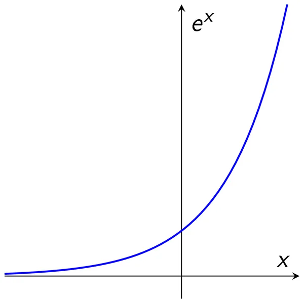
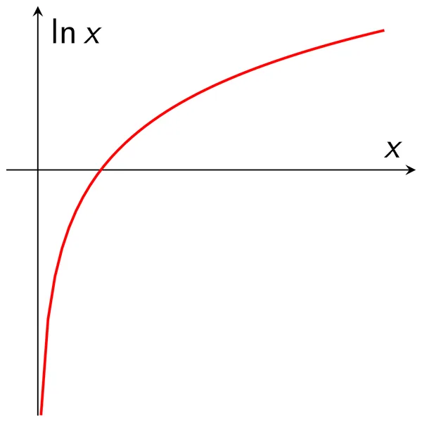
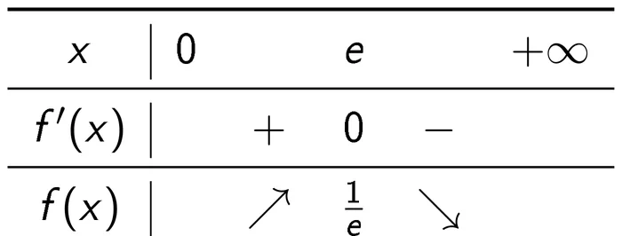

# Exponentielle et logarithme

Ces deux fonctions sont partout en informatique : croissance d'un volume de données, complexité d'un algorithme, fonction de perte d'un modèle de machine learning. Le but de ce chapitre : connaître leurs propriétés **par cœur** et les manipuler vite, sans les redémontrer.

## 1. L'exponentielle

La fonction exponentielle se note $x \mapsto e^x$ (ou $\exp(x)$). Elle est définie pour **tout** réel $x$ et donne toujours un résultat **strictement positif** : $e^x > 0$.

Le nombre $e$ vaut environ $2{,}718$. $e^x$ se manipule comme n'importe quelle puissance : $e^2 = e \times e$, $e^3 = e \times e \times e$, etc. Le nombre en haut s'appelle l'**exposant**.

### Les règles de calcul

$$e^{a+b} = e^a \times e^b \qquad e^{a-b} = \frac{e^a}{e^b} \qquad e^{-a} = \frac{1}{e^a} \qquad (e^a)^n = e^{na} \qquad e^0 = 1$$

| On a… | On fait quoi avec les exposants ? | Exemple |
|---|---|---|
| un **produit** $e^a \times e^b$ | on les **additionne** | $e^5 \times e^{-1} = e^{5 + (-1)} = e^4$ |
| un **quotient** $\dfrac{e^a}{e^b}$ | on les **soustrait** (haut moins bas) | $\dfrac{e^2}{e^6} = e^{2 - 6} = e^{-4}$ |
| une **puissance de puissance** $(e^a)^n$ | on les **multiplie** | $(e^{-1})^4 = e^{-1 \times 4} = e^{-4}$ |
| un exposant nul $e^0$ | rien : ça vaut 1 | $e^0 = 1$ |

> [!tip] Le réflexe
> L'exponentielle transforme une **somme** (dans l'exposant) en **produit**. Exemple : $e^3 \times e^{-1} = e^{3 + (-1)} = e^2$.

**Exemple résolu : simplifier $\dfrac{e^{5} \times e^{-1}}{e^{2}}$.**

1. Le haut est un produit : on additionne les exposants. $e^{5} \times e^{-1} = e^{5 + (-1)} = e^{4}$.
2. Il reste un quotient $\dfrac{e^4}{e^2}$ : on soustrait. $e^{4 - 2} = e^{2}$.
3. Résultat : $e^2$.

Pourquoi $e^0 = 1$ ? Parce que $e^0 = e^{a - a} = \dfrac{e^a}{e^a}$, et un nombre divisé par lui-même vaut 1. (Attention : $e^0$ ne vaut ni 0 ni $e$.)

Pourquoi on multiplie pour une puissance de puissance ? $(e^2)^4 = e^2 \times e^2 \times e^2 \times e^2 = e^{2+2+2+2} = e^{8}$ : additionner quatre fois 2, c'est multiplier 2 par 4.

**À retenir :** produit → on additionne les exposants, quotient → on soustrait, puissance de puissance → on multiplie. Ne mélange pas les trois.

> [!warning] Piège classique
> $e^{a+b} \neq e^a + e^b$. Par exemple $e^{1+1} = e^2 \approx 7{,}39$ alors que $e^1 + e^1 \approx 5{,}44$.

### Écrire une puissance quelconque avec $e$

N'importe quel nombre $a > 0$ peut s'écrire $a = e^{\ln a}$ (voir la partie 2). Donc toute puissance $a^x$ peut s'écrire avec $e$ :

$$a^x = \left(e^{\ln a}\right)^x = e^{x \ln a}$$

**Exemple résolu :** écrire $3^{t/5}$ sous la forme $e^{kt}$.

1. $3 = e^{\ln 3}$, donc $3^{t/5} = \left(e^{\ln 3}\right)^{t/5}$.
2. Puissance de puissance : on multiplie les exposants, $\ln 3 \times \dfrac{t}{5} = \dfrac{\ln 3}{5}\, t$.
3. Donc $3^{t/5} = e^{kt}$ avec $k = \dfrac{\ln 3}{5}$.

**À retenir :** $a^x = e^{x \ln a}$ : le $\ln$ de la base passe devant, dans l'exposant.

### Variations et limites



Sur l'image : à gauche, la courbe s'approche de l'axe sans jamais le toucher (limite 0, et $e^x > 0$ toujours). Elle coupe l'axe vertical à la hauteur 1, car $e^0 = 1$. À droite, elle monte de plus en plus fort (limite $+\infty$).

- $\exp$ est **strictement croissante** sur $\mathbb{R}$ : si $a < b$ alors $e^a < e^b$.
- $\lim\limits_{x \to +\infty} e^x = +\infty$ et $\lim\limits_{x \to -\infty} e^x = 0$.
- Sa dérivée est elle-même : $(e^x)' = e^x$.
- Pour une composée : $\left(e^{u(x)}\right)' = u'(x)\, e^{u(x)}$. Exemple : $\left(e^{3x^2}\right)' = 6x\,e^{3x^2}$.

« Composée » veut dire qu'il y a autre chose que $x$ tout seul dans l'exposant. On appelle $u(x)$ ce qu'il y a dans l'exposant.

**Exemple résolu : dériver $f(x) = e^{-2x + 1}$.**

1. Ce qu'il y a dans l'exposant : $u(x) = -2x + 1$.
2. On dérive l'intérieur : $u'(x) = -2$.
3. On applique $\left(e^{u}\right)' = u'\, e^{u}$ : $f'(x) = -2\, e^{-2x+1}$.

L'exposant **ne change pas** : on garde $e^{-2x+1}$ tel quel, et on multiplie devant par $u'$.

**À retenir :** dérivée de $e^{\text{quelque chose}}$ = (dérivée du quelque chose) $\times$ $e^{\text{le même quelque chose}}$.

## 2. Le logarithme népérien

La fonction $\ln$ est la **réciproque** de l'exponentielle : elle « défait » ce que fait $\exp$.

$$\ln(e^x) = x \quad \text{pour tout réel } x \qquad\qquad e^{\ln x} = x \quad \text{pour } x > 0$$

Autrement dit, $\ln x$ répond à la question : **« à quelle puissance faut-il élever $e$ pour obtenir $x$ ? »**

**Exemple résolu : calculer $\ln(e^{-3})$, $e^{\ln 7}$, $\ln 1$, $\ln e$ et $\ln\frac{1}{e}$.**

| Expression | Raisonnement | Valeur |
|---|---|---|
| $\ln(e^{-3})$ | le $\ln$ défait le $e^{\dots}$ | $-3$ |
| $e^{\ln 7}$ | le $e^{\dots}$ défait le $\ln$ (possible car $7 > 0$) | $7$ |
| $\ln 1$ | quelle puissance de $e$ donne 1 ? $e^0 = 1$ | $0$ |
| $\ln e$ | quelle puissance de $e$ donne $e$ ? $e^1 = e$ | $1$ |
| $\ln\frac{1}{e}$ | $\frac{1}{e} = e^{-1}$ | $-1$ |

**À retenir :** $\ln$ et $\exp$ s'annulent l'une l'autre. Et ne confonds pas $\ln 1 = 0$ avec $\ln e = 1$.

> [!warning] Le domaine
> $\ln x$ n'existe que pour $x > 0$. $\ln(0)$ et $\ln(-3)$ n'ont **aucun sens**. Avant de résoudre une équation avec $\ln$, on écrit toujours la condition sur $x$.

**Exemple résolu : pour quels $x$ l'expression $\ln(x - 4) + \ln(10 - x)$ existe-t-elle ?**

1. Premier $\ln$ : il faut $x - 4 > 0$, donc $x > 4$.
2. Second $\ln$ : il faut $10 - x > 0$, donc $x < 10$.
3. Les **deux** doivent être vrais en même temps : $4 < x < 10$, c'est-à-dire $x \in \, ]4, 10[$.

**À retenir :** écris une condition « intérieur $> 0$ » pour **chaque** $\ln$, puis garde ce qui respecte toutes les conditions à la fois.

### Les règles de calcul (pour $a > 0$ et $b > 0$)

$$\ln(ab) = \ln a + \ln b \qquad \ln\frac{a}{b} = \ln a - \ln b \qquad \ln(a^n) = n \ln a$$

$$\ln 1 = 0 \qquad \ln e = 1 \qquad \ln\frac{1}{a} = -\ln a$$

Ces règles se lisent dans les deux sens. Pour **regrouper** plusieurs $\ln$ en un seul :

- un nombre devant un $\ln$ **remonte en exposant** : $n \ln a = \ln(a^n)$ ;
- une somme de $\ln$ devient le $\ln$ d'un **produit** ;
- une différence de $\ln$ devient le $\ln$ d'un **quotient**.

> [!tip] Le réflexe
> Le logarithme transforme un **produit** en **somme**. Exemple : $2\ln 3 + \ln 2 = \ln(3^2) + \ln 2 = \ln(9 \times 2) = \ln 18$.

**Exemple résolu : écrire $\ln 20 - 2\ln 2$ sous la forme $\ln N$.**

1. On fait d'abord remonter le coefficient : $2 \ln 2 = \ln(2^2) = \ln 4$.
2. La différence devient un quotient : $\ln 20 - \ln 4 = \ln\dfrac{20}{4} = \ln 5$.
3. Donc $N = 5$.

**Exemple résolu : écrire $\ln 3 + \ln 4 - \ln 12$ sous la forme $\ln N$.**

1. La somme devient un produit : $\ln 3 + \ln 4 = \ln 12$.
2. Puis $\ln 12 - \ln 12 = 0$.
3. Or $0 = \ln 1$ : donc $N = 1$. (La **valeur** de l'expression est 0, mais le nombre **dans** le $\ln$ est 1.)

**Exemple résolu : écrire $\ln 10 + \ln\frac{1}{5}$ sous la forme $\ln N$.**

$\ln 10 + \ln\frac{1}{5} = \ln\left(10 \times \frac{1}{5}\right) = \ln 2$. Autre chemin : $\ln\frac{1}{5} = -\ln 5$, donc $\ln 10 - \ln 5 = \ln\frac{10}{5} = \ln 2$. Les deux donnent $N = 2$.

**À retenir :** d'abord les coefficients en exposant, ensuite somme → produit et différence → quotient. On ne fait **jamais** d'addition ou de soustraction entre les nombres à l'intérieur des $\ln$.

> [!warning] Piège classique
> $\ln(a + b) \neq \ln a + \ln b$. Il n'existe **aucune** formule pour le logarithme d'une somme.

### Variations et limites

- $\ln$ est **strictement croissante** sur $]0, +\infty[$.
- $\lim\limits_{x \to +\infty} \ln x = +\infty$ (mais **très lentement**) et $\lim\limits_{x \to 0^+} \ln x = -\infty$.
- Sa dérivée : $(\ln x)' = \dfrac{1}{x}$. Pour une composée : $\left(\ln u(x)\right)' = \dfrac{u'(x)}{u(x)}$.
- Signe : $\ln x < 0$ si $0 < x < 1$, $\ln x = 0$ si $x = 1$, $\ln x > 0$ si $x > 1$.



Sur l'image : rien à gauche de l'axe vertical ($\ln$ n'est défini que pour $x > 0$). Près de 0, la courbe plonge vers $-\infty$. Elle passe sous l'axe entre 0 et 1, le coupe en $x = 1$, puis reste au-dessus en montant tout doucement.

« Très lentement » ne veut pas dire « avec un plafond ». Par exemple, $\ln x$ dépasse 100 dès que $x > e^{100}$ : c'est un nombre gigantesque, mais il existe. Quelle que soit la valeur choisie, $\ln x$ finit par la dépasser.

**Exemple résolu : dériver $f(x) = \ln(5x + 2)$.**

1. Ce qu'il y a dans le $\ln$ : $u(x) = 5x + 2$.
2. Sa dérivée : $u'(x) = 5$.
3. On applique $(\ln u)' = \dfrac{u'}{u}$ : $f'(x) = \dfrac{5}{5x + 2}$.

Erreur fréquente : écrire $\dfrac{1}{5x+2}$, en oubliant de mettre $u'$ en haut.

**À retenir :** dérivée de $\ln(\text{quelque chose})$ = $\dfrac{\text{dérivée du quelque chose}}{\text{le quelque chose}}$.

```anim
exp-ln
```

### Dériver un produit ou un quotient

Quand deux morceaux sont **multipliés** ou **divisés**, on utilise :

$$(uv)' = u'v + uv' \qquad\qquad \left(\frac{u}{v}\right)' = \frac{u'v - uv'}{v^2}$$

Dans le quotient, l'ordre compte : c'est $u'v$ **moins** $uv'$, et on divise par $v^2$.

**Exemple résolu (produit) : dériver $f(x) = x\,e^{2x}$.**

| Morceau | Valeur | Dérivée |
|---|---|---|
| $u$ | $x$ | $u' = 1$ |
| $v$ | $e^{2x}$ | $v' = 2e^{2x}$ (composée) |

$f'(x) = u'v + uv' = 1 \times e^{2x} + x \times 2e^{2x} = (1 + 2x)\,e^{2x}$ (on met $e^{2x}$ en facteur).

**Exemple résolu (produit) : dériver $g(x) = x^2 \ln x$.**

$u = x^2$, $u' = 2x$ ; $v = \ln x$, $v' = \dfrac{1}{x}$. Donc $g'(x) = 2x \ln x + x^2 \times \dfrac{1}{x} = 2x\ln x + x$.

**Exemple résolu (quotient) : dériver $q(x) = \dfrac{x}{e^x}$.**

1. $u = x$, $u' = 1$ ; $v = e^x$, $v' = e^x$.
2. $q'(x) = \dfrac{1 \times e^x - x \times e^x}{(e^x)^2} = \dfrac{e^x(1 - x)}{e^{2x}}$.
3. On simplifie par $e^x$ : $q'(x) = \dfrac{1 - x}{e^x}$.

Erreur fréquente : ne dériver qu'un seul des deux morceaux, par exemple écrire $(x\,e^{2x})' = 2e^{2x}$. Il faut **toujours** les deux termes.

**À retenir :** produit → « dérivée du premier fois le second, plus le premier fois dérivée du second ». Quotient → $\dfrac{u'v - uv'}{v^2}$, dans cet ordre.

## 3. Le logarithme en base $a$

Pour $a > 0$ et $a \neq 1$ :

$$\log_a(x) = \frac{\ln x}{\ln a}$$

Il répond à la question : « à quelle puissance faut-il élever $a$ pour obtenir $x$ ? ». Donc $\log_a(a^n) = n$, $\log_a(a) = 1$ et $\log_a(1) = 0$.

| Base | Notation | Exemple | Usage |
|---|---|---|---|
| $e$ | $\ln$ | $\ln(e^3) = 3$ | maths, physique, machine learning |
| $10$ | $\log_{10}$ | $\log_{10}(1000) = 3$ | ordres de grandeur, décibels |
| $2$ | $\log_2$ | $\log_2(8) = 3$ | informatique |

**Exemple résolu : calculer $\log_5(125)$, $\log_{10}(100\,000)$ et $\log_2(64)$.**

La méthode : on écrit le nombre comme une puissance de la base, l'exposant est la réponse.

| Logarithme | On cherche… | Calcul | Réponse |
|---|---|---|---|
| $\log_5(125)$ | 5 puissance combien donne 125 ? | $5 \times 5 \times 5 = 125$, donc $125 = 5^3$ | $3$ |
| $\log_{10}(100\,000)$ | 10 puissance combien ? | 5 zéros, donc $100\,000 = 10^5$ | $5$ |
| $\log_2(64)$ | 2 puissance combien ? | $2, 4, 8, 16, 32, 64$ : 6 multiplications | $6$ |

Vérification avec la formule : $\log_5(125) = \dfrac{\ln(5^3)}{\ln 5} = \dfrac{3 \ln 5}{\ln 5} = 3$. C'est la même chose en général : $\log_a(a^n) = \dfrac{n \ln a}{\ln a} = n$.

Erreurs fréquentes : donner la puissance précédente ($25 = 5^2$ n'est pas 125), ou, en base 10, compter les **chiffres** (6 chiffres dans $100\,000$) au lieu des **zéros** (5).

**À retenir :** $\log_a(x) = n$ veut dire $a^n = x$. Pour le trouver, multiplie $a$ par lui-même jusqu'à tomber sur $x$.

> [!info] $\log_2$ en informatique
> $\log_2(n)$ est le nombre de fois qu'on peut **diviser $n$ par 2** avant d'arriver à 1. C'est le nombre d'étapes d'une **recherche dichotomique** dans un tableau trié, ou la profondeur d'un arbre binaire équilibré. Avec $n = 1\,000\,000$ : environ $20$ étapes seulement.

### Calculer vite un $\log_2$ ou un $\ln$ de grand nombre

Les logarithmes de toutes les bases ont les **mêmes règles** que $\ln$ : $\log_2(ab) = \log_2 a + \log_2 b$ et $\log_2(a^n) = n \log_2 a$.

Deux valeurs à connaître : $2^{10} = 1\,024 \approx 1\,000 = 10^3$, donc $\log_2(1\,000) \approx 10$. Et $\log_2 10 \approx 3{,}32$, $\ln 10 \approx 2{,}3$.

**Exemple résolu : $\log_2(10^{12})$ environ.**

- Méthode 1 : $10^{12} = (10^3)^4 \approx (2^{10})^4 = 2^{40}$, donc $\log_2(10^{12}) \approx 40$.
- Méthode 2 : $\log_2(10^{12}) = 12 \times \log_2 10 \approx 12 \times 3{,}32 \approx 39{,}9$, soit environ 40.

**Exemple résolu : $\ln(10^4)$ environ.** On fait descendre l'exposant : $\ln(10^4) = 4 \ln 10 \approx 4 \times 2{,}3 = 9{,}2$.

Attention à la base : $\log_{10}(10^4) = 4$, $\ln(10^4) \approx 9{,}2$ et $\log_2(10^4) \approx 13{,}3$. Ce sont trois nombres différents.

**Exemple résolu : multiplier $n$ par 1 024 ajoute combien d'étapes de dichotomie ?** $\log_2(1\,024 \times n) = \log_2(1\,024) + \log_2 n = 10 + \log_2 n$ : seulement **10 étapes de plus**, quel que soit $n$.

**À retenir :** pour un grand nombre, fais descendre l'exposant ($\log(10^k) = k \log 10$), et utilise $2^{10} \approx 10^3$ pour le $\log_2$.

## 4. Résoudre des équations et des inéquations

On « enlève » une exponentielle en appliquant $\ln$ des deux côtés, et on « enlève » un $\ln$ en appliquant $\exp$.

| À résoudre | Solution |
|---|---|
| $e^x = a$ (avec $a > 0$) | $x = \ln a$ |
| $\ln x = b$ | $x = e^b$ |
| $e^x > a$ (avec $a > 0$) | $x > \ln a$ |
| $\ln x \le b$ | $0 < x \le e^b$ |

Comme $\exp$ et $\ln$ sont **strictement croissantes**, elles ne changent pas le sens d'une inégalité.

Deux cas particuliers à connaître :

- $e^x = a$ avec $a \le 0$ n'a **aucune** solution, car $e^x$ est toujours $> 0$.
- $\ln(\text{quelque chose}) = 0$ veut dire que le quelque chose vaut **1** (car $\ln 1 = 0$), pas 0.

**Exemple.** $e^{2x-1} = 7 \iff 2x - 1 = \ln 7 \iff x = \dfrac{1 + \ln 7}{2}$.

En détail : on applique $\ln$ des deux côtés, $\ln(e^{2x-1}) = \ln 7$, et le $\ln$ défait l'exponentielle : $2x - 1 = \ln 7$. On ajoute 1 des deux côtés : $2x = 1 + \ln 7$. On divise **tout** par 2 : $x = \dfrac{1 + \ln 7}{2}$.

**Exemple résolu : $\ln(2x + 1) = 3$.**

1. Condition : $2x + 1 > 0$, donc $x > -\frac{1}{2}$.
2. On applique l'exponentielle : $2x + 1 = e^3$.
3. On isole $x$ : $x = \dfrac{e^3 - 1}{2} \approx 9{,}5$, qui respecte bien $x > -\frac{1}{2}$.

**Exemple résolu : $\ln(5 - x) = 0$.**

$\ln(5 - x) = 0 \iff 5 - x = e^0 = 1 \iff x = 4$. Vérification du domaine : $5 - 4 = 1 > 0$. Piège : écrire $5 - x = 0$, ce qui donnerait $\ln 0$, qui n'existe pas.

**Exemple résolu : $1 + 3\ln(x + 2) = 7$.**

1. Condition : $x + 2 > 0$, donc $x > -2$.
2. On isole le $\ln$ : $3 \ln(x + 2) = 6$, puis $\ln(x + 2) = 2$.
3. On applique l'exponentielle : $x + 2 = e^2$, donc $x = e^2 - 2 \approx 5{,}39$ (respecte $x > -2$).

**À retenir :** isole d'abord le $e^{\dots}$ ou le $\ln$ tout seul d'un côté, puis applique la fonction réciproque, puis isole $x$, et vérifie le domaine.

### Les inéquations

**Exemple résolu : $e^x \le 20$.** On applique $\ln$, qui est croissante, donc le sens ne change pas : $x \le \ln 20$. Solutions : $]-\infty, \ln 20]$.

**Exemple résolu : $\ln x < 2$.**

1. Domaine : $\ln x$ n'existe que pour $x > 0$.
2. On applique l'exponentielle (croissante) : $x < e^2$.
3. On combine les deux : $0 < x < e^2$, soit l'intervalle $]0, e^2[$.

Rappel sur les crochets : $]0, e^2[$ veut dire « strictement entre 0 et $e^2$ ». Un crochet tourné vers l'extérieur ($]0$) exclut la borne, un crochet tourné vers l'intérieur ($e^2]$) l'inclut. On l'utiliserait pour $\ln x \le 2$, qui donne $]0, e^2]$.

Erreurs fréquentes : oublier la condition $x > 0$ (on écrirait $]-\infty, e^2[$), retourner l'inégalité (les deux fonctions sont croissantes, on ne la retourne jamais), ou garder 2 au lieu de $e^2$.

**À retenir :** avec $\ln$ et $\exp$, le sens de l'inégalité ne change jamais ; avec un $\ln$, ajoute toujours la condition « intérieur $> 0$ ».

### Une équation avec un domaine

**Exemple avec domaine.** $\ln x + \ln(x - 3) = \ln 4$.
1. Condition : $x > 0$ **et** $x - 3 > 0$, donc $x > 3$.
2. On regroupe : $\ln\big(x(x-3)\big) = \ln 4$, donc $x^2 - 3x - 4 = 0$.
3. Solutions de l'équation du second degré : $x = 4$ ou $x = -1$.
4. Seule $x = 4$ respecte la condition $x > 3$.

Le détail de chaque étape :

- Étape 1 : les deux conditions doivent être vraies **en même temps**. Un nombre plus grand que 3 est aussi plus grand que 0, donc tout se résume à $x > 3$.
- Étape 2 : $\ln a + \ln b = \ln(ab)$. Puis, comme $\ln$ est strictement croissante, $\ln A = \ln B$ veut dire $A = B$ : $x(x - 3) = 4$, soit $x^2 - 3x = 4$, soit $x^2 - 3x - 4 = 0$.
- Étape 3 : rappel sur le second degré. Pour $ax^2 + bx + c = 0$, on calcule $\Delta = b^2 - 4ac$. Si $\Delta > 0$, il y a deux solutions $x = \dfrac{-b \pm \sqrt{\Delta}}{2a}$. Ici $a = 1$, $b = -3$, $c = -4$ : $\Delta = 9 + 16 = 25$, $\sqrt{\Delta} = 5$, donc $x = \dfrac{3 + 5}{2} = 4$ ou $x = \dfrac{3 - 5}{2} = -1$.
- Étape 4 : on compare chaque candidat à la condition. $4 > 3$, on le garde. $-1 > 3$ est faux, on l'élimine. Vérification : $\ln 4 + \ln(4 - 3) = \ln 4 + \ln 1 = \ln 4 + 0 = \ln 4$.

Il faut bien distinguer deux ensembles : les solutions de l'équation du second degré ($\{-1, 4\}$) et les solutions de l'équation **de départ** ($\{4\}$).

> [!warning] Ne pas oublier
> Une « solution » qui ne respecte pas le domaine doit être **éliminée**. Ici $x = -1$ rendrait $\ln(-1)$ et $\ln(-4)$ impossibles.

**À retenir :** condition d'abord, regroupement ensuite, tri des candidats à la fin.

## 5. Croissances comparées

Quand $x \to +\infty$, les trois fonctions tendent vers $+\infty$, mais pas à la même vitesse :

$$\ln x \ll x \ll e^x \qquad \text{c'est-à-dire} \qquad \lim_{x \to +\infty} \frac{\ln x}{x} = 0 \qquad \lim_{x \to +\infty} \frac{x}{e^x} = 0$$

Le symbole $\ll$ se lit « est négligeable devant ».

, x (bleu) et e^x (vert) : l'exponentielle gagne de très loin, le logarithme est le plus lent")

Sur l'image : les trois courbes montent, mais la verte ($e^x$) décolle très vite, la bleue ($x$) monte régulièrement et la rouge ($\ln x$) s'aplatit. Plus on va à droite, plus l'écart se creuse.

Plus précisément :

- $\ln x$ est négligeable devant **n'importe quelle puissance** $x^a$ avec $a > 0$, même petite : $x^2$, $x$, mais aussi $\sqrt{x} = x^{1/2}$ ou $x^{1/3}$.
- N'importe quelle puissance $x^a$ est négligeable devant $e^x$ : même $x^{100}$ finit par être écrasé.
- Si une fraction tend vers 0, la fraction **à l'envers** tend vers $+\infty$ (quand les deux sont positives) : $\dfrac{x}{e^x} \to 0$ donc $\dfrac{e^x}{x} \to +\infty$.

| $x$ | $\ln x$ | $\sqrt{x}$ | $x$ | $e^x$ |
|---|---|---|---|---|
| $10$ | $\approx 2{,}3$ | $\approx 3{,}2$ | $10$ | $\approx 22\,026$ |
| $100$ | $\approx 4{,}6$ | $10$ | $100$ | nombre à 44 chiffres |
| $10^8$ | $\approx 18{,}4$ | $10\,000$ | $10^8$ | inimaginable |

**Exemple résolu : $\lim\limits_{x \to +\infty} \dfrac{x^3}{e^x}$ et $\lim\limits_{x \to +\infty} \dfrac{e^x}{x^2}$.**

1. En haut et en bas, tout tend vers $+\infty$ : c'est une forme « $\frac{\infty}{\infty}$ », qui **ne vaut pas** 1. On regarde qui grandit le plus vite.
2. $\dfrac{x^3}{e^x}$ : $e^x$ (en bas) l'emporte sur $x^3$. Le bas écrase le haut : la limite vaut **0**.
3. $\dfrac{e^x}{x^2}$ : cette fois $e^x$ est en haut. Le haut écrase le bas : la limite vaut **$+\infty$**.

**Exemple résolu : comparer $\ln(10^8)$ et $\sqrt{10^8}$.**

- $\ln(10^8) = 8 \ln 10 \approx 8 \times 2{,}3 = 18{,}4$.
- $\sqrt{10^8} = (10^8)^{1/2} = 10^{8/2} = 10^4 = 10\,000$ : une racine carrée **divise l'exposant par 2** (et non le nombre par 2).
- La racine est plus de 500 fois plus grande : on voit déjà que $\dfrac{\ln x}{\sqrt{x}}$ devient tout petit, sa limite en $+\infty$ est 0.

**À retenir :** dans une fraction, celui qui est le plus haut dans la hiérarchie $\ln x \ll x^a \ll e^x$ gagne : en bas, la limite est 0 ; en haut, elle est $+\infty$.

### Le lien avec la complexité des algorithmes

$$O(\log n) \ll O(n) \ll O(n \log n) \ll O(n^2) \ll O(2^n)$$

| $n$ | $\log_2 n$ | $n^2$ | $2^n$ |
|---|---|---|---|
| $10$ | $\approx 3$ | $100$ | $1\,024$ |
| $1\,000$ | $\approx 10$ | $10^6$ | nombre à 302 chiffres |
| $1\,000\,000$ | $\approx 20$ | $10^{12}$ | impossible à calculer |

$O(\dots)$ indique en gros **combien d'opérations** fait un algorithme quand il reçoit $n$ données. Moins il y a d'opérations, plus il est rapide. Exemple : chercher une valeur dans un tableau trié.

- **Recherche linéaire** : on regarde les cases une par une. Dans le pire cas (valeur à la fin ou absente), $n$ comparaisons : $O(n)$.
- **Recherche dichotomique** : on regarde la case du milieu, on garde la moitié qui peut contenir la valeur, et on recommence. Le tableau est coupé en deux à chaque étape : environ $\log_2 n$ comparaisons, $O(\log n)$.

**Exemple résolu : $n \log_2 n$ contre $n^2$ pour $n = 1\,000$.**

1. $n \log_2 n = n \times \log_2 n$ et $n^2 = n \times n$. Le facteur $n$ est commun : tout se joue entre $\log_2 n$ et $n$.
2. Le rapport vaut $\dfrac{n^2}{n \log_2 n} = \dfrac{n}{\log_2 n} \approx \dfrac{1\,000}{10} = 100$.
3. L'algorithme en $O(n^2)$ fait environ 100 fois plus d'opérations : c'est le plus lent. Et comme $\log n \ll n$, ce rapport grandit sans limite avec $n$.

**À retenir :** pour comparer deux complexités, simplifie ce qu'elles ont en commun puis compare ce qui reste avec la hiérarchie $\log n \ll n \ll 2^n$.

> [!tip] À retenir
> Un algorithme en $O(\log n)$ reste rapide avec des milliards de données. Un algorithme en $O(2^n)$ devient impraticable dès que $n$ dépasse quelques dizaines.

## 6. Convexité

- **Convexe** : la courbe est **en dessous** de ses cordes (elle « sourit »). C'est le cas quand la dérivée seconde est positive.
- **Concave** : la courbe est **au-dessus** de ses cordes. Dérivée seconde négative.

Une **corde**, c'est le segment qui relie deux points de la courbe. La **dérivée seconde** $f''$, c'est la dérivée de la dérivée : on dérive deux fois.

 : la corde rouge passe au-dessus de la courbe. Concave (en bosse) : la corde passe en dessous")

Sur l'image : les pointillés rouges sont des cordes. Courbe en U (convexe) : la corde est **au-dessus**, la courbe est en dessous. Courbe en bosse (concave) : c'est l'inverse.

| Fonction | Dérivée seconde | Forme |
|---|---|---|
| $e^x$ | $e^x > 0$ | convexe |
| $\ln x$ | $-\dfrac{1}{x^2} < 0$ | concave |
| $-\ln x$ | $\dfrac{1}{x^2} > 0$ | convexe |

**Exemple résolu : la dérivée seconde de $\ln x$, puis une vérification à l'œil.**

1. $f(x) = \ln x$, donc $f'(x) = \dfrac{1}{x} = x^{-1}$.
2. On dérive encore : $(x^{-1})' = -1 \times x^{-2}$, donc $f''(x) = -\dfrac{1}{x^2}$.
3. $x^2 > 0$, donc $f''(x) < 0$ pour tout $x > 0$ : $\ln$ est **concave**.
4. Vérification avec une corde entre $x = 1$ ($\ln 1 = 0$) et $x = e$ ($\ln e = 1$). Au milieu, $x = \frac{1 + e}{2} \approx 1{,}86$ : la corde passe à la hauteur $\frac{0 + 1}{2} = 0{,}5$, la courbe à $\ln(1{,}86) \approx 0{,}62$. La courbe est **au-dessus** de la corde : c'est bien concave.

Piège : confondre les deux. L'exponentielle est convexe, le logarithme est concave, et mettre un signe moins devant ($-\ln$) change concave en convexe.

**À retenir :** dérive deux fois ; $f'' > 0$ → convexe (sourire), $f'' < 0$ → concave.

En machine learning, une fonction de perte **convexe** n'a qu'un seul « creux » : la descente de gradient trouve à coup sûr le meilleur réglage.

## 7. Applications en informatique et en IA

### Croissance exponentielle

Une quantité qui **double** toutes les $T$ unités de temps s'écrit :

$$Q(t) = Q_0 \times 2^{t/T} = Q_0 \, e^{kt} \qquad \text{avec } k = \frac{\ln 2}{T}$$

Exemple : 100 Go qui doublent tous les 6 mois donnent $Q(t) = 100 \times 2^{t/6}$ (avec $t$ en mois). Pour savoir quand on dépasse un seuil, on passe au $\ln$.

$Q_0$ est la quantité de départ (à $t = 0$, $2^0 = 1$ donc $Q(0) = Q_0$). L'exposant $\frac{t}{T}$ compte le **nombre de doublements** déjà faits. La formule avec $e$ vient de $a^x = e^{x \ln a}$ (partie 1) : $2^{t/T} = e^{\frac{t}{T}\ln 2}$, d'où $k = \frac{\ln 2}{T}$.

**Exemple résolu : 25 Go qui doublent tous les 4 mois, $Q(t) = 25 \times 2^{t/4}$.**

1. **Forme $e^{kt}$** : $2^{t/4} = e^{\frac{t}{4} \ln 2}$, donc $k = \dfrac{\ln 2}{4} \approx 0{,}173$.
2. **Après 12 mois** : $\frac{12}{4} = 3$ doublements, $Q(12) = 25 \times 2^3 = 25 \times 8 = 200$ Go. (Pas $25 \times 3$ : doubler 3 fois, c'est multiplier par $2 \times 2 \times 2$.)
3. **Après 6 mois** (pas un nombre entier de doublements) : $Q(6) = 25 \times 2^{6/4} = 25 \times 2^{1{,}5} \approx 25 \times 2{,}828 \approx 70{,}7$ Go, à la calculatrice.
4. **Quand dépasse-t-on 1 600 Go ?** $25 \times 2^{t/4} > 1\,600 \iff 2^{t/4} > 64$. Or $64 = 2^6$, donc $\frac{t}{4} > 6$, soit $t > 24$ mois.
5. **Quand dépasse-t-on 250 Go ?** $2^{t/4} > 10$, et 10 n'est pas une puissance de 2. On passe au $\ln$ : $\frac{t}{4} \ln 2 > \ln 10$, donc $t > \dfrac{4 \ln 10}{\ln 2} \approx 13{,}3$ mois.

**À retenir :** divise par $Q_0$, puis écris le seuil comme une puissance de 2 (ou passe au $\ln$) ; le nombre de doublements fois $T$ donne le temps.

### Linéariser une relation

Si $y = a\,e^{bx}$, alors en posant $z = \ln y$ :

$$z = \ln a + b\,x$$

C'est une **droite** en fonction de $x$ (pente $b$, ordonnée à l'origine $\ln a$). D'où les graphiques en **échelle logarithmique** : une croissance exponentielle y apparaît comme une droite, beaucoup plus facile à reconnaître à l'œil.

Rappel : une droite s'écrit $z = p + m\,x$. Le nombre $m$ devant $x$ est la **pente** (de combien $z$ monte quand $x$ augmente de 1). Le nombre $p$ seul est l'**ordonnée à l'origine** (la valeur de $z$ quand $x = 0$).

**Exemple résolu : $y = 2\,e^{0{,}7x}$.**

1. On applique $\ln$ : $z = \ln(2\,e^{0{,}7x})$.
2. Produit → somme : $z = \ln 2 + \ln(e^{0{,}7x})$.
3. Le $\ln$ défait l'exponentielle : $z = \ln 2 + 0{,}7x$.
4. Pente : $0{,}7$ (le nombre devant $x$). Ordonnée à l'origine : $\ln 2 \approx 0{,}69$ (et non 2 : 2 est la valeur de $y$ en $x = 0$, pas celle de $z = \ln y$).

Erreurs fréquentes : multiplier les deux nombres ($2 \times 0{,}7$), ou écrire $\ln(0{,}7x)$ alors que le $\ln$ fait juste « descendre » l'exposant.

**À retenir :** $\ln(a\,e^{bx}) = \ln a + bx$ ; si les points $(x, \ln y)$ sont alignés, la croissance de $y$ est exponentielle.

### La log-loss (entropie croisée)

Pour un modèle qui prédit la probabilité $\hat{p}$ qu'une donnée soit de classe $1$, avec $y \in \{0, 1\}$ la vraie classe :

$$\text{perte}(\hat{p}, y) = -\big(y \ln \hat{p} + (1 - y)\ln(1 - \hat{p})\big)$$

- Si $y = 1$, la perte vaut $-\ln \hat{p}$ : proche de $0$ si $\hat{p}$ est proche de $1$, énorme si $\hat{p}$ est proche de $0$.
- Un modèle **sûr de lui et qui se trompe** est très lourdement pénalisé.

Pourquoi un seul terme reste : si $y = 1$, alors $1 - y = 0$ et le second terme disparaît. Si $y = 0$, c'est le premier terme qui disparaît et la perte vaut $-\ln(1 - \hat{p})$. Dans les deux cas, on prend $-\ln$ de **la probabilité donnée à la vraie classe**.

Le signe moins est là pour que la perte soit **positive** : $\hat{p}$ est entre 0 et 1, donc son $\ln$ est négatif (partie 2), et $-\ln$ est positif.

**Exemple résolu : quatre prédictions.**

| Vraie classe $y$ | Prédiction $\hat{p}$ | Proba donnée à la vraie classe | Perte | Commentaire |
|---|---|---|---|---|
| 1 | $0{,}9$ | $0{,}9$ | $-\ln 0{,}9 \approx 0{,}11$ | sûr et juste : petite perte |
| 1 | $0{,}5$ | $0{,}5$ | $-\ln 0{,}5 \approx 0{,}69$ | hésite : perte moyenne |
| 0 | $0{,}4$ | $1 - 0{,}4 = 0{,}6$ | $-\ln 0{,}6 \approx 0{,}51$ | plutôt juste |
| 0 | $0{,}99$ | $1 - 0{,}99 = 0{,}01$ | $-\ln 0{,}01 \approx 4{,}61$ | sûr et faux : énorme |

Erreurs fréquentes : avec $y = 0$, calculer $-\ln \hat{p}$ au lieu de $-\ln(1 - \hat{p})$ ; oublier le signe moins et donner une perte négative.

**À retenir :** perte $= -\ln(\text{probabilité donnée à la vraie classe})$ : 0 si cette probabilité vaut 1, $+\infty$ si elle tend vers 0.

## 8. Étude de fonction guidée : $f(x) = \dfrac{\ln x}{x}$ sur $]0, +\infty[$

1. **Dérivée** (règle du quotient) : $f'(x) = \dfrac{\frac{1}{x} \times x - \ln x \times 1}{x^2} = \dfrac{1 - \ln x}{x^2}$.
2. **Signe** : $x^2 > 0$, donc $f'(x)$ a le signe de $1 - \ln x$ : positif si $x < e$, négatif si $x > e$.
3. **Variations** : $f$ croît sur $]0, e]$ puis décroît sur $[e, +\infty[$. Son maximum vaut $f(e) = \dfrac{1}{e}$.
4. **Limites** : $\lim\limits_{x \to 0^+} f(x) = -\infty$ et $\lim\limits_{x \to +\infty} f(x) = 0$ (croissances comparées).

Le détail de chaque étape :

- **Étape 1** : $u = \ln x$, $u' = \frac{1}{x}$ ; $v = x$, $v' = 1$. On applique $\frac{u'v - uv'}{v^2}$, et $\frac{1}{x} \times x = 1$.
- **Étape 2** : le bas $x^2$ est toujours positif, il ne change pas le signe. On étudie donc seulement $1 - \ln x$. Il vaut 0 quand $\ln x = 1$, c'est-à-dire $x = e$. Pour $x < e$, $\ln x < 1$ (car $\ln$ est croissante) donc $1 - \ln x > 0$ ; pour $x > e$, c'est l'inverse.
- **Étape 3** : dérivée positive → la fonction **monte** ; dérivée négative → elle **descend**. Elle monte puis descend : en $x = e$, elle atteint son point le plus haut. On distingue deux choses : **où** le maximum est atteint ($x = e$) et **combien** il vaut ($f(e) = \frac{\ln e}{e} = \frac{1}{e} \approx 0{,}37$).
- **Étape 4** : en $0^+$, $\ln x \to -\infty$ et on divise par un $x$ positif minuscule : le résultat part vers $-\infty$ (ce n'est pas une forme indéterminée). En $+\infty$, $\ln x \ll x$ : le bas l'emporte, la limite est 0.

Le tableau de variations résume tout :



La même chose en version détaillée, avec les limites aux bornes :

| $x$ | $0$ | | $e$ | | $+\infty$ |
|---|---|---|---|---|---|
| signe de $f'(x)$ | | $+$ | $0$ | $-$ | |
| variations de $f$ | $-\infty$ | monte | $\frac{1}{e}$ | descend | $0$ |

Erreurs fréquentes : inverser l'ordre dans la règle du quotient ($uv' - u'v$ change tous les signes), oublier le $v^2$, confondre « $f$ décroissante » (elle descend) et « $f$ négative » (elle est sous l'axe), ou donner l'abscisse $e$ quand on demande la **valeur** du maximum.

> [!tip] Méthode type pour étudier une fonction
> Dérivée, signe de la dérivée, tableau de variations, limites aux bornes.

## À retenir

> [!tip] Les formules
> - $\exp$ : somme vers produit, $(e^x)' = e^x$, toujours positive, convexe.
> - $\ln$ : produit vers somme, $(\ln x)' = \frac{1}{x}$, définie pour $x > 0$, concave.
> - $\log_a x = \frac{\ln x}{\ln a}$.
> - $\exp$ et $\ln$ sont réciproques : l'une défait l'autre.

> [!warning] Les pièges
> - $e^{a+b} \neq e^a + e^b$ et $\ln(a+b) \neq \ln a + \ln b$.
> - $\ln$ n'existe que pour $x > 0$ : vérifier le domaine et éliminer les fausses solutions.
> - Dans une composée, ne pas oublier la dérivée de l'intérieur : $(e^{3x})' = 3e^{3x}$.
