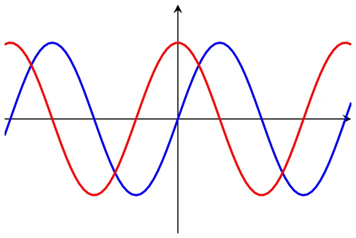

# Étude de fonctions

Ce chapitre remet en place les outils d'analyse : **continuité**, **dérivées**, **trigonométrie**, **primitives** et **intégrales**. En IA, ils servent à décrire une **fonction de coût** (combien le modèle se trompe) et à comprendre la **descente de gradient** (comment le modèle s'améliore).

## 1. Continuité

Une fonction est **continue** en un point $x_0$ si sa courbe n'a **pas de saut** en $x_0$ : on peut la tracer sans lever le crayon.

- Les **polynômes** ($x^2 - 3x + 1$, $5x^3 + x$...) sont continus sur $\mathbb{R}$ tout entier.
- Une **fraction** comme $\dfrac{1}{x-2}$ est continue partout où elle existe, c'est-à-dire sur $\mathbb{R} \setminus \{2\}$ (on enlève la valeur qui annule le dénominateur).
- $\ln$ est continue sur $]0, +\infty[$, et $e^x$ sur $\mathbb{R}$.
- Une fonction qui **n'est pas définie** en un point ne peut pas y être continue.

> [!info] Notation
> $\mathbb{R} \setminus \{2\}$ se lit « R privé de 2 » : tous les réels sauf 2.
>
> $]0, +\infty[$ : tous les réels strictement plus grands que 0. Un crochet tourné vers l'extérieur ($]0$) veut dire « 0 exclu », un crochet tourné vers l'intérieur ($[0$) veut dire « 0 inclus ».

### Trouver où une fonction est définie (et continue)

Dans ce chapitre, seuls deux cas créent des valeurs interdites :

| Ce qu'on voit | Valeurs interdites |
|---|---|
| un polynôme (somme de $a\,x^n$) | aucune : continu sur $\mathbb{R}$ |
| une fraction $\dfrac{A}{B}$ | celles où le dénominateur $B = 0$ |
| $\ln(\dots)$ | celles où ce qui est dans le $\ln$ est $\leq 0$ |

Le numérateur d'une fraction ne pose jamais problème, et un nombre seul (comme $-7$ dans $x^2 - 7$) n'interdit rien.

**Exemple résolu :** où sont continues $u(x) = 2x^3 - x + 9$, $v(x) = \dfrac{4}{x - 6}$ et $w(x) = \ln(x)$ ?

1. $u$ est un polynôme : pas de dénominateur, pas de $\ln$. Continue sur $\mathbb{R}$.
2. $v$ : le dénominateur est $x - 6$. On résout $x - 6 = 0$, donc $x = 6$. Vérification : $v(6) = \dfrac{4}{0}$, impossible. Continue sur $\mathbb{R} \setminus \{6\}$.
3. $w$ : $\ln(x)$ existe seulement si $x > 0$. On teste : $\ln 2$ existe, $\ln 0$ et $\ln(-1)$ n'existent pas. Continue sur $]0, +\infty[$ (0 exclu).

**À retenir :** pour une fraction, résous « dénominateur $= 0$ » ; pour un $\ln$, garde seulement les $x$ strictement positifs ; un polynôme n'a aucune valeur interdite.

### Continuité au raccord d'une fonction en morceaux

Une fonction peut être définie par **plusieurs formules** selon la valeur de $x$ (une à gauche d'un point, une autre à droite). Au point de raccord $x_0$, elle est continue si les **deux morceaux donnent la même valeur** en $x_0$ : les deux bouts de courbe se rejoignent.

**Exemple résolu :** $p(x) = x + 1$ si $x < 1$, et $p(x) = 2x$ si $x \geq 1$. Est-elle continue en 1 ?

1. Morceau de gauche en $x = 1$ : $1 + 1 = 2$.
2. Morceau de droite en $x = 1$ : $2 \times 1 = 2$.
3. Les deux valent 2 : pas de saut, $p$ est continue en 1.

Contre-exemple : $q(x) = 0$ si $x < 1$, et $q(x) = 5$ si $x \geq 1$. À gauche on arrive à 0, à droite on part de 5 : la courbe **saute** de 0 à 5, $q$ n'est pas continue en 1.

**À retenir :** continuité au raccord = calcule les deux formules au point de raccord ; égales = continue, différentes = saut.

En IA : une fonction de coût qui fait un saut brutal à un seuil rend l'optimisation difficile.

## 2. Dérivabilité

Une fonction est **dérivable** en $x_0$ si sa courbe a une **tangente bien définie** en ce point : pas de pointe, pas de saut. Le **nombre dérivé** $f'(x_0)$ est la **pente** de cette tangente.

$$f'(x_0) = \lim_{h \to 0} \frac{f(x_0 + h) - f(x_0)}{h}$$

Cette formule dit : « on regarde de combien $f$ monte quand on avance un tout petit peu ($h$), divisé par ce petit pas ».

### La pente d'une droite

Une droite $y = a\,x + b$ a pour pente (on dit aussi **coefficient directeur**) le nombre $a$ devant $x$ :

- $a > 0$ : la droite monte ; $a < 0$ : elle descend ; $a = 0$ : elle est horizontale.
- Quand $x$ augmente de 1, $y$ change de $a$.

**Exemple résolu :** pente de $y = 5 - 2x$.

1. On réécrit dans l'ordre : $y = -2x + 5$.
2. Le nombre devant $x$ est $-2$ : la pente vaut $-2$, la droite descend.
3. Vérification : en $x = 0$, $y = 5$ ; en $x = 1$, $y = 3$. On a bien perdu 2.

**À retenir :** pente d'une droite = le nombre devant $x$, avec son signe.

> [!warning] Dérivable ⇒ continue, mais pas l'inverse
> Une fonction dérivable est forcément continue. Mais une fonction continue peut ne pas être dérivable : $|x|$ est continue en 0, mais sa courbe fait une **pointe** (pente $-1$ à gauche, $+1$ à droite), donc pas de tangente unique.

### Dérivabilité au raccord : comparer les pentes

Pour une fonction en morceaux, elle est dérivable au raccord $x_0$ si :

1. elle est **continue** en $x_0$ (même valeur des deux côtés) ;
2. la **pente à gauche** (dérivée du morceau de gauche, calculée en $x_0$) est **égale** à la **pente à droite** (dérivée du morceau de droite, calculée en $x_0$).

Si les pentes diffèrent, la courbe change brusquement de direction : elle fait une **pointe** (un coude), et il n'y a pas de tangente unique.

**Exemple résolu 1 (pointe) :** $s(x) = x$ si $x < 2$, et $s(x) = 4 - x$ si $x \geq 2$.

| Étape | Gauche ($x$) | Droite ($4 - x$) |
|---|---|---|
| Valeur en 2 | $2$ | $4 - 2 = 2$ |
| Dérivée du morceau | $1$ | $-1$ |
| Pente en 2 | $1$ | $-1$ |

Même valeur (2) : $s$ est continue en 2. Mais pentes différentes ($1 \neq -1$) : la courbe monte puis redescend d'un coup, c'est une pointe en « Λ ». $s$ n'est **pas dérivable** en 2.

**Exemple résolu 2 (raccord lisse) :** $t(x) = 2x + 1$ si $x < 1$, et $t(x) = x^2 + 2$ si $x \geq 1$.

| Étape | Gauche ($2x + 1$) | Droite ($x^2 + 2$) |
|---|---|---|
| Valeur en 1 | $3$ | $1 + 2 = 3$ |
| Dérivée du morceau | $2$ | $2x$ |
| Pente en 1 | $2$ | $2 \times 1 = 2$ |

Même valeur **et** même pente : le raccord est lisse, $t$ est **dérivable** en 1 avec $t'(1) = 2$.

Attention : pour la pente à droite, on dérive d'abord ($2x$), **puis** on remplace $x$ par le point de raccord ($2 \times 1$). S'arrêter à « $2x$ » sans remplacer est une erreur fréquente.

**À retenir :** dérivable au raccord = même valeur **et** même pente des deux côtés ; une pointe n'empêche pas la continuité, mais empêche la dérivabilité.

### Dérivées à connaître

| $f(x)$ | $f'(x)$ |
|---|---|
| $c$ (constante) | $0$ |
| $x^n$ | $n\,x^{n-1}$ |
| $e^x$ | $e^x$ |
| $\ln x$ | $\dfrac{1}{x}$ |
| $\sin x$ | $\cos x$ |
| $\cos x$ | $-\sin x$ |
| $\tan x$ | $1 + \tan^2 x = \dfrac{1}{\cos^2 x}$ |

Pourquoi la dérivée d'une constante vaut 0 : la courbe de $f(x) = 4$ est une droite horizontale, elle ne monte ni ne descend, sa pente est nulle.

### Règles de calcul

$$(u + v)' = u' + v' \qquad (k\,u)' = k\,u'$$

$$(uv)' = u'v + uv' \qquad \left(\frac{u}{v}\right)' = \frac{u'v - uv'}{v^2}$$

$$\big(u(v(x))\big)' = v'(x) \times u'\big(v(x)\big)$$

La dernière règle est celle de la **composée** : on dérive « l'extérieur » en gardant « l'intérieur », puis on multiplie par la dérivée de l'intérieur.

### Dériver un polynôme, terme par terme

On applique $(u + v)' = u' + v'$ : chaque terme se dérive séparément. Pour un terme $k\,x^n$, le nombre $k$ reste devant et $(x^n)' = n\,x^{n-1}$, donc $(k\,x^n)' = k \times n\,x^{n-1}$.

**Exemple résolu :** $f(x) = 2x^4 - x^3 + 6x - 9$.

| Terme | Calcul | Dérivée |
|---|---|---|
| $2x^4$ | $2 \times 4x^3$ | $8x^3$ |
| $-x^3$ | $-1 \times 3x^2$ | $-3x^2$ |
| $6x$ | $6 \times 1$ | $6$ |
| $-9$ | constante | $0$ |

Donc $f'(x) = 8x^3 - 3x^2 + 6$.

Même chose avec une fraction devant : $\left(\dfrac{x^3}{3}\right)' = \dfrac{1}{3} \times 3x^2 = x^2$ (le 3 de la puissance se simplifie avec le 3 du dénominateur).

**À retenir :** coefficient × puissance, la puissance baisse de 1, et la constante disparaît. Un $k\,x$ se dérive en $k$ (pas en 0).

### La règle du produit, pas à pas

Méthode : repérer $u$ et $v$, écrire $u'$ et $v'$ dans un petit tableau, puis assembler $u'v + uv'$.

**Exemple résolu :** $(x^2 \ln x)'$ pour $x > 0$.

| | Fonction | Dérivée |
|---|---|---|
| $u$ | $x^2$ | $u' = 2x$ |
| $v$ | $\ln x$ | $v' = \dfrac{1}{x}$ |

1. $u'v = 2x \ln x$.
2. $uv' = x^2 \times \dfrac{1}{x} = x$.
3. $(x^2 \ln x)' = 2x\ln x + x$.

Deuxième exemple : $(x \sin x)'$ avec $u = x$ ($u' = 1$) et $v = \sin x$ ($v' = \cos x$) : $1 \times \sin x + x \cos x = \sin x + x\cos x$.

**À retenir :** un produit donne **deux** termes, $u'v + uv'$ ; jamais $u' \times v'$.

### La règle du quotient, pas à pas

**Exemple résolu :** $\left(\dfrac{x+1}{x-1}\right)'$ pour $x \neq 1$.

| | Fonction | Dérivée |
|---|---|---|
| $u$ (haut) | $x + 1$ | $u' = 1$ |
| $v$ (bas) | $x - 1$ | $v' = 1$ |

1. $u'v = 1 \times (x - 1) = x - 1$.
2. $uv' = (x + 1) \times 1 = x + 1$.
3. Numérateur : $(x - 1) - (x + 1) = x - 1 - x - 1 = -2$ (le moins s'applique à **toute** la parenthèse).
4. Dénominateur : $v^2 = (x - 1)^2$.
5. Résultat : $\dfrac{-2}{(x-1)^2}$.

Cas particulier, haut constant : $\left(\dfrac{1}{v}\right)' = \dfrac{0 \times v - 1 \times v'}{v^2} = \dfrac{-v'}{v^2}$. Exemple : $\left(\dfrac{1}{x^2 + 4}\right)' = \dfrac{-2x}{(x^2+4)^2}$.

**À retenir :** quotient = $\dfrac{u'v - uv'}{v^2}$, on commence par $u'v$ (inverser l'ordre change le signe) et le bas est **au carré**.

### La règle de la composée, pas à pas

Une **composée** est une fonction « dans » une autre : dans $e^{3x^2}$, l'extérieur est $e^{\square}$ et l'intérieur est $3x^2$. Les cas les plus utiles :

| Fonction | Dérivée |
|---|---|
| $e^{v}$ | $v' \times e^{v}$ |
| $\ln(v)$ | $\dfrac{v'}{v}$ |
| $v^n$ | $n\,v^{n-1} \times v'$ |
| $\sin(v)$ | $v' \times \cos(v)$ |
| $\cos(v)$ | $-v' \times \sin(v)$ |

**Exemple résolu 1 :** $(e^{3x^2})'$.

1. Extérieur : $e^{\square}$, qui se dérive en lui-même.
2. Intérieur : $v = 3x^2$, de dérivée $v' = 6x$.
3. Résultat : $6x\,e^{3x^2}$ (l'exposant ne change pas).

**Exemple résolu 2 :** $(\ln(5x - 2))'$. Intérieur $v = 5x - 2$, $v' = 5$ : $\dfrac{5}{5x - 2}$.

**Exemple résolu 3 :** $((3x - 1)^5)'$. Extérieur $\square^5$, de dérivée $5\,\square^4$ ; intérieur $3x - 1$, de dérivée 3 : $5(3x-1)^4 \times 3 = 15(3x-1)^4$. Pas besoin de développer la parenthèse.

**À retenir :** composée = dérivée de l'extérieur (intérieur recopié tel quel) **×** dérivée de l'intérieur.

> [!tip] Lien avec l'IA
> La **descente de gradient** calcule la dérivée (le gradient) de la fonction de perte pour savoir dans quel sens corriger le modèle. Si la fonction n'est pas dérivable en un point, le gradient n'y existe pas. C'est pour ça que ReLU ($\max(0, x)$) utilise une convention en 0.

```anim
tangente
```

### Dérivée, sens de variation et minimum

La dérivée $f'(x_0)$ est la pente de la tangente en $x_0$. Son **signe** dit comment se comporte la courbe :

| Signe de $f'(x)$ | La courbe... |
|---|---|
| $f'(x) > 0$ | monte |
| $f'(x) < 0$ | descend |
| $f'(x) = 0$ | a une tangente horizontale (souvent un minimum ou un maximum) |

**Méthode pour trouver un minimum :**

1. Calculer $f'(x)$.
2. Résoudre $f'(x) = 0$ : on obtient l'abscisse $x_0$, **où** se trouve le minimum.
3. Vérifier le signe de $f'$ : négatif avant $x_0$ (ça descend), positif après (ça remonte), c'est bien un minimum.
4. Calculer $f(x_0)$ dans la fonction de **départ** : c'est la **valeur** du minimum, **combien** il vaut.

**Exemple résolu :** $f(x) = x^2 + 6x + 5$.

1. $f'(x) = 2x + 6$.
2. $2x + 6 = 0$, donc $2x = -6$, donc $x = -3$.
3. Signe :

| $x$ | $-4$ | $-3$ | $-2$ |
|---|---|---|---|
| $f'(x) = 2x + 6$ | $-2$ (descend) | $0$ | $+2$ (monte) |

4. $f(-3) = (-3)^2 + 6 \times (-3) + 5 = 9 - 18 + 5 = -4$.

Le minimum est atteint en $x = -3$ et vaut $-4$.

Calculer une pente en un point : on remplace $x$ **dans $f'$**, pas dans $f$. Ici $f'(0) = 6$ (pente), alors que $f(0) = 5$ (valeur).

**Le lien avec la descente de gradient :** en $x = 0$, la pente vaut $6 > 0$, la courbe monte vers la droite. Pour faire baisser $f$, il faut donc aller vers la **gauche** (diminuer $x$). L'algorithme fait exactement ça : il avance dans le sens **opposé** au signe de la dérivée, $x \leftarrow x - \eta\,f'(x)$, avec $\eta$ un petit pas.

**À retenir :** $f'(x) = 0$ donne **où** est le minimum, $f(x_0)$ donne **combien** il vaut ; dérivée positive = on recule, dérivée négative = on avance.

## 3. Trigonométrie

### Le cercle trigonométrique

On prend un cercle de rayon 1 centré à l'origine. Un angle $\theta$ (en radians) donne un point du cercle : on part du point $(1, 0)$ et on tourne dans le sens inverse des aiguilles d'une montre. Les coordonnées de ce point sont :

$$(\cos\theta, \ \sin\theta)$$

- le **cosinus** est l'**abscisse** (la coordonnée horizontale) ;
- le **sinus** est l'**ordonnée** (la coordonnée verticale).

Un tour complet vaut $2\pi$, un demi-tour $\pi$, un quart de tour $\dfrac{\pi}{2}$.

| Angle | Tour effectué | Point du cercle | $\cos$ | $\sin$ |
|---|---|---|---|---|
| $0$ | départ | $(1, 0)$, à droite | $1$ | $0$ |
| $\frac{\pi}{2}$ | un quart | $(0, 1)$, en haut | $0$ | $1$ |
| $\pi$ | un demi | $(-1, 0)$, à gauche | $-1$ | $0$ |
| $\frac{3\pi}{2}$ | trois quarts | $(0, -1)$, en bas | $0$ | $-1$ |
| $2\pi$ | un tour complet | $(1, 0)$, retour au départ | $1$ | $0$ |

**Exemple résolu :** que valent $\sin(\pi)$ et $\cos\left(\dfrac{3\pi}{2}\right)$ ?

1. $\pi$ est un demi-tour : on arrive tout à gauche, en $(-1, 0)$. Le sinus est l'ordonnée : $\sin(\pi) = 0$.
2. $\dfrac{3\pi}{2}$ est trois quarts de tour : on arrive tout en bas, en $(0, -1)$. Le cosinus est l'abscisse : $\cos\left(\dfrac{3\pi}{2}\right) = 0$.

**À retenir :** place le point sur le cercle, puis lis l'abscisse pour $\cos$ et l'ordonnée pour $\sin$ (attention aux signes : à gauche $\cos < 0$, en bas $\sin < 0$).

### Propriétés

- $\sin$ et $\cos$ sont définies et continues sur $\mathbb{R}$, à valeurs dans $[-1, 1]$, et **périodiques** de période $2\pi$ (elles se répètent tous les $2\pi$) : $\cos(x + 2\pi) = \cos x$. Par exemple $\sin\left(2\pi + \dfrac{\pi}{2}\right) = \sin\left(\dfrac{\pi}{2}\right) = 1$.
- $\tan x = \dfrac{\sin x}{\cos x}$ n'est **pas définie** quand $\cos x = 0$, c'est-à-dire en $x = \dfrac{\pi}{2} + k\pi$ ($k$ entier). Sur $[0, 2\pi]$ : en $\dfrac{\pi}{2}$ et $\dfrac{3\pi}{2}$.



Sur l'image : la courbe bleue (sinus) passe par 0 au centre, la rouge (cosinus) y est à son maximum 1, car $\sin 0 = 0$ et $\cos 0 = 1$. Les deux vagues restent toujours entre $-1$ et $1$ et recommencent le même motif tous les $2\pi$ : c'est ça, être **périodique**. Le cosinus, c'est le sinus décalé d'un quart de tour.

| $x$ | $0$ | $\dfrac{\pi}{2}$ | $\pi$ | $\dfrac{3\pi}{2}$ | $2\pi$ |
|---|---|---|---|---|---|
| $\sin x$ | $0$ | $1$ | $0$ | $-1$ | $0$ |
| $\cos x$ | $1$ | $0$ | $-1$ | $0$ | $1$ |

**Exemple résolu :** où $\tan$ n'est-elle pas définie sur $[-\pi, \pi]$ ?

1. On cherche les angles où $\cos x = 0$ : ce sont les points du haut et du bas du cercle, $x = \dfrac{\pi}{2} + k\pi$.
2. On essaie des valeurs de $k$ : $k = 0$ donne $\dfrac{\pi}{2}$ (dans l'intervalle), $k = -1$ donne $-\dfrac{\pi}{2}$ (dans l'intervalle), $k = 1$ donne $\dfrac{3\pi}{2}$ (trop grand), $k = -2$ donne $-\dfrac{3\pi}{2}$ (trop petit).
3. Réponse : $\left\{-\dfrac{\pi}{2}, \dfrac{\pi}{2}\right\}$.

En $0$ ou en $\pi$, c'est $\sin$ qui vaut 0 : $\tan$ vaut alors 0, elle existe.

**À retenir :** $\tan$ est interdite là où $\cos = 0$ ; liste les $\dfrac{\pi}{2} + k\pi$ et garde ceux qui sont dans l'intervalle.

### Dériver sin et cos

$(\sin x)' = \cos x$ et $(\cos x)' = -\sin x$. Pour retenir le signe : $\sin \to \cos \to -\sin \to -\cos \to \sin$, chaque dérivation avance d'une case.

Exemple (composée) : $f(x) = \sin(3x^2)$, intérieur $3x^2$ : $f'(x) = 6x\cos(3x^2)$.

**Exemple résolu :** $g(x) = \sin x + \cos(5x)$.

| Terme | Intérieur et sa dérivée | Dérivée du terme |
|---|---|---|
| $\sin x$ | pas d'intérieur | $\cos x$ |
| $\cos(5x)$ | $v = 5x$, $v' = 5$ | $-5\sin(5x)$ |

Donc $g'(x) = \cos x - 5\sin(5x)$.

**À retenir :** le moins n'apparaît qu'en dérivant $\cos$ ; un intérieur $a\,x$ fait sortir un facteur $a$ devant.

En IA : saisonnalité d'une série temporelle, signaux audio, encodages de position des Transformers.

## 4. Primitives

$F$ est une **primitive** de $f$ si $F' = f$. C'est l'opération inverse de la dérivée.

Il y en a une infinité : si $F$ est une primitive, $F + C$ aussi, pour toute **constante** $C$ (car la dérivée de $C$ vaut 0). Par exemple $x^2$, $x^2 + 1$ et $x^2 - 50$ sont toutes des primitives de $2x$ : deux primitives d'une même fonction diffèrent toujours d'une constante.

| $f(x)$ | Une primitive $F(x)$ |
|---|---|
| $k$ (constante) | $kx$ |
| $x^n$ ($n \neq -1$) | $\dfrac{x^{n+1}}{n+1}$ |
| $\dfrac{1}{x}$ ($x > 0$) | $\ln x$ |
| $e^x$ | $e^x$ |
| $e^{ax}$ ($a \neq 0$) | $\dfrac{1}{a}e^{ax}$ |
| $\sin x$ | $-\cos x$ |
| $\cos x$ | $\sin x$ |

Deux règles en plus : une primitive d'une **somme** est la somme des primitives, et un **facteur constant** reste devant (primitive de $k\,f$ = $k \times F$).

> [!warning] Le cas $n = -1$
> $x^{-1} = \dfrac{1}{x}$ n'a pas pour primitive $\dfrac{x^0}{0}$ (division par zéro !) mais $\ln x$.

> [!tip] Vérifier une primitive
> Dérive ta réponse : tu dois retomber exactement sur $f$.

**Exemple résolu 1 :** une primitive de $f(x) = 6x^2 + 5$.

| Terme | Calcul | Primitive |
|---|---|---|
| $6x^2$ | $6 \times \dfrac{x^3}{3}$ | $2x^3$ |
| $5$ | constante $k$ donne $kx$ | $5x$ |

$F(x) = 2x^3 + 5x$. Vérification : $F'(x) = 6x^2 + 5$. (Écrire $5$ au lieu de $5x$ serait faux : la dérivée de $5$ vaut 0.)

**Exemple résolu 2 :** une primitive de $g(x) = \dfrac{3}{x} + 2\cos x$ (pour $x > 0$).

- $\dfrac{3}{x} = 3 \times \dfrac{1}{x}$, primitive $3\ln x$.
- $2\cos x$, primitive $2\sin x$ (car $(\sin x)' = \cos x$).

$G(x) = 3\ln x + 2\sin x$. Vérification : $G'(x) = \dfrac{3}{x} + 2\cos x$.

**Exemple résolu 3 :** une primitive de $-\cos x$. Comme $(\sin x)' = \cos x$, on a $(-\sin x)' = -\cos x$ : la primitive est $-\sin x$. Pour les signes avec $\sin$ et $\cos$, lis toujours le tableau des dérivées à l'envers et vérifie.

**Exemple résolu 4 :** une primitive de $e^{2x}$. Avec $a = 2$ : $\dfrac{1}{2}e^{2x}$. Vérification : $\left(\dfrac{1}{2}e^{2x}\right)' = \dfrac{1}{2} \times 2e^{2x} = e^{2x}$. On **divise** par $a$ pour la primitive parce qu'en dérivant, on **multiplie** par $a$. De même, $\dfrac{1}{0{,}5} = 2$, donc une primitive de $e^{0{,}5x}$ est $2e^{0{,}5x}$.

**À retenir :** monte la puissance et divise par la nouvelle, $\dfrac{1}{x} \to \ln x$, $e^{ax} \to \dfrac{1}{a}e^{ax}$, puis vérifie toujours en dérivant.

## 5. Intégrales

$$\int_a^b f(x)\,dx = F(b) - F(a) = \Big[F(x)\Big]_a^b$$

où $F$ est n'importe quelle primitive de $f$ (la constante $C$ s'annule dans la soustraction). On fait toujours « borne du **haut** moins borne du **bas** ».

Deux valeurs reviennent souvent aux bornes : $e^0 = 1$ (pas 0) et $\ln 1 = 0$.

L'intégrale est l'**aire algébrique** entre la courbe et l'axe horizontal : les parties au-dessus de l'axe comptent en positif, celles en dessous en négatif.

Exemple : $\displaystyle\int_1^3 (2x + 1)\,dx$. Une primitive est $F(x) = x^2 + x$, donc $F(3) - F(1) = 12 - 2 = 10$.

Exemple d'aire : $\displaystyle\int_0^4 x\,dx = \left[\frac{x^2}{2}\right]_0^4 = 8$, c'est l'aire du triangle rectangle de base 4 et de hauteur 4 : $\dfrac{4 \times 4}{2} = 8$.

**Exemple résolu (avec $e^0$) :** $\displaystyle\int_0^1 (e^x + 2x)\,dx$.

1. Primitive : $F(x) = e^x + x^2$. Vérification : $F'(x) = e^x + 2x$.
2. $F(1) = e + 1$.
3. $F(0) = e^0 + 0 = 1$.
4. $F(1) - F(0) = e + 1 - 1 = e$.

**Exemple résolu (avec $\ln$) :** $\displaystyle\int_1^{e} \dfrac{1}{x}\,dx = \ln e - \ln 1 = 1 - 0 = 1$. Faire « $e - 1$ » (soustraire les bornes sans primitive) serait faux.

**Exemple résolu (aire négative) :** $\displaystyle\int_{\pi}^{2\pi} \sin x\,dx$.

1. Primitive : $-\cos x$.
2. En $2\pi$ : $-\cos(2\pi) = -1$.
3. En $\pi$ : $-\cos(\pi) = -(-1) = 1$.
4. $-1 - 1 = -2$.

Le résultat est négatif, et c'est normal : entre $\pi$ et $2\pi$, $\sin x \leq 0$, la courbe est **sous** l'axe. Ce n'est pas une erreur, et les bornes sont dans le bon ordre ($\pi < 2\pi$). Avec beaucoup de signes moins, écris chaque valeur entre parenthèses : $(-1) - (1)$.

**À retenir :** primitive, puis $F(\text{haut}) - F(\text{bas})$ ; une courbe sous l'axe donne une intégrale négative.

```anim
integrale
```

### Quantité accumulée

Quand une fonction est un **débit** (des euros **par jour**, des litres **par minute**), son intégrale entre deux instants donne le **total accumulé** pendant cette période : on additionne la quantité de chaque petit instant.

Ne pas confondre :

| Ce qu'on calcule | Ce que ça donne |
|---|---|
| $r(t_0)$ | le débit à un seul instant $t_0$ |
| $r'(t_0)$ | la vitesse à laquelle le débit change |
| $\displaystyle\int_a^b r(t)\,dt$ | le total accumulé entre $a$ et $b$ |

**Exemple résolu :** une citerne se remplit avec un débit $r(t) = 50\,e^{0{,}1t}$ litres par minute. Combien de litres entrent pendant les 10 premières minutes ?

1. Total = $\displaystyle\int_0^{10} 50\,e^{0{,}1t}\,dt$ (bornes 0 et 10, fonction $r$ en entier, avec le 50).
2. Primitive de $e^{0{,}1t}$ : $\dfrac{1}{0{,}1}e^{0{,}1t} = 10\,e^{0{,}1t}$.
3. $\displaystyle\int_0^{10} 50\,e^{0{,}1t}\,dt = 50 \times \Big[10\,e^{0{,}1t}\Big]_0^{10} = 500\,(e^{1} - e^{0}) = 500\,(e - 1)$.
4. Valeur approchée : $500 \times 1{,}718 \approx 859$ litres.

Le piège : oublier de soustraire $e^0 = 1$, ce qui donnerait $500e \approx 1\,359$.

**À retenir :** total accumulé = intégrale du débit sur la période ; le 1 de $e^0$ ne disparaît pas.

> [!tip] Lien avec l'IA
> L'intégrale mesure une **quantité accumulée** : un coût cumulé dans le temps, un revenu total à partir d'un revenu par jour, l'aire sous une courbe ROC (AUC), une probabilité (aire sous une densité).

## Méthode : calculer une intégrale

1. Trouver une primitive $F$ de $f$ (et la vérifier en dérivant).
2. Calculer $F(b)$ puis $F(a)$.
3. Faire la différence $F(b) - F(a)$.

## À retenir

- Continue = pas de saut. Dérivable = tangente unique. Dérivable ⇒ continue, **pas l'inverse**.
- Au raccord d'une fonction en morceaux : même valeur = continue ; même valeur **et** même pente = dérivable.
- Produit : $u'v + uv'$. Quotient : $\dfrac{u'v - uv'}{v^2}$. Composée : $v' \times u'(v)$.
- $f'(x) = 0$ donne l'abscisse du minimum, $f(x_0)$ sa valeur.
- Sur le cercle : $\cos$ = abscisse, $\sin$ = ordonnée. $(\sin)' = \cos$, $(\cos)' = -\sin$, $\tan$ non définie en $\dfrac{\pi}{2} + k\pi$.
- Primitive à une constante près ; intégrale $= F(b) - F(a)$ = aire algébrique ; intégrale d'un débit = total accumulé.

> [!warning] Pièges fréquents
> - Oublier la dérivée de l'intérieur dans une composée : $(e^{3x})' = 3e^{3x}$, pas $e^{3x}$.
> - Écrire $(uv)' = u'v'$ : c'est faux.
> - Appliquer la formule $\dfrac{x^{n+1}}{n+1}$ avec $n = -1$.
> - Oublier qu'une aire sous l'axe compte en négatif.
> - Écrire $e^0 = 0$ : c'est $e^0 = 1$.
> - Confondre l'abscisse du minimum ($x_0$) et sa valeur ($f(x_0)$).
