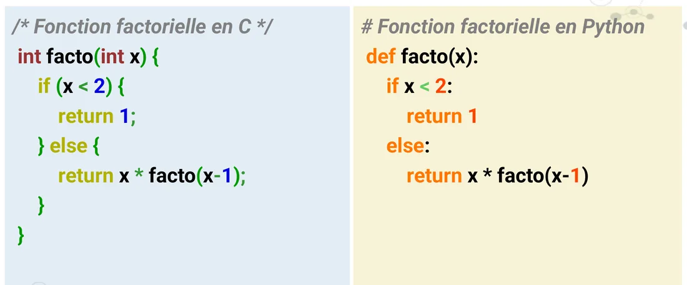
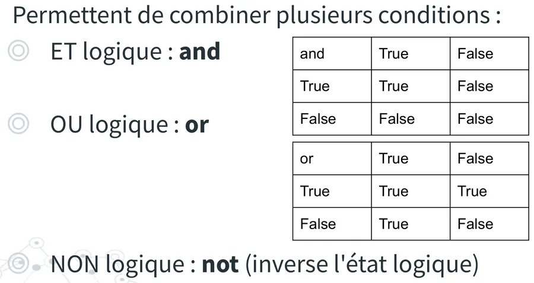
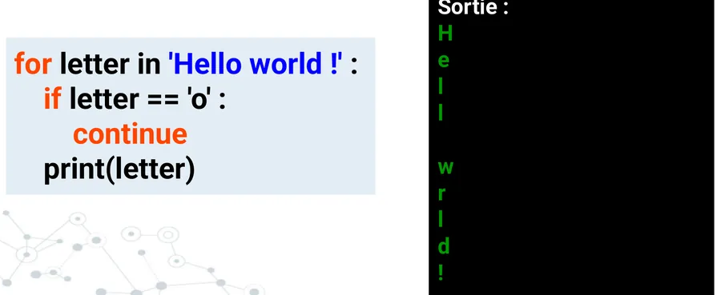
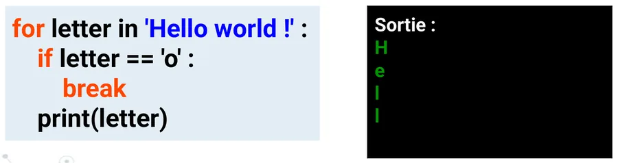
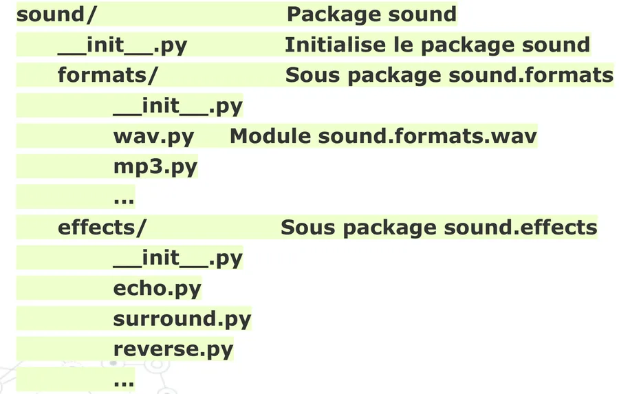

# Les bases de Python

## 1. Python en bref

Python est un langage :

- **interprété** : un programme, l'interpréteur, lit ton fichier `.py` et l'exécute directement. Pas d'étape de compilation, et le même fichier tourne sur Windows, Linux ou macOS ;
- **multi-paradigmes** : on peut écrire des suites d'instructions rangées dans des fonctions (style impératif) ou des classes (style objet, chapitre 4) ;
- à **typage dynamique fort** : on ne déclare pas les types, ils sont décidés à l'exécution. « Fort » : Python refuse de mélanger des types incompatibles (`"3" + 4` est une erreur) ;
- à **gestion automatique de la mémoire** : pas de `malloc` ni de `free`, un ramasse-miettes libère ce qui ne sert plus.

Créé par Guido van Rossum (première ébauche à Noël 1989, version publique en 1991). **Python 3** (2008) n'est pas compatible avec Python 2 : tout le cours est en Python 3.

On s'en sert pour les **scripts** (automatiser des tâches), les **plugins**, le **prototypage** et le **web**.

**Exemple résolu : que veut dire « typage fort » ?**

```python
texte = "3"
nombre = 4
try:
    print(texte + nombre)
except TypeError:
    print("TypeError : on ne colle pas une str et un int")
print(int(texte) + nombre)
print(texte + str(nombre))
```

1. `texte + nombre` : à gauche une `str`, à droite un `int`. Python ne devine pas si tu veux additionner ou coller : il lève une `TypeError` (le `try` / `except`, vu à la section 14, attrape l'erreur pour que le programme continue).
2. `int(texte)` transforme `"3"` en `3` : `3 + 4` vaut `7`.
3. `str(nombre)` transforme `4` en `"4"` : `"3" + "4"` colle les deux textes, `"34"`.

**À retenir :** Python ne convertit jamais tout seul entre texte et nombre : c'est toi qui écris `int(...)` ou `str(...)`.

## 2. La syntaxe

```python
def facto(x):
    if x < 2:
        return 1
    else:
        return x * facto(x - 1)


print(facto(5))
```

Sur l'image : la même fonction factorielle écrite en C (à gauche) et en Python (à droite). En C, ce sont les accolades `{ }` et les `;` qui délimitent les blocs ; en Python, il n'y a plus que les `:` et le décalage des lignes.



- **Une instruction par ligne**, pas de point-virgule.
- Les **blocs** se font par **indentation** (4 espaces), pas avec des accolades. Une ligne qui ouvre un bloc (`def`, `if`, `for`, `while`...) se termine par `:`.
- Les **commentaires** commencent par `#`.
- Les **noms** commencent par une lettre ou `_`, puis lettres, chiffres et `_`. La casse compte (`age` et `Age` sont différents).

Python n'a **ni** accolades `{ }`, **ni** `begin` / `end`, **ni** point-virgule obligatoire : seul le décalage (l'indentation) dit quelles lignes font partie d'un bloc.

> [!warning] L'indentation a un sens
> Une ligne décalée au mauvais niveau change de bloc. Un décalage incohérent donne une `IndentationError`. Ne mélange jamais tabulations et espaces.

**Exemple résolu : la même ligne, deux décalages, deux résultats.**

```python
for i in range(3):
    print("tour", i)
    print("dans la boucle")

for i in range(3):
    print("tour", i)
print("après la boucle")
```

1. Première boucle : les deux `print` sont décalés de 4 espaces sous le `for`. Ils font **tous les deux** partie de la boucle : « dans la boucle » s'affiche 3 fois.
2. Deuxième boucle : seul `print("tour", i)` est décalé. `print("après la boucle")` est revenu au bord gauche : il est **après** la boucle et ne s'affiche qu'**une** fois, quand la boucle est finie.

**À retenir :** pour savoir à quel bloc appartient une ligne, regarde de combien d'espaces elle est décalée, et remonte jusqu'à la ligne terminée par `:` juste au-dessus avec un décalage plus petit.

> [!tip] Conventions de nommage (PEP 8)
> Variables et fonctions en `snake_case`, classes en `CamelCase`, constantes en `MAJUSCULES`.

## 3. Types simples et typage dynamique

| Type | Contenu | Exemple |
|---|---|---|
| `int` | entier de taille illimitée | `a = 1` |
| `float` | nombre à virgule | `b = 1.4` |
| `bool` | `True` ou `False` (avec majuscule) | `c = True` |
| `str` | texte, **non modifiable** | `d = "Hello"` |

```python
a = 1
print(type(a))
a = 4.2
print(type(a))
print(2 ** 100)

d, e = "toto", False
d, e = e, d
print(d, e)
```

Une variable n'a pas de type : c'est la **valeur** qu'elle contient qui en a un. `d, e = e, d` échange deux valeurs sans variable temporaire.

**Le même exemple, pas à pas :**

| Ligne | Ce qui se passe | Affiché |
|---|---|---|
| `a = 1` | `a` désigne l'entier 1 | |
| `print(type(a))` | la valeur 1 est un `int` | `<class 'int'>` |
| `a = 4.2` | `a` désigne maintenant un nombre à virgule : le nom est le même, la valeur a changé de type | |
| `print(type(a))` | 4.2 est un `float` | `<class 'float'>` |
| `print(2 ** 100)` | un `int` n'a pas de limite de taille : le résultat (31 chiffres) est exact | `1267650600228229401496703205376` |
| `d, e = "toto", False` | `d` reçoit `"toto"`, `e` reçoit `False` | |
| `d, e = e, d` | Python calcule d'abord la partie droite, `(False, "toto")`, puis la range dans `d` et `e` | |
| `print(d, e)` | | `False toto` |

**À retenir :** le type appartient à la valeur, pas au nom : `type(x)` te dit ce que contient `x` **en ce moment**.

### Convertir d'un type à l'autre

| Conversion | Exemple | Résultat |
|---|---|---|
| texte → entier | `int("42")` | `42` |
| texte → nombre à virgule | `float("2.5")` | `2.5` |
| nombre → texte | `str(20)` | `"20"` |
| à virgule → entier | `int(3.9)` | `3` (on **coupe** la partie après la virgule, pas d'arrondi) |
| arrondi | `round(3.14159, 2)` | `3.14` |

```python
age = "20"
print(int(age) + 10)
print(str(7) + " jours")
print(int(3.9), round(3.9), round(2.675, 1))
try:
    int("douze")
except ValueError:
    print("int('douze') lève une ValueError")
```

Pas à pas : `int("20") + 10` vaut `30` ; `str(7) + " jours"` colle deux textes, `"7 jours"` ; `int(3.9)` coupe et donne `3`, alors que `round(3.9)` arrondit à `4` ; `round(2.675, 1)` garde un chiffre après la virgule, `2.7`. Enfin `"douze"` n'est pas écrit avec des chiffres : `int` ne sait pas le lire et lève une `ValueError`.

**À retenir :** `int()`, `float()`, `str()` fabriquent une nouvelle valeur du bon type ; `int()` coupe, `round()` arrondit.

## 4. Opérateurs

| Opération | Exemple | Résultat |
|---|---|---|
| `+`, `-`, `*` | `10 + 4`, `10 - 4`, `10 * 4` | `14`, `6`, `40` |
| `/` division | `10 / 4` | `2.5` |
| `//` quotient | `10 // 4` | `2` |
| `%` reste | `10 % 4` | `2` |
| `**` puissance | `10 ** 4` | `10000` |

```python
print(10 / 2)
print(10 // 2.5)
print(-7 // 2, -7 % 2)
print(0.1 + 0.2)
```

> [!warning] Pièges
> - `/` donne **toujours** un `float` : `10 / 2` vaut `5.0`.
> - `//` donne un `float` dès qu'un des nombres est un `float` : `10 // 2.5` vaut `4.0`.
> - `//` arrondit vers le bas : `-7 // 2` vaut `-4`.
> - Les `float` sont approximatifs : `0.1 + 0.2` ne vaut pas exactement `0.3`.

**Le même exemple, pas à pas :**

1. `10 / 2` : la division `/` donne un `float` **même quand elle tombe juste** : `5.0`, pas `5`.
2. `10 // 2.5` : dans 10, combien de fois 2.5 ? 4 fois tout juste (4 × 2.5 = 10). Comme 2.5 est un `float`, le quotient est écrit en `float` : `4.0`.
3. `-7 // 2` : -7 / 2 = -3.5. `//` prend l'entier **juste en dessous** (vers le bas, pas vers zéro) : `-4`. Le reste suit : -7 = 2 × (-4) + **1**, donc `-7 % 2` vaut `1`.
4. `0.1 + 0.2` : 0.1 et 0.2 ne s'écrivent pas exactement en binaire, le résultat affiché est `0.30000000000000004`.

**À retenir :** `/` donne toujours un `float` ; `//` et `%` vont ensemble : `a == b * (a // b) + a % b`.

### Quotient et reste : découper une quantité

`//` dit **combien de paquets entiers** on peut faire, `%` dit **ce qui reste** une fois les paquets faits. C'est la méthode pour convertir dans des unités plus grandes.

**Exemple résolu : 4000 minutes, c'est combien de jours, d'heures et de minutes ?**

Un jour = 24 × 60 = 1440 minutes, une heure = 60 minutes.

| Étape | Calcul | Résultat |
|---|---|---|
| 1. jours entiers | `4000 // 1440` | `2` (2 × 1440 = 2880) |
| 2. minutes qui restent | `4000 % 1440` | `1120` (4000 − 2880) |
| 3. heures entières dans ce reste | `1120 // 60` | `18` (18 × 60 = 1080) |
| 4. minutes qui restent encore | `1120 % 60` | `40` (1120 − 1080) |

Vérification dans l'autre sens : 2 × 1440 + 18 × 60 + 40 = 2880 + 1080 + 40 = 4000.

```python
total = 4000
jours = total // 1440
reste = total % 1440
heures = reste // 60
minutes = reste % 60
print(jours, heures, minutes)
print(jours * 1440 + heures * 60 + minutes)
```

**À retenir :** pour découper, prends le quotient `//` par la plus grande unité, puis recommence avec le reste `%` ; pour revenir en arrière, multiplie chaque morceau par la taille de son unité et additionne.

### Priorité des opérations et pièges de notation

Comme en maths : `**` d'abord, puis `*`, `/`, `//`, `%`, puis `+` et `-`. Les parenthèses passent avant tout.

```python
print(2 + 3 * 4 ** 2)
print((2 + 3) * 4)
print(12 + 8 / 2, (12 + 8) / 2)
print(2 ** 10, pow(2, 10), 2 ^ 10)
```

Pas à pas :

1. `2 + 3 * 4 ** 2` : d'abord `4 ** 2 = 16`, puis `3 * 16 = 48`, puis `2 + 48 = 50`.
2. `(2 + 3) * 4` : la parenthèse d'abord, `5 * 4 = 20`.
3. `12 + 8 / 2` vaut `16.0` (la division passe avant l'addition) ; pour une **moyenne** il faut des parenthèses : `(12 + 8) / 2` vaut `10.0`.
4. La puissance s'écrit `**` (ou `pow(2, 10)`) : `1024`. `^` existe aussi, mais c'est le **ou exclusif bit à bit** : 2 s'écrit `0010` en binaire, 10 s'écrit `1010`, on garde les bits différents, `1000`, soit 8. Aucune erreur n'est levée, d'où le piège.

**À retenir :** la puissance, c'est `**`, jamais `^` ; mets des parenthèses dès que tu divises une somme.

## 5. Conditions

```python
a = -3
if a == 0:
    print("nul")
elif a > 0:
    print("positif")
else:
    print("négatif")
```

| Comparaison | Sens | Logique | Sens |
|---|---|---|---|
| `==`, `!=` | égal, différent | `and` | ET |
| `<`, `<=`, `>`, `>=` | ordre | `or` | OU |
| `x in l`, `x not in l` | appartenance | `not` | NON |

Les deux tableaux ci-dessous donnent le résultat de `and` et de `or` pour toutes les combinaisons : on lit la ligne (valeur de gauche) et la colonne (valeur de droite). `and` ne donne `True` que si les **deux** sont vrais ; `or` donne `True` dès qu'**un** des deux est vrai.



`if` teste sa condition ; si elle est fausse, Python essaie le `elif` suivant (« sinon si »), et ainsi de suite ; `else` (« sinon ») attrape tout ce qui reste. **Un seul** bloc est exécuté : le premier dont la condition est vraie.

**Exemple résolu : classer une température.**

```python
def meteo(t):
    if t < 0:
        return "gel"
    elif t < 15:
        return "froid"
    elif t < 25:
        return "doux"
    else:
        return "chaud"


for t in [-5, 0, 15, 30]:
    print(t, meteo(t))
```

On suit `t = 15` :

1. `15 < 0` ? faux, on passe au `elif`.
2. `15 < 15` ? faux (15 n'est pas **strictement** plus petit que 15), on passe au suivant.
3. `15 < 25` ? vrai : on renvoie `"doux"`, et les lignes suivantes ne sont même pas regardées.

Pour `t = 0` : `0 < 0` est faux, `0 < 15` est vrai, donc `"froid"`. Au deuxième `elif`, inutile d'écrire `0 <= t and t < 15` : si on arrive là, c'est que `t < 0` était faux, donc `t >= 0` est déjà sûr.

**À retenir :** range les cas dans l'ordre des seuils, et fais attention à `<` (seuil exclu) ou `<=` (seuil inclus) : c'est là que se cachent les erreurs sur les valeurs limites.

### Vrai ou faux : la valeur de vérité

Tout objet peut servir de condition : il est **faux** s'il est nul (`0`, `0.0`, `None`, `False`) ou **vide** (`""`, `[]`, `()`, `{}`, `set()`), et vrai sinon.

```python
for valeur in [0, 3, "", "a", [], [0], None]:
    if valeur:
        print(repr(valeur), "est vrai")
    else:
        print(repr(valeur), "est faux")

note = 14
print(0 <= note <= 20)
```

Pas à pas sur la liste testée :

| Valeur | Nulle ou vide ? | Dans un `if` |
|---|---|---|
| `0` | nulle | faux |
| `3` | non | vrai |
| `""` | chaîne vide | faux |
| `"a"` | chaîne d'un caractère | vrai |
| `[]` | liste vide | faux |
| `[0]` | liste qui contient **une** case (peu importe ce qu'il y a dedans) | **vrai** |
| `None` | « rien » | faux |

`0 <= note <= 20` est une **comparaison enchaînée** : elle veut dire `0 <= note and note <= 20`. Avec `note = 14`, les deux sont vrais : `True`.

`None` est la valeur « rien » (une fonction sans `return` renvoie `None`). On le teste avec `is` : `if resultat is None:`.

**À retenir :** une valeur est fausse seulement si elle est nulle ou vide ; une liste qui **contient** quelque chose, même `0`, est vraie.

> [!tip] Court-circuit
> `and` s'arrête au premier faux, `or` au premier vrai : `if l and l[0] == 5:` ne plante pas sur une liste vide.

**Exemple résolu : pourquoi `l and l[0] == 5` ne plante pas.**

```python
for l in [[], [5, 1], [2]]:
    if l and l[0] == 5:
        print(l, "commence par 5")
    else:
        print(l, "ne commence pas par 5")
```

Avec `l = []` : `l` est vide donc faux ; `and` sait déjà que le tout est faux et **ne calcule pas** `l[0]` (qui lèverait une `IndexError`, car une liste vide n'a pas de case 0). Avec `[5, 1]` : `l` est vrai, on teste `l[0] == 5`, vrai. Avec `[2]` : `l` est vrai, `l[0] == 5` est faux.

**À retenir :** mets le test qui protège (liste non vide, clé présente) **à gauche** du `and`.

## 6. Boucles

`while` répète **tant qu'une condition est vraie**, `for` parcourt **les éléments** d'une séquence.

```python
l = [1, 2, 3, 4]
while l:
    print(l)
    l = l[1::2]

for i in range(3):
    print("tour", i)

for lettre in "abc":
    print(lettre)
```

**Le `while` de cet exemple, pas à pas.** `l[1::2]` garde les éléments d'indice 1, 3, 5... (section 8).

| Tour | `l` au début du tour | `l` vide ? | Affiché | Nouvelle valeur `l[1::2]` |
|---|---|---|---|---|
| 1 | `[1, 2, 3, 4]` | non, on entre | `[1, 2, 3, 4]` | `[2, 4]` |
| 2 | `[2, 4]` | non, on entre | `[2, 4]` | `[4]` |
| 3 | `[4]` | non, on entre | `[4]` | `[]` (il n'y a pas d'indice 1) |
| fin | `[]` | oui : la condition est fausse, on sort | | |

**À retenir :** `while` reteste sa condition **avant chaque tour** ; il faut que quelque chose change dans la boucle, sinon elle ne s'arrête jamais.

| `range(...)` | Valeurs |
|---|---|
| `range(5)` | 0, 1, 2, 3, 4 (fin **exclue**) |
| `range(2, 6)` | 2, 3, 4, 5 |
| `range(0, 10, 3)` | 0, 3, 6, 9 |
| `range(5, 0, -1)` | 5, 4, 3, 2, 1 |

**Exemple résolu : que donne `range(1, 12, 4)` ?** On part du début, 1, et on ajoute le pas, 4, tant qu'on reste **strictement en dessous** de la fin, 12 : 1, puis 5, puis 9, puis 13 (13 ≥ 12, on s'arrête avant). Résultat : 1, 5, 9. Le nombre de valeurs de `range(debut, fin)` (pas de 1) est `fin - debut` : `range(2, 6)` donne 6 − 2 = 4 valeurs.

**À retenir :** dans `range`, le début est inclus et la fin **jamais** atteinte.

### Accumuler pendant une boucle

Beaucoup de boucles **construisent** un résultat : un total, un compteur, une liste. On crée la variable **avant** la boucle, on la met à jour **dans** la boucle, on l'utilise **après**. `x += 1` est un raccourci pour `x = x + 1` (de même `-=`, `*=`).

**Exemple résolu : compter les chiffres d'un texte et additionner ces chiffres.**

```python
texte = "A3b07"
nombre = 0
total = 0
for caractere in texte:
    if caractere in "0123456789":
        nombre += 1
        total += int(caractere)
print(nombre, total)
```

| Caractère | Est un chiffre ? | `nombre` | `total` |
|---|---|---|---|
| (avant la boucle) | | 0 | 0 |
| `"A"` | non | 0 | 0 |
| `"3"` | oui | 1 | 3 |
| `"b"` | non | 1 | 3 |
| `"0"` | oui | 2 | 3 |
| `"7"` | oui | 3 | 10 |

Affiché : `3 10`. Le test `caractere in "0123456789"` regarde si le caractère fait partie de cette chaîne. Pour accepter majuscules et minuscules d'un coup, on écrit par exemple `lettre.lower() in "abc"`.

**Exemple résolu : construire une liste avec `while`.** On veut les puissances de 2 plus petites que 50.

```python
puissances = []
p = 1
while p < 50:
    puissances.append(p)
    p = p * 2
print(puissances)
```

`p` vaut 1, 2, 4, 8, 16, 32 : chacun est `< 50` et est ajouté. Puis `p` devient 64, la condition `64 < 50` est fausse, on sort : `[1, 2, 4, 8, 16, 32]`.

**Exemple résolu : le plus long mot, sans `max`.** On garde « le meilleur vu jusqu'ici » et on le remplace dès qu'on trouve mieux.

```python
mots = ["chat", "éléphant", "rat", "girafe"]
plus_long = mots[0]
for mot in mots[1:]:
    if len(mot) > len(plus_long):
        plus_long = mot
print(plus_long)
```

On part du premier mot, `"chat"` (4 lettres). `"éléphant"` (8) est plus long : il le remplace. `"rat"` (3) et `"girafe"` (6) ne battent pas 8 : on garde `"éléphant"`. Le même schéma sert à trouver un plus petit et un plus grand nombre à la main : on part du premier élément et on compare chaque suivant.

**À retenir :** une boucle qui calcule quelque chose = une variable initialisée avant, mise à jour à chaque tour, lue après.

### `break` et `continue`

`continue` passe directement au tour suivant, `break` sort de la boucle.

```python
for lettre in "Hello world !":
    if lettre == "o":
        continue
    print(lettre, end="")
print()

for lettre in "Hello world !":
    if lettre == "o":
        break
    print(lettre, end="")
print()
```

Pas à pas (`end=""` empêche `print` d'aller à la ligne après chaque lettre) :

1. Première boucle : à chaque `"o"`, `continue` saute le `print` et passe à la lettre suivante. Les deux `o` disparaissent : `Hell wrld !`.
2. Deuxième boucle : au premier `"o"` (le 5e caractère), `break` arrête **toute** la boucle : seules les lettres d'avant sont affichées, `Hell`.
3. Le `print()` final, sans rien dedans, passe juste à la ligne.

Dans les diapos du cours, la même boucle est écrite **sans** `end=""` : chaque lettre s'affiche sur sa propre ligne. Sur la première image, les deux `o` manquent dans la sortie (`continue` les a sautés) ; sur la seconde, la sortie s'arrête net avant le premier `o` (`break`).





**Exemple résolu : chercher le premier élément qui convient.**

```python
def premier_negatif(nombres):
    trouve = None
    for n in nombres:
        if n < 0:
            trouve = n
            break
    return trouve


print(premier_negatif([4, -2, 7, -9]))
print(premier_negatif([1, 2]))
```

Avec `[4, -2, 7, -9]` : 4 n'est pas négatif ; -2 l'est, on le garde et `break` arrête la recherche (on ne regarde jamais 7 ni -9) : `-2`. Avec `[1, 2]` : aucun tour ne passe dans le `if`, `trouve` reste `None`. Dans une fonction, on peut aussi écrire directement `return n` dans le `if` : `return` arrête la boucle **et** la fonction.

**À retenir :** `continue` = « saute ce tour », `break` = « arrête tout » ; pour « le premier qui… », sors dès que tu l'as trouvé et prévois une valeur (souvent `None`) pour le cas où il n'y en a aucun.

### Pas de `do ... while`

Python n'a que **deux** boucles : `while` et `for`. Il n'y a ni `do ... while` ni `repeat ... until`. Pour faire au moins un tour avant de tester, on écrit `while True:` (une boucle sans fin) et on sort avec `break` :

```python
valeur = 100
while True:
    valeur = valeur // 3
    print(valeur)
    if valeur < 5:
        break
```

Le corps s'exécute d'abord (100 // 3 = 33, affiché), **puis** on teste : 33 < 5 est faux, on recommence ; 11, toujours pas ; 3 < 5 est vrai, `break`. Affiché : 33, 11, 3.

**À retenir :** « au moins une fois » en Python, c'est `while True:` + un `if ...: break` à la fin du corps.

## 7. Fonctions et console

```python
def aire_rectangle(largeur, hauteur):
    """Renvoie l'aire d'un rectangle."""
    return largeur * hauteur


print(aire_rectangle(3, 4))
print("a", "b", 3, sep=" - ")
```

- La **docstring** (texte entre triples guillemets sous `def`) explique la fonction : ce qu'elle fait, ses paramètres, ce qu'elle renvoie.
- Sans `return`, une fonction renvoie `None`.
- `print(a, b)` affiche plusieurs valeurs séparées par un espace.
- `input()` lit une ligne tapée au clavier et renvoie **toujours une `str`** : `age = int(input())` pour un entier.

Pas à pas : `aire_rectangle(3, 4)` met 3 dans `largeur` et 4 dans `hauteur`, calcule `3 * 4` et **renvoie** 12, que `print` affiche. Dans le deuxième `print`, `sep=" - "` remplace l'espace habituel entre les valeurs : `a - b - 3`.

### `return` n'est pas `print`

`return` **renvoie** une valeur à celui qui a appelé la fonction : il peut la stocker, la comparer, la réutiliser. `print` **affiche** seulement à l'écran, et la fonction renvoie alors `None`.

```python
def double_renvoye(x):
    return x * 2


def double_affiche(x):
    print(x * 2)


a = double_renvoye(5)
b = double_affiche(5)
print("a =", a, "et b =", b)
print(double_renvoye(5) + 1)
```

1. `double_renvoye(5)` renvoie 10 : `a` vaut 10.
2. `double_affiche(5)` affiche `10` à l'écran, mais n'a pas de `return` : `b` vaut `None`.
3. `double_renvoye(5) + 1` vaut 11. Avec `double_affiche(5) + 1`, on calculerait `None + 1` : `TypeError`.

Les tests des exercices comparent ce que la fonction **renvoie** : une fonction qui affiche au lieu de renvoyer échoue.

**À retenir :** si l'énoncé dit « renvoie », écris `return` ; `print` ne sert qu'à montrer quelque chose à l'écran.

### Paramètre avec valeur par défaut

Un paramètre peut avoir une valeur par défaut, utilisée quand l'appel ne la donne pas.

```python
def saluer(nom, formule="Bonjour"):
    return formule + " " + nom


print(saluer("Ada"))
print(saluer("Ada", "Salut"))
```

Premier appel : `formule` n'est pas donnée, elle vaut `"Bonjour"` : `Bonjour Ada`. Deuxième appel : `"Salut"` remplace la valeur par défaut : `Salut Ada`.

**À retenir :** `def f(x, seuil=10):` rend `seuil` facultatif ; les paramètres avec défaut se mettent après les autres.

### Récursivité ou boucle

Une fonction **récursive** s'appelle elle-même sur un cas plus petit, jusqu'à un **cas de base** qui s'arrête sans s'appeler. `facto` (section 2) en est un exemple. Voici la même idée pour la somme 1 + 2 + … + n, écrite des deux façons.

```python
def somme_recursive(n):
    if n == 0:
        return 0
    return n + somme_recursive(n - 1)


def somme_boucle(n):
    total = 0
    for i in range(1, n + 1):
        total += i
    return total


print(somme_recursive(4), somme_boucle(4))
```

Version récursive, appel par appel :

| Appel | Ce qu'il calcule |
|---|---|
| `somme_recursive(4)` | `4 + somme_recursive(3)` |
| `somme_recursive(3)` | `3 + somme_recursive(2)` |
| `somme_recursive(2)` | `2 + somme_recursive(1)` |
| `somme_recursive(1)` | `1 + somme_recursive(0)` |
| `somme_recursive(0)` | cas de base : `0` |

On remonte : 1 + 0 = 1, puis 2 + 1 = 3, puis 3 + 3 = 6, puis 4 + 6 = **10**. Version boucle : `range(1, n + 1)` donne 1, 2, 3, 4 (il faut `n + 1` pour que `n` soit inclus) et `total` passe par 1, 3, 6, 10.

**À retenir :** une fonction récursive a besoin d'un cas de base, sinon elle s'appelle sans fin (`RecursionError`) ; une boucle avec accumulateur fait le même calcul.

### Lire au clavier avec `input()`

> [!warning] `input()` et les nombres
> `input()` renvoie `"42"`, pas `42`. Sans `int(...)`, `"42" + 1` lève une `TypeError`. Si le texte n'est pas un nombre, `int("abc")` lève une `ValueError`.

Chaque appel à `input()` lit **une ligne** de l'entrée. Pour lire « un nombre `n`, puis `n` lignes », on appelle `input()` une fois, puis `n` fois dans une boucle. Dans les exercices, écris `input()` **sans message** : le message s'afficherait dans la sortie et la comparaison échouerait.

**Exemple résolu :** l'entrée contient le nombre de mots, puis un mot par ligne :

```text
3
pomme
kiwi
banane
```

```python
import io
import sys

sys.stdin = io.StringIO("3\npomme\nkiwi\nbanane\n")

n = int(input())
mots = []
for _ in range(n):
    mots.append(input())
print("Nombre de mots :", len(mots))
print("Tous :", " ".join(mots))
print("Lettres en moyenne : %.2f" % (len("".join(mots)) / n))
```

1. `input()` lit `"3"`, `int` le transforme en `3`.
2. La boucle fait 3 tours (`_` est un nom de variable qu'on n'utilise pas) : chaque `input()` lit la ligne suivante, `"pomme"`, `"kiwi"`, `"banane"`, ajoutée à la liste.
3. `" ".join(mots)` recolle les mots avec un espace : `pomme kiwi banane`.
4. `"".join(mots)` les recolle sans rien, 5 + 4 + 6 = 15 lettres ; 15 / 3 = 5.0, affiché avec 2 décimales : `5.00` (le formatage `%.2f` est expliqué à la section 9).

Ce programme affiche :

```text
Nombre de mots : 3
Tous : pomme kiwi banane
Lettres en moyenne : 5.00
```

Les lignes `import io`, `import sys` et `sys.stdin = io.StringIO(...)` font semblant de taper l'entrée au clavier (chaque `\n` est un retour à la ligne), pour que le bouton « Essayer » marche sans clavier. Dans un exercice, ne les écris pas : le site fournit lui-même l'entrée. Pour lire des nombres, il suffit de faire `int(input())` dans la boucle.

**À retenir :** un `input()` = une ligne, toujours une `str` ; convertis avec `int()` ou `float()` avant de calculer.

## 8. Les listes

Pas de tableaux en Python : on utilise `list`, qui grandit, rétrécit, se découpe et se concatène.

```python
l = [10, 20, 30, 40, 50]
print(l[0], l[-1], l[-2])
l[2] = 5
print(l, len(l))

print(list(range(5)), list("hello"))

l.append(60)
l.insert(0, 0)
dernier = l.pop()
print(l, dernier)
print(30 in l, [1, 2] + [3], [0] * 3)
```

On crée une liste de trois façons : en écrivant ses valeurs (`[1, 2, 3]`, un **littéral**), à partir d'un autre itérable (`list(range(5))`, `list("abc")`), ou avec une compréhension (chapitre 3). Une liste vide s'écrit `[]` ou `list()` ; attention, `{}` n'est **pas** une liste vide mais un dictionnaire vide (section 12).

### Les indices, pas à pas

Chaque case a deux numéros : l'indice **positif** compte depuis le début à partir de **0**, l'indice **négatif** compte depuis la fin à partir de **-1**.

| Valeur | 10 | 20 | 30 | 40 | 50 |
|---|---|---|---|---|---|
| Indice positif | 0 | 1 | 2 | 3 | 4 |
| Indice négatif | -5 | -4 | -3 | -2 | -1 |

Sur l'exemple ci-dessus :

1. `l[0]` vaut 10, `l[-1]` (la dernière case) vaut 50, `l[-2]` (l'avant-dernière) vaut 40.
2. `l[2] = 5` remplace la case d'indice 2 (qui contenait 30) : `[10, 20, 5, 40, 50]`, et `len(l)` vaut toujours 5.
3. `l.append(60)` ajoute 60 à la fin, `l.insert(0, 0)` met 0 tout au début : `[0, 10, 20, 5, 40, 50, 60]`. `l.pop()` retire le dernier (60) et le renvoie : `dernier` vaut 60.
4. `30 in l` vaut `False` : on a remplacé 30 par 5 à l'étape 2.
5. `[1, 2] + [3]` colle deux listes, `[1, 2, 3]` ; `[0] * 3` répète la liste, `[0, 0, 0]`.

La dernière case a l'indice `len(l) - 1`. Demander une case qui n'existe pas (`l[10]` sur 5 éléments) lève une `IndexError`.

**À retenir :** le premier élément est `l[0]`, le dernier `l[-1]` ; `len(l)` est le nombre de cases, donc l'indice `len(l)` n'existe jamais.

### Les méthodes des listes

Elles **modifient la liste** elle-même (on dit « sur place ») et, sauf `pop` et `index`, renvoient `None`.

| Méthode | Effet | Avec `l = [1, 2, 3]` |
|---|---|---|
| `l.append(x)` | ajoute **un** élément à la fin | `l.append(4)` → `[1, 2, 3, 4]` |
| `l.extend(it)` | ajoute **chaque** élément d'un itérable | `l.extend("hi")` → `[1, 2, 3, 'h', 'i']` |
| `l.insert(i, x)` | insère `x` à l'indice `i` (à la fin si `i` est trop grand) | `l.insert(1, 10)` → `[1, 10, 2, 3]` |
| `l.pop()`, `l.pop(i)` | retire et **renvoie** le dernier, ou celui d'indice `i` | `l.pop(0)` renvoie `1` |
| `l.remove(x)` | retire la **première** occurrence de `x` (`ValueError` si absent) | `l.remove(2)` → `[1, 3]` |
| `l.index(x, debut, fin)` | position de la première occurrence, cherchée entre `debut` et `fin` (`ValueError` si absent) | `l.index(3)` vaut `2` |
| `l.count(x)` | nombre d'occurrences | `l.count(1)` vaut `1` |
| `l.sort()` | trie sur place | |
| `l.clear()` | vide la liste | `[]` |

```python
l = [1, 2, 3, 4, 5, 6]
del l[0]
del l[-1]
del l[1::2]
print(l)

try:
    l.remove(42)
except ValueError:
    print("42 n'est pas dans la liste")

notes = [12, 8, 15]
print(sum(notes), min(notes), max(notes))

grille = [0] * 5
print(grille)
```

`del` supprime un élément **ou une tranche entière** : `del l[1::2]` retire tous les éléments d'indice impair en une instruction.

**Le même exemple, pas à pas :**

1. `del l[0]` retire la case 0 (le 1) : `[2, 3, 4, 5, 6]`.
2. `del l[-1]` retire la dernière (le 6) : `[2, 3, 4, 5]`.
3. `del l[1::2]` retire les indices 1 et 3 (les valeurs 3 et 5) : `[2, 4]`.
4. `l.remove(42)` : 42 n'est pas dans la liste, `remove` lève une `ValueError`, que le `except` attrape pour afficher un message.
5. `sum(notes)` = 12 + 8 + 15 = 35, `min` = 8, `max` = 15. La moyenne serait `sum(notes) / len(notes)` = 35 / 3 ≈ 11.67 ; sur une liste vide, `len` vaut 0 et la division lève une `ZeroDivisionError` : il faut tester la liste vide avant.

**Exemple résolu : `index` avec un point de départ.**

```python
l = ["a", "b", "a", "c", "a"]
print(l.index("a"))
print(l.index("a", 1))
print(l.index("a", 3))
print(l.count("a"))
```

| Appel | Où on cherche | Premier `"a"` trouvé |
|---|---|---|
| `l.index("a")` | à partir de l'indice 0 | indice **0** |
| `l.index("a", 1)` | à partir de l'indice 1 : `"b"`, `"a"`... | indice **2** |
| `l.index("a", 3)` | à partir de l'indice 3 : `"c"`, `"a"` | indice **4** |

L'indice renvoyé compte toujours depuis le **début** de la liste, pas depuis le point de départ. `l.count("a")` vaut 3.

**Exemple résolu : retirer toutes les occurrences.** `remove` n'en retire qu'**une** à la fois : on recommence tant qu'il en reste.

```python
l = [3, 0, 3, 1, 3]
retires = 0
while 3 in l:
    l.remove(3)
    retires += 1
print(l, retires)
```

Tours : `[0, 3, 1, 3]`, puis `[0, 1, 3]`, puis `[0, 1]` ; `3 in l` devient faux, on sort. Affiché : `[0, 1] 3`.

**À retenir :** `remove` et `index` lèvent une `ValueError` si l'élément est absent ; `index(x, debut)` cherche à partir de `debut` ; pour tout retirer, boucle `while x in l`.

> [!warning] `append` ou `extend` ?
> `l.append([4, 5])` ajoute **une** case qui contient une liste : `[1, 2, 3, [4, 5]]`. `l.extend([4, 5])` (ou `l += [4, 5]`) ajoute deux cases. Et `+` ne marche qu'entre deux listes : `[1, 2] + 3` lève une `TypeError`, il faut `[1, 2] + [3]`.

```python
a = [1, 2, 3]
a.append([4, 5])
print(a, len(a))
b = [1, 2, 3]
b.extend([4, 5])
print(b, len(b))
c = [1, 2, 3]
c.extend("ok")
print(c)
```

`a` a 4 cases (la dernière est la liste `[4, 5]`), `b` en a 5. `extend("ok")` parcourt la chaîne lettre par lettre : `[1, 2, 3, 'o', 'k']`.

**À retenir :** `append` = une case de plus, `extend` = autant de cases que d'éléments dans ce qu'on lui donne.

### `sort()` ou `sorted()` ?

`l.sort()` trie la liste **elle-même** et renvoie `None`. `sorted(l)` laisse `l` tranquille et renvoie une **nouvelle** liste triée. `sorted` marche aussi sur une chaîne, un ensemble, un tuple : le résultat est toujours une liste.

```python
notes = [14, 9, 17, 11]
triees = sorted(notes)
print(notes, triees)
resultat = notes.sort()
print(notes, resultat)
print(sorted("lune"), sorted(["poire", "Banane", "abricot"]))
```

1. `sorted(notes)` renvoie `[9, 11, 14, 17]`, mais `notes` est toujours `[14, 9, 17, 11]`.
2. `notes.sort()` modifie `notes`, qui devient `[9, 11, 14, 17]`, et renvoie `None` : écrire `notes = notes.sort()` ferait perdre la liste.
3. `sorted("lune")` découpe la chaîne en lettres et les trie : `['e', 'l', 'n', 'u']`.
4. Les textes sont triés dans l'ordre alphabétique, **majuscules avant minuscules** : `['Banane', 'abricot', 'poire']`.

**À retenir :** si la liste reçue ne doit pas changer, utilise `sorted(l)`, jamais `l.sort()`.

### Le milieu d'une liste

Pour une liste de longueur `n`, l'indice du milieu est `n // 2` (division **entière** : un indice est toujours un `int`).

```python
for l in [[4, 8, 15], [4, 8, 15, 16]]:
    n = len(l)
    print(l, "milieu :", l[n // 2])
```

- `[4, 8, 15]` : n = 3, 3 // 2 = 1, `l[1]` vaut 8 : il y a une valeur de chaque côté.
- `[4, 8, 15, 16]` : n = 4, 4 // 2 = 2, `l[2]` vaut 15. Avec un nombre pair de valeurs, il y a **deux** valeurs au milieu, aux indices `n // 2 - 1` et `n // 2` (ici 8 et 15).

`l[n / 2]` lèverait une `TypeError` (`4 / 2` vaut `2.0`, un `float`), et `round(n / 2)` ne tombe pas toujours au même endroit que `n // 2` : pour n = 3, `round(3 / 2)` = `round(1.5)` vaut 2 alors que `3 // 2` vaut 1 (et `round(2.5)` vaut 2, car Python arrondit les « .5 » vers l'entier pair).

**À retenir :** milieu = `l[len(l) // 2]` ; si la longueur est paire, les deux du milieu sont aux indices `len(l) // 2 - 1` et `len(l) // 2`.

### Modifier une liste reçue par une fonction

Quand on passe une liste à une fonction, le paramètre désigne **la même** liste que celle de l'appelant. Une méthode (`append`, `insert`, `remove`, `del`...) la modifie donc pour tout le monde. Mais `l = l + [x]` fabrique une **nouvelle** liste et ne fait que changer ce que désigne le nom `l` **dans la fonction**.

```python
def ajouter_sur_place(l, x):
    l.append(x)


def ajouter_copie(l, x):
    l = l + [x]


notes = [10, 12]
ajouter_sur_place(notes, 14)
print(notes)
ajouter_copie(notes, 16)
print(notes)
```

1. `ajouter_sur_place(notes, 14)` : `l` et `notes` désignent la même liste, `append` la modifie : `[10, 12, 14]`.
2. `ajouter_copie(notes, 16)` : `l + [x]` crée une nouvelle liste `[10, 12, 14, 16]` que seul le `l` local désigne ; à la fin de la fonction, elle est perdue. `notes` n'a pas bougé : `[10, 12, 14]`.

**À retenir :** pour modifier la liste reçue, utilise ses méthodes ou `del` ; pour ne pas la modifier, travaille sur une copie ou renvoie une nouvelle liste.

Pour parcourir **deux listes en même temps**, rang par rang, on utilise `zip` (détaillé au chapitre 3) :

```python
noms = ["Ana", "Tom", "Eva"]
notes = [14, 9, 17]
for nom, note in zip(noms, notes):
    print(nom, note)
```

Au premier tour, `zip` donne le couple `("Ana", 14)`, au deuxième `("Tom", 9)`, au troisième `("Eva", 17)`.

### Les tranches `[début:fin:pas]`

Le début est **inclus**, la fin **exclue**.

```python
l = [1, 2, 3, 4, 5]
print(l[1:4])
print(l[:4])
print(l[2:])
print(l[::2])
print(l[::-1])
print(l[-3:])
```

```anim
decoupage
```

**Le même exemple, pas à pas** (rappel : `l[0]` = 1, `l[1]` = 2, ..., `l[4]` = 5) :

| Tranche | Début | Fin (exclue) | Pas | Indices pris | Résultat |
|---|---|---|---|---|---|
| `l[1:4]` | 1 | 4 | 1 | 1, 2, 3 | `[2, 3, 4]` |
| `l[:4]` | 0 (rien = depuis le début) | 4 | 1 | 0, 1, 2, 3 | `[1, 2, 3, 4]` |
| `l[2:]` | 2 | rien = jusqu'au bout | 1 | 2, 3, 4 | `[3, 4, 5]` |
| `l[::2]` | début | bout | 2 | 0, 2, 4 | `[1, 3, 5]` |
| `l[::-1]` | dernier | avant le premier | -1 | 4, 3, 2, 1, 0 | `[5, 4, 3, 2, 1]` |
| `l[-3:]` | -3 (le 3e en partant de la fin) | bout | 1 | 2, 3, 4 | `[3, 4, 5]` |

Une tranche renvoie toujours une **nouvelle** liste et ne lève jamais d'`IndexError` : `l[2:100]` donne `[3, 4, 5]`, `l[10:]` donne `[]`. Nombre d'éléments de `l[a:b]` (pas de 1, dans les bornes) : `b - a`. La syntaxe est toujours avec des crochets et des `:` : `l[1:4]`. `l[1, 4]` (avec une virgule) cherche un indice qui serait le tuple `(1, 4)` et lève une `TypeError`.

**Exemple résolu : les tranches utiles.**

```python
l = [10, 20, 30, 40, 50, 60]
print(l[:2], l[-2:])
print(l[1:-1])
print(l[::3], l[1::2])
print(l[1::2][::-1], l[::-2])
print(l + l[::-1])
print(l[:2] * 3)
```

1. `l[:2]` : les 2 premiers, `[10, 20]`. `l[-2:]` : les 2 derniers, `[50, 60]`.
2. `l[1:-1]` : de l'indice 1 jusqu'au dernier **exclu** : tout sauf le premier et le dernier, `[20, 30, 40, 50]`.
3. `l[::3]` : indices 0, 3, `[10, 40]`. `l[1::2]` : indices impairs 1, 3, 5, `[20, 40, 60]`.
4. `l[1::2][::-1]` : on prend les indices impairs, **puis** on retourne : `[60, 40, 20]`. Ici `l[::-2]` donne la même chose (indices 5, 3, 1), mais seulement parce que la longueur, 6, est paire : sur `[10, 20, 30, 40, 50]`, `l[::-2]` part du dernier (indice 4, pair) et donne `[50, 30, 10]`.
5. `l + l[::-1]` : la liste suivie de son reflet, 12 éléments.
6. `l[:2] * 3` : `[10, 20, 10, 20, 10, 20]`.

> [!warning] Le piège de `l[-n:]` avec `n = 0`
> `-0` vaut `0` : `l[-0:]` est donc `l[0:]`, **toute** la liste, et pas une liste vide. Pour « les `n` derniers » quel que soit `n`, calcule le début à partir de la longueur : il y a `len(l) - n` éléments avant eux.

```python
l = [1, 2, 3]
n = 0
print(l[-n:], l[len(l) - n:])
```

Affiché : `[1, 2, 3] []`. Avec `n = 2`, les deux écritures donnent `[2, 3]`.

**À retenir :** `[début:fin:pas]`, début inclus, fin exclue, rien = « jusqu'au bout » ; un pas négatif parcourt à l'envers ; une tranche ne modifie jamais la liste d'origine.

> [!warning] `l2 = l` ne copie pas
> Les deux noms désignent **la même** liste : modifier l'une modifie « l'autre ». Pour une vraie copie : `l[:]`, `list(l)` ou `l.copy()`.

```python
a = [1, 2]
b = a
b.append(3)
print(a)
c = a[:]
c.append(4)
print(a, c)
```

```anim
references
scenario: alias
titre: Deux noms, une seule liste
```

Pas à pas : `b = a` ne crée aucune liste, il donne un deuxième nom à la même. `b.append(3)` modifie cette liste unique : `a` affiche `[1, 2, 3]`. `c = a[:]` fabrique une nouvelle liste avec les mêmes valeurs : `c.append(4)` ne touche que `c`, d'où `[1, 2, 3] [1, 2, 3, 4]`.

**À retenir :** `=` donne un nom de plus, il ne copie jamais ; pour copier, `l[:]`, `list(l)` ou `l.copy()`.

## 9. Les chaînes

Pas de type `char` : un caractère est une `str` de longueur 1. Une `str` est **non modifiable** : `s[0] = "J"` lève une `TypeError`, on fabrique une nouvelle chaîne à la place.

```python
s = "Hello World"
print(s[0], s[-1], len(s))
print(s[1:4], s[:5], s[6:], s[::-1])
print("World" in s)
print("hi" * 3, "Hello " + "!")

s = "J" + s[1:]
print(s)

texte = """Plusieurs
lignes"""
print(texte)
```

**Le même exemple, pas à pas.** Les indices et les tranches marchent exactement comme pour les listes ; l'espace compte comme un caractère :

| Caractère | H | e | l | l | o | (espace) | W | o | r | l | d |
|---|---|---|---|---|---|---|---|---|---|---|---|
| Indice | 0 | 1 | 2 | 3 | 4 | 5 | 6 | 7 | 8 | 9 | 10 |

1. `s[0]` = `H`, `s[-1]` = `d`, `len(s)` = 11.
2. `s[1:4]` = indices 1, 2, 3 = `ell` ; `s[:5]` = `Hello` ; `s[6:]` = `World` ; `s[::-1]` = `dlroW olleH`.
3. `"World" in s` cherche le **morceau** `"World"` dans le texte : `True`.
4. `"hi" * 3` = `hihihi`, `"Hello " + "!"` = `Hello !`.
5. On ne peut pas changer `s[0]`. `"J" + s[1:]` construit une **nouvelle** chaîne (le `J` puis tout sauf le premier caractère), et on la range dans `s` : `Jello World`.
6. Les triples guillemets `"""` permettent d'écrire un texte sur plusieurs lignes.

**À retenir :** une chaîne se lit comme une liste de caractères (indices, tranches, `in`, `len`) mais ne se modifie jamais : on en construit une nouvelle.

### Découper, relier, formater

```python
mots = "Hello World".split()
print(mots)
print("Hello World".split("o"))
print("-".join(["A", "B", "C"]))

print("j'ai %d pommes" % 5)
print("%s a %d ans" % ("Ben", 20))
print("%.2f euros" % 1.4)

prix = 1.4
print(f"{prix:.2f} euros")
```

- `split()` coupe une chaîne en **liste** de morceaux. Sans argument, elle coupe sur les espaces. Avec un argument, elle coupe à chaque endroit où il apparaît : `"Hello World".split("o")` donne `['Hell', ' W', 'rld']` (les `o` disparaissent).
- `séparateur.join(liste)` fait l'inverse : elle **recolle** une liste de chaînes en mettant le séparateur **entre** les morceaux : `"-".join(["A", "B", "C"])` donne `A-B-C`. Tous les éléments doivent être des `str` : `"-".join([1, 2])` lève une `TypeError`.

**Exemple résolu : `split()` ou `split(" ")` ?**

```python
texte = "  le   chat dort "
print(texte.split())
print(texte.split(" "))
print(len(texte.split()))
```

1. `split()` sans argument coupe sur **n'importe quelle suite** d'espaces et ignore ceux du début et de la fin : `['le', 'chat', 'dort']`, donc 3 mots.
2. `split(" ")` coupe à **chaque** espace, un par un : entre deux espaces collés, il trouve un morceau vide `''`. Résultat : `['', '', 'le', '', '', 'chat', 'dort', '']`, plein de morceaux vides.

**À retenir :** pour découper en mots, écris `split()` sans rien entre les parenthèses ; `" ".join(mots)` remet un seul espace entre chaque mot.

**Exemple résolu : fabriquer une abréviation.** On veut les 3 premières lettres de chaque mot, en majuscules, reliées par des tirets : `"bonjour tout le monde"` → `"BON-TOU-LE-MON"`.

```python
phrase = "bonjour tout le monde"
morceaux = []
for mot in phrase.split():
    morceaux.append(mot[:3].upper())
print("-".join(morceaux))
```

| Mot | `mot[:3]` | `.upper()` |
|---|---|---|
| `bonjour` | `bon` | `BON` |
| `tout` | `tou` | `TOU` |
| `le` | `le` (le mot est plus court que 3 : la tranche s'arrête au bout, sans erreur) | `LE` |
| `monde` | `mon` | `MON` |

`"-".join(...)` met un tiret **entre** les morceaux (pas après le dernier) : `BON-TOU-LE-MON`. Pour un seul caractère par mot, `mot[0]` donne la première lettre.

**À retenir :** découpe avec `split()`, transforme chaque morceau dans une boucle, recolle avec `join`.

### Le formatage avec `%` et les f-strings

| Marqueur `%` | Pour |
|---|---|
| `%d` | un entier |
| `%f`, `%.2f` | un flottant (6 ou 2 décimales) |
| `%s` | n'importe quoi converti en texte |

Le texte à gauche du `%` contient des marqueurs ; à droite, on donne **une** valeur, ou un **tuple** de valeurs s'il y a plusieurs marqueurs. Chaque marqueur est remplacé, dans l'ordre, par la valeur correspondante.

**Exemple résolu : `"%s a %d ans" % ("Ben", 20)`.**

1. Premier marqueur `%s` ← première valeur `"Ben"`.
2. Deuxième marqueur `%d` ← deuxième valeur `20`.
3. Résultat : `Ben a 20 ans`.

**Exemple résolu : une ligne de facture.** 3 cahiers à 2.5 euros pièce.

```python
quantite = 3
article = "cahier"
prix_unitaire = 2.5
total = quantite * prix_unitaire
print("%d %s = %.2f euros" % (quantite, article, total))
print(f"{quantite} {article} = {total:.2f} euros")
print("%.2f" % 2.0, "%.2f" % 1.005)
```

1. On **calcule d'abord** le total : 3 × 2.5 = 7.5.
2. `%d` ← 3, `%s` ← `cahier`, `%.2f` ← 7.5 écrit avec **exactement** 2 chiffres après la virgule : `7.50`.
3. La f-string fait la même chose : chaque `{...}` est remplacé par la valeur de ce qu'il contient, et `:.2f` après le nom demande 2 décimales.
4. `%.2f` ajoute les zéros qui manquent (`2.0` → `2.00`) et arrondit ce qui dépasse. Attention aux `float` approximatifs : `1.005` est stocké comme 1.00499..., il devient `1.00`.

`%.2f` sert à **afficher** (le résultat est une `str`) ; `round(x, 2)` garde un **nombre** (`round(7.456, 2)` vaut `7.46`), mais n'ajoute pas de zéros (`round(7.5, 2)` affiche `7.5`).

**À retenir :** calcule le nombre, puis formate-le au moment de l'afficher ; `.2f` = 2 décimales, zéros compris.

> [!tip] f-strings
> `f"{nom} a {age} ans"` écrit les valeurs directement dans le texte : c'est la façon moderne, plus lisible que `%`. On peut y mettre un calcul : `f"{age + 10}"`.

### Les méthodes les plus courantes

Elles renvoient une **nouvelle** valeur : la chaîne d'origine ne change jamais.

| Méthode | Rôle | Exemple | Résultat |
|---|---|---|---|
| `upper()`, `lower()` | majuscules, minuscules | `"Salut".upper()` | `"SALUT"` |
| `capitalize()`, `title()` | majuscule à la première lettre / à chaque mot | `"le chat".title()` | `"Le Chat"` |
| `startswith(p)`, `endswith(s)` | commence / finit par | `"Hello".startswith("He")` | `True` |
| `find(sous)` | position de la première occurrence, **`-1`** si absente | `"hello".find("l")` | `2` |
| `replace(a, b)` | remplace toutes les occurrences | `"Mr X et Mr Y".replace("Mr", "Dr")` | `"Dr X et Dr Y"` |
| `isdigit()`, `isalpha()`, `isalnum()` | que des chiffres / des lettres / les deux | `"Naruto93".isalnum()` | `True` |
| `isupper()`, `islower()` | toutes les lettres sont en majuscules / minuscules | `"hello world".islower()` | `True` |
| `strip()` | enlève les espaces aux deux bouts | `"  ok ".strip()` | `"ok"` |

```python
print("hello world".isalpha())
print("a1".islower())
print("hello".find("X"))
print("Hello World".endswith("world"))
```

> [!warning] Pièges
> - `isalpha()` est faux dès qu'il y a un espace : `"hello world".isalpha()` vaut `False`.
> - `islower()` et `isupper()` ne regardent **que les lettres** : `"a1".islower()` vaut `True`.
> - Tout est sensible à la casse : `"Hello World".endswith("world")` vaut `False`.

**Exemple résolu : comparer sans tenir compte des majuscules.** `"Python" == "python"` est faux : `P` et `p` sont deux caractères différents. On met **les deux** côtés en minuscules avant de comparer.

```python
reponse = "PyThOn"
print(reponse == "python")
print(reponse.lower() == "python")
nombre = 12321
print(str(nombre) == str(nombre)[::-1])
mot = reponse.lower()
print(mot, reponse)
```

1. `"PyThOn" == "python"` : `False`.
2. `"PyThOn".lower()` donne `"python"` : `True`.
3. Un nombre se lit-il pareil dans les deux sens ? On le transforme en texte, `"12321"`, on le retourne avec `[::-1]`, `"12321"` : égal, `True`.
4. `lower()` renvoie une nouvelle chaîne : `reponse` vaut toujours `PyThOn`, c'est `mot` qui contient la version en minuscules.

**À retenir :** pour ignorer la casse, compare `a.lower()` et `b.lower()` ; une méthode de chaîne ne change rien si tu ne ranges pas son résultat.

Le chapitre 5 détaille toutes ces méthodes et les f-strings.

## 10. Les tuples

Un tuple est une liste **non modifiable**.

```python
t = (1, 2, 3)
un_seul = ("one",)
print(type(un_seul), type(("one")))

a, b, c = t
print(a, b, c)

t = (1, 2, 3, 4, 5, 6, 7, 8)
premier, deuxieme, *reste = t
*debut, avant_dernier, dernier = t
print(premier, reste)
print(debut, dernier)
```

> [!warning] La virgule fait le tuple
> `("one")` est juste une chaîne. Il faut `("one",)`. Et `*reste` reçoit une **liste**, même si on déballe un tuple.

**Le même exemple, pas à pas :**

1. `("one")` : les parenthèses servent seulement à grouper, comme dans `(2 + 3) * 4`. C'est la chaîne `"one"`, de type `str`. Avec la virgule, `("one",)` est un tuple d'un élément : `<class 'tuple'>`.
2. `a, b, c = t` : c'est l'**unpacking** (le déballage). Python range chaque élément dans une variable, dans l'ordre : `a = 1`, `b = 2`, `c = 3`. Il faut **autant** de noms que d'éléments, sinon `ValueError`.
3. `premier, deuxieme, *reste = t` : `premier` = 1, `deuxieme` = 2, et le nom étoilé `*reste` ramasse **tout ce qui reste**, sous forme de **liste** : `[3, 4, 5, 6, 7, 8]`.
4. `*debut, avant_dernier, dernier = t` : on remplit d'abord les noms sans étoile en partant de la fin (`dernier` = 8, `avant_dernier` = 7) ; `debut` ramasse le reste : `[1, 2, 3, 4, 5, 6]`.

**À retenir :** une virgule fait un tuple ; `x, y = couple` déballe ; `*nom` ramasse le reste dans une liste (vide s'il ne reste rien).

### Renvoyer plusieurs valeurs

Une fonction ne renvoie qu'**une** valeur, mais cette valeur peut être un tuple : `return a, b` renvoie le tuple `(a, b)`, que l'appelant déballe.

```python
def division(a, b):
    return a // b, a % b


resultat = division(17, 5)
print(resultat, type(resultat))
quotient, reste = division(17, 5)
print(quotient, reste)

x, y = (3, "trois")
print((y, x))
```

1. `division(17, 5)` renvoie `(17 // 5, 17 % 5)` = `(3, 2)`, un `tuple`.
2. `quotient, reste = division(17, 5)` déballe directement : `quotient` = 3, `reste` = 2.
3. Pour **inverser** un couple, on le déballe puis on reconstruit dans l'autre ordre : `(y, x)` = `('trois', 3)`.

**À retenir :** `return a, b` renvoie un tuple ; déballe-le avec autant de noms que de valeurs.

### Des tuples comme points

Un point du plan s'écrit souvent comme un tuple `(x, y)`. La distance entre deux points se calcule avec le théorème de Pythagore : on fait la différence des `x`, la différence des `y`, on met chacune au carré, on additionne, puis on prend la **racine carrée** (`math.sqrt(...)` ou `... ** 0.5`).

**Exemple résolu : distance entre `(2, 1)` et `(8, 9)`.**

```python
import math

a = (2, 1)
b = (8, 9)
xa, ya = a
xb, yb = b
dx = xb - xa
dy = yb - ya
print(dx, dy)
print(math.sqrt(dx ** 2 + dy ** 2))
print((dx ** 2 + dy ** 2) ** 0.5)
```

| Étape | Calcul | Résultat |
|---|---|---|
| déballer | `xa, ya = (2, 1)` et `xb, yb = (8, 9)` | xa = 2, ya = 1, xb = 8, yb = 9 |
| différences | 8 − 2 et 9 − 1 | dx = 6, dy = 8 |
| carrés | 6² + 8² | 36 + 64 = 100 |
| racine | √100 | `10.0` (un `float`) |

`math.sqrt` demande `import math` en haut du fichier (section 13) ; `** 0.5` (puissance un demi) donne la même racine sans import. Les carrés effacent le signe : l'ordre des points ne change pas la distance.

**À retenir :** déballe les coordonnées, fais les différences, puis racine de (dx² + dy²).

## 11. Les ensembles

Un `set` contient des éléments **uniques**, **sans ordre** ni position.

```python
s = {1, 2, 4, 4}
print(s, len(s))
print(set("hello"))
vide = set()
print(type(vide), type({}))

a = {0, 1, 2, 3}
b = {2, 3, 4}
print(a & b, a | b, a - b, a ^ b)

print({1, 2, 3}.isdisjoint([4, 5]))
print({1, 2}.issubset([1, 2, 3]))
print(set("01").issuperset("100101"))
```

**Le début de l'exemple, pas à pas :**

1. `{1, 2, 4, 4}` : le deuxième 4 est un doublon, il n'est pas gardé. L'ensemble est `{1, 2, 4}` et `len(s)` vaut **3** (on compte les valeurs différentes, pas ce qu'on a écrit).
2. `set("hello")` prend chaque lettre : h, e, l, l, o. Le second `l` est un doublon : il reste 4 lettres, dans un ordre quelconque (un ensemble n'a pas d'ordre).
3. `set()` est un ensemble vide ; `{}` est un **dictionnaire** vide : `<class 'set'> <class 'dict'>`.

**Les opérations, pas à pas** avec `a = {0, 1, 2, 3}` et `b = {2, 3, 4}`. On regarde chaque valeur rencontrée :

| Valeur | Dans `a` ? | Dans `b` ? | `a & b` (les deux) | `a \| b` (au moins un) | `a - b` (a mais pas b) | `a ^ b` (un seul des deux) |
|---|---|---|---|---|---|---|
| 0 | oui | non | | oui | oui | oui |
| 1 | oui | non | | oui | oui | oui |
| 2 | oui | oui | oui | oui | | |
| 3 | oui | oui | oui | oui | | |
| 4 | non | oui | | oui | | oui |

D'où `a & b = {2, 3}` (intersection), `a | b = {0, 1, 2, 3, 4}` (union), `a - b = {0, 1}` (différence), `a ^ b = {0, 1, 4}` (différence symétrique : les éléments qui ne sont que d'un seul côté). Ces opérations renvoient un **nouvel** ensemble ; `a` et `b` ne changent pas.

**À retenir :** `&` = dans les deux, `|` = dans au moins un, `-` = dans le premier seulement, `^` = dans un seul des deux.

| Question | Méthode |
|---|---|
| `x` ne contient **aucun** élément de `s` ? | `s.isdisjoint(x)` |
| `x` contient **tous** les éléments de `s` ? | `s.issubset(x)` |
| `x` ne contient **que** des éléments de `s` ? | `s.issuperset(x)` |

`x` peut être n'importe quel itérable (liste, chaîne...) : Python le transforme d'abord en ensemble.

**La fin de l'exemple, pas à pas :**

1. `{1, 2, 3}.isdisjoint([4, 5])` : on cherche un élément commun. 4 n'est pas dans `{1, 2, 3}`, 5 non plus : aucun en commun, `True` (« disjoint » = sans rien en commun).
2. `{1, 2}.issubset([1, 2, 3])` : chaque élément de `{1, 2}` est-il dans `[1, 2, 3]` ? 1 oui, 2 oui : `True` (`{1, 2}` est un sous-ensemble).
3. `set("01").issuperset("100101")` : `"100101"` devient `{"1", "0"}`. Chacun est-il dans `{"0", "1"}` ? oui, oui : `True`. Le texte n'utilise **que** les caractères `0` et `1`.

Piège : un texte **vide** n'a aucun caractère, donc aucun caractère « interdit » : `set("01").issuperset("")` vaut `True`. Si le texte doit être non vide, il faut le tester à part.

**Exemple résolu : un texte contient-il une voyelle ?**

```python
voyelles = set("aeiouy")
for mot in ["rythme", "crwth", "ok"]:
    print(mot, voyelles.isdisjoint(mot))
```

| Mot | Lettres en commun avec les voyelles | `isdisjoint` |
|---|---|---|
| `rythme` | `y`, `e` | `False` |
| `crwth` | aucune | `True` |
| `ok` | `o` | `False` |

**À retenir :** `isdisjoint` = « rien en commun », `issubset` = « tout ce que j'ai est là-bas », `issuperset` = « tout ce qui est là-bas, je l'ai ».

### Modifier un ensemble

| Méthode | Effet |
|---|---|
| `s.add(x)` | ajoute **un** élément (rien ne change s'il y est déjà) |
| `s.update(it)` | ajoute chaque élément d'un itérable |
| `s.remove(x)` | retire `x`, **`KeyError`** s'il n'y est pas |
| `s.discard(x)` | retire `x` s'il y est, sinon ne fait rien |
| `s.pop()` | retire et renvoie un élément **au hasard** |
| `s.difference_update(it)` | retire tous les éléments d'un itérable |
| `s.clear()` | vide l'ensemble |

```python
s = {1, 2, 3}
s.add(4)
s.add(1)
s.update([2, 6])
s.discard(99)
s.difference_update([1, 2])
print(s)

print(sorted({5, 2, 3, 1}))
print(sum({5, 2, 1}), min({5, 2, 1}), max({5, 2, 1}))
```

Pas à pas :

| Instruction | `s` après | Pourquoi |
|---|---|---|
| (départ) | `{1, 2, 3}` | |
| `s.add(4)` | `{1, 2, 3, 4}` | 4 est nouveau |
| `s.add(1)` | `{1, 2, 3, 4}` | 1 y est déjà : rien ne change, pas d'erreur |
| `s.update([2, 6])` | `{1, 2, 3, 4, 6}` | 2 y est déjà, 6 est ajouté |
| `s.discard(99)` | `{1, 2, 3, 4, 6}` | 99 est absent : `discard` ne dit rien (`remove(99)` lèverait une `KeyError`) |
| `s.difference_update([1, 2])` | `{3, 4, 6}` | 1 et 2 sont retirés |

Un ensemble n'a pas d'ordre : pour l'afficher trié, `sorted(s)` renvoie une **liste** triée. `sorted({5, 2, 3, 1})` donne `[1, 2, 3, 5]` ; `sum`, `min` et `max` marchent comme sur une liste : `8 1 5`.

> [!warning] Pièges
> - `{}` est un **dictionnaire** vide : l'ensemble vide s'écrit `set()`.
> - `s.update(t)` modifie `s` et renvoie `None` : pour un nouvel ensemble, `s | t` ou `s.union(t)`.
> - Un set ne contient que des valeurs non modifiables (pas de liste dedans).

**Exemple résolu : construire un ensemble à partir d'un `range` ou d'un texte.**

```python
impairs = set(range(1, 10, 2))
print(impairs)

date = "2026-11-23"
chiffres = set(date)
chiffres.discard("-")
print(sorted(chiffres))
```

1. `range(1, 10, 2)` donne 1, 3, 5, 7, 9 ; `set(...)` les range dans un ensemble : `{1, 3, 5, 7, 9}`.
2. `set("2026-11-23")` prend chaque caractère sans doublon : `2`, `0`, `6`, `-`, `1`, `3`.
3. `discard("-")` enlève le tiret (sans erreur s'il n'y en avait pas).
4. `sorted(...)` renvoie la liste triée des caractères : `['0', '1', '2', '3', '6']`. Ce sont des **textes** : on trie dans l'ordre des caractères. Pour ignorer la casse dans un texte, on fait `.lower()` **avant** de construire l'ensemble.

**Exemple résolu : savoir si `add` a ajouté quelque chose.** `add` renvoie toujours `None`, même quand l'élément était déjà là : on teste avec `in` **avant** d'ajouter.

```python
def noter_visite(vus, page):
    if page in vus:
        return "déjà vue"
    vus.add(page)
    return "nouvelle"


vus = set()
for page in ["accueil", "contact", "accueil"]:
    print(page, noter_visite(vus, page))
print(sorted(vus))
```

1. `"accueil"` n'est pas dans `vus` (vide) : on l'ajoute, `"nouvelle"`.
2. `"contact"` : absent, ajouté, `"nouvelle"`.
3. `"accueil"` : il est déjà dans `vus`, on renvoie `"déjà vue"` sans rien ajouter.

Comme pour les listes, l'ensemble reçu en paramètre est **le même** que celui de l'appelant : `vus.add(...)` dans la fonction modifie bien `vus` dehors.

**Exemple résolu : vider un ensemble élément par élément.** Un ensemble non vide est vrai : `while s:` tourne tant qu'il reste quelque chose.

```python
s = {"c", "a", "b"}
retires = []
while s:
    retires.append(s.pop())
print(s, sorted(retires))
```

Chaque tour, `pop` retire un élément (on ne sait pas lequel) et on le note. Après 3 tours, `s` est vide (`set()`), la condition devient fausse ; `sorted` remet les éléments retirés dans l'ordre : `['a', 'b', 'c']`.

**À retenir :** `add` ne dit pas si l'élément était nouveau (teste `in` avant) ; `discard` ne lève jamais d'erreur ; `sorted(s)` donne une liste triée.

## 12. Les dictionnaires

Un `dict` associe une **clé** à une **valeur**. Un couple clé-valeur s'appelle un **item**.

```python
d = {"a": 1, "b": 2}
d["c"] = 4
d["a"] = 10
print(d, len(d))
print("a" in d, 1 in d)

print(d.get("z", 0))
d.update({"b": 33, "x": 32})
print(d)

valeur = d.pop("c")
print(valeur, d.pop("absent", 0))
del d["x"]

try:
    d.pop("absent")
except KeyError:
    print("pas de clé absent")

for cle, valeur in d.items():
    print(cle, valeur)
print(list(d.keys()), list(d.values()))

compte = {}
for mot in "le chat et le chien".split():
    compte[mot] = compte.get(mot, 0) + 1
print(compte)

d.clear()
print(d)
```

**Le même exemple, pas à pas :**

| Instruction | `d` après | Explication |
|---|---|---|
| `d = {"a": 1, "b": 2}` | `{'a': 1, 'b': 2}` | 2 items |
| `d["c"] = 4` | `{'a': 1, 'b': 2, 'c': 4}` | clé nouvelle : on **ajoute** un item |
| `d["a"] = 10` | `{'a': 10, 'b': 2, 'c': 4}` | clé existante : on **remplace** la valeur |
| `d.update({"b": 33, "x": 32})` | `{'a': 10, 'b': 33, 'c': 4, 'x': 32}` | `b` remplacée, `x` ajoutée |
| `valeur = d.pop("c")` | `{'a': 10, 'b': 33, 'x': 32}` | retire `c` et renvoie sa valeur, 4 |
| `d.pop("absent", 0)` | inchangé | clé absente : renvoie la valeur par défaut 0, sans erreur |
| `del d["x"]` | `{'a': 10, 'b': 33}` | supprime l'item `x` |
| `d.pop("absent")` | inchangé | sans valeur par défaut : `KeyError`, attrapée par le `except` |

- `len(d)` compte les **items** (donc les clés) : 3 après les deux premières lignes. Python n'a pas de `d.length` ni de `d.size()` : `len(...)` est une **fonction** qui marche sur tous les conteneurs (liste, chaîne, tuple, ensemble, dictionnaire).
- `"a" in d` vaut `True` (c'est une clé), `1 in d` vaut `False` : 1 était une **valeur**, et `in` ne regarde que les clés. Pour chercher parmi les valeurs : `1 in d.values()`.
- `d.get("z", 0)` : `z` n'est pas une clé, `get` renvoie la valeur par défaut 0. Sans défaut, `d.get("z")` renvoie `None`. `d["z"]`, lui, lèverait une `KeyError`.
- `d.items()` donne les couples `(clé, valeur)` : `a 10`, puis `b 33`. `d.keys()` donne les clés, `d.values()` les valeurs.

**La boucle `compte`, pas à pas** (compter les mots de `"le chat et le chien"`) :

| Mot | `compte.get(mot, 0)` | Nouvelle valeur | `compte` après |
|---|---|---|---|
| `le` | 0 (pas encore vu) | 1 | `{'le': 1}` |
| `chat` | 0 | 1 | `{'le': 1, 'chat': 1}` |
| `et` | 0 | 1 | `{'le': 1, 'chat': 1, 'et': 1}` |
| `le` | 1 (déjà vu une fois) | 2 | `{'le': 2, 'chat': 1, 'et': 1}` |
| `chien` | 0 | 1 | `{'le': 2, 'chat': 1, 'et': 1, 'chien': 1}` |

**À retenir :** `d[cle] = v` ajoute ou remplace ; pour compter, `d[x] = d.get(x, 0) + 1`.

> [!info] À retenir
> - `in` teste les **clés**, pas les valeurs.
> - `for cle, valeur in d.items():` est plus clair que `for cle in d:` suivi de `d[cle]`.
> - `d[cle]` lève une `KeyError` si la clé n'existe pas ; `d.get(cle, defaut)` jamais.
> - Les clés doivent être non modifiables (`str`, `int`, `tuple`).
> - Depuis Python 3.7, un dictionnaire garde l'ordre d'insertion.

### Chercher, remplacer, enchaîner

`d.get(cle, defaut)` permet de « remplacer si on connaît, sinon garder » : on donne la valeur d'origine comme défaut.

**Exemple résolu : développer les abréviations d'un message.**

```python
abreviations = {"stp": "s'il te plaît", "bcp": "beaucoup"}
message = "merci bcp stp"
mots = []
for mot in message.split():
    mots.append(abreviations.get(mot, mot))
print(" ".join(mots))
```

| Mot | Clé du dictionnaire ? | `get(mot, mot)` renvoie |
|---|---|---|
| `merci` | non | `merci` (le défaut, c'est-à-dire le mot lui-même) |
| `bcp` | oui | `beaucoup` |
| `stp` | oui | `s'il te plaît` |

Résultat : `merci beaucoup s'il te plaît`.

**Exemple résolu : enchaîner deux dictionnaires.** Un produit a une catégorie, une catégorie a un rayon. On veut produit → rayon, en sautant les produits dont la catégorie n'a pas de rayon.

```python
categorie_de = {"pomme": "fruit", "brie": "fromage", "savon": "hygiène"}
rayon_de = {"fruit": "R1", "fromage": "R4"}
rayon_du_produit = {}
for produit, categorie in categorie_de.items():
    if categorie in rayon_de:
        rayon_du_produit[produit] = rayon_de[categorie]
print(rayon_du_produit)
```

1. `pomme` → catégorie `fruit` ; `fruit` est une clé de `rayon_de` : on ajoute `pomme: R1`.
2. `brie` → `fromage` → `R4` : on ajoute `brie: R4`.
3. `savon` → `hygiène`, qui n'est **pas** une clé de `rayon_de` : on ne l'ajoute pas (sans le test `in`, `rayon_de["hygiène"]` lèverait une `KeyError`).

Résultat : `{'pomme': 'R1', 'brie': 'R4'}`.

**À retenir :** `get(cle, cle)` = « traduis si possible » ; avant `d[cle]`, vérifie `cle in d` si la clé peut manquer.

### Copier, fusionner, supprimer sans casse

Comme pour les listes, `d2 = d` ne copie pas : les deux noms désignent le même dictionnaire, et `update` le **modifie**. Pour obtenir un nouveau dictionnaire sans toucher aux anciens, on copie d'abord (`dict(d)` ou `d.copy()`), puis on met à jour la copie. (En Python 3.9 et plus, `d1 | d2` fait la même chose en une fois.)

```python
defauts = {"langue": "fr", "theme": "sombre"}
choix = {"theme": "clair", "taille": 14}
reglages = dict(defauts)
reglages.update(choix)
print(reglages)
print(defauts)
```

1. `dict(defauts)` fabrique une **copie** : `{'langue': 'fr', 'theme': 'sombre'}`.
2. `reglages.update(choix)` : `theme` existe déjà, la valeur de `choix` **remplace** l'ancienne (`clair`) ; `taille` est ajoutée.
3. `defauts` n'a pas changé : on n'a modifié que la copie.

**Supprimer plusieurs clés.** On ne retire pas d'items d'un dictionnaire **pendant** qu'on le parcourt (`RuntimeError: dictionary changed size during iteration`) : on parcourt plutôt la liste des clés à supprimer.

```python
stock = {"pomme": 3, "kiwi": 0, "poire": 5}
a_retirer = ["kiwi", "mangue"]
retirees = 0
for cle in a_retirer:
    if cle in stock:
        del stock[cle]
        retirees += 1
print(stock, retirees)
```

`kiwi` est une clé : supprimée, compteur à 1. `mangue` n'en est pas une : on ne fait rien (sans le test, `del` lèverait une `KeyError`). Affiché : `{'pomme': 3, 'poire': 5} 1`.

**À retenir :** copie avant de fusionner si l'original doit rester intact ; pour supprimer, parcours la liste des clés à retirer, pas le dictionnaire lui-même.

### Inverser et regrouper

**Inverser** un dictionnaire, c'est faire de chaque valeur une clé, et de chaque clé une valeur.

```python
code_de = {"France": "FR", "Italie": "IT"}
pays_de = {}
for pays, code in code_de.items():
    pays_de[code] = pays
print(pays_de)
```

Pas à pas : `("France", "FR")` donne `pays_de["FR"] = "France"`, puis `("Italie", "IT")` donne `pays_de["IT"] = "Italie"`. Résultat : `{'FR': 'France', 'IT': 'Italie'}`.

Problème : si **deux** clés ont la même valeur, la deuxième écrase la première (une clé n'existe qu'une fois). Pour ne rien perdre, on associe à chaque valeur une **liste** de clés : c'est un **regroupement**.

**Exemple résolu : regrouper des mots par première lettre**, chaque groupe étant une liste triée, sans doublon.

```python
mots = ["kiwi", "abricot", "kaki", "ananas", "kiwi", "banane"]
groupes = {}
for mot in mots:
    lettre = mot[0]
    if lettre not in groupes:
        groupes[lettre] = []
    if mot not in groupes[lettre]:
        groupes[lettre].append(mot)
for lettre in groupes:
    groupes[lettre].sort()
print(groupes)
```

| Mot | Lettre | Groupe créé ? | Liste de cette lettre après |
|---|---|---|---|
| `kiwi` | `k` | oui, `[]` | `['kiwi']` |
| `abricot` | `a` | oui | `['abricot']` |
| `kaki` | `k` | non, il existe | `['kiwi', 'kaki']` |
| `ananas` | `a` | non | `['abricot', 'ananas']` |
| `kiwi` | `k` | non | déjà dedans, pas ajouté : `['kiwi', 'kaki']` |
| `banane` | `b` | oui | `['banane']` |

Puis on trie chaque liste : `{'k': ['kaki', 'kiwi'], 'a': ['abricot', 'ananas'], 'b': ['banane']}`. Les deux lignes « créer la liste si besoin, puis ajouter » s'écrivent aussi `groupes.setdefault(lettre, []).append(mot)` : `setdefault` renvoie la liste de cette clé, en la créant vide si elle n'existe pas. Une autre façon d'éviter les doublons : parcourir `set(mots)` au lieu de `mots`.

La **clé** d'un groupe peut être n'importe quel calcul sur le mot : sa première lettre, sa longueur `len(mot)`, ou ses lettres triées `"".join(sorted(mot))`. Par exemple, `sorted("trac")` donne la liste `['a', 'c', 'r', 't']` et `"".join(...)` la recolle en `"acrt"` ; `"cart"` donne aussi `"acrt"` : deux mots qui ont les mêmes lettres ont la même clé.

```python
print("".join(sorted("trac")), "".join(sorted("cart")))
```

**Exemple résolu : les valeurs qui reviennent au moins deux fois.**

```python
salle_de = {"Ana": "A1", "Tom": "B2", "Eva": "A1", "Léo": "C3"}
combien = {}
for salle in salle_de.values():
    combien[salle] = combien.get(salle, 0) + 1
print(combien)
print(sorted(s for s in combien if combien[s] >= 2))
```

On compte chaque valeur : `A1` apparaît 2 fois, `B2` et `C3` une fois. On garde celles qui ont au moins 2 : `['A1']`. (`sorted(s for s in combien if ...)` parcourt les clés de `combien` et ne garde que celles qui respectent la condition : cette écriture est détaillée au chapitre 3.)

**À retenir :** inverser simplement perd les doublons ; pour regrouper, fais `dict` → liste, crée la liste au premier élément puis `append`, et trie à la fin.

### Un dictionnaire de listes

Une valeur peut être une liste : par exemple un nom associé à ses temps de course.

**Exemple résolu : le coureur le plus rapide en moyenne.**

```python
temps = {"Zoé": [12, 14], "Ali": [13, 13], "Max": [15, 11, 13]}
moyenne_de = {}
for nom, liste in temps.items():
    moyenne_de[nom] = round(sum(liste) / len(liste), 2)
print(moyenne_de)

meilleur = None
for nom in sorted(temps):
    if meilleur is None or moyenne_de[nom] < moyenne_de[meilleur]:
        meilleur = nom
print(meilleur)

temps.setdefault("Kim", []).append(12)
print(temps["Kim"])
```

| Nom | Temps | Moyenne |
|---|---|---|
| Zoé | 12, 14 | 26 / 2 = 13.0 |
| Ali | 13, 13 | 26 / 2 = 13.0 |
| Max | 15, 11, 13 | 39 / 3 = 13.0 |

Les trois sont à égalité. On parcourt les noms dans l'ordre alphabétique (`sorted(temps)` trie les **clés**) : Ali, Max, Zoé. `meilleur` vaut `None`, donc Ali devient le meilleur. Max et Zoé ont 13.0, qui n'est **pas strictement** plus petit que 13.0 : on garde Ali. Parcourir dans l'ordre alphabétique avec une comparaison **stricte** règle les égalités en faveur du premier nom. Si une liste pouvait être vide, il faudrait tester `if liste:` avant de diviser par `len(liste)`.

La dernière ligne ajoute un temps à un coureur qui n'existait pas : `setdefault` crée la liste vide, `append` y met 12.

**À retenir :** pour un « meilleur » avec départage, parcours dans l'ordre voulu et ne remplace que si c'est **strictement** mieux.

## 13. Structurer un programme

```python
def saluer(nom):
    return "Bonjour " + nom


def main():
    print(saluer("Ada"))


if __name__ == "__main__":
    main()
```

`__name__` vaut `"__main__"` quand le fichier est **lancé directement**, et le nom du module quand il est **importé**. Ainsi, `main()` ne se lance pas quand un autre fichier importe `saluer`.

Pas à pas, deux situations :

1. Tu lances `python salut.py` : Python lit le fichier, définit `saluer` et `main` (définir ne lance rien), puis arrive au `if`. `__name__` vaut `"__main__"` : la condition est vraie, `main()` affiche `Bonjour Ada`.
2. Un autre fichier écrit `import salut` : Python lit `salut.py` de la même façon, mais cette fois `__name__` vaut `"salut"`. La condition est fausse : rien ne s'affiche, et l'autre fichier peut utiliser `salut.saluer(...)` tranquillement.

Ce n'est **pas** une fonction principale obligatoire (comme le `main` du C) : un fichier Python marche sans. C'est juste un test qui évite de lancer du code au moment de l'import.

> [!info] Dans les exercices
> Le site **importe** ton code pour le tester : ce qui affiche ou lit au clavier doit être sous `if __name__ == "__main__":`.

**À retenir :** mets les essais, les `print` et les `input()` sous `if __name__ == "__main__":`, et les fonctions au-dessus.

- **Module** : un fichier `.py`. **Package** : un dossier de modules avec un fichier `__init__.py`.
- Trois façons d'importer : `import sound.formats.wav` (puis `sound.formats.wav.read()`), `from sound.formats import wav` (puis `wav.read()`), `from sound.formats.wav import read` (puis `read()`).

Sur l'image : le package `sound` est un dossier qui contient son `__init__.py` et deux sous-dossiers (`formats` et `effects`), eux-mêmes des packages avec leur propre `__init__.py`. Le fichier `wav.py` rangé dans `sound/formats/` est le module qu'on appelle `sound.formats.wav` : le chemin des dossiers devient le nom avec des points.



```python
import math
from random import randint

print(math.sqrt(16), math.pi)
print(1 <= randint(1, 6) <= 6)
```

Pas à pas : `import math` donne accès au module entier, on écrit donc `math.sqrt(16)` (la racine carrée, `4.0`) et `math.pi` (3.141592653589793). `from random import randint` importe seulement la fonction `randint`, qu'on appelle directement sans `random.` devant : `randint(1, 6)` tire un entier entre 1 et 6, **bornes comprises**, donc le test affiche `True`.

**À retenir :** `import module` → `module.nom` ; `from module import nom` → `nom` tout seul.

## 14. Les erreurs et `try` / `except`

Quand une instruction est impossible, Python **lève une exception** (une erreur) : le programme s'arrête et affiche son nom. Les plus fréquentes :

| Erreur | Quand ? | Exemple |
|---|---|---|
| `TypeError` | type qui ne convient pas | `"3" + 4`, `s[0] = "J"` sur une chaîne, `l[1, 4]` |
| `ValueError` | bon type, mauvaise valeur | `int("abc")`, `l.remove(x)` ou `l.index(x)` si `x` est absent |
| `IndexError` | indice qui n'existe pas | `[1, 2][5]`, `[][0]` |
| `KeyError` | clé absente d'un dictionnaire, ou élément absent pour `s.remove(x)` | `{"a": 1}["z"]` |
| `ZeroDivisionError` | division par zéro | `10 / 0`, moyenne d'une liste vide |
| `NameError` | nom jamais défini (souvent une faute de frappe) | `pirnt("a")` |
| `IndentationError` | décalage incohérent | un bloc mal aligné |

Au lieu de tester avant (« la clé est-elle là ? »), on peut **essayer** et **attraper** l'erreur :

```python
try:
    valeur = int("12a")
except ValueError:
    valeur = 0
print(valeur)
```

1. Python exécute le bloc `try`. `int("12a")` lève une `ValueError` : la suite du bloc `try` est abandonnée.
2. L'erreur correspond au `except ValueError` : Python exécute ce bloc, `valeur` vaut 0, et le programme **continue** normalement.
3. Si le `try` ne lève aucune erreur, le bloc `except` est sauté.

Écris toujours le **nom** de l'erreur attendue. Un `except:` tout seul attraperait aussi une faute de frappe (`NameError`) et la cacherait.

**Exemple résolu : la position d'un élément, en comptant à partir de 1.**

```python
def place(arrivee, nom):
    try:
        return arrivee.index(nom) + 1
    except ValueError:
        return None


arrivee = ["Léa", "Sam", "Noé"]
print(place(arrivee, "Sam"), place(arrivee, "Bob"))
```

`index("Sam")` vaut 1 (on compte depuis 0) ; pour une place « humaine », on ajoute 1 : `2`. `"Bob"` n'est pas dans la liste : `index` lève une `ValueError`, on renvoie `None`.

**Exemple résolu : la troisième occurrence.** `index(x, debut)` cherche à partir de `debut` : pour trouver l'occurrence suivante, on repart juste **après** celle qu'on vient de trouver.

```python
def troisieme(l, x):
    try:
        i = l.index(x)
        i = l.index(x, i + 1)
        return l.index(x, i + 1)
    except ValueError:
        return -1


print(troisieme([5, 1, 5, 2, 5, 5], 5), troisieme([5, 1, 5], 5))
```

Sur `[5, 1, 5, 2, 5, 5]` : premier 5 à l'indice 0 ; on cherche à partir de 1, le suivant est à l'indice 2 ; on cherche à partir de 3, le suivant est à l'indice **4**. Sur `[5, 1, 5]` : 0, puis 2, puis on cherche à partir de 3, il n'y a plus rien : `ValueError`, on renvoie `-1`.

**Exemple résolu : une clé manquante dans un calcul.**

```python
prix = {"stylo": 1.5, "gomme": 0.8}
achats = ["stylo", "règle", "gomme", "stylo"]
total = 0
manquants = []
for article in achats:
    try:
        total += prix[article]
    except KeyError:
        manquants.append(article)
print(round(total, 2), manquants)
```

| Article | `prix[article]` | `total` | `manquants` |
|---|---|---|---|
| `stylo` | 1.5 | 1.5 | `[]` |
| `règle` | `KeyError` | 1.5 | `['règle']` |
| `gomme` | 0.8 | 2.3 | `['règle']` |
| `stylo` | 1.5 | 3.8 | `['règle']` |

Affiché : `3.8 ['règle']` (`round` évite un `3.8000000000000003` dû aux `float`).

**Exemple résolu : vider des conteneurs et compter ce qu'on a retiré.** `clear()` existe pour les listes, les ensembles et les dictionnaires, mais renvoie `None` : on prend `len(...)` **avant** de vider.

```python
panier = ["pain", "lait"]
etiquettes = {"bio", "promo", "local"}
quantites = {"pain": 1}
retires = len(panier) + len(etiquettes) + len(quantites)
panier.clear()
etiquettes.clear()
quantites.clear()
print(retires, panier, etiquettes, quantites)
```

2 + 3 + 1 = 6 éléments retirés ; ensuite les trois conteneurs sont vides : `6 [] set() {}`. `clear()` vide les objets **eux-mêmes** : si une fonction les a reçus en paramètres, l'appelant les voit vides aussi.

**À retenir :** `try` le code qui peut échouer, `except NomDeLErreur:` ce qu'on fait à la place ; `ValueError` pour `remove` / `index` d'une liste, `KeyError` pour une clé de dictionnaire.
