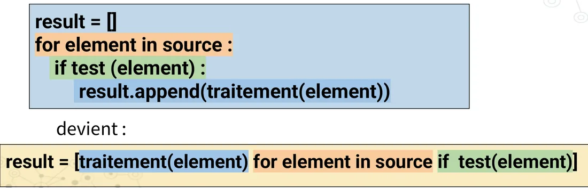
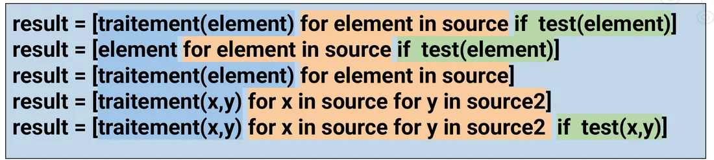

# Notions avancées

Un **itérable** est tout ce qu'on peut parcourir avec `for` : liste, tuple, chaîne, ensemble, dictionnaire, `range`, fichier, générateur... Toutes les notions de ce chapitre marchent avec n'importe quel itérable.

**À retenir :** si `for x in truc:` marche, alors `truc` est un itérable, et tout ce chapitre s'applique à lui.

## 1. Listes en compréhension

On construit souvent une liste à partir d'une autre séquence, avec toujours le même schéma :

```python
result = []
for v in range(10):
    if v % 2 == 0:
        result.append(-v)
print(result)
```

Python permet de l'écrire en **une seule ligne** :

```python
result = [-v for v in range(10) if v % 2 == 0]
print(result)
```

La forme générale : `[traitement(e) for e in source if test(e)]`. Se lit : « ce que je mets » `for` « d'où ça vient » `if` « la condition pour garder ». Le `if` est facultatif.

Sur l'image, chaque morceau de la boucle a sa couleur, et on retrouve la même couleur dans la compréhension : le `for` (orange) reste un `for`, le `if` (vert) passe à la fin, et ce qu'on ajoute avec `append` (bleu) passe **au début**, entre les crochets.



**Exemple résolu : que vaut `[v * 10 for v in range(6) if v % 3 == 0]` ?**

On fait tourner la boucle à la main, une valeur de `v` à la fois :

| `v` | `v % 3 == 0` ? | Ajouté dans la liste |
|---|---|---|
| 0 | oui (0 % 3 vaut 0) | `0 * 10` = 0 |
| 1 | non (reste 1) | rien |
| 2 | non (reste 2) | rien |
| 3 | oui | `3 * 10` = 30 |
| 4 | non | rien |
| 5 | non | rien |

Résultat : `[0, 30]`. Attention : `range(6)` va de 0 à 5, le 6 n'est **jamais** atteint.

```python
print([v * 10 for v in range(6) if v % 3 == 0])
```

**À retenir :** lis d'abord le `for` (d'où viennent les valeurs), puis le `if` (lesquelles on garde), et seulement à la fin le début (ce qu'on met dans la liste).

Les variantes possibles, avec les mêmes couleurs : on peut garder l'élément tel quel (pas de traitement), enlever le `if`, ou enchaîner deux `for` (toutes les paires `x`, `y`), avec ou sans test.



D'autres exemples :

```python
line = "Il y a 3 chats et 12 chiens"
print([w.upper() for w in line.split() if w.isalpha()])

my_list = [3, -1, 0, 7, -5]
print([i for i in my_list if i > 0])
print([i ** 2 for i in range(10)])

firstnames = ["Ana", "Bob"]
lastnames = ["Diaz", "Roy"]
print([f + " " + l for f in firstnames for l in lastnames])

E = [1, 2, 3]
print([(i, j) for i in E for j in E if i < j])
```

Ligne par ligne :

- `line.split()` donne `['Il', 'y', 'a', '3', 'chats', 'et', '12', 'chiens']` ; `isalpha()` refuse `'3'` et `'12'` (ce ne sont pas des lettres), les autres mots sont mis en majuscules ;
- `i > 0` garde 3 et 7 : 0 n'est **pas** strictement positif ;
- `i ** 2` est la puissance (`**`, et pas `^` qui est un tout autre opérateur) : les carrés de 0 à 9 ;
- les deux dernières lignes ont **deux** `for` : voir l'encart juste en dessous.

> [!info] Plusieurs `for`
> `[... for x in A for y in B]` correspond à deux boucles imbriquées écrites dans le même ordre : `for x in A:` puis, à l'intérieur, `for y in B:`.

**Exemple résolu : que vaut `[x + str(y) for x in "ab" for y in [1, 2] if y != 2 or x == "b"]` ?**

Le premier `for` est la boucle du dehors : pour chaque `x`, la boucle sur `y` est faite **en entier**.

| `x` | `y` | `y != 2 or x == "b"` ? | Ajouté |
|---|---|---|---|
| `"a"` | 1 | oui (`y != 2`) | `"a1"` |
| `"a"` | 2 | non (`y` vaut 2 et `x` n'est pas `"b"`) | rien |
| `"b"` | 1 | oui | `"b1"` |
| `"b"` | 2 | oui (`x == "b"`) | `"b2"` |

Résultat : `['a1', 'b1', 'b2']`.

```python
print([x + str(y) for x in "ab" for y in [1, 2] if y != 2 or x == "b"])
```

**À retenir :** avec deux `for`, le premier change **lentement** (boucle du dehors), le second **vite** (boucle du dedans), exactement comme deux boucles imbriquées.

### Les méthodes de chaînes utiles pour filtrer

Beaucoup de compréhensions travaillent sur des mots. Voici les méthodes qui servent le plus. Celles en `is...` renvoient `True` ou `False` : elles se mettent dans le `if`.

| Méthode | Renvoie | Exemple |
|---|---|---|
| `s.split()` | la liste des mots (coupe sur les espaces, **ignore** les espaces en trop) | `"a  b".split()` → `['a', 'b']` |
| `s.split(";")` | coupe à chaque `;` (garde les morceaux vides) | `"a;;b".split(";")` → `['a', '', 'b']` |
| `sep.join(l)` | colle les chaînes de `l` avec `sep` entre elles | `"-".join(["a", "b"])` → `'a-b'` |
| `s.upper()`, `s.lower()` | tout en majuscules, tout en minuscules | `"Ana".lower()` → `'ana'` |
| `s.capitalize()` | première lettre en majuscule, le reste en minuscules | `"aDA".capitalize()` → `'Ada'` |
| `s.strip()` | enlève les espaces et `"\n"` au début et à la fin | `" a \n".strip()` → `'a'` |
| `s.strip(".!")` | enlève ces caractères-là au début et à la fin | `"oui!.".strip(".!")` → `'oui'` |
| `s.lstrip("-")` | pareil, mais seulement **à gauche** | `"-12".lstrip("-")` → `'12'` |
| `s[::-1]` | la chaîne à l'envers | `"abc"[::-1]` → `'cba'` |
| `s.isalpha()` | que des lettres (au moins une) | `"été".isalpha()` → `True`, `"a1"` → `False` |
| `s.isdigit()` | que des chiffres (au moins un) | `"42"` → `True`, `"-3"` → `False` |
| `s.isupper()`, `s.islower()` | toutes les **lettres** sont en majuscules / minuscules | voir le piège plus bas |

```python
print("a  b".split(), "a  b".split(" "))
print("a;;b".split(";"))
print(" ".join(["un", "deux"]))
print("aDA".capitalize(), "oui!.".strip(".!"), "-12".lstrip("-"))
print("python"[::-1])
print("été".isalpha(), "a1".isalpha(), "42".isdigit(), "-3".isdigit())
print("a1".islower(), "14-18".islower(), "abc".islower())
```

> [!warning] Deux pièges
> - `"a  b".split(" ")` (avec un argument) coupe à **chaque** espace : deux espaces de suite donnent un morceau vide `''`. Sans argument, `split()` ignore les espaces en trop.
> - `islower()` ne regarde que les lettres : `"a1".islower()` vaut `True` (la seule lettre, `a`, est minuscule) et `"14-18".islower()` vaut `False` (aucune lettre). Pour « que des lettres minuscules », il faut **les deux** tests : `m.isalpha() and m.islower()`.

**Exemple résolu : dans `"Le 1er vol  part"`, garder les mots faits uniquement de lettres minuscules, d'au moins 2 lettres.**

1. `split()` donne `['Le', '1er', 'vol', 'part']` (les deux espaces ne créent pas de mot vide).
2. On teste chaque mot :

| Mot | `isalpha()` | `islower()` | `len(m) >= 2` | Gardé ? |
|---|---|---|---|---|
| `'Le'` | oui | non (`L` majuscule) | oui | non |
| `'1er'` | non (chiffre `1`) | oui (les lettres `e`, `r` sont minuscules) | oui | non |
| `'vol'` | oui | oui | oui | **oui** |
| `'part'` | oui | oui | oui | **oui** |

`'1er'` montre pourquoi `islower()` seul ne suffit pas : il dirait oui.

```python
phrase = "Le 1er vol  part"
print([m for m in phrase.split() if m.isalpha() and m.islower() and len(m) >= 2])
print(" ".join(m[::-1] for m in phrase.split()))
```

La première ligne garde `['vol', 'part']` ; la seconde retourne chaque mot et les recolle avec **un seul** espace : `'eL re1 lov trap'`.

**À retenir :** `split()` sans argument pour couper en mots, `" ".join(...)` pour recoller, et un test `is...` dans le `if` pour filtrer (en combinant deux tests si un seul ne suffit pas).

### Pourquoi une compréhension ?

Il y a trois façons de créer une liste :

- le **littéral** `[1, 2, 3]` : on écrit les valeurs à la main, pratique pour quelques valeurs seulement ;
- le **constructeur** `list(range(10))` : il prend tout un itérable d'un coup, mais sans pouvoir filtrer ni transformer ;
- la **compréhension** : elle filtre et transforme en une ligne.

Pour passer d'une boucle classique à une compréhension : on recopie les `for` et les `if` **dans le même ordre**, et on met ce qu'on ajoute (le traitement) **tout au début**.

**Exemple résolu : transformer cette boucle en compréhension.**

```python
mots = ["Oui", "", "non", "Peut-être"]
res = []
for m in mots:
    if m != "":
        res.append(m.lower())
print(res)
```

1. Ce qu'on ajoute (dans le `append`) : `m.lower()`. Il va **au début**.
2. Le `for` : `for m in mots`.
3. Le `if` : `if m != ""`. Une chaîne vide vaut faux, donc on peut aussi écrire `if m`.

```python
mots = ["Oui", "", "non", "Peut-être"]
print([m.lower() for m in mots if m])
```

**À retenir :** `[ ce qu'il y a dans append  for ...  if ... ]`, dans cet ordre.

> [!warning] Où mettre le `if` ?
> Le filtre se met **après** le `for` : `[m for m in mots if len(m) > 3]`. Écrire `[len(m) > 3 for m in mots]` ne filtre rien : on obtient une liste de `True` / `False`. Et `[m if len(m) > 3 for m in mots]` est une erreur de syntaxe : un `if` placé **avant** le `for` est un choix entre deux valeurs, il exige un `else` (`[m if len(m) > 3 else "?" for m in mots]` garde tous les mots mais remplace les courts).

Un cas très courant : lire des nombres tapés au clavier. `input()` renvoie **une seule chaîne**, `split()` la coupe en une liste de **chaînes**, et il reste à convertir chacune avec `int` :

```python
saisie = "4 8 quinze 16"
print(saisie.split())
print([int(x) for x in saisie.split() if x.isnumeric()])
```

Ici, `saisie` remplace `input()` pour que l'exemple tourne seul. Le filtre `isnumeric()` écarte ce qui n'est pas un nombre (mais il refuse aussi `"-3"`).

**Exemple résolu : garder aussi les entiers négatifs.** Le signe `-` fait échouer `isdigit()`. L'astuce : enlever le `-` du début **seulement pour le test**, puis convertir le morceau complet.

| Morceau | `m.lstrip("-")` | `.isdigit()` ? | Gardé | `int(m)` |
|---|---|---|---|---|
| `"10"` | `"10"` | oui | oui | 10 |
| `"-5"` | `"5"` | oui | oui | -5 |
| `"1.5"` | `"1.5"` | non (le point n'est pas un chiffre) | non | |
| `"x"` | `"x"` | non | non | |
| `"-"` | `""` | non (chaîne vide) | non | |

```python
saisie = "10 -5 1.5 x -"
entiers = [int(m) for m in saisie.split() if m.lstrip("-").isdigit()]
print(entiers)
print([abs(n) for n in entiers], sum(entiers))
```

Dans un vrai programme, on écrit `saisie = input()` (sans texte entre les parenthèses, sinon ce texte s'affiche avant la saisie). `abs(n)` donne la valeur absolue (le nombre sans son signe).

**À retenir :** `input().split()` donne des **chaînes** ; on filtre avec un test `is...` puis on convertit avec `int(...)` au début de la compréhension.

### Lire plusieurs lignes au clavier

Quand le programme lit d'abord un nombre `n`, puis `n` lignes, on fait **un `input()` par ligne** : le premier pour `n`, puis une boucle `for _ in range(n)`. Le `_` est un nom de variable qu'on ne lit pas (on veut juste répéter `n` fois).

```text
n = int(input())
mots = []
for _ in range(n):
    mots += input().split()
```

`mots += liste` ajoute **tous** les éléments de la liste à la fin de `mots`. Dans l'exemple ci-dessous, la liste `entree` joue le rôle du clavier (chaque `next(clavier)` est un `input()`) :

```python
entree = ["2", "le ciel est bleu", "le soleil brille"]
clavier = iter(entree)

n = int(next(clavier))
mots = []
for _ in range(n):
    mots += next(clavier).split()

distincts = set(mots)
print("Lignes :", n)
print("Mots :", len(mots))
print("Différents :", len(distincts))
print("Le plus long :", max(mots, key=len))
print(", ".join(sorted(distincts)))
```

Pas à pas :

1. `n` vaut 2 : on lit 2 lignes.
2. `mots` devient `['le', 'ciel', 'est', 'bleu', 'le', 'soleil', 'brille']` : 7 mots.
3. `set(mots)` enlève les doublons (`'le'` est là deux fois) : 6 mots différents.
4. `max(mots, key=len)` compare les longueurs ; `'soleil'` et `'brille'` font 6 lettres, `max` garde **le premier** rencontré : `'soleil'` (voir la section 3).
5. `sorted(distincts)` range par ordre alphabétique, `", ".join` les colle avec une virgule et un espace.
6. `print("Lignes :", n)` : avec plusieurs arguments, `print` met **un espace** entre eux.

**À retenir :** un `input()` par ligne tapée, `set` pour les valeurs différentes, `", ".join(sorted(...))` pour les afficher dans l'ordre.

La deuxième boucle peut parcourir l'élément donné par la première :

```python
villes = ["Lyon", "Nice"]
print([c for v in villes for c in v.lower()])

prenoms = ["Lena", "Marc"]
noms = ["Lopez", "Martin", "Petit"]
print([p + " " + n for p in prenoms for n in noms if p[0] == n[0]])
```

**Exemple résolu : la deuxième ligne, couple par couple.** `p[0]` est la première lettre du prénom, `n[0]` celle du nom.

| `p` | `n` | `p[0] == n[0]` ? | Ajouté |
|---|---|---|---|
| `"Lena"` | `"Lopez"` | `L` et `L` : oui | `"Lena Lopez"` |
| `"Lena"` | `"Martin"` | `L` et `M` : non | |
| `"Lena"` | `"Petit"` | non | |
| `"Marc"` | `"Lopez"` | non | |
| `"Marc"` | `"Martin"` | `M` et `M` : oui | `"Marc Martin"` |
| `"Marc"` | `"Petit"` | non | |

Attention : `"l" == "L"` vaut `False`. Si les majuscules ne doivent pas compter, on compare `p[0].lower() == n[0].lower()`.

```python
print("l" == "L", "l".lower() == "L".lower())
```

**À retenir :** la variable du premier `for` peut servir dans le second (`for v in villes for c in v`) ; pour comparer des lettres sans tenir compte des majuscules, passe les deux en `lower()`.

> [!tip] Les bons réflexes
> - Une compréhension sert à rendre le code **plus court et plus clair**, pas plus rapide. Si elle devient difficile à lire, une boucle classique avec `append` est très bien.
> - Pour un simple filtre, `filter` existe ; pour un simple traitement, `map`.
> - Si le résultat n'est parcouru **qu'une seule fois**, une expression génératrice (section 2) évite de stocker toute la liste.

### Dictionnaires et ensembles en compréhension

Même idée avec des accolades : `{cle: valeur for ...}` pour un dictionnaire, `{valeur for ...}` pour un ensemble.

```python
mots = ["chat", "souris", "ours"]
print({m: len(m) for m in mots})

prix = {"pomme": 2, "kiwi": 5, "melon": 8}
print({k: v for k, v in prix.items() if v > 3})
print({v: k for k, v in prix.items()})
print({m[0] for m in mots})
```

Comment reconnaître le type :

| Écriture | Type obtenu | Pourquoi |
|---|---|---|
| `[x for ...]` | `list` | crochets |
| `{k: v for ...}` | `dict` | accolades **avec** deux-points `:` |
| `{x for ...}` | `set` (ensemble) | accolades **sans** deux-points |
| `(x for ...)` | générateur (section 2) | parenthèses, ce n'est **pas** un tuple |

**Exemple résolu : la ligne `{k: v for k, v in prix.items() if v > 3}`.**

`prix.items()` fournit les couples `(clé, valeur)` ; `for k, v in ...` range la clé dans `k` et la valeur dans `v` à chaque tour.

| `k` | `v` | `v > 3` ? | Dans le résultat |
|---|---|---|---|
| `"pomme"` | 2 | non | |
| `"kiwi"` | 5 | oui | `"kiwi": 5` |
| `"melon"` | 8 | oui | `"melon": 8` |

Résultat : `{'kiwi': 5, 'melon': 8}`. Pour « au plus 5 », on écrirait `v <= 5` : le `=` compte, 5 serait gardé.

La ligne suivante, `{v: k for k, v in prix.items()}`, met la valeur **en clé** et la clé **en valeur** : on **inverse** le dictionnaire (`{2: 'pomme', 5: 'kiwi', 8: 'melon'}`).

Le dernier exemple, `{m[0] for m in mots}`, donne un **ensemble** : `'c'` n'y est qu'une fois, même si deux mots commencent par `c`. L'ordre d'affichage d'un ensemble peut changer, il ne compte pas.

**À retenir :** `for k, v in d.items()` pour parcourir un dictionnaire ; `{v: k ...}` inverse ; un ensemble en compréhension enlève les doublons tout seul.

> [!warning] Le mot vide
> `m[0]` sur un mot vide `""` lève une `IndexError` (il n'y a pas de première lettre). On filtre d'abord avec `if m` : une chaîne vide vaut faux.
> ```python
> mots = ["Ane", "", "abeille"]
> print({m[0].lower() for m in mots if m})
> ```

Pour associer deux listes rang par rang (la première donne les clés, la seconde les valeurs), on passe par `zip` :

```python
keys = ["a", "b", "c"]
values = [1, 2, 3]
print({k: v for k, v in zip(keys, values)})
print(dict(zip(keys, values)))
```

`zip(keys, values)` fournit `('a', 1)`, puis `('b', 2)`, puis `('c', 3)` ; `dict(...)` transforme directement ces couples en dictionnaire. Écrire `{keys: values}` ne marche pas : Python essaierait d'utiliser **la liste entière** comme clé, et une liste ne peut pas être une clé (`TypeError`).

Quand la source est une liste de **tuples**, on peut aussi découper chaque tuple dans le `for` :

```python
villes = [("Paris", "France"), ("Rome", "Italie")]
print({ville[:3].upper(): ville + " (" + pays + ")" for ville, pays in villes})
```

Pas à pas sur le premier tuple : `ville` vaut `"Paris"`, `pays` vaut `"France"` ; la clé est `"Paris"[:3].upper()` = `"PAR"`, la valeur `"Paris (France)"`.

**À retenir :** `dict(zip(cles, valeurs))` pour deux listes ; `for a, b in liste_de_couples` pour découper chaque couple.

> [!warning] Deux fois la même clé
> Un dictionnaire ne garde qu'**une** valeur par clé. Si la compréhension produit deux fois la même clé, la **dernière** valeur écrase la précédente :
> ```python
> print({p[0]: p for p in ["Ana", "Alex", "Bob"]})
> ```

### Tableaux 2D

Un tableau 2D est une liste de listes : `mat[i][j]` est la case de la ligne `i`, colonne `j`. Pour le créer, une compréhension qui fabrique **une nouvelle ligne à chaque tour** :

```python
lignes, colonnes = 2, 3
bon = [[0] * colonnes for _ in range(lignes)]
bon[0][0] = 5
print(bon)

piege = [[0] * colonnes] * lignes
piege[0][0] = 5
print(piege)
```

> [!warning] `[[0] * n] * m`
> Le `* m` copie `m` fois **la même** liste (la même référence) : modifier une case modifie toute la colonne. Pour une liste de nombres, `[0] * n` ne pose pas ce problème, car les nombres ne se modifient pas.

**Exemple résolu : pourquoi `piege` affiche `[[5, 0, 0], [5, 0, 0]]`.**

1. `[0] * 3` fabrique **une** liste `[0, 0, 0]`.
2. `[ cette_liste ] * 2` fait une liste qui contient **deux fois la même** liste, pas deux copies. Les deux cases `piege[0]` et `piege[1]` désignent le même objet.
3. `piege[0][0] = 5` modifie cet objet unique : on le voit donc « dans les deux lignes ».
4. Avec `[[0] * 3 for _ in range(2)]`, l'expression `[0] * 3` est **recalculée à chaque tour** : deux listes différentes, indépendantes.

```python
piege = [[0] * 3] * 2
bon = [[0] * 3 for _ in range(2)]
print(piege[0] is piege[1], bon[0] is bon[1])
```

`is` vérifie si deux noms désignent le **même** objet : `True` pour le piège, `False` pour la bonne version. Autre erreur : `[0] * 3 * 2` donne une liste **simple** de 6 zéros, pas un tableau 2D.

**À retenir :** pour un tableau 2D, `[[valeur] * colonnes for _ in range(lignes)]` ; jamais `* lignes` sur une liste de listes.

On parcourt un tableau 2D avec deux `for` : dans le même ordre que deux boucles imbriquées pour l'aplatir, ou une compréhension **dans** une compréhension pour garder les lignes.

```python
mat = [[1, 2, 3], [4, 5, 6]]
print([x for ligne in mat for x in ligne])
print([[x * 10 for x in ligne] for ligne in mat])
print([list(colonne) for colonne in zip(*mat)])
```

**Exemple résolu : fabriquer `[[0, 1, 2], [1, 2, 3]]` avec une compréhension dans une compréhension.** Chaque case vaut « numéro de ligne + numéro de colonne ».

`[[i + j for j in range(3)] for i in range(2)]` se lit **de l'extérieur vers l'intérieur** :

1. La compréhension du dehors fait une ligne pour chaque `i` de `range(2)`, donc 2 lignes.
2. Pour `i = 0`, la compréhension du dedans calcule `[0 + 0, 0 + 1, 0 + 2]` = `[0, 1, 2]`.
3. Pour `i = 1`, elle calcule `[1 + 0, 1 + 1, 1 + 2]` = `[1, 2, 3]`.

```python
print([[i + j for j in range(3)] for i in range(2)])
print([[i + j for j in range(1, 4)] for i in range(1, 3)])
```

Pour commencer à 1 au lieu de 0, on change les `range` : `range(1, 4)` va de 1 à 3 (la fin est exclue).

À comparer avec `[x for ligne in mat for x in ligne]` : là, il n'y a **qu'une** paire de crochets, donc le résultat est une liste **plate** (aplatie) : `[1, 2, 3, 4, 5, 6]`. Une ligne vide `[]` ne donne simplement aucun élément.

**À retenir :** deux `for` dans les mêmes crochets → une liste plate ; des crochets **dans** des crochets → une liste de lignes.

`zip(*mat)` passe chaque ligne comme un argument séparé (`zip(mat[0], mat[1])`) : il regroupe les premiers éléments de chaque ligne, puis les deuxièmes... C'est la **transposée** (les lignes deviennent les colonnes).

**Exemple résolu : transposer `[["a", "b"], ["c", "d"], ["e", "f"]]`.**

1. L'étoile `*` « vide » la liste : `zip(*m)` devient `zip(["a", "b"], ["c", "d"], ["e", "f"])`.
2. `zip` prend le 1er élément de chaque ligne : `('a', 'c', 'e')`, puis le 2e : `('b', 'd', 'f')`.
3. `zip` donne des tuples : `list(colonne)` les remet en listes.

```python
m = [["a", "b"], ["c", "d"], ["e", "f"]]
print([list(colonne) for colonne in zip(*m)])
print(list(zip(m)))
```

Sans l'étoile, `zip(m)` reçoit **un seul** itérable : chaque ligne est juste emballée seule dans un tuple (`(['a', 'b'],)`...), rien n'est transposé.

**À retenir :** transposée = `[list(c) for c in zip(*mat)]`, avec l'étoile.

> [!warning] Rester lisible
> Au-delà de deux `for` ou d'une condition compliquée, une boucle classique est plus claire.

## 2. Expressions génératrices

On remplace les crochets par des **parenthèses** : on obtient un **générateur**, qui calcule les valeurs **une par une, à la demande**, sans les stocker.

```python
carres = (x * x for x in range(3))
for c in carres:
    print(c)

print(sum(x * x for x in range(1_000_000)))
print(next((m for m in ["a", "abc", "abcd"] if len(m) > 2), None))
```

| | `[...]` liste | `(...)` générateur |
|---|---|---|
| Calcul | tout de suite | à la demande |
| Mémoire | stocke tout | presque rien |
| Réutilisable | oui | non, une seule fois |
| `len()`, `[i]` | oui | non |

> [!tip] Seul argument d'une fonction
> Les parenthèses du générateur peuvent alors être omises : `sum(x * x for x in l)`.

**Exemple résolu : `sum(x * x for x in range(1, 4))`.** Le générateur fournit les valeurs une à une, et `sum` les additionne au fur et à mesure :

| `x` | valeur fournie `x * x` | total de `sum` |
|---|---|---|
| 1 | 1 | 1 |
| 2 | 4 | 5 |
| 3 | 9 | 14 |

Résultat : 14. À aucun moment la liste `[1, 4, 9]` n'existe en mémoire : avec `range(1, 10_000_001)`, on n'en stocke pas dix millions. `1_000_000` s'écrit avec des `_` juste pour être lisible : c'est le nombre un million.

**À retenir :** `sum(... for ...)`, `max(... for ...)`, `any(... for ...)` : le générateur se met directement dans la fonction, sans crochets.

### Compter avec `sum(1 for ...)`

Pour **compter** les éléments qui respectent une condition, on additionne un `1` par élément gardé :

```python
texte = "Bonjour"
print(sum(1 for c in texte if c in "aeiou"))
print(sum(1 for c in texte.lower() if c == "b"))
```

Pas à pas sur la première ligne : `B` non, `o` oui (+1), `n` non, `j` non, `o` oui (+1), `u` oui (+1), `r` non : total 3. `c in "aeiou"` vérifie si le caractère `c` fait partie de la chaîne `"aeiou"`. Attention aux majuscules : `"B" == "b"` vaut `False`, d'où le `texte.lower()` de la deuxième ligne.

**À retenir :** compter = `sum(1 for x in source if condition)`.

### Le premier qui convient : `next`

`next(generateur, defaut)` demande **une seule** valeur au générateur : la première qui passe le filtre. S'il n'y en a aucune, il renvoie `defaut` au lieu de lever une erreur.

```python
nombres = [3, 8, 5, 12]
print(next((n for n in nombres if n > 6), None))
print(next((n for n in nombres if n > 100), None))
```

Pas à pas : 3 n'est pas `> 6`, 8 l'est : `next` s'arrête **tout de suite** et renvoie 8 (12 n'est même pas regardé). Pour `> 100`, rien ne convient : on obtient `None`. Il faut des parenthèses autour du générateur, car `next` a un deuxième argument.

**À retenir :** `next((x for x in l if cond), None)` = le premier qui convient, ou `None`.

> [!warning] Un générateur ne sert qu'une fois
> Une fois parcouru, il est vide. Pour une moyenne (total **et** nombre d'éléments), il faut deux parcours : soit deux générateurs, soit une liste.
> ```python
> notes = [12, -1, 15, -1]
> valides = (n for n in notes if n >= 0)
> print(sum(valides), sum(1 for _ in valides))
> total = sum(n for n in notes if n >= 0)
> nombre = sum(1 for n in notes if n >= 0)
> print(total / nombre if nombre else 0)
> ```
> La première ligne affiche `27 0` : le deuxième `sum` trouve le générateur déjà vide. La version correcte refait le parcours, et teste `nombre` avant de diviser (diviser par 0 lève une `ZeroDivisionError`).

## 3. Fonctions utilitaires

- **Intermédiaires** : elles fournissent plusieurs résultats et peuvent s'enchaîner : `zip`, `map`, `filter`, `enumerate`, `sorted`, `reversed`.
- **Terminales** : elles combinent tout en un seul résultat : `any`, `all`, `min`, `max`, `sum`.

> [!warning] Des résultats « paresseux »
> `zip`, `map`, `filter`, `enumerate` et `reversed` renvoient un itérable, pas une liste. `print(map(...))` affiche `<map object ...>` : utilise `list(...)` pour voir le contenu. Ils ne se parcourent qu'**une fois**.

```python
resultat = map(str.upper, ["a", "b"])
print(resultat)
print(list(resultat))
print(list(resultat))
print(tuple(map(str.upper, ["a", "b"])))
```

Pas à pas : le premier `print` montre l'objet `map` (pas son contenu) ; `list(...)` le parcourt et donne `['A', 'B']` ; le second `list(...)` donne `[]`, car l'objet a déjà été parcouru. `tuple(...)` marche comme `list(...)` mais donne un tuple. `str.upper` est la méthode `upper` utilisée comme une fonction : `str.upper("a")` vaut `"A"`.

**À retenir :** pour voir ou garder le résultat de `map`, `filter`, `zip`... entoure-le de `list(...)` ou `tuple(...)`, une seule fois.

### zip, map, filter, enumerate

```python
a = [1, 2, 3, 4]
b = "abcd"
c = (1.5, 3.0, 4.0)
print(list(zip(a, b, c)))

noms = ["Tom", "Bob"]
notes = [12, 15]
for nom, note in zip(noms, notes):
    print(nom, note)
print(dict(zip(noms, notes)))

print(list(map(int, ["1", "2", "3"])))
print(list(map(pow, [2, 3], [10, 2])))


def est_pair(n):
    return n % 2 == 0


print(list(filter(est_pair, range(10))))

for i, fruit in enumerate(["banane", "pomme"], start=1):
    print(i, fruit)
```

- `zip` s'arrête au plus court des itérables ;
- `map(f, l)` équivaut à `(f(x) for x in l)`, avec une séquence par paramètre si `f` en prend plusieurs ;
- `filter(f, l)` équivaut à `(x for x in l if f(x))` ;
- `enumerate(l, start=0)` fournit des couples `(compteur, élément)`.

**Exemple résolu : `list(zip(a, b, c))` ci-dessus.** `zip` prend un élément de **chaque** source au même rang :

| Rang | `a` | `b` | `c` | Tuple fourni |
|---|---|---|---|---|
| 0 | 1 | `'a'` | 1.5 | `(1, 'a', 1.5)` |
| 1 | 2 | `'b'` | 3.0 | `(2, 'b', 3.0)` |
| 2 | 3 | `'c'` | 4.0 | `(3, 'c', 4.0)` |
| 3 | 4 | `'d'` | plus rien | **arrêt** |

`c` n'a que 3 éléments : `zip` s'arrête là, sans erreur, et le 4 et le `'d'` sont oubliés. Il y a donc 3 tuples.

**À retenir :** `zip` = « rang par rang », et il y a autant de résultats que d'éléments dans la source **la plus courte**.

**Exemple résolu : `map(pow, [2, 3], [10, 2])`.** `pow(x, n)` calcule `x ** n` et prend **deux** paramètres : on donne donc **deux** listes, et `map` les parcourt rang par rang comme `zip`. Rang 0 : `pow(2, 10)` = 1024 ; rang 1 : `pow(3, 2)` = 9. Résultat : `[1024, 9]`. Même chose avec `min`, qui accepte deux valeurs :

```python
a = [5, 1, 8]
b = [2, 4, 8]
print(list(map(min, a, b)))
print(sum(x * y for x, y in zip([2, 3], [10, 100])))
```

Rang par rang : `min(5, 2)` = 2, `min(1, 4)` = 1, `min(8, 8)` = 8, donc `[2, 1, 8]`. La deuxième ligne multiplie terme à terme puis additionne : `2 × 10 + 3 × 100` = 320 (c'est le calcul d'un prix total avec des prix et des quantités).

**À retenir :** une fonction à deux paramètres dans `map` → deux listes, parcourues rang par rang.

**Exemple résolu : `enumerate`.** Il numérote les éléments. Par défaut, le compteur part de **0** ; avec `start=1`, il part de 1.

```python
courses = ["riz", "thé"]
print(list(enumerate(courses)))
print([f"{i}) {c}" for i, c in enumerate(courses, start=1)])
print([i for i, lettre in enumerate("radar") if lettre == "r"])
```

| Ligne | Ce qui se passe | Résultat |
|---|---|---|
| 1 | couples `(compteur, élément)`, compteur depuis 0 | `[(0, 'riz'), (1, 'thé')]` |
| 2 | `for i, c in ...` découpe chaque couple, `start=1` | `['1) riz', '2) thé']` |
| 3 | on garde l'**indice** `i` quand la lettre vaut `"r"` | `[0, 4]` |

`f"{i}) {c}"` est une f-string : ce qui est entre `{}` est remplacé par la valeur. On peut aussi écrire `str(i) + ") " + c` : `str` est nécessaire, car `1 + ")"` lève une `TypeError`.

**À retenir :** `enumerate` quand tu as besoin **de l'indice et de l'élément** ; `start=1` pour numéroter « à l'humaine ».

### sorted et reversed

```python
print(sorted([3, 1, 2]))
print(sorted([3, 1, 2], reverse=True))
print(sorted(["poire", "kiwi", "banane"], key=len))
print(sorted("hello"))
print(list(reversed([1, 2, 3])))

l = [3, 1, 2]
print(l.sort(), l)
```

`sorted` renvoie une **nouvelle** liste triée. `key` est une fonction qui donne le critère de tri, `reverse=True` trie en ordre décroissant. Toute fonction qui prend un élément convient comme `key`, même `max` ou `sum` :

```python
ll = [[1, 0, 5], [1, 2, 3], [8, 5]]
for liste in sorted(ll, key=max, reverse=True):
    print(*liste)

phrase = "Bonjour tout le monde"
print(" ".join(sorted(phrase.split(), key=len)))
```

`print(*liste)` passe chaque élément comme un argument séparé : ils sont affichés séparés par des espaces, sans crochets. Le tri est **stable** : à longueur égale, les mots gardent leur ordre de départ.

**Exemple résolu : trier `["melon", "fig", "kiwi", "pomme"]` avec `key=len`.** Python calcule `len` de chaque mot, trie selon ce nombre, mais renvoie **les mots** (pas les longueurs) :

| Mot | `len(mot)` (la clé) |
|---|---|
| `"melon"` | 5 |
| `"fig"` | 3 |
| `"kiwi"` | 4 |
| `"pomme"` | 5 |

Ordre des clés : 3, 4, 5, 5. `"melon"` et `"pomme"` ont la même clé : le tri est stable, ils restent dans leur ordre de départ (`"melon"` d'abord). Résultat : `['fig', 'kiwi', 'melon', 'pomme']`.

```python
print(sorted(["melon", "fig", "kiwi", "pomme"], key=len))
print(sorted(["b", "C", "a"]), sorted(["b", "C", "a"], key=str.lower))
print(sorted([[4, 4], [9], [1, 2]], key=sum))
```

- Sans `key`, les majuscules passent **avant** toutes les minuscules (`'C'` avant `'a'`) ; avec `key=str.lower`, chaque mot est comparé en minuscules, mais le résultat garde les mots d'origine : `['a', 'b', 'C']`.
- `key=sum` compare les sommes : 8, 9, 3, donc `[[1, 2], [4, 4], [9]]`.

**À retenir :** `key` reçoit **le nom** d'une fonction (sans parenthèses : `key=len`, pas `key=len()`) ; elle sert à comparer, mais ce sont les éléments d'origine qui sont renvoyés.

> [!warning] `sorted(l)` ou `l.sort()` ?
> `l.sort()` trie la liste **sur place** et renvoie `None` : `l = l.sort()` détruit la liste.

**Exemple résolu : pourquoi `l = l.sort()` donne `None`.** `l.sort()` fait deux choses : il range la liste **elle-même**, puis il renvoie `None` (il ne renvoie pas la liste). `l = ...` range ce résultat, `None`, dans `l` : la liste triée est perdue. Et si on ne doit **pas** modifier la liste reçue (par exemple dans une fonction), on utilise `sorted`, qui fabrique une copie triée.

```python
donnees = [7, 2, 9, 4]
tries = sorted(donnees)
print(tries, donnees)
```

**À retenir :** `l.sort()` seul sur une ligne, ou `l2 = sorted(l)` ; jamais `l = l.sort()`.

### Trier avec plusieurs critères

Une clé peut être un **tuple**. Python compare deux tuples case par case : la première case d'abord, et seulement en cas d'égalité, la deuxième.

```python
print((2, "b") < (3, "a"), (2, "b") < (2, "c"))
```

`(2, "b") < (3, "a")` est vrai car 2 < 3 (on ne regarde même pas les lettres) ; `(2, "b") < (2, "c")` est vrai car les premières cases sont égales et `"b" < "c"`.

Pour trier **un critère en décroissant et l'autre en croissant**, on met un **moins** devant le nombre : trier `-x` dans l'ordre croissant revient à trier `x` du plus grand au plus petit.

**Exemple résolu : des équipes `(nom, points)`, par points décroissants puis par nom.**

```python
equipes = [("Lille", 10), ("Brest", 14), ("Angers", 10)]
print(sorted(equipes, key=lambda e: (-e[1], e[0])))
```

`lambda e: (-e[1], e[0])` (une petite fonction, voir la section 4) fabrique la clé de chaque équipe :

| Équipe | Clé `(-points, nom)` |
|---|---|
| `("Lille", 10)` | `(-10, "Lille")` |
| `("Brest", 14)` | `(-14, "Brest")` |
| `("Angers", 10)` | `(-10, "Angers")` |

Tri croissant des clés : `-14` est le plus petit, donc Brest en premier ; puis les deux `-10`, départagés par le nom : `"Angers" < "Lille"`. Résultat : `[('Brest', 14), ('Angers', 10), ('Lille', 10)]`.

Avec `reverse=True` à la place du moins, les noms seraient **aussi** inversés (Lille avant Angers) : c'est pour ça qu'on utilise le moins.

**À retenir :** plusieurs critères = une clé tuple ; un `-` devant un nombre pour le mettre en ordre décroissant.

### Trier un dictionnaire

`sorted(d)` parcourt un dictionnaire comme `for` le fait : il trie **les clés**. `sorted(d.items())` trie les couples `(clé, valeur)`, donc par clé (les clés sont toutes différentes, la valeur ne sert jamais à départager). Pour trier selon les valeurs, la clé de tri va chercher la valeur avec `d[k]` :

```python
stock = {"vis": 40, "clou": 75, "boulon": 40}
print(sorted(stock))
print(sorted(stock.items()))
print(sorted(stock, key=lambda k: stock[k]))
print(sorted(stock.items(), key=lambda kv: kv[1], reverse=True)[:2])
```

Pas à pas sur la dernière ligne : chaque `kv` est un couple comme `("vis", 40)`, `kv[1]` est la valeur ; on trie du plus grand au plus petit, puis `[:2]` garde les deux premiers. `[:k]` sur une liste donne ses `k` premiers éléments.

**À retenir :** `sorted(d)` → les clés triées ; `sorted(d.items())` → les couples triés par clé ; `key=lambda k: d[k]` → trié selon les valeurs.

### La médiane : trier puis prendre le milieu

La **médiane** est la valeur du milieu d'une liste **triée**. Avec `n` éléments, les indices vont de 0 à `n - 1`.

- `n` impair : le milieu est à l'indice `n // 2` (`//` est la division entière : `7 // 2` vaut 3).
- `n` pair : il y a deux valeurs au milieu, aux indices `n // 2 - 1` et `n // 2` ; la médiane est leur moyenne.

**Exemple résolu :** `[40, 10, 30]` triée donne `[10, 30, 40]`, `n` = 3, indice `3 // 2` = 1 : médiane 30. `[8, 2, 6, 4]` triée donne `[2, 4, 6, 8]`, `n` = 4, indices 1 et 2 : `(4 + 6) / 2` = 5.0.

```python
for valeurs in ([40, 10, 30], [8, 2, 6, 4]):
    t = sorted(valeurs)
    n = len(t)
    print(t, n // 2, t[n // 2] if n % 2 == 1 else (t[n // 2 - 1] + t[n // 2]) / 2)
```

**À retenir :** médiane = `sorted` d'abord (jamais sur la liste d'origine si on ne doit pas la modifier), puis l'indice `n // 2`.

### any, all, min, max, sum

```python
notes = [12, 8, 15]
print(any(n < 10 for n in notes))
print(all(n >= 10 for n in notes))
print(any([]), all([]))

print(min(notes), max(notes), sum(notes))
print(max(["aa", "b", "cccc"], key=len))
print(min([], default=0))
```

- `any` : vrai si **au moins un** élément est vrai (une suite de OU) ;
- `all` : vrai si **tous** les éléments sont vrais (une suite de ET) ;
- `min` / `max` acceptent `key` (le critère) et `default` (la valeur si l'itérable est vide, sinon `ValueError`).

> [!info] Itérable vide
> `any([])` vaut `False` et `all([])` vaut `True` : il n'y a aucun élément faux dans une liste vide.

**Exemple résolu : avec `notes = [12, 8, 15]`.**

| `n` | `n < 10` | `n >= 10` |
|---|---|---|
| 12 | False | True |
| 8 | **True** | False |
| 15 | False | True |

- `any(n < 10 ...)` : il y a au moins un `True` (pour 8), donc `True`. `any` s'arrête dès le premier `True`.
- `all(n >= 10 ...)` : il y a un `False` (pour 8), donc `False`. `all` s'arrête dès le premier `False`.
- Liste vide : `any` ne trouve aucun `True` → `False` ; `all` ne trouve aucun `False` → `True`.

**À retenir :** `any` = « il en existe au moins un », `all` = « aucun ne fait exception ». Ce sont des **fonctions** : `all(x > 0 for x in l)`, et pas `l.all(...)`.

**Exemple résolu : un code d'accès valide a au moins 6 caractères, au moins une lettre et au moins un chiffre.** Chaque « au moins un » devient un `any` ; on relie les conditions par `and`.

```python
def code_valide(code):
    return (
        len(code) >= 6
        and any(c.isalpha() for c in code)
        and any(c.isdigit() for c in code)
    )


print(code_valide("abc123"), code_valide("abcdef"), code_valide("a1"))
```

| Code | `len >= 6` | une lettre ? | un chiffre ? | Valide |
|---|---|---|---|---|
| `"abc123"` | oui (6) | oui | oui | True |
| `"abcdef"` | oui | oui | **non** | False |
| `"a1"` | **non** (2) | oui | oui | False |

Les parenthèses autour du `return` permettent d'écrire la condition sur plusieurs lignes. Pour une majuscule ou une minuscule, on utiliserait `c.isupper()` ou `c.islower()` de la même façon.

**À retenir :** « au moins un caractère qui... » = `any(test(c) for c in texte)` ; plusieurs exigences = plusieurs tests reliés par `and`.

**`not any` et les autres astuces.** « Aucun élément ne vérifie... » s'écrit `not any(...)` (ou `all(not ...)`, c'est pareil). Pour savoir si une liste a des **doublons**, on compare sa longueur à celle de son ensemble : `set` enlève les doublons, donc les longueurs ne sont égales que s'il n'y en a aucun.

```python
temperatures = [3, -2, 5]
print(not any(t < -5 for t in temperatures))
print(len(set([1, 2, 1])) == len([1, 2, 1]), len(set([1, 2, 3])) == 3)
grille = [[1, 2], [3, 4], [5]]
print(all(len(ligne) == len(grille[0]) for ligne in grille))
print(all(len(ligne) == len(grille[0]) for ligne in []))
```

- Aucune température sous -5 : `True`.
- `set([1, 2, 1])` = `{1, 2}` : 2 éléments contre 3 → il y a un doublon, `False`. Pour `[1, 2, 3]`, 3 et 3 → `True`.
- Toutes les lignes ont-elles la longueur de la première ? 2, 2, puis 1 : non, `False`.
- Sur une liste vide, `all` vaut `True` **sans jamais** calculer `grille[0]` (il n'y a aucun tour de boucle) : pas d'`IndexError`.

**À retenir :** « aucun » = `not any(...)` ; « tous différents » = `len(set(l)) == len(l)`.

> [!warning] « Au plus » ou « moins de » ?
> « Tous les mots font au plus 6 lettres » s'écrit `all(len(m) <= 6 for m in mots)`. Avec `< 6`, un mot de 6 lettres pile serait refusé. Teste toujours la valeur limite.

| Phrase en français | Opérateur |
|---|---|
| au plus 6, au maximum 6, 6 ou moins | `<= 6` |
| moins de 6, strictement inférieur à 6 | `< 6` |
| au moins 6, 6 ou plus | `>= 6` |
| plus de 6, strictement supérieur à 6 | `> 6` |

**Exemple résolu :** avec `mots = ["avion", "bateau"]` et « au plus 6 lettres » : `len("bateau")` vaut 6, `6 <= 6` est vrai, donc `all(...)` vaut `True`. Avec `< 6`, `6 < 6` est faux et `all(...)` vaudrait `False` à tort.

**À retenir :** teste toujours ta condition avec un élément **pile sur la limite**.

**`max` et `min` avec `key` et `default`.** Comme pour `sorted`, `key` donne le critère. En cas d'égalité, `max` et `min` renvoient **le premier** élément rencontré. Sur une liste vide, sans `default`, ils lèvent une `ValueError`.

```python
print(max(["lune", "soleil", "étoile"], key=len))
print(max([], key=len, default="rien"))
print(min([12, 18, 15], key=lambda n: abs(n - 16)))
print(min([14, 18], key=lambda n: (abs(n - 16), n)))
```

- `"soleil"` et `"étoile"` font 6 lettres : `max` garde le premier, `"soleil"`.
- Liste vide : on obtient `"rien"`.
- Le plus proche de 16 : on compare les **écarts** `abs(n - 16)` : 4, 2, 1. Le plus petit écart est 1, pour 15.
- 14 et 18 sont tous deux à 2 de 16 : la clé tuple `(écart, n)` départage avec la valeur elle-même, donc 14 (le plus petit).

**À retenir :** « le plus proche de c » = `min(l, key=lambda n: abs(n - c))`, et un tuple dans la clé pour départager les égalités.

`sum` se combine très bien avec une expression génératrice et `enumerate`. `ord(c)` donne le code d'un caractère (`ord("a")` vaut 97), `chr(n)` fait l'inverse :

```python
s = "abc"
print(sum(ord(c) for c in s))
print(sum(ord(c) * i for i, c in enumerate(s, start=1)))
print(sum([[1], [2, 3]], []))
```

Le deuxième argument de `sum` est la valeur de départ (0 par défaut) : avec `[]`, on additionne des listes, donc on les met bout à bout.

**Exemple résolu : la deuxième ligne.** `ord("a")` = 97, `ord("b")` = 98, `ord("c")` = 99, et `enumerate(s, start=1)` numérote à partir de 1 :

| `i` | `c` | `ord(c) * i` |
|---|---|---|
| 1 | `"a"` | 97 × 1 = 97 |
| 2 | `"b"` | 98 × 2 = 196 |
| 3 | `"c"` | 99 × 3 = 297 |

Total : 97 + 196 + 297 = 590.

**Le rang d'une lettre dans l'alphabet.** Les lettres de `a` à `z` ont des codes qui se suivent (97, 98... 122). Donc `ord(c) - ord("a")` vaut 0 pour `a`, 1 pour `b`..., et on ajoute 1 pour que `a` vaille 1. Pour ne garder que ces lettres-là, on compare les caractères : `"a" <= c <= "z"` (les caractères se comparent par leur code). Une lettre accentuée comme `é` a un code plus grand que `z` : elle est écartée.

```python
print(ord("a"), ord("z"), chr(98))
print([ord(c) - ord("a") + 1 for c in "dé!z" if "a" <= c <= "z"])
```

`"dé!z"` donne `[4, 26]` : `d` est la 4e lettre, `z` la 26e ; `é` et `!` ne passent pas le filtre.

**Exemple résolu : une moyenne pondérée** (chaque note compte selon son coefficient) : `somme(note × coef) / somme(coefs)`. Notes `[8, 14]`, coefficients `[1, 2]` : `(8 × 1 + 14 × 2) / (1 + 2)` = `36 / 3` = 12.0.

```python
notes, coefs = [8, 14], [1, 2]
total_coefs = sum(coefs)
print(sum(n * c for n, c in zip(notes, coefs)) / total_coefs if total_coefs != 0 else None)
```

Le test `total_coefs != 0` évite la division par zéro.

**Exemple résolu : une clé de contrôle.** Beaucoup de numéros (cartes, livres...) finissent par un chiffre de contrôle calculé avec une somme pondérée et un **reste** (`%`). Exemple inventé : poids 1, 2, 3... sur chaque chiffre de `"314"`, puis reste de la division par 7.

| Position `i` | Chiffre | `i × chiffre` |
|---|---|---|
| 1 | 3 | 3 |
| 2 | 1 | 2 |
| 3 | 4 | 12 |

Somme 17, et `17 % 7` vaut 3 (17 = 2 × 7 + 3). `int(c)` transforme le caractère `"4"` en nombre 4.

```python
code = "314"
reste = sum(i * int(c) for i, c in enumerate(code, start=1)) % 7
print(reste, "Z" if reste == 6 else str(reste))
```

`"Z" if reste == 6 else str(reste)` est une **expression conditionnelle** : elle vaut `"Z"` si la condition est vraie, sinon `str(reste)`. Elle sert quand un reste particulier doit s'écrire autrement.

**À retenir :** `sum(... for i, x in enumerate(l, start=1))` pour pondérer par la position, `zip` pour pondérer par une autre liste, et `%` pour le reste.

## 4. Les fonctions lambda

Une **lambda** est une petite fonction **anonyme**, écrite en une ligne : `lambda arguments: expression`. Le résultat de l'expression est renvoyé automatiquement.

```python
mypow = lambda x, n: x ** n
print(mypow(5, 2))

lst = [3, 6, 7, 9, 10]
print(list(filter(lambda x: x % 3 == 0, lst)))
print(list(map(lambda x, y: x * y, lst, [1, 2, 3, 4, 5])))

eleves = [("Tom", 12), ("Bob", 15), ("Ana", 9)]
print(sorted(eleves, key=lambda e: e[1]))
print(max(eleves, key=lambda e: e[1]))
```

`lambda x, n: x ** n` est exactement la même chose que :

```python
def mypow(x, n):
    return x ** n


print(mypow(5, 2))
```

**Exemple résolu : `list(filter(lambda x: x % 3 == 0, lst))` avec `lst = [3, 6, 7, 9, 10]`.** `filter` appelle la lambda sur chaque élément et garde ceux pour qui elle renvoie `True` :

| `x` | `x % 3` | `x % 3 == 0` | Gardé |
|---|---|---|---|
| 3 | 0 | True | oui |
| 6 | 0 | True | oui |
| 7 | 1 | False | non |
| 9 | 0 | True | oui |
| 10 | 1 | False | non |

Résultat : `[3, 6, 9]`. Si la lambda a besoin d'une autre valeur (un diviseur `k` reçu en paramètre par exemple), elle peut l'utiliser directement : `lambda x: x % k == 0`.

**À retenir :** `filter(lambda x: condition, l)` garde, `map(lambda x: calcul, l)` transforme ; entoure de `list(...)` pour avoir une liste.

**Exemple résolu : une lambda avec un choix et un arrondi.**

```python
temperatures = [-3, 0, 12]
print(tuple(map(lambda t: "gel" if t <= 0 else "doux", temperatures)))

prix = [19.99, 5]
print(list(map(lambda p: round(p * 0.9, 2), prix)))
print(list(map(lambda p, q: round(p * q, 2), [2.5, 1.1], [3, 3])))
print(list(map(lambda m: m.capitalize() + "!", ["salut", "BRAVO"])))
```

- `"gel" if t <= 0 else "doux"` : -3 et 0 donnent `"gel"`, 12 donne `"doux"`. C'est la seule façon de faire un choix dans une lambda.
- `round(x, 2)` arrondit à 2 chiffres après la virgule : `19.99 × 0.9` = 17.991 → 17.99 ; `5 × 0.9` = 4.5. Sans `round`, les calculs à virgule donnent parfois des valeurs comme `3.3000000000000003` (`1.1 * 3`) : l'ordinateur stocke les nombres à virgule de façon approchée.
- `map` avec deux listes et une lambda à deux paramètres : prix × quantité, rang par rang.
- `capitalize()` met la première lettre en majuscule et le reste en minuscules : `'Salut!'`, `'Bravo!'`.

**À retenir :** dans une lambda, un choix s'écrit `a if condition else b`, et un prix se termine par `round(..., 2)`.

> [!warning] Limites
> Une lambda ne contient qu'**une seule expression** : pas de boucle, pas d'affectation (`x if condition else y` est permis). Le guide de style PEP 8 conseille un vrai `def` plutôt qu'une lambda rangée dans une variable : les lambdas sont faites pour être passées directement en argument.

Exemples : `lambda x: x + 1` est valide ; `lambda x: y = x + 1` est une erreur de syntaxe (une affectation n'est pas une expression) ; `lambda x: for ...` aussi.

## 5. Les fichiers

```python
fichier = open("exemple.txt", "w", encoding="utf-8")
nombre = fichier.write("première ligne\n")
fichier.write("deuxième ligne\n")
print(fichier.name, fichier.mode, fichier.closed, nombre)
fichier.close()
print(fichier.closed)

fichier = open("exemple.txt", encoding="utf-8")
print(repr(fichier.readline()))
print(repr(fichier.read()))
print(repr(fichier.read()))
fichier.close()
```

| Mode | Rôle | Si le fichier n'existe pas |
|---|---|---|
| `"r"` | lecture (par défaut) | `FileNotFoundError` |
| `"w"` | écriture, **efface** le contenu | il est créé |
| `"a"` | ajout à la fin | il est créé |
| `"rb"`, `"wb"` | lecture / écriture binaire (`bytes`) | |

- `write(texte)` renvoie le nombre de caractères écrits et **n'ajoute pas** de retour à la ligne ;
- `read()` lit tout, `read(n)` au plus `n` caractères ; `readline()` lit une ligne **avec** son `"\n"` ;
- à la fin du fichier, `read()` et `readline()` renvoient `""` ;
- `for ligne in fichier:` parcourt les lignes une par une.

**Exemple résolu : le bloc ci-dessus, ligne par ligne.**

1. `open(..., "w")` crée le fichier (ou **vide** celui qui existe). `encoding="utf-8"` permet d'écrire les accents correctement sur tous les ordinateurs.
2. `write("première ligne\n")` écrit 15 caractères (14 lettres et espaces, plus le `"\n"`) : `nombre` vaut 15.
3. `fichier.closed` vaut `False` tant que le fichier est ouvert, `True` après `close()`.
4. À la relecture, le fichier garde une **position de lecture**, comme un marque-page : `readline()` lit `'première ligne\n'` et avance le marque-page ; `read()` lit **le reste**, `'deuxième ligne\n'` ; le dernier `read()` est déjà à la fin : `''`.

`repr(...)` affiche la chaîne avec ses guillemets et ses `\n` visibles : pratique pour voir ce qui a vraiment été lu.

**À retenir :** `"w"` efface tout, `"a"` ajoute à la fin, `"r"` lit ; `write` n'ajoute jamais `"\n"` tout seul ; une lecture avance dans le fichier.

**Exemple résolu : écrire une liste, ajouter, relire.**

```python
def ecrire(chemin, lignes):
    with open(chemin, "w", encoding="utf-8") as f:
        for ligne in lignes:
            f.write(ligne + "\n")


ecrire("villes.txt", ["Lyon", "Nantes"])
with open("villes.txt", "a", encoding="utf-8") as f:
    f.write("Lille\n")
with open("villes.txt", encoding="utf-8") as f:
    print([ligne.rstrip("\n") for ligne in f])
ecrire("villes.txt", ["Brest"])
with open("villes.txt", encoding="utf-8") as f:
    print(f.read().splitlines())
```

1. `ecrire` ouvre en `"w"` et ajoute `"\n"` après **chaque** ligne : le fichier contient `Lyon\nNantes\n`.
2. Le mode `"a"` écrit **après** ce qui existe : `Lyon\nNantes\nLille\n`.
3. On relit en enlevant le `"\n"` de chaque ligne : `['Lyon', 'Nantes', 'Lille']`.
4. Un nouvel appel à `ecrire` (mode `"w"`) **efface** tout : il ne reste que `Brest`. `splitlines()` coupe un texte en lignes, sans les `"\n"`.

**À retenir :** pour écrire des lignes, `f.write(ligne + "\n")` ; pour les relire proprement, `ligne.rstrip("\n")` (ou `strip()`).

> [!tip] Le `"\n"` en trop
> Chaque ligne lue garde son retour à la ligne : utilise `ligne.strip()` (ou `ligne.rstrip("\n")`) avant de la traiter.

### Fichier absent : `FileNotFoundError`

Ouvrir en lecture un fichier qui n'existe pas lève une `FileNotFoundError`. On l'intercepte avec `try` / `except` pour renvoyer une valeur par défaut :

```python
def nombre_lignes(chemin):
    try:
        with open(chemin, encoding="utf-8") as f:
            return sum(1 for _ in f)
    except FileNotFoundError:
        return -1


with open("trois.txt", "w", encoding="utf-8") as f:
    f.write("a\nb\nc\n")
print(nombre_lignes("trois.txt"), nombre_lignes("absent.txt"))
```

Pas à pas : pour `"trois.txt"`, `for _ in f` fait un tour par ligne (3 tours), `sum(1 for _ in f)` compte donc 3 ; le `return` à l'intérieur du `with` ferme quand même le fichier. Pour `"absent.txt"`, `open` lève l'erreur, Python saute dans le `except` et renvoie -1.

**À retenir :** `try: with open(...) ... except FileNotFoundError: return valeur_par_defaut`.

### Découper les lignes d'un fichier « CSV »

Un fichier CSV range des données en colonnes séparées par un caractère (`,` ou `;`). Pour chaque ligne : `strip()`, puis `split(";")`, puis vérifier le nombre de morceaux, puis convertir. Une conversion impossible (`float("abc")`) lève une `ValueError`, qu'on intercepte pour **ignorer** la ligne. `continue` passe directement au tour de boucle suivant.

```python
contenu = "Lyon;513\n\nNice;abc\nParis;2100;capitale\nBrest;139\n"
with open("villes.csv", "w", encoding="utf-8") as f:
    f.write(contenu)

habitants = {}
with open("villes.csv", encoding="utf-8") as f:
    for ligne in f:
        ligne = ligne.strip()
        if not ligne:
            continue
        morceaux = ligne.split(";")
        if len(morceaux) != 2:
            continue
        ville, texte = morceaux
        try:
            habitants[ville] = float(texte)
        except ValueError:
            continue
print(habitants)
```

| Ligne lue | Après `strip()` | `split(";")` | Résultat |
|---|---|---|---|
| `"Lyon;513\n"` | `"Lyon;513"` | `['Lyon', '513']` | gardée : `513.0` |
| `"\n"` | `""` (vide) | | ignorée par `if not ligne` |
| `"Nice;abc\n"` | `"Nice;abc"` | `['Nice', 'abc']` | `float("abc")` : `ValueError`, ignorée |
| `"Paris;2100;capitale\n"` | | 3 morceaux | ignorée (il en faut 2) |
| `"Brest;139\n"` | | `['Brest', '139']` | gardée : `139.0` |

`ville, texte = morceaux` range les deux morceaux dans deux variables (ça marche seulement s'il y en a exactement deux, d'où le test juste avant).

**À retenir :** une ligne → `strip`, `split`, vérifier la longueur, convertir dans un `try` ; `continue` pour sauter les lignes invalides.

### Écrire un nombre avec un nombre fixe de décimales

`f"{x:.1f}"` écrit le nombre `x` avec **une** décimale (`.2f` pour deux). L'ancienne écriture `"%.1f" % x` fait pareil.

```python
for nom, note in sorted({"Zoé": 9, "Adam": 12.34}.items()):
    print(f"{nom} : {note:.1f}/20", "%s = %.2f" % (nom, note))
```

`sorted(d.items())` range les élèves par ordre alphabétique (Adam avant Zoé). `12.34` s'écrit `12.3` avec une décimale et `12.34` avec deux ; `9` s'écrit `9.0` et `9.00` : le format **ajoute** les zéros qui manquent.

**À retenir :** `f"{x:.1f}"` pour une décimale, et `sorted(d.items())` pour écrire un dictionnaire dans l'ordre des clés.

## 6. Les context managers : `with`

Si une exception survient entre `open` et `close`, le fichier n'est jamais fermé. On pourrait écrire un `try` / `finally`, mais Python a mieux : `with` **lie la durée de vie** du fichier à un bloc. À la sortie du bloc (fin normale, `return` ou exception), le fichier est **fermé automatiquement**.

```python
with open("in.txt", "w", encoding="utf-8") as f:
    f.write("bonjour\nle monde\n")

with open("in.txt", encoding="utf-8") as file_in:
    with open("out.txt", "w", encoding="utf-8") as file_out:
        for ligne in file_in:
            file_out.write(ligne.upper())
    print(file_out.closed)
print(file_in.closed)

with open("out.txt", encoding="utf-8") as f:
    print([ligne.strip() for ligne in f])
```

Pas à pas : le premier `with` écrit deux lignes puis ferme `in.txt`. Ensuite, `file_out` est fermé dès la fin du `with` intérieur (le premier `print` affiche `True`), et `file_in` à la fin du `with` extérieur (`True` aussi). Enfin on relit `out.txt` : `['BONJOUR', 'LE MONDE']`.

Ce que `with` évite d'écrire à la main :

```python
with open("in.txt", "w", encoding="utf-8") as f:
    f.write("bonjour\n")

f = open("in.txt", encoding="utf-8")
try:
    print(f.readline().strip())
finally:
    f.close()
print(f.closed)
```

**À retenir :** toujours `with open(...) as f:` ; à la sortie du bloc indenté, le fichier est fermé, quoi qu'il arrive. `with` n'accélère rien et ne crée pas de fichier : c'est le **mode** (`"w"`, `"a"`) qui crée.

> [!info] Toujours `with`
> C'est la bonne façon d'ouvrir un fichier. Les deux `with` imbriqués peuvent aussi s'écrire sur une ligne : `with open(a) as f, open(b, "w") as g:`.

### Exemple complet

```python
def compter_mots(chemin):
    compte = {}
    with open(chemin, encoding="utf-8") as f:
        for ligne in f:
            for mot in ligne.lower().split():
                compte[mot] = compte.get(mot, 0) + 1
    return compte


with open("texte.txt", "w", encoding="utf-8") as f:
    f.write("le chat et le chien\nle loup\n")

try:
    compte = compter_mots("texte.txt")
except FileNotFoundError:
    print("Fichier introuvable")
else:
    print(sorted(compte.items(), key=lambda kv: kv[1], reverse=True)[:2])
```

**Pas à pas.**

1. `compte.get(mot, 0)` renvoie la valeur du mot s'il est déjà dans le dictionnaire, sinon `0` : on ajoute 1, ce qui donne 1 pour un nouveau mot et « ancien nombre + 1 » sinon.
2. Après la ligne 1 (`le chat et le chien`) : `{'le': 2, 'chat': 1, 'et': 1, 'chien': 1}` ; après la ligne 2 (`le loup`) : `'le'` passe à 3 et `'loup'` arrive avec 1.
3. Le bloc `else` d'un `try` s'exécute seulement s'il n'y a pas eu d'erreur. On trie les couples par nombre décroissant et on garde les 2 premiers : `[('le', 3), ('chat', 1)]` (`'chat'` est le premier des mots à 1, car le tri est stable).

**Avec de la ponctuation.** Dans `"Oui, oui !"`, `split()` donne `['Oui,', 'oui', '!']` : la virgule reste collée au mot, et `!` est un « mot » à lui seul. On nettoie chaque mot avec `strip(".,;:!?")` (qui enlève ces caractères au début et à la fin), et on ignore ce qui devient vide :

```python
compte = {}
for mot in "Oui, oui ! Non...".lower().split():
    mot = mot.strip(".,;:!?")
    if mot:
        compte[mot] = compte.get(mot, 0) + 1
print(compte)
print(sorted([("b", 1), ("a", 1), ("c", 2)], key=lambda kv: (-kv[1], kv[0])))
```

| Mot de `split()` | Après `strip(".,;:!?")` | Compté ? |
|---|---|---|
| `'oui,'` | `'oui'` | oui |
| `'oui'` | `'oui'` | oui |
| `'!'` | `''` | non (vide) |
| `'non...'` | `'non'` | oui |

Résultat : `{'oui': 2, 'non': 1}`. La dernière ligne rappelle le tri à deux critères (section 3) : nombre décroissant, puis ordre alphabétique pour départager les égalités : `[('c', 2), ('a', 1), ('b', 1)]`.

**À retenir :** compter = `d[cle] = d.get(cle, 0) + 1` ; nettoyer un mot = `mot.strip("ponctuation")` puis ignorer s'il est vide.
