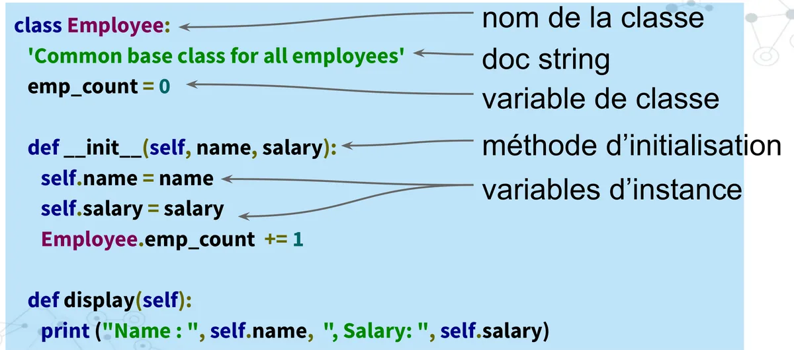

# Programmation orientée objet

## 1. Vocabulaire

| Terme | Définition |
|---|---|
| **Objet** | une structure qui regroupe des **données** et des **fonctions** qui agissent dessus |
| **Classe** | le **modèle** qui décrit les attributs de tous les objets de ce type |
| **Instance** | un objet fabriqué à partir d'une classe : `emp1` est une instance de `Employee` |

Les **attributs** sont de trois sortes :

- **variable d'instance** : propre à **un** objet (le nom d'un employé) ;
- **variable de classe** : **partagée** par toutes les instances (le nombre total d'employés) ;
- **méthode** : une fonction définie dans la classe, qui travaille sur l'instance.

**Exemple :** la classe `Voiture` est le plan de fabrication. `v1 = Voiture("rouge")` et `v2 = Voiture("bleue")` sont deux **instances** : deux objets réels, fabriqués avec le même plan. La couleur est une variable d'instance (chaque voiture a la sienne), le nombre de roues commun à toutes pourrait être une variable de classe, et `demarrer()` serait une méthode.

**À retenir :** classe = le moule, instance = un objet sorti du moule ; on fabrique autant d'instances qu'on veut avec une seule classe.

## 2. Définir une classe

```python
class Employee:
    """Classe de base de tous les employés."""
    emp_count = 0

    def __init__(self, name, salary):
        self.name = name
        self.salary = salary
        Employee.emp_count += 1

    def display(self):
        print("Name :", self.name, ", Salary:", self.salary)


emp1 = Employee("Tom", 2000)
emp2 = Employee("Bob", 5000)
emp1.display()
emp2.display()
print("Total Employee %d" % Employee.emp_count)
```

- `emp_count = 0`, écrit dans le corps de la classe, est une **variable de classe**. On la modifie en passant par la classe : `Employee.emp_count += 1`.
- `__init__` est l'**initialiseur** : il est appelé automatiquement à la création de l'objet et définit les **variables d'instance** (`self.name`, `self.salary`).
- Pour créer une instance, on **appelle la classe** avec les paramètres de `__init__`, sans `self`.
- On accède aux attributs avec le **point** : `emp1.name`, `emp1.display()`.

Sur l'image, la même classe tirée des diapos, avec une flèche vers chaque partie : le nom de la classe, la docstring (le texte qui la décrit), la variable de classe `emp_count`, la méthode d'initialisation `__init__` et les variables d'instance rangées dans `self`.



La syntaxe : le mot-clé `class`, le nom de la classe (avec une majuscule au début de chaque mot, par convention : `CompteBancaire`), deux-points, puis le corps **indenté**. Pas d'accolades, pas de `new` : on crée un objet en écrivant `Employee(...)` comme un appel de fonction.

**Exemple résolu : ce qui se passe pendant `emp1 = Employee("Tom", 2000)`.**

1. Python fabrique un objet vide de type `Employee`.
2. Il appelle `__init__` en mettant cet objet dans `self` : `self` = le nouvel objet, `name` = `"Tom"`, `salary` = 2000.
3. `self.name = name` range `"Tom"` **dans l'objet** (attribut `name`) ; pareil pour `salary`.
4. `Employee.emp_count += 1` : le compteur partagé passe de 0 à 1.
5. L'objet est rangé dans `emp1`.

Après `emp2 = Employee("Bob", 5000)`, le compteur vaut 2 : il appartient à la **classe**, pas à un employé. `"Total Employee %d" % 2` remplace `%d` par le nombre (même rôle qu'une f-string).

**À retenir :** `Classe(arguments)` crée l'objet puis appelle `__init__(self, arguments)` ; tout ce qui est rangé dans `self.xxx` reste attaché à l'objet.

### Méthodes qui modifient, méthodes qui renvoient

Une méthode peut **modifier** l'objet (elle change `self.xxx`, et ne renvoie rien), ou **renvoyer** un résultat calculé (avec `return`), voire un **nouvel** objet sans toucher à l'ancien.

```python
import math


class Segment:
    def __init__(self, longueur):
        self.longueur = longueur

    def allonger(self, d):
        self.longueur += d

    def double(self):
        return Segment(self.longueur * 2)

    def resume(self):
        return "Segment de " + str(self.longueur) + " cm"

    def diagonale_du_carre(self):
        return math.sqrt(2 * self.longueur ** 2)


s = Segment(3)
s.allonger(1)
print(s.longueur)
t = s.double()
print(s.longueur, t.longueur)
print(s.resume())
print(s.allonger(1))
print(round(Segment(1).diagonale_du_carre(), 3))
```

Pas à pas :

1. `s.allonger(1)` modifie `s` : sa longueur passe de 3 à 4.
2. `s.double()` fabrique un **autre** `Segment` de longueur 8 et le renvoie ; `s` garde 4.
3. `resume()` **renvoie** un texte (elle n'affiche rien) : c'est le `print` autour qui l'affiche. `str(...)` est nécessaire, car `"de " + 4` lève une `TypeError`.
4. `print(s.allonger(1))` affiche `None` : une méthode sans `return` renvoie `None`.
5. `math.sqrt` calcule une racine carrée (il faut `import math` en haut du fichier) : la diagonale d'un carré de côté 1 vaut racine de 2, environ 1.414.

**Exemple résolu : augmenter une valeur d'un pourcentage.** Augmenter de `p` % revient à multiplier par `1 + p / 100`. Avec un loyer de 800 et une hausse de 3 % : `800 × 1.03` = 824.0. On arrondit avec `round(..., 2)` pour garder des centimes propres.

```python
class Loyer:
    def __init__(self, montant):
        self.montant = montant

    def augmenter(self, pourcentage):
        self.montant = round(self.montant * (1 + pourcentage / 100), 2)


loyer = Loyer(800)
loyer.augmenter(3)
print(loyer.montant)
```

**À retenir :** « modifier l'objet » = changer `self.xxx` ; « renvoyer un nouvel objet » = `return Classe(...)` sans toucher à `self` ; « renvoyer un texte » = `return`, pas `print`.

### `self`

Le premier paramètre de chaque méthode est **`self`** : une référence vers l'objet sur lequel on appelle la méthode. On ne le donne **jamais** à l'appel, Python l'ajoute : `emp1.display()` équivaut à `Employee.display(emp1)`.

> [!warning] Oublier `self`
> - `def display():` sans `self` : l'appel `emp1.display()` lève une `TypeError` (Python passe l'objet, mais la méthode n'a pas de place pour lui).
> - `name = name` au lieu de `self.name = name` crée une variable locale, perdue à la fin de `__init__`.

**Exemple résolu : les deux oublis.**

```python
class Lampe:
    def __init__(self, couleur):
        couleur = couleur

    def allumer():
        return "allumée"


lampe = Lampe("verte")
print(hasattr(lampe, "couleur"))
try:
    lampe.allumer()
except TypeError as erreur:
    print("TypeError :", erreur)
```

1. Dans `__init__`, `couleur = couleur` range la valeur dans une variable **locale** : elle disparaît à la fin de la méthode. `hasattr(lampe, "couleur")` (« l'objet a-t-il cet attribut ? ») vaut `False`.
2. `lampe.allumer()` devient `Lampe.allumer(lampe)` : Python donne 1 argument, la méthode n'en attend aucun → `TypeError`.

**À retenir :** chaque méthode commence par `self`, et chaque donnée à garder s'écrit `self.donnee = ...`.

### Ajouter et supprimer des attributs

Python permet d'ajouter, modifier ou supprimer une variable d'instance **à la volée**, sur un seul objet :

```python
class Employee:
    emp_count = 0

    def __init__(self, name):
        self.name = name
        Employee.emp_count += 1


emp1 = Employee("Tom")
emp2 = Employee("Bob")
emp1.age = 7
emp1.age = 8
print(emp1.age, hasattr(emp2, "age"))
del emp1.age
print(hasattr(emp1, "age"))

emp1.emp_count = 100
print(Employee.emp_count, emp1.emp_count, emp2.emp_count)
```

> [!warning] Variable de classe masquée
> **Lire** `emp1.emp_count` remonte à la classe si l'objet n'a pas cet attribut. Mais **écrire** `emp1.emp_count = 100` crée une variable d'instance sur `emp1` seulement : la variable de classe ne change pas.

**Exemple résolu : la dernière ligne affiche `2 100 2`.**

| Expression | Où Python cherche | Valeur |
|---|---|---|
| `Employee.emp_count` | dans la classe | 2 (deux employés créés) |
| `emp1.emp_count` | dans `emp1` d'abord : il a maintenant son **propre** `emp_count` | 100 |
| `emp2.emp_count` | dans `emp2` : rien, donc dans la classe | 2 |

`emp1.emp_count = 100` n'a pas touché la variable de classe : il a créé un attribut sur `emp1`, qui **cache** celui de la classe pour cet objet seulement. C'est pour ça qu'on écrit `Employee.emp_count += 1` (par la classe) dans `__init__`.

**À retenir :** une variable de classe se **modifie** toujours par le nom de la classe ; par une instance, on crée une copie qui la cache.

```anim
classes-objets
```

## 3. Encapsulation et attributs privés

Python n'a **pas d'encapsulation stricte** : tout attribut est accessible de l'extérieur. Il y a des conventions :

| Écriture | Sens |
|---|---|
| `self.x` | public |
| `self._x` | interne : « ne pas toucher de l'extérieur » (simple convention) |
| `self.__x` | privé : Python le renomme en `_Classe__x`, donc `obj.__x` ne marche plus |

Pour lire ou modifier un attribut privé, on écrit des **accesseurs** `get_x` et `set_x`, qui peuvent vérifier les valeurs :

```python
class Compte:
    def __init__(self, solde):
        self.__solde = solde

    def get_solde(self):
        return self.__solde

    def set_solde(self, valeur):
        if valeur < 0:
            raise ValueError("solde négatif interdit")
        self.__solde = valeur


c = Compte(100)
c.set_solde(c.get_solde() + 50)
print(c.get_solde())
print(hasattr(c, "__solde"), c._Compte__solde)
```

**Exemple résolu : où est passé `__solde` ?**

1. Dans la classe `Compte`, `self.__solde` (deux `_` devant) est **renommé** par Python en `self._Compte__solde` (un `_`, le nom de la classe, puis le nom). C'est le *name mangling* (« déformation du nom »).
2. Depuis l'extérieur, `c.__solde` n'existe donc pas : `hasattr(c, "__solde")` vaut `False`.
3. Mais le nom déformé reste accessible : `c._Compte__solde` vaut 150. Le renommage décourage, il n'interdit pas.
4. À l'intérieur des méthodes de la classe, on continue d'écrire `self.__solde` : Python fait la traduction tout seul.

**À retenir :** `__x` cache l'attribut sous le nom `_Classe__x` ; on le lit avec un `get_x()` et on le change par des méthodes qui vérifient les valeurs.

### Refuser une valeur : `raise`

`raise ValueError("message")` **arrête** la méthode et signale une erreur à celui qui l'a appelée. Pour que l'objet ne change pas en cas d'erreur, on fait **toutes les vérifications avant** de modifier quoi que ce soit.

| Erreur | Quand l'utiliser |
|---|---|
| `ValueError` | valeur interdite (montant négatif, quantité trop grande...) |
| `IndexError` | accès à une position qui n'existe pas (structure vide) |
| `KeyError` | clé (nom, identifiant) inconnue |
| `ZeroDivisionError` | division par zéro |
| `NotImplementedError` | méthode que chaque sous-classe doit écrire (section 6) |

```python
class Reservoir:
    def __init__(self, capacite, niveau=0):
        self.capacite = capacite
        self.__niveau = niveau

    def get_niveau(self):
        return self.__niveau

    def vider(self, litres):
        if litres <= 0:
            raise ValueError("quantité invalide")
        if litres > self.__niveau:
            raise ValueError("pas assez de carburant")
        self.__niveau -= litres


r = Reservoir(50, 20)
r.vider(5)
for essai in (-2, 100):
    try:
        r.vider(essai)
    except ValueError as erreur:
        print(essai, "refusé :", erreur)
print(r.get_niveau(), Reservoir(40).get_niveau())
```

Pas à pas :

1. `Reservoir(50, 20)` : capacité 50, niveau 20. `niveau=0` est une **valeur par défaut** : `Reservoir(40)` démarre à 0.
2. `vider(5)` passe les deux tests, le niveau devient 15.
3. `vider(-2)` : `-2 <= 0`, la première vérification lève l'erreur ; la ligne `self.__niveau -= litres` n'est jamais atteinte.
4. `vider(100)` : 100 est positif, mais `100 > 15` : deuxième erreur, le niveau reste 15.
5. `except ValueError as erreur` attrape l'erreur ; `erreur` contient le message donné au `raise`.

Si on avait écrit `self.__niveau -= litres` **avant** les tests, le niveau aurait changé avant l'erreur : l'objet serait abîmé.

**À retenir :** d'abord tous les `if ...: raise ...`, ensuite seulement la modification. « Strictement positif » se teste avec `if x <= 0: raise`.

## 4. Les propriétés

Les accesseurs sont lourds à écrire à l'usage. Une **propriété** permet d'écrire `obj.x` et `obj.x = valeur` tout en passant par un getter et un setter :

1. on écrit `_get_x` et `_set_x`, qui manipulent **`self._x`** ;
2. on déclare `x = property(_get_x, _set_x)` ;
3. on utilise directement `obj.x`.

```python
class Employee:
    def __init__(self, name):
        self.name = name

    def _get_name(self):
        return self._name

    def _set_name(self, name):
        if not name:
            raise ValueError("le nom ne peut pas être vide")
        self._name = name.capitalize()

    name = property(_get_name, _set_name)


e = Employee("tom")
print(e.name)
e.name = "bob"
print(e.name)
try:
    e.name = ""
except ValueError as erreur:
    print("Refusé :", erreur)
```

**Exemple résolu : le trajet de chaque ligne.**

| Ligne | Ce que Python appelle | Effet |
|---|---|---|
| `Employee("tom")` | `__init__`, qui fait `self.name = "tom"` → **le setter** `_set_name` | `_name` vaut `"Tom"` |
| `print(e.name)` | le getter `_get_name` | affiche `Tom` |
| `e.name = "bob"` | le setter | `_name` vaut `"Bob"` |
| `e.name = ""` | le setter : `not ""` est vrai | `ValueError`, `_name` reste `"Bob"` |

Point important : dans `__init__`, `self.name = name` passe **déjà** par le setter. La vérification marche donc aussi à la création de l'objet : `Employee("")` lèverait l'erreur.

**À retenir :** avec une propriété, chaque `obj.x = ...` (même dans `__init__`) passe par le setter, et chaque lecture `obj.x` par le getter.

> [!warning] `self._name`, pas `self.name`
> Dans le getter, `return self.name` rappellerait le getter à l'infini (`RecursionError`). La propriété s'appelle `name`, la vraie donnée est rangée dans `_name`.

La même chose avec les **décorateurs** `@property` et `@x.setter` (l'écriture la plus courante) :

```python
class Temperature:
    def __init__(self, celsius):
        self.celsius = celsius

    @property
    def celsius(self):
        return self._celsius

    @celsius.setter
    def celsius(self, valeur):
        if valeur < -273.15:
            raise ValueError("en dessous du zéro absolu")
        self._celsius = valeur

    @property
    def fahrenheit(self):
        return self._celsius * 9 / 5 + 32


t = Temperature(20)
print(t.celsius, t.fahrenheit)
t.celsius = 100
print(t.fahrenheit)
```

Une propriété **sans setter** est en lecture seule : `t.fahrenheit = 50` lève une `AttributeError`.

**Exemple résolu : une propriété calculée qu'on peut aussi modifier.** Un prix est stocké hors taxes (`ht`) ; la propriété `ttc` le calcule avec 20 % de TVA. Pour pouvoir **écrire** `p.ttc = ...`, on lui ajoute un setter qui fait le calcul **à l'envers** et range le résultat dans `ht` : une seule vraie donnée, deux façons de la voir.

```python
class Prix:
    def __init__(self, ht):
        self.ht = ht

    @property
    def ht(self):
        return self._ht

    @ht.setter
    def ht(self, valeur):
        if valeur < 0:
            raise ValueError("prix négatif")
        self._ht = valeur

    @property
    def ttc(self):
        return round(self.ht * 1.2, 2)

    @ttc.setter
    def ttc(self, valeur):
        self.ht = round(valeur / 1.2, 2)


p = Prix(50)
print(p.ttc)
p.ttc = 30
print(p.ht, p.ttc)
try:
    p.ttc = -6
except ValueError as erreur:
    print("Refusé :", erreur)
```

1. `Prix(50)` : le setter de `ht` vérifie 50 et le range dans `_ht`.
2. `p.ttc` : `50 × 1.2` = 60.0.
3. `p.ttc = 30` : on inverse la formule, `ht = ttc / 1.2` = 25.0 ; le setter de `ht` le vérifie et le range. Relire `p.ttc` redonne 30.0.
4. `p.ttc = -6` : le setter de `ttc` calcule `ht = -5.0`, et **le setter de `ht`** refuse. Comme `ttc` passe par `self.ht = ...` (et pas par `self._ht`), la vérification n'est écrite qu'une fois.

L'ordre des décorateurs compte : d'abord `@property` (le getter), puis `@ttc.setter` sur une méthode **du même nom**.

**À retenir :** setter d'une valeur calculée = inverser la formule, puis passer par la propriété principale (`self.ht = ...`) pour garder sa vérification.

## 5. Surcharge d'opérateurs

Si une classe définit `__add__(self, autre)`, on peut écrire `x1 + x2` : Python le traduit en `x1.__add__(x2)`. Ces méthodes entourées de doubles `_` sont les **méthodes spéciales** (liste complète dans la documentation Python, rubrique « Data model »).

| Méthode | Déclenchée par |
|---|---|
| `__add__`, `__sub__`, `__mul__` | `a + b`, `a - b`, `a * b` |
| `__eq__`, `__lt__` | `a == b`, `a < b` |
| `__len__`, `__contains__` | `len(a)`, `x in a` |
| `__str__` | `print(a)`, `str(a)` : texte lisible |
| `__repr__` | affichage dans l'interpréteur ou dans une liste : texte technique |

```python
class Vecteur:
    def __init__(self, x, y):
        self.x = x
        self.y = y

    def __add__(self, autre):
        return Vecteur(self.x + autre.x, self.y + autre.y)

    def __eq__(self, autre):
        return self.x == autre.x and self.y == autre.y

    def __str__(self):
        return "(" + str(self.x) + ", " + str(self.y) + ")"

    def __repr__(self):
        return "Vecteur(" + str(self.x) + ", " + str(self.y) + ")"


v = Vecteur(1, 2) + Vecteur(3, 4)
print(v)
print([v])
print(v == Vecteur(4, 6))
```

> [!info] Sans `__str__` ni `__eq__`
> `print(obj)` affiche `<__main__.Classe object at 0x...>`, et `==` teste si c'est **le même objet**, pas si le contenu est égal.

**Exemple résolu : une durée en minutes.**

```python
class Duree:
    def __init__(self, minutes):
        self.minutes = minutes

    def __add__(self, autre):
        return Duree(self.minutes + autre.minutes)

    def __sub__(self, autre):
        return Duree(self.minutes - autre.minutes)

    def __mul__(self, nombre):
        return Duree(self.minutes * nombre)

    def __eq__(self, autre):
        return self.minutes == autre.minutes

    def __lt__(self, autre):
        return self.minutes < autre.minutes

    def __str__(self):
        return "%dh%02d" % (self.minutes // 60, self.minutes % 60)

    def __repr__(self):
        return "Duree(" + str(self.minutes) + ")"


film = Duree(95)
pause = Duree(15)
print(film + pause, film - pause, pause * 3)
print([film, pause])
print(film == Duree(95), pause < film)
print(sorted([film, pause, Duree(40)]))
```

| On écrit | Python appelle | Résultat |
|---|---|---|
| `film + pause` | `film.__add__(pause)` | `Duree(110)`, affiché `1h50` |
| `film - pause` | `film.__sub__(pause)` | `Duree(80)`, affiché `1h20` |
| `pause * 3` | `pause.__mul__(3)` : `autre` est ici un **nombre**, pas une durée | `Duree(45)`, affiché `0h45` |
| `film == Duree(95)` | `__eq__` : compare les contenus | `True` |
| `pause < film` | `__lt__` | `True` |
| `sorted([...])` | `sorted` utilise `<`, donc `__lt__` | `[Duree(15), Duree(40), Duree(95)]` |

Chaque opération **renvoie une nouvelle** `Duree` : `film` et `pause` ne changent jamais. Dans `__str__`, `95 // 60` = 1 (heures), `95 % 60` = 35 (minutes restantes), et `%02d` écrit le nombre sur 2 chiffres (`5` devient `05`). `print([film, pause])` affiche une liste : Python utilise alors `__repr__` pour chaque élément.

**À retenir :** `a + b` → `a.__add__(b)` qui **renvoie** `Classe(...)` ; le deuxième paramètre peut être un objet de la même classe ou un simple nombre.

### `__str__` et `__repr__`

- `__str__` : texte pour l'utilisateur, utilisé par `print(obj)` et `str(obj)`.
- `__repr__` : texte technique, qui ressemble à du code Python ; utilisé par `repr(obj)`, dans une liste affichée, et par `print` **si** `__str__` n'existe pas.

Pour qu'un `__repr__` montre les chaînes **avec leurs guillemets**, on utilise `repr(valeur)` (ou `%r`) sur chaque attribut :

```python
class Carte:
    def __init__(self, valeur, couleur):
        self.valeur = valeur
        self.couleur = couleur

    def __repr__(self):
        return "Carte(" + repr(self.valeur) + ", " + repr(self.couleur) + ")"


c = Carte("As", "pique")
print(c, [c])
print(repr("As"), str("As"), "%r et %d" % ("As", 7))
```

Pas à pas : `repr("As")` donne `'As'` **avec** les apostrophes, `str("As")` donne `As` sans. Il n'y a pas de `__str__` : `print(c)` utilise `__repr__` et affiche `Carte('As', 'pique')`, comme dans la liste.

**À retenir :** `__str__` pour joli, `__repr__` pour « comme on l'écrirait en code » ; `repr(...)` ou `%r` pour garder les guillemets des chaînes.

### `__len__` et `__contains__` : un objet qui contient des choses

Une classe peut ranger ses données dans une liste ou un dictionnaire **interne** (un attribut `_elements`). `__len__` permet alors `len(obj)`, et `__contains__` permet `x in obj`. Bonus : avec `__len__`, un objet de longueur 0 vaut **faux** dans un `if`.

Rappels sur les listes : `l.append(x)` ajoute à la fin, `l[-1]` est le dernier élément, `l.pop()` **retire et renvoie** le dernier élément ; sur une liste vide, `l[-1]` et `l.pop()` lèvent une `IndexError`.

```python
class Playlist:
    def __init__(self):
        self._titres = []

    def ajouter(self, titre):
        self._titres.append(titre)

    def derniere(self):
        if not self._titres:
            raise IndexError("playlist vide")
        return self._titres[-1]

    def __len__(self):
        return len(self._titres)

    def __contains__(self, titre):
        return titre in self._titres

    def __repr__(self):
        return "Playlist(" + str(self._titres) + ")"


p = Playlist()
print(len(p), bool(p))
p.ajouter("Intro")
p.ajouter("Final")
print(p, len(p), "Intro" in p, "Bonus" in p)
print(p.derniere(), p)

l = ["a", "b"]
print(l.pop(), l)
```

1. Au départ, `len(p)` appelle `__len__` : 0. `bool(p)` vaut `False` : Python utilise `__len__` pour décider si l'objet est « vide ».
2. Après deux `ajouter`, `__repr__` affiche la liste interne : `Playlist(['Intro', 'Final'])`. `str(liste)` donne le texte de la liste avec ses crochets.
3. `"Intro" in p` appelle `p.__contains__("Intro")` : `True` ; `"Bonus" in p` : `False`.
4. `derniere()` lit `_titres[-1]` sans rien retirer : la playlist ne change pas.
5. Sur une liste simple, `l.pop()` retire `"b"` **et** le renvoie : il reste `['a']`.

**À retenir :** une classe « conteneur » garde une liste ou un dictionnaire dans `self._...`, et ses méthodes spéciales délèguent à ce conteneur (`len(self._x)`, `x in self._x`).

### Normaliser dans `__init__` : l'exemple d'un format d'écran

Parfois, `__init__` doit **transformer** les valeurs reçues pour toujours ranger la même forme. Un format d'image `1920 × 1080` est le même que `16 × 9` : on divise les deux nombres par leur **PGCD** (plus grand diviseur commun), donné par `math.gcd`.

```python
import math


class Format:
    def __init__(self, largeur, hauteur):
        if hauteur == 0:
            raise ZeroDivisionError("hauteur nulle")
        if hauteur < 0:
            largeur, hauteur = -largeur, -hauteur
        d = math.gcd(largeur, hauteur)
        self.l = largeur // d
        self.h = hauteur // d

    def __eq__(self, autre):
        return self.l == autre.l and self.h == autre.h

    def __lt__(self, autre):
        return self.l * autre.h < autre.l * self.h

    def __str__(self):
        return str(self.l) + ":" + str(self.h)


print(Format(1920, 1080), Format(-4, -3), Format(800, 600) == Format(4, 3))
print(Format(4, 3) < Format(16, 9), math.gcd(1920, 1080))
```

Pas à pas :

1. `math.gcd(1920, 1080)` vaut 120 ; `1920 // 120` = 16 et `1080 // 120` = 9 : le format est rangé `16:9`. `//` est la division **entière** (le résultat reste un `int`).
2. `Format(-4, -3)` : la hauteur est négative, on change le signe **des deux** nombres, ce qui donne `4:3`. Le signe se retrouve toujours en haut.
3. Comme tout est simplifié à la création, `__eq__` peut comparer directement : `800:600` devient `4:3`, égal à `Format(4, 3)`.
4. `__lt__` compare `a/b < c/d` **sans division**, en multipliant en croix (les hauteurs sont positives) : `4 × 9 = 36` contre `16 × 3 = 48`, 36 < 48 donc `4:3` est plus petit que `16:9`.

Pour les calculs de fractions : `a/b + c/d = (a×d + c×b) / (b×d)` et `a/b × c/d = (a×c) / (b×d)`. Par exemple `1/4 + 1/6 = (6 + 4) / 24 = 10/24`, qui se simplifie en `5/12` (PGCD 2). Si `__init__` simplifie, il suffit de renvoyer `Classe(numérateur, dénominateur)` : le nouvel objet se simplifie tout seul.

**À retenir :** simplifie et range les signes **une fois** dans `__init__`, et toutes les autres méthodes peuvent compter sur cette forme.

## 6. L'héritage

L'**héritage** permet de créer une classe à partir d'une autre : la classe **enfant** récupère tous les attributs et méthodes de la classe **parente**, et peut en ajouter.

```python
class Employee:
    def __init__(self, name, salary):
        self.name = name
        self.salary = salary

    def display(self):
        print("Name :", self.name, ", Salary:", self.salary)


class ITGuy(Employee):
    def __init__(self, name, salary, computer):
        Employee.__init__(self, name, salary)
        self.computer = computer

    def display(self):
        super().display()
        print("Computer :", self.computer)


bob = ITGuy("Bob", 2000, "ASUS")
bob.display()
print(isinstance(bob, Employee), issubclass(ITGuy, Employee))
```

- `class ITGuy(Employee):` : `ITGuy` hérite de `Employee` ;
- l'initialiseur de l'enfant **doit appeler** celui du parent : `Employee.__init__(self, ...)` ou `super().__init__(...)` (sans `self`) ;
- l'enfant peut **redéfinir** une méthode (ici `display`), et appeler la version du parent avec `super()`.

**Exemple résolu : un étudiant qui hérite d'une personne.**

```python
class Personne:
    def __init__(self, nom):
        self.nom = nom

    def carte(self):
        return "Nom : " + self.nom

    def saluer(self):
        return "Bonjour, je suis " + self.nom


class Etudiant(Personne):
    def __init__(self, nom, ecole):
        super().__init__(nom)
        self.ecole = ecole

    def carte(self):
        return super().carte() + ", École : " + self.ecole


e = Etudiant("Lina", "ESGI")
print(e.carte())
print(e.saluer())
print(isinstance(e, Personne), type(e) is Personne, type(e).__name__)
```

1. `Etudiant("Lina", "ESGI")` appelle `Etudiant.__init__`. Sa première ligne, `super().__init__(nom)`, exécute `Personne.__init__` : `self.nom` existe. Sans cette ligne, `e.nom` n'existerait pas (`AttributeError`), car l'`__init__` du parent n'est **plus** appelé tout seul dès que l'enfant a le sien.
2. `e.carte()` : `Etudiant` a sa propre `carte`. Elle **réutilise** celle du parent avec `super().carte()` (qui donne `"Nom : Lina"`) et y ajoute l'école. On ne recopie pas le code du parent.
3. `e.saluer()` : `Etudiant` n'a pas de `saluer`, Python va la chercher dans `Personne` : elle est **héritée telle quelle**.
4. `isinstance(e, Personne)` vaut `True` (un étudiant **est une** personne) ; `type(e) is Personne` vaut `False` (son type exact est `Etudiant`) ; `type(e).__name__` donne le nom de la classe réelle sous forme de texte : `'Etudiant'`.

Attention aux parenthèses : `super().__init__(nom)`. Sans elles, `super.__init__(nom)` ne désigne pas le parent et lève une `TypeError`. Et avec `super()`, on ne passe **pas** `self` ; avec le nom du parent (`Personne.__init__(self, nom)`), on le passe.

**À retenir :** dans l'enfant, `super().__init__(...)` en première ligne, puis les attributs en plus ; `super().methode()` pour compléter la version du parent au lieu de la recopier.

### Polymorphisme : toutes les méthodes sont virtuelles

C'est toujours la méthode de la classe **réelle** de l'objet qui est appelée. Une même boucle traite donc des objets différents :

```python
class Animal:
    def parler(self):
        return "..."


class Chien(Animal):
    def parler(self):
        return "Wouf"


class Chat(Animal):
    def parler(self):
        return "Miaou"


for a in [Chien(), Chat(), Animal()]:
    print(type(a).__name__, ":", a.parler())
```

Pas à pas : au premier tour, `a` est un `Chien` : Python cherche `parler` d'abord dans `Chien`, la trouve, affiche `Wouf`. Au deuxième, `Chat` : `Miaou`. Au troisième, un `Animal` : `...`. La boucle n'a jamais besoin de savoir quel animal elle tient.

**Exemple résolu : une méthode du parent qui utilise une méthode des enfants.** Le parent `Boisson` définit `description()`, qui appelle `self.prix()`. Il ne sait pas calculer le prix lui-même : il lève `NotImplementedError` pour obliger chaque enfant à écrire sa version.

```python
class Boisson:
    def prix(self):
        raise NotImplementedError("chaque boisson doit définir prix()")

    def description(self):
        return "%s à %.2f €" % (type(self).__name__, self.prix())


class Cafe(Boisson):
    def __init__(self, doses):
        self.doses = doses

    def prix(self):
        return 1.2 * self.doses


class Double(Cafe):
    def __init__(self):
        super().__init__(2)


class The(Boisson):
    def prix(self):
        return 1.5


commande = [Cafe(1), Double(), The()]
for b in commande:
    print(b.description())
print(round(sum(b.prix() for b in commande), 2))
try:
    Boisson().description()
except NotImplementedError as erreur:
    print("Erreur :", erreur)
```

| Objet | `type(self).__name__` | `self.prix()` appelé | Texte |
|---|---|---|---|
| `Cafe(1)` | `Cafe` | celui de `Cafe` : 1.2 × 1 | `Cafe à 1.20 €` |
| `Double()` | `Double` | hérité de `Cafe` : 1.2 × 2 | `Double à 2.40 €` |
| `The()` | `The` | celui de `The` | `The à 1.50 €` |

- `description` est écrite **une seule fois**, dans `Boisson`, mais `self` est l'objet réel : `self.prix()` appelle la bonne version, et `type(self).__name__` donne le bon nom (pas `"Boisson"`).
- `Double` hérite de `Cafe` et appelle `super().__init__(2)` : il réutilise l'initialiseur du parent avec une valeur fixée. Un enfant peut donc avoir **moins** de paramètres que son parent.
- `%.2f` écrit le nombre avec 2 décimales (`1.5` devient `1.50`).
- `sum(b.prix() for b in commande)` additionne les prix de toutes les boissons, quel que soit leur type : 5.1.
- `Boisson()` seule n'a pas de vrai prix : appeler `description()` déclenche l'erreur.

**À retenir :** écris le code commun dans le parent en appelant `self.methode()` ; chaque enfant fournit sa version, et c'est celle de la classe **réelle** qui s'exécute.

## 7. L'héritage multiple

Une classe peut hériter de **plusieurs** parents. Un `ITGuy` est à la fois un `Employee` et un `Geek` :

```python
class Employee:
    def __init__(self, name, salary):
        self.name = name
        self.salary = salary

    def presentation(self):
        return self.name + " (employé)"


class Geek:
    def __init__(self, name, computer):
        self.name = name
        self.computer = computer

    def presentation(self):
        return self.name + " (geek)"


class ITGuy(Employee, Geek):
    def __init__(self, name, salary, computer):
        Employee.__init__(self, name, salary)
        Geek.__init__(self, name, computer)


bob = ITGuy("Bob", 2000, "ASUS")
print(bob.salary, bob.computer)
print(bob.presentation())
print([c.__name__ for c in ITGuy.__mro__])
```

> [!info] Ordre de recherche (MRO)
> Si plusieurs parents ont une méthode du même nom, Python prend celle du **premier parent listé**. L'ordre complet (*Method Resolution Order*) se lit dans `Classe.__mro__` : ici `ITGuy`, `Employee`, `Geek`, `object`.

**Exemple résolu : un véhicule amphibie, à la fois voiture et bateau.**

```python
class Voiture:
    def __init__(self, nom, roues):
        self.nom = nom
        self.roues = roues

    def avancer(self):
        return self.nom + " roule"


class Bateau:
    def __init__(self, nom, helices):
        self.nom = nom
        self.helices = helices

    def avancer(self):
        return self.nom + " navigue"

    def couler(self):
        return self.nom + " ne coule pas avec " + str(self.helices) + " hélice(s)"


class Amphibie(Voiture, Bateau):
    def __init__(self, nom, roues, helices):
        Voiture.__init__(self, nom, roues)
        Bateau.__init__(self, nom, helices)

    def fiche(self):
        return self.avancer() + ", " + str(self.roues) + " roues, " + str(self.helices) + " hélice(s)"


a = Amphibie("Duck", 4, 1)
print(a.avancer())
print(a.couler())
print(a.fiche())
print([c.__name__ for c in Amphibie.__mro__])
```

1. L'`__init__` d'`Amphibie` appelle **les deux** initialiseurs, avec le nom de chaque parent et `self` : `Voiture.__init__` crée `nom` et `roues`, `Bateau.__init__` crée `helices`. Avec `super().__init__(...)`, seul le premier parent serait appelé ici : on nomme donc les parents un par un.
2. `a.avancer()` : Python suit le MRO `Amphibie`, `Voiture`, `Bateau`, `object`. `Amphibie` n'a pas d'`avancer`, `Voiture` en a une : c'est elle, `"Duck roule"`. Pas d'erreur d'ambiguïté, et pas d'appel des deux.
3. `a.couler()` : ni `Amphibie` ni `Voiture` ne l'ont, on continue jusqu'à `Bateau` : la méthode du **second** parent marche aussi.
4. `fiche()` utilise des attributs venus des **deux** parents (`roues` et `helices`) et `self.avancer()` (celle de `Voiture`).

Pour que `avancer` soit celle de `Bateau`, il suffirait d'écrire `class Amphibie(Bateau, Voiture):` : l'ordre des parents décide.

**À retenir :** méthode cherchée de gauche à droite dans la liste des parents (le MRO) ; dans `__init__`, appelle chaque parent par son nom avec `self`.

> [!tip] « Est un » ou « a un » ?
> L'héritage convient quand l'enfant **est un** parent. Si l'objet **a un** élément (un `ITGuy` a un ordinateur), un simple attribut suffit souvent.

**Exemple résolu : un objet qui contient d'autres objets.** Une bibliothèque **a des** livres : ce n'est pas de l'héritage, c'est un attribut, ici un dictionnaire « titre → objet `Exemplaire` ». Chaque `Exemplaire` protège son nombre de copies avec une propriété.

```python
class Exemplaire:
    def __init__(self, titre, copies):
        self.titre = titre
        self.copies = copies

    @property
    def copies(self):
        return self._copies

    @copies.setter
    def copies(self, valeur):
        if valeur < 0:
            raise ValueError("nombre de copies négatif")
        self._copies = valeur


class Bibliotheque:
    def __init__(self):
        self._livres = {}

    def ajouter(self, exemplaire):
        if exemplaire.titre in self._livres:
            self._livres[exemplaire.titre].copies += exemplaire.copies
        else:
            self._livres[exemplaire.titre] = exemplaire

    def preter(self, titre):
        if titre not in self._livres:
            raise KeyError(titre)
        livre = self._livres[titre]
        if livre.copies == 0:
            raise ValueError("plus de copie disponible")
        livre.copies -= 1

    def indisponibles(self):
        return sorted(t for t, livre in self._livres.items() if livre.copies == 0)

    def __len__(self):
        return len(self._livres)

    def __contains__(self, titre):
        return titre in self._livres


bib = Bibliotheque()
bib.ajouter(Exemplaire("Dune", 1))
bib.ajouter(Exemplaire("Candide", 2))
bib.ajouter(Exemplaire("Dune", 1))
bib.preter("Candide")
bib.preter("Candide")
print(len(bib), "Dune" in bib, bib.indisponibles())
for essai in ("Candide", "Zadig"):
    try:
        bib.preter(essai)
    except (KeyError, ValueError) as erreur:
        print(type(erreur).__name__, erreur)
```

1. Le premier `ajouter` range l'objet `Dune` (1 copie) dans le dictionnaire, sous la clé `"Dune"`.
2. Le troisième `ajouter` trouve `"Dune"` déjà présent : il **ne remplace pas** l'objet, il augmente ses copies (`1 + 1` = 2). `livre.copies += 1` passe par le setter, donc la vérification marche aussi ici.
3. Deux prêts de `Candide` : ses copies passent de 2 à 0, mais le livre **reste** dans la bibliothèque.
4. `len(bib)` compte les titres différents (2), `"Dune" in bib` appelle `__contains__` (`True`), `indisponibles()` trie les titres à 0 copie : `['Candide']`.
5. Prêter `Candide` à nouveau : `ValueError`, rien ne change. Prêter `Zadig` : titre inconnu, `KeyError`. `except (KeyError, ValueError)` attrape les deux sortes d'erreurs ; `type(erreur).__name__` donne le nom de l'erreur.

**À retenir :** « a un / a des » = un attribut (souvent une liste ou un dictionnaire d'objets) ; la classe qui contient délègue les vérifications aux objets contenus.
