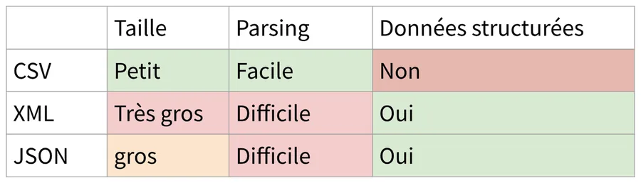

# Fichiers, CSV et JSON

Un **fichier** est une suite de données, rangée sous un **nom** sur un support (disque, clé USB...). Un script passe son temps à en lire et à en écrire : journaux, exports de tableur, configurations, réponses d'API. Ce chapitre reprend les bases vues au chapitre « Notions avancées » (`open`, `with`) et va plus loin : modes, encodage, lecture fine, puis les deux formats de données les plus courants, **CSV** et **JSON**.

> [!info] Les exemples créent leurs fichiers
> Chaque exemple de ce cours commence par écrire le fichier dont il a besoin, puis le relit : tu peux tous les lancer avec « Essayer » sans rien préparer.

## 1. Fichier texte ou fichier binaire

| | Fichier texte | Fichier binaire |
|---|---|---|
| Contenu | des **caractères**, lisibles par un humain | des **octets** qu'il faut décoder |
| Exemples | `.txt`, code source (`.py`, `.c`, `.html`), données (`.csv`, `.json`, `.xml`) | images (`.png`, `.jpg`), sons et vidéos (`.mp3`, `.mp4`), programmes (`.exe`) |
| En Python | on lit et on écrit des `str` | on lit et on écrit des `bytes` |

Au fond, tout fichier est une suite d'octets. Un fichier texte est simplement un fichier dont les octets représentent des caractères selon un **encodage** (voir plus bas).

**Exemple résolu : texte ou binaire ?** On se demande : « si j'ouvre ce fichier dans le Bloc-notes, est-ce que je peux le lire ? »

| Fichier | Lisible dans le Bloc-notes ? | Type |
|---|---|---|
| `rapport.txt` | oui, des phrases | texte |
| `page.html` | oui, des balises et du texte | texte |
| `export.csv` | oui, des valeurs séparées par `;` | texte |
| `logo.png` | non, des symboles sans aucun sens | binaire |
| `musique.mp3` | non | binaire |

Le CSV et le JSON sont des **données**, mais écrites en texte : ce sont des fichiers texte.

**À retenir :** lisible par un humain (même si c'est du code ou des données) = texte, à lire en `str` ; image, son, vidéo, programme = binaire, à lire en `bytes`.

## 2. Ouvrir et fermer

Manipuler un fichier ressemble à l'usage d'un cahier : on l'**ouvre**, on **lit** ou on **écrit** (en repartant de zéro ou à la suite), puis on le **ferme** pour que d'autres puissent s'en servir.

`open(nom, mode)` renvoie un **objet fichier** (*file object*), par lequel passent toutes les lectures et écritures.

| Mode | Rôle | Si le fichier existe | S'il n'existe pas |
|---|---|---|---|
| `"r"` | lecture (par défaut) | lu depuis le début | `FileNotFoundError` |
| `"w"` | écriture | **vidé** puis réécrit | créé |
| `"a"` | ajout | on écrit **à la fin** | créé |
| `"x"` | création | `FileExistsError` | créé |

On ajoute `"b"` pour le **binaire** (`"rb"`, `"wb"`, `"ab"`) et `"+"` pour lire **et** écrire (`"r+"`), plus rare.

```python
f = open("exemple.txt", "w", encoding="utf-8")
print(f.name, f.mode, f.closed)
f.write("bonjour\n")
f.close()
print(f.closed)
```

**Pas à pas :**

1. `open("exemple.txt", "w", ...)` crée le fichier (ou le vide s'il existait) et renvoie l'objet fichier `f`.
2. `f.name` est le nom donné, `f.mode` le mode, `f.closed` vaut `False` : le fichier est ouvert.
3. `f.write("bonjour\n")` écrit le texte.
4. `f.close()` ferme le fichier : `f.closed` vaut maintenant `True`. Toute lecture ou écriture sur `f` lèverait une `ValueError`.

```text
exemple.txt w False
True
```

**Exemple résolu : quel mode choisir ?**

| Je veux… | Mode | Pourquoi pas un autre ? |
|---|---|---|
| lire un fichier de configuration | `"r"` (ou rien) | `"w"` l'effacerait |
| ajouter une ligne à la fin d'un journal | `"a"` | `"w"` effacerait les anciennes lignes |
| écrire un rapport, en remplaçant l'ancien | `"w"` | `"a"` garderait l'ancien rapport au début |
| créer un fichier sans risquer d'en écraser un | `"x"` | `"w"` écraserait sans prévenir |

> [!warning] `open` et pas `fopen`
> En Python, la fonction s'appelle `open(nom, mode)`. `fopen` est son équivalent en C, et `file.open(...)` n'existe pas.

**À retenir :** `open(nom, mode, encoding="utf-8")` ; `"r"` lit (et plante si le fichier manque), `"w"` vide puis écrit, `"a"` ajoute à la fin, `"x"` crée sans jamais écraser.

### `with` : la fermeture automatique

Oublier `close()` (ou planter avant de l'atteindre) laisse le fichier ouvert. Le bloc `with` est un **gestionnaire de contexte** : il ferme le fichier tout seul en sortant du bloc, que ce soit à la fin normale, sur un `return` ou sur une exception.

```python
def premiere_ligne(chemin):
    with open(chemin, encoding="utf-8") as f:
        for ligne in f:
            if ligne.strip():
                return ligne.strip()
    return None


with open("exemple.txt", "w", encoding="utf-8") as f:
    f.write("\n\nla vraie première ligne\nla suite\n")

print(premiere_ligne("exemple.txt"))
```

Sans `with`, il faudrait penser à un `close()` avant **chaque** `return`. Avec `with`, il n'y a rien à faire.

Sur l'image : à gauche, sans `with`, il faut écrire `f.close()` deux fois, une avant chaque `return` (et en oublier un suffit à laisser le fichier ouvert). À droite, avec `with`, plus aucun `close()` : la fermeture se fait toute seule, par n'importe quelle sortie.

 avant chaque return. Avec with : aucun")

**Pas à pas :**

1. Le premier `with` écrit 4 lignes : deux lignes vides, `la vraie première ligne`, `la suite`. En sortant du bloc, le fichier est fermé (et son contenu bien enregistré).
2. `premiere_ligne` ouvre le fichier en lecture et lit les lignes une par une.
3. Ligne 1 : `"\n"`, `strip()` donne `""`, faux : on continue. Ligne 2 : pareil.
4. Ligne 3 : `strip()` donne `"la vraie première ligne"`, vrai : `return`. On sort de la fonction **au milieu** du `with`, et le fichier est quand même fermé.

```text
la vraie première ligne
```

> [!tip] Toujours `with`
> C'est la façon normale d'ouvrir un fichier en Python. Plusieurs fichiers à la fois : `with open(a) as source, open(b, "w") as cible:`.

**À retenir :** `with open(...) as f:` ferme le fichier en sortant du bloc, quelle que soit la façon d'en sortir (fin, `return`, exception) : la lecture n'est pas plus rapide, mais tu n'oublies jamais de fermer.

## 3. L'encodage

Pour ranger un caractère dans un fichier, il faut le transformer en octets : c'est l'**encodage**. Le standard actuel est **UTF-8** (1 octet pour les lettres simples, 2 pour `é`, jusqu'à 4 pour un emoji). D'anciens fichiers Windows utilisent encore **Latin-1** ou **cp1252**.

```python
texte = "été"
octets = texte.encode("utf-8")
print(octets, len(octets))
print(octets.decode("utf-8"))
print(octets.decode("latin-1"))
print(len(texte.encode("latin-1")))
```

**Pas à pas :**

1. En UTF-8, `é` prend 2 octets (`\xc3\xa9`) et `t` un seul : 2 + 1 + 2 = **5** octets.
2. Relire ces octets en UTF-8 (le bon encodage) redonne `été`.
3. Les relire en Latin-1 (le mauvais) : Latin-1 lit chaque octet comme un caractère, donc `\xc3` devient `Ã` et `\xa9` devient `©` : `été`. C'est le texte « cassé » qu'on voit parfois.
4. En Latin-1, chaque caractère prend **1** octet : 3 octets.

```text
b'\xc3\xa9t\xc3\xa9' 5
été
été
3
```

Si on ne précise rien, `open` utilise l'encodage par défaut du système, qui n'est **pas le même** partout (souvent cp1252 sur un vieux Windows, UTF-8 sur Linux et macOS). Un script qui marche chez toi peut alors afficher `été` chez un autre, ou planter avec une `UnicodeDecodeError`.

> [!warning] Précise toujours l'encodage
> Écris `open(chemin, encoding="utf-8")` pour tous les fichiers texte. En mode binaire (`"rb"`, `"wb"`), on ne met **pas** d'encodage : on manipule directement des `bytes`.

```python
with open("image.bin", "wb") as f:
    f.write(bytes([137, 80, 78, 71]))

with open("image.bin", "rb") as f:
    debut = f.read()
print(debut, list(debut))
```

**Pas à pas :** `bytes([137, 80, 78, 71])` fabrique 4 octets (ce sont les premiers octets de toute image PNG). En `"wb"`, `write` attend des `bytes`, pas une `str`, et pas d'`encoding`. En `"rb"`, `read()` renvoie des `bytes` : Python affiche les octets lisibles comme des lettres (`P`, `N`, `G`) et les autres en `\x..` ; `list(...)` redonne les nombres.

```text
b'\x89PNG' [137, 80, 78, 71]
```

**À retenir :** fichier texte → `encoding="utf-8"` à **chaque** `open` ; fichier binaire → mode `"rb"` / `"wb"`, sans encodage. Préciser l'encodage ne sert pas à rendre le fichier plus petit : cela garantit que les accents sont lus pareil sur tous les ordinateurs.

## 4. Lire

| Méthode | Renvoie |
|---|---|
| `f.read()` | **tout** le reste du fichier, en une chaîne |
| `f.read(n)` | au plus `n` caractères (`n` octets en binaire) |
| `f.readline()` | la ligne suivante, **avec** son `"\n"` ; `""` à la fin du fichier |
| `f.readlines()` | la **liste** des lignes restantes, chacune avec son `"\n"` |
| `for ligne in f:` | les lignes une par une, sans tout charger en mémoire |

```python
with open("poeme.txt", "w", encoding="utf-8") as f:
    f.write("un\ndeux\ntrois\n")

with open("poeme.txt", encoding="utf-8") as f:
    print(repr(f.read(2)))
    print(repr(f.readline()))
    print(f.readlines())
    print(repr(f.read()))
```

Le fichier garde un **curseur** : chaque lecture avance. Une fois au bout, `read()` renvoie `""`. Pour relire, on revient au début avec `f.seek(0)` (`f.tell()` donne la position actuelle).

**Pas à pas :** le fichier contient `un\ndeux\ntrois\n`. On suit le curseur (`|`).

| Lecture | Ce qui est lu | Curseur après |
|---|---|---|
| `f.read(2)` | 2 caractères : `'un'` | `un|\ndeux\ntrois\n` |
| `f.readline()` | jusqu'au prochain `\n` compris : il ne reste que `'\n'` sur cette ligne | `un\n|deux\ntrois\n` |
| `f.readlines()` | toutes les lignes restantes : `['deux\n', 'trois\n']` | à la fin |
| `f.read()` | plus rien : `''` | à la fin |

```text
'un'
'\n'
['deux\n', 'trois\n']
''
```

> [!tip] Le `"\n"` de fin
> Chaque ligne lue garde son retour à la ligne : `print(ligne)` en ajoute un deuxième (ligne vide entre chaque). Nettoie avec `ligne.rstrip("\n")` (garde les espaces) ou `ligne.strip()` (enlève tous les blancs autour).

### La fin du fichier

À la fin du fichier, `readline()` renvoie la chaîne **vide** `""` (pas `None`, pas d'erreur). Une ligne vide au **milieu** du fichier, elle, vaut `"\n"` : elle contient son retour à la ligne. On peut donc lire ligne par ligne avec une boucle `while` qui s'arrête sur `""`.

```python
with open("trous.txt", "w", encoding="utf-8") as f:
    f.write("a\n\nb")

with open("trous.txt", encoding="utf-8") as f:
    while True:
        ligne = f.readline()
        if ligne == "":
            break
        print(repr(ligne), repr(ligne.rstrip("\n")))
```

**Pas à pas :** le fichier contient `a`, une ligne vide, puis `b` **sans** retour à la ligne final.

| Tour | `readline()` | Fin ? | Après `rstrip("\n")` |
|---|---|---|---|
| 1 | `'a\n'` | non | `'a'` |
| 2 | `'\n'` (ligne vide) | non | `''` |
| 3 | `'b'` (dernière ligne, sans `\n`) | non | `'b'` |
| 4 | `''` | **oui**, on sort | |

```text
'a\n' 'a'
'\n' ''
'b' 'b'
```

La dernière ligne n'a pas toujours de `\n` : `rstrip("\n")` marche dans les deux cas (il n'enlève rien s'il n'y a rien à enlever), alors que `ligne[:-1]` couperait la dernière lettre `b`.

**À retenir :** `""` = fin du fichier, `"\n"` = ligne vide ; enlève le retour à la ligne avec `rstrip("\n")`, jamais avec `[:-1]`.

### Numéroter les lignes avec `enumerate`

`enumerate(f, start=1)` donne des couples `(numéro, ligne)` en comptant à partir de 1. Le numéro suit **toutes** les lignes lues, même celles qu'on décide ensuite de ne pas garder.

```python
with open("taches.txt", "w", encoding="utf-8") as f:
    f.write("acheter du pain\n   \nappeler Lina\n")

with open("taches.txt", encoding="utf-8") as f:
    for numero, ligne in enumerate(f, start=1):
        if not ligne.strip():
            continue
        print(f"tâche {numero} -> {ligne.rstrip()}")
```

**Pas à pas :**

1. Ligne 1 : `"acheter du pain\n"`, pas vide : on l'affiche avec le numéro 1.
2. Ligne 2 : `"   \n"`, `strip()` donne `""` : la ligne ne contient que des blancs, `continue` passe directement au tour suivant.
3. Ligne 3 : `"appeler Lina\n"`, numéro **3** (le numéro 2 a bien été compté, même si la ligne a été sautée).

```text
tâche 1 -> acheter du pain
tâche 3 -> appeler Lina
```

**À retenir :** `for numero, ligne in enumerate(f, start=1)` ; `continue` saute une ligne sans casser la numérotation ; `not ligne.strip()` repère une ligne vide ou faite seulement d'espaces.

### Les gros fichiers

`read()` et `readlines()` chargent tout en mémoire. Pour un journal de plusieurs gigaoctets, on parcourt le fichier avec `for` : une seule ligne est en mémoire à la fois. Un **générateur** (chapitre « Fonctions avancées ») permet d'emballer ce parcours dans une fonction :

```python
def lignes_non_vides(chemin):
    with open(chemin, encoding="utf-8") as f:
        for numero, ligne in enumerate(f, start=1):
            if ligne.strip():
                yield numero, ligne.rstrip("\n")


with open("journal.txt", "w", encoding="utf-8") as f:
    f.write("démarrage\n\nerreur disque\n")

for numero, ligne in lignes_non_vides("journal.txt"):
    print(numero, ":", ligne)
```

Le fichier reste ouvert tant que le générateur n'est pas terminé, puis `with` le ferme.

**Pas à pas :** chaque `yield` donne un couple à la boucle du bas, puis le générateur reprend là où il s'était arrêté. Ligne 1 `démarrage` : donnée. Ligne 2 vide : rien. Ligne 3 `erreur disque` : donnée avec son vrai numéro.

```text
1 : démarrage
3 : erreur disque
```

### Les premières et les dernières lignes

Deux outils de la bibliothèque standard prennent un morceau d'un fichier **sans** le charger en entier :

- `itertools.islice(f, n)` donne les `n` **premières** lignes, puis s'arrête de lire ;
- `collections.deque(f, maxlen=n)` lit tout le fichier ligne par ligne, mais ne **garde** que les `n` dernières : quand une nouvelle ligne arrive et que la file est pleine, la plus ancienne est jetée.

```python
from collections import deque
from itertools import islice

with open("compte.txt", "w", encoding="utf-8") as f:
    f.write("un\ndeux\ntrois\nquatre\ncinq\n")

with open("compte.txt", encoding="utf-8") as f:
    print([ligne.rstrip("\n") for ligne in islice(f, 2)])

with open("compte.txt", encoding="utf-8") as f:
    print([ligne.rstrip("\n") for ligne in deque(f, maxlen=3)])

with open("compte.txt", encoding="utf-8") as f:
    print(len(list(islice(f, 10))))
```

**Pas à pas de `deque(f, maxlen=3)`** :

| Ligne lue | File après la lecture |
|---|---|
| `un` | `un` |
| `deux` | `un`, `deux` |
| `trois` | `un`, `deux`, `trois` (pleine) |
| `quatre` | `un` jeté → `deux`, `trois`, `quatre` |
| `cinq` | `deux` jeté → `trois`, `quatre`, `cinq` |

Il reste les 3 dernières lignes, **dans l'ordre** du fichier. Avec `islice(f, 2)`, on lit `un`, `deux` et on s'arrête. Et si on demande plus de lignes qu'il n'y en a (`islice(f, 10)` sur 5 lignes), on obtient simplement les 5, sans erreur.

```text
['un', 'deux']
['trois', 'quatre', 'cinq']
5
```

> [!warning] Les nombres négatifs
> `islice(f, -1)` et `deque(f, maxlen=-1)` lèvent une `ValueError`. Si `n` peut être nul ou négatif, teste `if n <= 0: return []` avant.

**À retenir :** pour un gros fichier, ne jamais faire `read()` ni `readlines()` : boucle `for`, `islice(f, n)` pour le début, `deque(f, maxlen=n)` pour la fin.

### Compter dans un texte

Pour des statistiques sur un fichier pas trop gros, on lit tout avec `read()`, puis on compte avec les outils des chaînes :

| On veut | Écriture |
|---|---|
| le nombre de lignes | `len(contenu.splitlines())` |
| les mots (morceaux séparés par des blancs) | `contenu.split()` |
| le nombre de caractères | `len(contenu)` |
| les caractères qui vérifient un test | `sum(1 for c in contenu if c.isdigit())` |

`sum(1 for c in contenu if test)` ajoute 1 pour chaque caractère qui passe le test : c'est un compteur en une ligne.

```python
with open("note.txt", "w", encoding="utf-8") as f:
    f.write("Il est 8h30, 2 cafés.\nÀ demain")

with open("note.txt", encoding="utf-8") as f:
    contenu = f.read()

mots = contenu.split()
print(len(contenu.splitlines()), len(mots), len(contenu))
print(mots)
print(sum(1 for c in contenu if c.isalpha()), sum(1 for c in contenu if c.isdigit()))
print(sum(1 for c in contenu if c.isupper()), sum(1 for c in contenu if c.islower()))
print([mot for mot in mots if mot.isalpha()])
```

**Pas à pas :**

1. **Lignes :** `splitlines()` coupe au `\n` : `"Il est 8h30, 2 cafés."` et `"À demain"`, soit 2. La dernière ligne compte même sans `\n` final (alors que `contenu.count("\n")` ne donnerait que 1).
2. **Mots :** `split()` coupe sur les espaces **et** les retours à la ligne : 7 morceaux. La ponctuation reste collée aux mots (`"8h30,"`, `"cafés."`).
3. **Caractères :** 21 pour la première ligne, 1 pour le `\n`, 8 pour `"À demain"` : 30.
4. **Lettres :** `Il` (2) + `est` (3) + `h` (1) + `cafés` (5) + `À` (1) + `demain` (6) = 18. **Chiffres :** 8, 3, 0, 2 = 4.
5. **Majuscules :** `I` et `À` = 2 ; les 16 autres lettres sont minuscules.
6. **Mots faits uniquement de lettres :** `Il`, `est`, `À`, `demain`. `"8h30,"` et `"cafés."` contiennent autre chose que des lettres, `"2"` est un chiffre.
7. Le reste (ni lettre ni chiffre) se déduit : 30 - 18 - 4 = 8 (5 espaces, la virgule, le point et le `\n`).

```text
2 7 30
['Il', 'est', '8h30,', '2', 'cafés.', 'À', 'demain']
18 4
2 16
['Il', 'est', 'À', 'demain']
```

**À retenir :** lignes = `len(contenu.splitlines())`, mots = `contenu.split()`, compter un type de caractère = `sum(1 for c in contenu if c.test())`.

## 5. Écrire

- `f.write(texte)` écrit le texte **tel quel** (pas de retour à la ligne ajouté) et renvoie le nombre de caractères écrits ;
- `f.writelines(liste)` écrit chaque chaîne de la liste, là encore **sans** ajouter de `"\n"` ;
- `print(..., file=f)` écrit comme `print`, avec le retour à la ligne.

```python
notes = {"Ana": 17, "Tom": 12.5}

with open("bilan.txt", "w", encoding="utf-8") as f:
    f.write("Bilan\n")
    f.writelines(["-----\n", "\n"])
    for nom, note in notes.items():
        print(nom, ":", note, file=f)

with open("bilan.txt", "a", encoding="utf-8") as f:
    f.write("fin du bilan\n")

with open("bilan.txt", encoding="utf-8") as f:
    print(f.read())
```

**Pas à pas :**

1. `"w"` crée (ou vide) `bilan.txt`. `write("Bilan\n")` écrit la première ligne : le `\n` est écrit **par nous**.
2. `writelines` écrit `-----\n` puis `\n` (une ligne vide), sans rien ajouter.
3. `print(nom, ":", note, file=f)` écrit `Ana : 17` puis `Tom : 12.5`, avec les espaces et le retour à la ligne de `print`.
4. On rouvre en `"a"` : `fin du bilan` est écrit **à la suite**, rien n'est effacé.
5. On relit tout. Le `print` final ajoute encore un retour à la ligne après le dernier `\n` du fichier, d'où la ligne vide à la fin.

```text
Bilan
-----

Ana : 17
Tom : 12.5
fin du bilan

```

> [!warning] `"w"` efface tout
> Ouvrir en `"w"` vide le fichier **immédiatement**, avant même la première écriture. Pour compléter un fichier, c'est `"a"`. Pour ne jamais écraser un fichier existant, c'est `"x"`.

### Ce que renvoie `write`

`write` renvoie le nombre de **caractères** écrits (pas d'octets) : une lettre accentuée compte pour 1, un `\n` aussi.

```python
with open("court.txt", "w", encoding="utf-8") as f:
    n1 = f.write("été\n")
    n2 = f.write("OK")
print(n1, n2, n1 + n2)

with open("court.txt", encoding="utf-8") as f:
    print(repr(f.read().upper()))
```

**Pas à pas :** `"été\n"` contient `é`, `t`, `é`, `\n` : 4 caractères (même si `é` prend 2 octets sur le disque). `"OK"` en contient 2. On relit et on met en majuscules : `upper()` transforme aussi les lettres accentuées (`é` → `É`) et laisse le `\n` tel quel.

```text
4 2 6
'ÉTÉ\nOK'
```

**À retenir :** `write` n'ajoute jamais de `\n` (écris-le toi-même, ou utilise `print(..., file=f)`) et renvoie le nombre de caractères écrits.

## 6. Les erreurs courantes

| Exception | Quand |
|---|---|
| `FileNotFoundError` | lecture d'un fichier qui n'existe pas |
| `FileExistsError` | mode `"x"` sur un fichier qui existe |
| `PermissionError` | pas le droit (fichier protégé, ouvert ailleurs) |
| `IsADirectoryError` | le chemin désigne un dossier |
| `UnicodeDecodeError` | les octets ne correspondent pas à l'encodage demandé |

Les quatre premières sont des sortes d'`OSError`.

```python
def lire_ou_defaut(chemin, defaut=""):
    try:
        with open(chemin, encoding="utf-8") as f:
            return f.read()
    except FileNotFoundError:
        return defaut


print(repr(lire_ou_defaut("absent.txt", "rien")))
```

**Pas à pas :** `open("absent.txt")` en lecture ne trouve pas le fichier et lève `FileNotFoundError`. Python saute directement au bloc `except FileNotFoundError` : la fonction renvoie la valeur par défaut, `"rien"`, au lieu de planter. Si le fichier existait, `return f.read()` renverrait son contenu et le `except` serait ignoré.

```text
'rien'
```

Pour intercepter **plusieurs** sortes d'erreurs avec le même traitement, on les met dans un **tuple** : `except (FileNotFoundError, PermissionError):`.

> [!info] Savoir si un fichier existe
> `os.path.exists(chemin)` répond `True` ou `False`, `os.remove(chemin)` supprime un fichier. Le module `pathlib` propose la même chose en objets : `Path("a.txt").exists()`, `Path("a.txt").read_text(encoding="utf-8")`. Mais pour lire, le plus sûr reste d'essayer et d'intercepter `FileNotFoundError` : le fichier peut disparaître entre le test et l'ouverture.

**À retenir :** quand un fichier peut manquer, entoure l'ouverture d'un `try` / `except FileNotFoundError` et renvoie une valeur par défaut.

## 7. Les formats de données

Pour ranger des **données** (et pas juste du texte) dans un fichier, il faut un **format** qui dit quoi correspond à quoi. Le binaire est plus compact, le texte plus lisible et plus facile à échanger. Trois formats texte dominent :

**CSV** (*Comma-Separated Values*) : un tableau, une ligne par enregistrement, les colonnes séparées par un délimiteur (virgule, ou point-virgule en France).

```text
nom;ville;age
Lina;Lyon;24
Marc;Brest;31
```

**XML** (*Extensible Markup Language*) : des balises ouvrantes et fermantes, imbriquées.

```text
<personne>
  <nom>Lina</nom>
  <ville>Lyon</ville>
</personne>
```

**JSON** (*JavaScript Object Notation*) : des dictionnaires et des listes, comme en Python.

```text
{"personnes": [{"nom": "Lina", "ville": "Lyon", "age": 24}]}
```

| Format | Taille | Facile à lire en code | Données imbriquées |
|---|---|---|---|
| CSV | petite | oui | non (un tableau plat) |
| XML | grosse (chaque balise est écrite deux fois) | non | oui |
| JSON | moyenne | avec le module `json`, oui | oui, et très utilisé sur le web |

Le même récapitulatif dans les diapos, en couleurs : vert = point fort, rouge = point faible. « Parsing » veut dire « relire le fichier pour en retrouver les données » : difficile à faire **à la main** pour XML et JSON, mais en Python le module `json` le fait pour toi.



**Exemple résolu : quel format pour quelles données ?**

| Données | Forme | Format conseillé |
|---|---|---|
| un export de tableur (une ligne par client, mêmes colonnes) | tableau plat | CSV |
| des équipes qui contiennent chacune une liste de joueurs | imbriquée | JSON |
| la réponse d'une API web | imbriquée | JSON |
| les sauvegardes d'un jeu (scores par joueur) | dictionnaire | JSON |

**À retenir :** tableau à colonnes fixes → CSV ; listes et dictionnaires imbriqués → JSON.

## 8. Le CSV

### À la main, avec `split`

Pour un CSV très simple, découper chaque ligne suffit :

```python
with open("gens.csv", "w", encoding="utf-8") as f:
    f.write("Lina;Lyon;24\nMarc;Brest;31\n")

with open("gens.csv", encoding="utf-8") as f:
    for ligne in f:
        nom, ville, age = ligne.rstrip("\n").split(";")
        print(nom, "a", int(age), "ans")
```

**Pas à pas :** la ligne `"Lina;Lyon;24\n"` perd son `\n` avec `rstrip("\n")`, puis `split(";")` donne `["Lina", "Lyon", "24"]`, rangés dans trois variables. `"24"` est un **texte** : `int(age)` le transforme en nombre.

```text
Lina a 24 ans
Marc a 31 ans
```

Mais dès qu'une valeur contient le délimiteur (`"Brest; Finistère"`), un guillemet ou un retour à la ligne, `split` se trompe. Le CSV prévoit alors de mettre la valeur **entre guillemets** : c'est le module `csv` qui sait gérer ces cas.

```python
ligne = 'Marc;"Brest; Finistère";31'
print(ligne.split(";"))
```

```text
['Marc', '"Brest', ' Finistère"', '31']
```

`split` ne connaît pas les guillemets : il coupe **à chaque** `;`, et on obtient 4 morceaux au lieu de 3.

**À retenir :** `split(";")` ne marche que si aucune valeur ne contient de `;` ; pour un vrai CSV, utilise le module `csv`.

### Le module `csv`

```python
import csv

with open("gens.csv", "w", encoding="utf-8", newline="") as f:
    ecrivain = csv.writer(f, delimiter=";")
    ecrivain.writerow(["nom", "ville", "age"])
    ecrivain.writerow(["Lina", "Lyon", 24])
    ecrivain.writerow(["Marc", "Brest; Finistère", 31])

with open("gens.csv", encoding="utf-8") as f:
    print(f.read())

with open("gens.csv", encoding="utf-8", newline="") as f:
    lecteur = csv.reader(f, delimiter=";")
    entete = next(lecteur)
    for ligne in lecteur:
        print(dict(zip(entete, ligne)))
```

- `csv.reader` fournit chaque ligne sous forme de **liste de chaînes** (convertis toi-même avec `int`, `float`) ;
- `csv.writer` met les guillemets là où il faut ;
- `newline=""` à l'ouverture est recommandé avec `csv` : le module gère lui-même les fins de ligne (sinon, sous Windows, on obtient des lignes vides en trop à l'écriture).

**Pas à pas :**

1. `csv.writer(f, delimiter=";")` prépare un écrivain ; chaque `writerow(liste)` écrit une ligne, les valeurs séparées par `;`. Les nombres `24` et `31` sont transformés en texte tout seuls.
2. La valeur `"Brest; Finistère"` contient le délimiteur : l'écrivain l'entoure de **guillemets**.
3. À la lecture, `csv.reader(f, delimiter=";")` donne chaque ligne en liste. Le paramètre s'appelle bien `delimiter` (pas `sep`).
4. `next(lecteur)` lit **une** ligne : l'en-tête `["nom", "ville", "age"]`. La boucle `for` reprend ensuite à la ligne suivante.
5. `zip(entete, ligne)` associe chaque nom de colonne à sa valeur ; `dict(...)` en fait un dictionnaire. Les guillemets ont été retirés et `Brest; Finistère` est bien **une** seule valeur. L'âge revient en texte : `'24'`.

```text
nom;ville;age
Lina;Lyon;24
Marc;"Brest; Finistère";31

{'nom': 'Lina', 'ville': 'Lyon', 'age': '24'}
{'nom': 'Marc', 'ville': 'Brest; Finistère', 'age': '31'}
```

**À retenir :** `csv.reader(f, delimiter=";")` lit des **listes de textes**, `csv.writer(f, delimiter=";").writerow([...])` écrit en ajoutant les guillemets ; `newline=""` et `encoding="utf-8"` à chaque `open`.

### Des nombres dans un CSV

Le module `csv` ne convertit **rien** : chaque valeur est un texte. Deux pièges de plus dans les fichiers français :

- les décimales s'écrivent avec une **virgule** (`12,5`), alors que `float` attend un **point** : `float("12,5")` lève une `ValueError`, il faut d'abord `replace(",", ".")` ;
- une ligne vide du fichier arrive dans `csv.reader` sous la forme d'une liste **vide** `[]`, qu'on saute avec `if not ligne: continue`.

```python
import csv

with open("meteo.csv", "w", encoding="utf-8") as f:
    f.write("ville;lundi;mardi;mercredi\nLyon;12,5;14;15\n\nBrest;8,5;10;11\n")

villes = []
with open("meteo.csv", encoding="utf-8", newline="") as f:
    lecteur = csv.reader(f, delimiter=";")
    jours = next(lecteur)[1:]
    for ligne in lecteur:
        if not ligne:
            continue
        valeurs = [float(v.replace(",", ".")) for v in ligne[1:]]
        villes.append((ligne[0], valeurs))

for ville, valeurs in villes:
    print(ville, valeurs, round(sum(valeurs) / len(valeurs), 1))

colonnes = list(zip(*(valeurs for _, valeurs in villes)))
print(colonnes)
for jour, colonne in zip(jours, colonnes):
    print(jour, sum(colonne) / len(colonne))
```

**Pas à pas :**

1. `next(lecteur)` donne l'en-tête `["ville", "lundi", "mardi", "mercredi"]` ; `[1:]` enlève `"ville"` : il reste les jours. Le programme marche quel que soit le nombre de jours.
2. Ligne `["Lyon", "12,5", "14", "15"]` : `ligne[0]` est le nom, `ligne[1:]` les valeurs. `"12,5"` devient `"12.5"` puis `12.5`.
3. La ligne vide donne `[]` : `continue`.
4. Moyenne de Lyon : (12.5 + 14 + 15) / 3 = 41.5 / 3 = 13.83…, arrondie à une décimale : `13.8`. Brest : 29.5 / 3 = 9.83… → `9.8`.
5. **Moyenne par colonne :** `zip(*listes)` « retourne » le tableau. `zip([12.5, 14, 15], [8.5, 10, 11])` prend le premier élément de chaque liste, puis le deuxième, etc. : `(12.5, 8.5)`, `(14, 10)`, `(15, 11)`. Chaque tuple est une colonne (un jour).
6. Lundi : (12.5 + 8.5) / 2 = 10.5 ; mardi : 12 ; mercredi : 13.

```text
Lyon [12.5, 14.0, 15.0] 13.8
Brest [8.5, 10.0, 11.0] 9.8
[(12.5, 8.5), (14.0, 10.0), (15.0, 11.0)]
lundi 10.5
mardi 12.0
mercredi 13.0
```

**À retenir :** une valeur de CSV est un texte : `float(v.replace(",", "."))` pour une décimale à la française ; `if not ligne: continue` pour les lignes vides ; `zip(*lignes)` pour passer des lignes aux colonnes.

### Trier puis écrire un CSV

Pour ranger des résultats du plus grand au plus petit, avec l'ordre alphabétique en cas d'égalité, on trie avec une **clé** qui renvoie un tuple : `key=lambda x: (-x[1], x[0])`. Python compare d'abord le premier élément du tuple, et ne regarde le second qu'en cas d'égalité. Le `-` inverse l'ordre des nombres (le plus grand devient le plus petit).

```python
import csv

resultats = [("Brest", 9.8), ("Nice", 15.0), ("Lyon", 13.8), ("Arles", 15.0)]
resultats.sort(key=lambda v: (-v[1], v[0]))
print(resultats)

with open("bilan-meteo.csv", "w", encoding="utf-8", newline="") as f:
    ecrivain = csv.writer(f, delimiter=";")
    ecrivain.writerow(["ville", "moyenne", "ressenti"])
    for ville, moyenne in resultats:
        ecrivain.writerow([ville, f"{moyenne:.1f}", "doux" if moyenne >= 12 else "frais"])

with open("bilan-meteo.csv", encoding="utf-8") as f:
    print(f.read())
```

**Pas à pas :**

| Ville | Clé `(-moyenne, ville)` |
|---|---|
| Brest | `(-9.8, "Brest")` |
| Nice | `(-15.0, "Nice")` |
| Lyon | `(-13.8, "Lyon")` |
| Arles | `(-15.0, "Arles")` |

Les clés rangées dans l'ordre croissant : `-15.0` (deux fois : on départage par le nom, `"Arles"` avant `"Nice"`), puis `-13.8`, puis `-9.8`. On obtient Arles, Nice, Lyon, Brest. À l'écriture, `f"{moyenne:.1f}"` écrit toujours une décimale (`15.0`, et pas `15`), et la condition choisit le mot de la dernière colonne.

```text
[('Arles', 15.0), ('Nice', 15.0), ('Lyon', 13.8), ('Brest', 9.8)]
ville;moyenne;ressenti
Arles;15.0;doux
Nice;15.0;doux
Lyon;13.8;doux
Brest;9.8;frais

```

**À retenir :** décroissant puis alphabétique = `key=lambda x: (-nombre, nom)` ; formate les nombres avec une f-string avant de les écrire.

### Avec les noms de colonnes : `DictReader` et `DictWriter`

Quand la première ligne contient les noms des colonnes, `DictReader` renvoie un **dictionnaire** par ligne : on écrit `ligne["ville"]` plutôt que `ligne[1]`.

```python
import csv

with open("stock.csv", "w", encoding="utf-8", newline="") as f:
    ecrivain = csv.DictWriter(f, fieldnames=["article", "prix", "quantite"])
    ecrivain.writeheader()
    ecrivain.writerow({"article": "stylo", "prix": 1.5, "quantite": 40})
    ecrivain.writerow({"article": "cahier", "prix": 3.2, "quantite": 12})

with open("stock.csv", encoding="utf-8", newline="") as f:
    total = 0
    for ligne in csv.DictReader(f):
        total += float(ligne["prix"]) * int(ligne["quantite"])
print(round(total, 2))
```

**Pas à pas :**

1. `DictWriter` a besoin de la liste des colonnes (`fieldnames`) ; `writeheader()` écrit la ligne `article,prix,quantite` (séparateur par défaut : la virgule).
2. Chaque `writerow` reçoit un dictionnaire : les valeurs sont rangées dans l'ordre des colonnes.
3. `DictReader(f)` lit la **première ligne** comme en-tête : ses mots deviennent les clés. La ligne suivante donne `{"article": "stylo", "prix": "1.5", "quantite": "40"}` (des textes).
4. Total : 1.5 × 40 + 3.2 × 12 = 60 + 38.4 = 98.4.

```text
98.4
```

Si le fichier n'a **pas** d'en-tête, on donne les noms soi-même : `csv.DictReader(f, fieldnames=["article", "prix", "quantite"])`.

**À retenir :** `DictReader` prend les clés dans la première ligne (ou dans `fieldnames=`), et les valeurs restent des textes.

### Dialectes et détection automatique

Un **dialecte** regroupe les réglages d'un CSV : délimiteur, caractère de guillemet, caractère d'échappement, fin de ligne. On peut passer les réglages un par un (`delimiter=";"`, `quotechar='"'`), ou enregistrer un dialecte réutilisable :

```python
import csv


class PointVirgule(csv.Dialect):
    delimiter = ";"
    quotechar = '"'
    doublequote = True
    lineterminator = "\n"
    quoting = csv.QUOTE_MINIMAL


csv.register_dialect("point-virgule", PointVirgule)

with open("villes.csv", "w", encoding="utf-8", newline="") as f:
    csv.writer(f, dialect="point-virgule").writerows([["Lyon", 522000], ["Brest", 140000]])

with open("villes.csv", encoding="utf-8", newline="") as f:
    extrait = f.read(1024)
    dialecte = csv.Sniffer().sniff(extrait)
    f.seek(0)
    print("délimiteur deviné :", repr(dialecte.delimiter))
    for ligne in csv.reader(f, dialecte):
        print(ligne)
```

Le `Sniffer` lit un **extrait** du fichier et devine le dialecte. Comme cette lecture a avancé le curseur, `f.seek(0)` revient au début avant la vraie lecture.

**Pas à pas :**

1. La classe `PointVirgule` rassemble les réglages ; `register_dialect` lui donne un nom, réutilisable avec `dialect="point-virgule"`. `writerows` écrit plusieurs lignes d'un coup.
2. `f.read(1024)` lit au plus 1024 caractères : ici tout le petit fichier. Le curseur est maintenant **à la fin**.
3. `Sniffer().sniff(extrait)` regarde quel caractère revient sur chaque ligne et devine `;`.
4. Sans `f.seek(0)`, `csv.reader` partirait de la fin et ne lirait **aucune** ligne. Avec, il relit depuis le début.

```text
délimiteur deviné : ';'
['Lyon', '522000']
['Brest', '140000']
```

**À retenir :** après toute lecture « pour voir » (un extrait pour le `Sniffer`), reviens au début avec `f.seek(0)` avant la vraie lecture.

## 9. Le JSON

Le module `json` convertit des dictionnaires et des listes Python en texte JSON, et inversement.

| Fonction | Va de | Vers |
|---|---|---|
| `json.dump(donnees, f)` | objet Python | **fichier** JSON |
| `json.load(f)` | fichier JSON | objet Python |
| `json.dumps(donnees)` | objet Python | **chaîne** JSON |
| `json.loads(texte)` | chaîne JSON | objet Python |

Moyen mnémotechnique : le `s` final veut dire *string* (chaîne).

```python
import json

carnet = {"contacts": [
    {"nom": "Lina", "ville": "Lyon", "tel": None, "actif": True},
    {"nom": "Élodie", "ville": "Brest", "tel": "0601020304", "actif": False},
]}

with open("carnet.json", "w", encoding="utf-8") as f:
    json.dump(carnet, f, indent=2, ensure_ascii=False)

with open("carnet.json", encoding="utf-8") as f:
    relu = json.load(f)

print(relu == carnet)
print([c["nom"] for c in relu["contacts"] if c["actif"]])
print(json.dumps({"a": 1, "b": [1, 2]}))
print(json.loads('{"x": [true, null, 2.5]}'))
```

- `indent=2` rend le fichier lisible (retours à la ligne et indentation) ;
- `ensure_ascii=False` écrit `É` tel quel, au lieu de `É`.

**Pas à pas :**

1. `json.dump(carnet, f, ...)` écrit le dictionnaire dans le **fichier** ouvert `f`. `None` devient `null`, `True` devient `true`.
2. `json.load(f)` relit le **fichier** et reconstruit les dictionnaires et les listes : `relu == carnet` vaut `True`.
3. On parcourt `relu["contacts"]` (une liste de dictionnaires) et on garde les noms des contacts actifs : seulement Lina.
4. `json.dumps(...)` fabrique une **chaîne** JSON (rien n'est écrit sur le disque).
5. `json.loads(...)` lit une **chaîne** JSON : `true` → `True`, `null` → `None`.

```text
True
['Lina']
{"a": 1, "b": [1, 2]}
{'x': [True, None, 2.5]}
```

| JSON | Python |
|---|---|
| objet `{...}` | `dict` |
| tableau `[...]` | `list` |
| texte `"..."` | `str` |
| nombre | `int` ou `float` |
| `true` / `false` | `True` / `False` |
| `null` | `None` |

> [!warning] Pas de `json.parse`
> En JavaScript, on écrit `JSON.parse(texte)`. En Python, c'est `json.loads(texte)` pour une chaîne, `json.load(f)` pour un fichier ouvert. Donner un fichier à `loads` (ou une chaîne à `load`) provoque une erreur.

**À retenir :** fichier → `load` / `dump`, chaîne → `loads` / `dumps` ; pour un fichier lisible avec ses accents : `json.dump(donnees, f, indent=2, ensure_ascii=False)`.

> [!warning] Ce que JSON ne sait pas garder
> - Les **clés** d'un objet JSON sont toujours des **textes** : `{1: "a"}` revient sous la forme `{"1": "a"}` ;
> - un **tuple** revient sous forme de **liste** ;
> - un `set`, une date ou un objet de ta propre classe ne passent pas du tout (`TypeError`) : convertis-les d'abord (en liste, en texte, en dictionnaire).

```python
import json

print(json.loads(json.dumps({1: (2, 3)})))
try:
    json.dumps({"tags": {"a", "b"}})
except TypeError as e:
    print("Refusé :", e)
try:
    json.loads("{'simple': 'quotes'}")
except json.JSONDecodeError as e:
    print("JSON invalide :", e)
```

Un fichier JSON mal formé (guillemets simples, virgule en trop, fichier vide) lève `json.JSONDecodeError`, une sorte de `ValueError`.

**Pas à pas :**

1. `json.dumps({1: (2, 3)})` donne le texte `{"1": [2, 3]}` : la clé `1` est écrite entre guillemets, le tuple entre crochets. Relu avec `loads`, on obtient `{'1': [2, 3]}` : une clé texte et une liste, ce n'est plus le dictionnaire de départ.
2. Un `set` n'a pas d'équivalent en JSON : `dumps` lève `TypeError`. Il faut écrire `sorted(tags)` ou `list(tags)` à la place.
3. JSON exige des **guillemets doubles** : le texte avec des apostrophes est refusé avec `JSONDecodeError`.

```text
{'1': [2, 3]}
Refusé : Object of type set is not JSON serializable
JSON invalide : Expecting property name enclosed in double quotes: line 1 column 2 (char 1)
```

**À retenir :** après un aller-retour en JSON, les clés sont des textes, les tuples des listes ; un `set` est refusé (`TypeError`) ; un texte mal formé lève `JSONDecodeError`.

### Charger sans planter, modifier, sauvegarder

Un programme qui garde ses données en JSON fait souvent trois choses : **charger** le fichier (avec une valeur par défaut s'il n'existe pas encore ou s'il est abîmé), **modifier** les données, puis les **sauvegarder**. Pour intercepter deux sortes d'erreurs avec le même traitement, on les met dans un tuple après `except`.

```python
import json
import os


def charger_config(chemin):
    try:
        with open(chemin, encoding="utf-8") as f:
            return json.load(f)
    except (FileNotFoundError, json.JSONDecodeError):
        return {"theme": "sombre"}


def compter_lancement(chemin):
    config = charger_config(chemin)
    config["lancements"] = config.get("lancements", 0) + 1
    with open(chemin, "w", encoding="utf-8") as f:
        json.dump(config, f, indent=2, ensure_ascii=False)
    return config["lancements"]


if os.path.exists("config.json"):
    os.remove("config.json")
print(compter_lancement("config.json"), compter_lancement("config.json"))

with open("config.json", "w", encoding="utf-8") as f:
    f.write("{abîmé")
print(compter_lancement("config.json"))

with open("config.json", encoding="utf-8") as f:
    print(f.read())
```

**Pas à pas :**

1. On supprime `config.json` s'il existe, pour partir de zéro.
2. Premier appel : le fichier n'existe pas, `open` lève `FileNotFoundError`, attrapée : on part de `{"theme": "sombre"}`. `config.get("lancements", 0)` renvoie `0` car la clé n'existe pas encore (là où `config["lancements"]` lèverait `KeyError`) : on enregistre `1`.
3. Deuxième appel : le fichier existe, on relit `{"theme": "sombre", "lancements": 1}`, on passe à `2`.
4. On abîme le fichier. Troisième appel : `json.load` lève `JSONDecodeError`, attrapée aussi : on repart du défaut, donc `1`.
5. Le fichier final est indenté de 2 espaces.

```text
1 2
1
{
  "theme": "sombre",
  "lancements": 1
}
```

**À retenir :** `except (FileNotFoundError, json.JSONDecodeError):` pour un fichier absent **ou** abîmé ; `d.get(cle, 0) + 1` pour augmenter un compteur qui n'existe peut-être pas encore.

### Parcourir des données imbriquées

Un JSON se parcourt comme n'importe quelle structure Python : des `for` sur les listes, des `[...]` ou `.get(...)` sur les dictionnaires.

```python
import json

texte = '{"equipes": [{"nom": "Rouge", "joueurs": [{"pseudo": "kim", "score": 12}, {"pseudo": "lou", "score": 7}]}, {"nom": "Bleu", "joueurs": []}]}'
donnees = json.loads(texte)

for equipe in donnees["equipes"]:
    total = sum(j["score"] for j in equipe["joueurs"])
    meilleur = max(equipe["joueurs"], key=lambda j: j["score"], default=None)
    print(equipe["nom"], total, meilleur["pseudo"] if meilleur else "-")
```

**Pas à pas :**

1. `donnees["equipes"]` est une liste de 2 dictionnaires (les équipes).
2. Équipe Rouge : `equipe["joueurs"]` est une liste de 2 joueurs. `sum(...)` additionne 12 + 7 = 19. `max(..., key=...)` compare les scores et renvoie le joueur entier `{"pseudo": "kim", "score": 12}`.
3. Équipe Bleu : la liste est vide. `sum` d'une liste vide vaut 0 ; `max` d'une liste vide lèverait `ValueError`, sauf avec `default=None`, qui renvoie `None`. On affiche alors `-`.

```text
Rouge 19 kim
Bleu 0 -
```

**À retenir :** descends dans la structure niveau par niveau (`donnees["equipes"]`, puis `equipe["joueurs"]`, puis `j["score"]`) et prévois toujours le cas d'une liste ou d'un dictionnaire **vide**.

### Moyennes et meilleur par catégorie

Quand les valeurs sont dans un **dictionnaire** (`{"lundi": 12, "mardi": 14}`), `d.values()` donne les nombres et `len(d)` leur nombre. Un dictionnaire vide n'a pas de moyenne : on le teste avant de diviser (sinon `ZeroDivisionError`).

Pour trouver le meilleur de chaque catégorie, on garde un dictionnaire « catégorie → (nom, valeur) » et on ne le remplace que si la nouvelle valeur est **strictement** plus grande : en cas d'égalité, le premier rencontré reste.

```python
import json

texte = """{"villes": [
  {"nom": "Lyon", "releves": {"lundi": 12, "mardi": 15}},
  {"nom": "Gap", "releves": {}},
  {"nom": "Nice", "releves": {"lundi": 16, "mardi": 15}}
]}"""
villes = json.loads(texte)["villes"]

for ville in villes:
    releves = ville["releves"]
    moyenne = sum(releves.values()) / len(releves) if releves else None
    print(ville["nom"], moyenne)

meilleurs = {}
for ville in villes:
    for jour, valeur in ville["releves"].items():
        if jour not in meilleurs or valeur > meilleurs[jour][1]:
            meilleurs[jour] = (ville["nom"], valeur)
print(meilleurs)
```

**Pas à pas :**

1. Lyon : (12 + 15) / 2 = 13.5. Gap : `releves` est vide (faux) : `None`, sans division. Nice : (16 + 15) / 2 = 15.5.
2. Le dictionnaire `meilleurs` se remplit ville par ville :

| Ville, jour | Valeur | Déjà un meilleur ? | Décision | `meilleurs` |
|---|---|---|---|---|
| Lyon, lundi | 12 | non | on prend | lundi : Lyon 12 |
| Lyon, mardi | 15 | non | on prend | mardi : Lyon 15 |
| Gap | (aucun relevé) | | rien | |
| Nice, lundi | 16 | Lyon 12 | 16 > 12, on remplace | lundi : Nice 16 |
| Nice, mardi | 15 | Lyon 15 | 15 > 15 est faux, on garde Lyon | mardi : Lyon 15 |

```text
Lyon 13.5
Gap None
Nice 15.5
{'lundi': ('Nice', 16), 'mardi': ('Lyon', 15)}
```

Avec `>=` au lieu de `>`, c'est le **dernier** à égalité qui gagnerait (Nice pour mardi).

**À retenir :** moyenne d'un dictionnaire = `sum(d.values()) / len(d) if d else None` ; pour le meilleur, `>` garde le premier à égalité, `>=` garde le dernier.

### Comparer des dates écrites en texte

Une date écrite `"jour-mois-année"` ne se compare **pas** correctement en texte : les chaînes se comparent caractère par caractère, en commençant par le jour. On la transforme en **tuple** `(année, mois, jour)` : les tuples se comparent élément par élément, d'abord l'année, puis le mois, puis le jour.

```python
def en_tuple(date):
    jour, mois, annee = date.split("-")
    return int(annee), int(mois), int(jour)


print("12-4-2010" < "3-1-2009")
print(en_tuple("12-4-2010"), en_tuple("3-1-2009"))
print(en_tuple("12-4-2010") < en_tuple("3-1-2009"))

versions = [("tel", "0601", "5-3-2024"), ("tel", "0699", "20-1-2025"), ("tel", "0612", "20-1-2025")]
retenue = None
for champ, valeur, date in versions:
    if retenue is None or en_tuple(date) >= en_tuple(retenue[2]):
        retenue = (champ, valeur, date)
print(retenue)
```

**Pas à pas :**

1. En texte, `"12-4-2010" < "3-1-2009"` compare d'abord `"1"` et `"3"` : `"1"` est plus petit, donc `True`. Faux en vrai : 2010 est **après** 2009.
2. `split("-")` donne `["12", "4", "2010"]` ; on range dans l'ordre année, mois, jour et on convertit avec `int` : `(2010, 4, 12)`.
3. `(2010, 4, 12) < (2009, 1, 3)` : on compare d'abord 2010 et 2009 → `False`, ce qui est juste.
4. Pour garder la version la plus récente, on parcourt les versions : `0601` (2024) est pris ; `0699` (2025) est plus récent, il le remplace ; `0612` a la **même** date, et `>=` le laisse gagner : à égalité, c'est le dernier de la liste qui l'emporte.

```text
True
(2010, 4, 12) (2009, 1, 3)
False
('tel', '0612', '20-1-2025')
```

**À retenir :** date en texte → tuple `(année, mois, jour)` d'entiers avant de comparer ; `>=` fait gagner le dernier à égalité, `>` le premier.

## 10. Lire du HTML

Une page web est un fichier texte en **HTML**, un langage à balises proche du XML. Pour en extraire des informations (le titre, les liens...), on évite les `split` et les recherches de texte : les balises peuvent avoir des attributs, des espaces, des majuscules. La bibliothèque standard fournit `html.parser.HTMLParser` : on en hérite et on réagit à chaque balise rencontrée.

```python
from html.parser import HTMLParser


class Liens(HTMLParser):
    def __init__(self):
        super().__init__()
        self.liens = []

    def handle_starttag(self, balise, attributs):
        if balise == "a":
            self.liens.append(dict(attributs).get("href"))


page = '<html><body><a href="/cours">Cours</a> et <A HREF="/quiz">Quiz</A></body></html>'
lecteur = Liens()
lecteur.feed(page)
print(lecteur.liens)
```

- `handle_starttag(balise, attributs)` : une balise ouvrante (nom en minuscules, attributs en liste de couples) ;
- `handle_endtag(balise)` : une balise fermante ;
- `handle_data(texte)` : le texte entre les balises.

**Pas à pas :**

1. `lecteur.feed(page)` lit la page du début à la fin et appelle nos méthodes à chaque balise.
2. `<html>` et `<body>` : `handle_starttag` est appelée, mais la balise n'est pas `"a"`, rien ne se passe.
3. `<a href="/cours">` : `attributs` vaut `[("href", "/cours")]` ; `dict(...)` en fait `{"href": "/cours"}` et `.get("href")` donne `"/cours"`.
4. `<A HREF="/quiz">` : le lecteur met le nom de la balise **et** des attributs en minuscules, donc `balise == "a"` et la clé `"href"` marchent aussi.

```text
['/cours', '/quiz']
```

### Récupérer le texte d'une balise

Le texte arrive dans `handle_data`, **séparément** des balises. Pour savoir à quelle balise il appartient, on garde un **drapeau** (`True` / `False`) : on le lève sur la balise ouvrante, on le baisse sur la balise fermante. Le texte d'une balise peut arriver en **plusieurs morceaux** (s'il contient d'autres balises) : on les range dans une liste, puis on les recolle.

L'attribut `class` peut contenir **plusieurs** classes séparées par des espaces : on le découpe avec `split()`. Il peut aussi manquer : `.get("class")` vaut alors `None`, d'où `(... or "")` avant `split()`.

```python
from html.parser import HTMLParser


class Notes(HTMLParser):
    def __init__(self):
        super().__init__()
        self.dans_note = False
        self.morceaux = []
        self.notes = []

    def handle_starttag(self, balise, attributs):
        classes = (dict(attributs).get("class") or "").split()
        if balise == "p" and "note" in classes:
            self.dans_note = True
            self.morceaux = []

    def handle_endtag(self, balise):
        if balise == "p" and self.dans_note:
            self.dans_note = False
            self.notes.append(" ".join("".join(self.morceaux).split()))

    def handle_data(self, texte):
        if self.dans_note:
            self.morceaux.append(texte)


page = """<p>Introduction</p>
<P CLASS="note important">Lis <b>bien</b>
   la consigne</P>
<p class="note">Rends avant lundi</p>"""
lecteur = Notes()
lecteur.feed(page)
print(lecteur.notes)
```

**Pas à pas :**

| Événement | Ce que fait le lecteur | État |
|---|---|---|
| `<p>` sans classe | `classes` vaut `[]`, pas de `"note"` | drapeau baissé |
| texte `Introduction` | drapeau baissé : ignoré | |
| `</p>` | drapeau baissé : rien | |
| `<P CLASS="note important">` | balise `"p"`, classes `["note", "important"]` | drapeau **levé** |
| texte `Lis ` | rangé | morceaux : `Lis ` |
| `<b>`, texte `bien`, `</b>` | `<b>` ignorée, `bien` rangé (drapeau levé) | `Lis `, `bien` |
| texte `\n   la consigne` | rangé | trois morceaux |
| `</P>` | on recolle `"Lis bien\n   la consigne"`, puis on nettoie les blancs | `"Lis bien la consigne"` |
| `<p class="note">` … `</p>` | même chose | `"Rends avant lundi"` |

`" ".join(texte.split())` (vu au chapitre sur les chaînes) laisse un seul espace entre les mots et aucun aux bouts.

```text
['Lis bien la consigne', 'Rends avant lundi']
```

> [!tip] Compter ou garder le premier
> Pour **compter** des balises, augmente un compteur dans `handle_starttag`. Pour ne garder que la **première** d'une sorte, ne remplis la valeur que si elle est encore à `None`.

> [!info] Hors bibliothèque standard
> En dehors des exercices, on utilise souvent **Beautiful Soup** (`pip install beautifulsoup4`), plus confortable : `soup.find("title").text`, `soup.find_all("a")`. Le principe reste le même : laisser un vrai lecteur de HTML découper la page.

**À retenir :** `handle_starttag` pour les balises et leurs attributs (`dict(attributs).get(...)`, classes avec `split()`), un drapeau levé / baissé pour savoir où l'on est, `handle_data` pour ranger le texte, et on recolle les morceaux à la balise fermante.

## À retenir

- Toujours `with open(chemin, mode, encoding="utf-8") as f:` ; pas d'encodage en binaire.
- `"r"` lit, `"w"` **vide** puis écrit, `"a"` ajoute, `"x"` crée sans jamais écraser.
- Les lignes lues gardent leur `"\n"` ; `for ligne in f` lit sans tout charger.
- CSV : `csv.reader` / `csv.writer` (ou `DictReader` / `DictWriter`), `newline=""`, valeurs lues en **texte**.
- JSON : `load` / `dump` pour les fichiers, `loads` / `dumps` pour les chaînes ; clés toujours en texte, tuples rendus en listes.
- Intercepte `FileNotFoundError` et `json.JSONDecodeError` quand un fichier peut manquer ou être abîmé.
