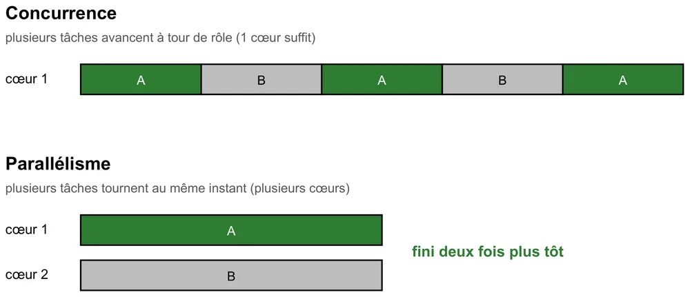
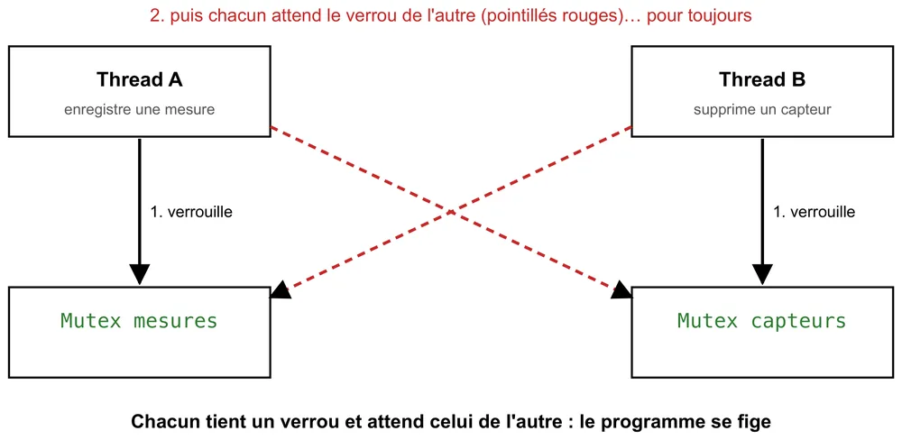

# Concurrence

## 1. Pourquoi des threads ?

Un **thread** est un fil d'exécution : une suite d'instructions qui tourne en même temps que d'autres. Avec plusieurs threads, un programme peut faire plusieurs choses à la fois (par exemple, utiliser tous les cœurs du processeur).

Le risque : deux threads qui touchent à la même donnée en même temps donnent des bugs très difficiles à reproduire. Rust utilise son système de propriété (ownership) pour transformer beaucoup de ces bugs en **erreurs de compilation**. C'est ce qu'on appelle la « concurrence sans peur ».

> [!info] Concurrence et parallélisme
> Concurrence : plusieurs tâches avancent chacune leur tour. Parallélisme : plusieurs tâches avancent vraiment en même temps. Les threads de Rust sont de vrais threads du système, donc les deux sont possibles.



Sur l'image : en concurrence, A et B se partagent **un seul** cœur (ils avancent par petits bouts). En parallélisme, chacun a **son** cœur : les deux finissent au même moment, deux fois plus tôt.

**Exemple : pourquoi deux threads sur une même donnée posent problème.** Deux threads font chacun `compteur = compteur + 1` sur un compteur qui vaut 0. Cette ligne se fait en trois temps : **lire**, **ajouter 1**, **écrire**. Le système peut couper un thread entre deux temps :

| Moment | Thread A | Thread B | Compteur en mémoire |
|---|---|---|---|
| 1 | lit 0 | | 0 |
| 2 | | lit 0 | 0 |
| 3 | calcule 0 + 1 = 1, écrit 1 | | 1 |
| 4 | | calcule 0 + 1 = 1, écrit 1 | 1 |

Deux ajouts ont eu lieu, mais le compteur vaut 1 : un ajout est **perdu**. Et ça n'arrive qu'une fois de temps en temps, selon la vitesse des threads. En Rust, ce code est **refusé à la compilation** : il faut passer par un outil sûr (`Mutex`, atomique, canal), vus plus bas.

**À retenir :** deux threads qui modifient la même donnée sans protection perdent des modifications au hasard ; Rust t'oblige à protéger cette donnée.

## 2. Lancer un thread : `spawn` et `join`

`thread::spawn` prend une fonction (une closure) et la lance dans un nouveau thread. Elle renvoie un `JoinHandle`, sur lequel on appelle `join()` pour **attendre la fin** du thread et récupérer son résultat.

```rust
use std::thread;

let handle = thread::spawn(|| {
    let mut somme = 0;
    for i in 1..=100 {
        somme += i;
    }
    somme
});

let resultat = handle.join().unwrap();
println!("Somme : {resultat}");
```

`join()` renvoie un `Result` : c'est `Err` si le thread a paniqué.

**Le même exemple, pas à pas :**

1. `thread::spawn(|| { ... })` : la closure (le code entre `|| {` et `}`) part dans un **nouveau** thread. `spawn` rend la main tout de suite, sans attendre la fin du calcul.
2. La dernière ligne de la closure, `somme` (sans `;`), est la **valeur renvoyée** par le thread.
3. `handle` est le « ticket » du thread : un `JoinHandle<i32>` (le thread renverra un `i32`).
4. `handle.join()` **bloque** le thread principal jusqu'à la fin du thread, puis donne `Ok(5050)` (ou `Err(...)` si le thread a paniqué).
5. `.unwrap()` sort la valeur du `Ok` : `resultat` vaut 5050.

> [!tip] La somme en une ligne
> La boucle `for` peut s'écrire `(1..=n).sum::<u64>()` : `1..=n` est la suite 1, 2, …, n (le `=` inclut `n`), `sum` les additionne, et `::<u64>` précise le type du total. Pour `n = 0`, la suite est vide et la somme vaut `0`.

> [!warning] Piège : ne pas attendre
> Quand `main` se termine, tous les threads encore en cours sont arrêtés d'un coup. Si tu oublies `join()`, le thread peut ne jamais finir son travail.

**À retenir :** `spawn` lance, `join` attend et rend le résultat (`unwrap` pour le sortir du `Result`).

### L'ordre n'est pas garanti

Le système décide quand chaque thread s'exécute. Deux lancements du même programme peuvent se dérouler dans un ordre différent.

```rust
use std::thread;

let mut handles = Vec::new();
for numero in 0..3 {
    handles.push(thread::spawn(move || numero * 10));
}
for handle in handles {
    println!("Résultat : {}", handle.join().unwrap());
}
```

Ici, l'affichage est toujours dans le même ordre, car on fait `join` dans l'ordre du `Vec`. Les calculs, eux, ont pu se faire dans n'importe quel ordre.

**Pas à pas :**

| Étape | Ce qui se passe | Contenu de `handles` |
|---|---|---|
| 1re boucle, `numero = 0` | lance un thread qui calculera `0 * 10` | `[ticket 0]` |
| 1re boucle, `numero = 1` | lance un thread qui calculera `1 * 10` | `[ticket 0, ticket 1]` |
| 1re boucle, `numero = 2` | lance un thread qui calculera `2 * 10` | `[ticket 0, ticket 1, ticket 2]` |
| 2e boucle | attend le ticket 0 → affiche 0, puis le 1 → 10, puis le 2 → 20 | vidé |

Les trois threads tournent **en même temps** pendant la première boucle. La deuxième boucle lit les résultats dans l'ordre du `Vec` : l'ordre d'affichage est fixe, même si le thread 2 a fini avant le thread 0.

### Deux passes : lancer tout, puis attendre tout

Le piège classique : faire `join` **juste après** chaque `spawn`.

```text
for v in valeurs {
    let h = thread::spawn(move || calcul(v));
    resultats.push(h.join().unwrap());   // on attend ce thread avant de lancer le suivant
}
```

Chaque thread est attendu avant que le suivant soit lancé : ils tournent **l'un après l'autre**, comme sans thread. La bonne méthode fait deux passes : la première lance tous les threads et range les tickets, la deuxième les attend dans l'ordre. Avec des itérateurs :

```rust
use std::thread;

let mots = vec!["chat", "éléphant", "ours"];

let handles: Vec<_> = mots
    .into_iter()
    .map(|mot| thread::spawn(move || mot.chars().count()))
    .collect();

let longueurs: Vec<usize> = handles.into_iter().map(|h| h.join().unwrap()).collect();
println!("{longueurs:?}");
```

1. `mots.into_iter()` donne chaque mot (par valeur).
2. `.map(|mot| thread::spawn(...))` lance un thread par mot ; `.collect()` range les tickets dans un `Vec`. Tous les threads sont lancés **avant** la ligne suivante.
3. `handles.into_iter().map(|h| h.join().unwrap())` attend chaque ticket dans l'ordre du `Vec` : `[4, 8, 4]`, dans le même ordre que les mots.
4. Pour une liste vide, aucun thread n'est lancé et le résultat est `[]`.

**À retenir :** pour vraiment travailler en parallèle, lance **tous** les threads (première passe), puis fais **tous** les `join` (deuxième passe) ; l'ordre du `Vec` garde l'ordre des données.

> [!tip] Résultats déterministes
> Dans un test ou un exercice, ne compte jamais sur le temps (`sleep`) pour « laisser le temps » à un thread. Fais toujours `join`, et compare les résultats dans un ordre fixé (par exemple en triant).

## 3. `move` : donner des données au thread

Un thread peut vivre plus longtemps que la fonction qui l'a créé. Il ne peut donc pas emprunter une variable locale. Le mot-clé `move` **déplace** les variables utilisées dans la closure : le thread en devient propriétaire.

```rust
use std::thread;

let prenom = String::from("Alice");
let handle = thread::spawn(move || {
    println!("Bonjour {prenom}");
});
handle.join().unwrap();
```

Sans `move`, le compilateur refuse : il ne peut pas prouver que `prenom` existera encore quand le thread l'utilisera.

**Pas à pas :**

1. `prenom` appartient à `main`.
2. La closure utilise `prenom`. Avec `move`, `prenom` est **déplacé** dans la closure, donc dans le thread.
3. Après le `spawn`, `main` ne peut plus utiliser `prenom` (il a été donné). Écrire `println!("{prenom}")` après le `spawn` serait refusé.
4. Pour un type copiable (`i32`, `u64`, `bool`, `char`, une référence `&T`…), `move` fait une **copie** : la variable reste utilisable dehors. C'est ce qui se passe avec `numero` dans l'exemple précédent.

**À retenir :** avec `thread::spawn`, mets `move` : chaque thread doit **posséder** ce qu'il utilise (déplacé, ou copié pour les petits types).

## 4. Threads à portée : `thread::scope`

Avec `thread::scope`, les threads sont **garantis terminés** à la sortie du bloc. Ils peuvent donc emprunter des variables locales, sans `move` ni copie.

```rust
use std::thread;

let nombres = [1, 2, 3, 4, 5, 6];
let (gauche, droite) = nombres.split_at(3);

let (a, b) = thread::scope(|s| {
    let t1 = s.spawn(|| gauche.iter().sum::<i32>());
    let t2 = s.spawn(|| droite.iter().sum::<i32>());
    (t1.join().unwrap(), t2.join().unwrap())
});

println!("{a} + {b} = {}", a + b);
```

**Pas à pas :**

1. `split_at(3)` coupe le tableau en deux emprunts : `gauche = [1, 2, 3]` et `droite = [4, 5, 6]`.
2. `thread::scope(|s| { ... })` ouvre une zone. Dans cette zone, on lance les threads avec `s.spawn` (et non `thread::spawn`).
3. `t1` calcule 1 + 2 + 3 = 6 et `t2` calcule 4 + 5 + 6 = 15, en même temps. Ils **empruntent** `gauche` et `droite` : pas de `move`, pas de copie.
4. La dernière expression du bloc, `(6, 15)`, est **la valeur renvoyée par `scope`** : `a = 6`, `b = 15`, et on affiche `6 + 15 = 21`.

> [!tip] À préférer quand c'est possible
> `thread::scope` évite de cloner les données ou d'utiliser `Arc`. Les threads que tu n'as pas `join` à la main sont attendus automatiquement à la fin du bloc.

**À retenir :** `thread::scope` = des threads qui peuvent emprunter, attendus à la fin du bloc ; le bloc renvoie sa dernière valeur.

### Découper en morceaux : `chunks`

`liste.chunks(n)` découpe une liste en morceaux de `n` éléments, **sans copie** (chaque morceau est un emprunt `&[T]`). Le dernier morceau est plus court s'il ne reste pas assez d'éléments.

| Liste | Appel | Morceaux |
|---|---|---|
| `[1, 2, 3, 4, 5, 6, 7]` | `chunks(3)` | `[1, 2, 3]`, `[4, 5, 6]`, `[7]` |
| `[1, 2, 3, 4]` | `chunks(2)` | `[1, 2]`, `[3, 4]` |
| `[]` | `chunks(5)` | aucun morceau |

`n` doit être au moins 1 (`chunks(0)` panique).

**Exemple résolu : le maximum de chaque morceau, un thread par morceau.**

```rust
use std::thread;

let mesures = [4, 9, 2, 7, 7, 1, 8];

let maximums: Vec<i32> = thread::scope(|s| {
    let handles: Vec<_> = mesures
        .chunks(3)
        .map(|morceau| s.spawn(move || *morceau.iter().max().unwrap()))
        .collect();
    handles.into_iter().map(|h| h.join().unwrap()).collect()
});

for (i, m) in maximums.iter().enumerate() {
    println!("Morceau {} : max {}", i + 1, m);
}
```

| Morceau | Contenu | Thread | Résultat |
|---|---|---|---|
| 1 | `[4, 9, 2]` | le plus grand | 9 |
| 2 | `[7, 7, 1]` | le plus grand | 7 |
| 3 | `[8]` | le plus grand | 8 |

1. `chunks(3)` donne les trois morceaux ; `.map(...)` lance un thread par morceau, `.collect()` range les tickets (première passe).
2. `morceau` est une **référence** (`&[i32]`) : `move` copie seulement la référence, les données restent à leur place.
3. Deuxième passe : les `join` dans l'ordre donnent `[9, 7, 8]`, renvoyé par le bloc `scope`.
4. L'affichage se fait **après** les threads, dans `main` : `enumerate()` donne le numéro (0, 1, 2), on affiche `i + 1` pour commencer à 1. La sortie est donc toujours la même.

**À retenir :** `chunks(n)` + un `s.spawn` par morceau + `join` dans l'ordre = un calcul découpé dont les résultats restent dans l'ordre des morceaux.

## 5. Passer des messages : les canaux

Un **canal** (`mpsc::channel`) a deux bouts : un **émetteur** (`Sender`) et un **récepteur** (`Receiver`). `mpsc` veut dire « multiple producers, single consumer » : plusieurs producteurs, un seul consommateur.

```rust
use std::sync::mpsc;
use std::thread;

let (tx, rx) = mpsc::channel();

thread::spawn(move || {
    tx.send(String::from("coucou")).unwrap();
});

let message = rx.recv().unwrap();
println!("Reçu : {message}");
```

- `send` envoie une valeur (elle est **déplacée** : l'émetteur ne peut plus l'utiliser).
- `recv` attend un message ; il renvoie `Err` quand tous les émetteurs ont disparu et que le canal est vide.
- `rx.iter()` (ou `for m in rx`) lit les messages jusqu'à la fermeture du canal.

, une file FIFO, un seul consommateur (for msg in rx)")

Sur l'image : chaque thread a sa copie de `tx` et fait `send()`. Les messages font la queue dans l'ordre d'arrivée (premier entré, premier sorti). Seul le thread `main` lit, avec `for msg in rx`. Quand le dernier `tx` est détruit, la boucle `for` s'arrête.

**Pas à pas :**

1. `mpsc::channel()` crée les deux bouts : `tx` (pour envoyer) et `rx` (pour recevoir). Le type des messages (`String`) est deviné grâce au `send`.
2. `move` donne `tx` au thread. Le thread envoie `"coucou"` puis se termine ; `tx` est alors détruit.
3. `rx.recv()` attend qu'un message arrive, puis rend `Ok("coucou")`. `unwrap` sort le texte.

**À retenir :** un canal = `tx` pour envoyer (`send`), `rx` pour recevoir (`recv`, ou `for` jusqu'à la fermeture).

### Plusieurs producteurs

On **clone** l'émetteur pour chaque thread.

```rust
use std::sync::mpsc;
use std::thread;

let (tx, rx) = mpsc::channel();

for id in 0..3 {
    let tx = tx.clone();
    thread::spawn(move || {
        tx.send(id * 10).unwrap();
    });
}
drop(tx);

let mut recus: Vec<i32> = rx.iter().collect();
recus.sort();
println!("{recus:?}");
```

**Pas à pas : on compte les émetteurs vivants.** Le canal se ferme quand ce nombre tombe à 0.

| Moment | Émetteurs vivants |
|---|---|
| après `mpsc::channel()` | 1 (`tx` de `main`) |
| après les 3 `tx.clone()` | 4 (`main` + un par thread) |
| chaque thread finit son `send` puis se termine | 3, puis 2, puis 1 |
| `drop(tx)` dans `main` | 0 → canal fermé quand il est vide |

`rx.iter().collect()` lit les messages jusqu'à la fermeture : il récupère 0, 10 et 20 dans un ordre qui varie, puis `sort()` donne `[0, 10, 20]`.

> [!warning] Piège : oublier `drop(tx)`
> Le canal ne se ferme que quand **tous** les émetteurs sont détruits, y compris celui gardé dans le thread principal. Sans `drop(tx)`, `rx.iter()` attend pour toujours et le programme reste bloqué.

> [!tip] L'ordre d'arrivée varie
> Les messages arrivent dans l'ordre où les threads les envoient, donc dans un ordre qui change d'une exécution à l'autre. On trie avant de comparer.

Si tu gardes les tickets des threads (`handles.push(thread::spawn(...))`), fais les `join` **après** avoir lu le canal (ou après le `drop(tx)`), puis trie le résultat. Un thread qui envoie plusieurs messages fait simplement plusieurs `send` dans une boucle.

**À retenir :** un `tx.clone()` par producteur, `drop(tx)` sur l'original, lire jusqu'à la fermeture, puis trier.

### Canal borné : `sync_channel`

`mpsc::channel` n'a pas de limite : un producteur rapide peut remplir la mémoire si le consommateur est lent. `mpsc::sync_channel(n)` crée un canal qui garde **au plus `n` messages en attente**. Quand la file est pleine, `send` **attend** que le consommateur en retire un.

```rust
use std::sync::mpsc;
use std::thread;

let (tx, rx) = mpsc::sync_channel(2);

thread::spawn(move || {
    for i in 0..5 {
        tx.send(i).unwrap();
    }
});

let recus: Vec<i32> = rx.iter().collect();
println!("{recus:?}");
```

Le résultat est toujours `[0, 1, 2, 3, 4]` : avec un seul producteur, l'ordre est garanti. La limite ne change pas ce qui est reçu, elle freine seulement le producteur.

**Pas à pas (un déroulement possible) :**

| Action | Messages en attente | Le producteur… |
|---|---|---|
| envoie 0 | `[0]` | continue |
| envoie 1 | `[0, 1]` | continue (file pleine) |
| veut envoyer 2 | `[0, 1]` | **attend** |
| `main` reçoit 0 | `[1]` | se débloque, envoie 2 → `[1, 2]` |
| … | … | … |
| envoie 4 puis se termine (`tx` détruit) | ce qui reste est lu par `main` | canal fermé une fois vidé |

> [!info] `sync_channel(0)`
> Avec une taille de `0`, chaque `send` attend que le consommateur soit prêt à recevoir : c'est un rendez-vous entre les deux threads.

Attention : avec un canal borné, l'envoi et la réception doivent se faire dans des threads **différents**. Si `main` envoie lui-même dans un `sync_channel(0)` avant de lire, personne ne reçoit et `send` attend pour toujours.

**À retenir :** `sync_channel(n)` garde au plus `n` messages ; un `send` sur une file pleine attend : ça freine le producteur sans rien perdre.

### Une chaîne de canaux

On peut relier plusieurs étapes : chaque étape est un thread qui lit un canal et écrit dans le suivant. La fermeture se **propage** toute seule d'une étape à l'autre.

```rust
use std::sync::mpsc;
use std::thread;

let (tx_mots, rx_mots) = mpsc::sync_channel(1);
let (tx_cris, rx_cris) = mpsc::sync_channel(1);

let lecteur = thread::spawn(move || {
    for mot in ["bonjour", "rust"] {
        tx_mots.send(mot.to_string()).unwrap();
    }
});

let crieur = thread::spawn(move || {
    for mot in rx_mots {
        tx_cris.send(mot.to_uppercase()).unwrap();
    }
});

let cris: Vec<String> = rx_cris.iter().collect();
lecteur.join().unwrap();
crieur.join().unwrap();
println!("{cris:?}");
```

1. `lecteur` envoie `"bonjour"` puis `"rust"` dans le premier canal. Il finit : `tx_mots` est détruit, le premier canal se ferme.
2. `crieur` lit le premier canal avec `for mot in rx_mots`. Pour chaque mot, il envoie sa version en majuscules dans le second canal. Quand le premier canal est fermé et vide, sa boucle s'arrête, le thread finit, et `tx_cris` est détruit : le second canal se ferme à son tour.
3. `main` lit le second canal jusqu'à la fermeture : `["BONJOUR", "RUST"]`, dans l'ordre (un seul producteur par canal). Puis il fait les deux `join`.
4. Chaque `tx` a été **déplacé** dans un thread : pas besoin de `drop` à la main. Et comme chaque bout est dans un thread différent, ça marche même avec une capacité de 0.

**À retenir :** dans une chaîne, chaque étape lit avec `for x in rx` et écrit dans le canal suivant ; quand le premier émetteur disparaît, tout se ferme en cascade.

## 6. Partager un état : `Mutex` et `Arc`

Un **`Mutex`** (exclusion mutuelle) protège une donnée : un seul thread à la fois peut y accéder. On appelle `lock()` pour obtenir l'accès ; il renvoie un « garde » qui libère le verrou **quand il est détruit** (à la fin de son bloc).

```rust
use std::sync::Mutex;

let compteur = Mutex::new(0);
{
    let mut valeur = compteur.lock().unwrap();
    *valeur += 1;
}
println!("{:?}", compteur);
```

**Pas à pas :**

1. `Mutex::new(0)` range le nombre 0 dans une boîte protégée.
2. `compteur.lock()` attend que la boîte soit libre, la verrouille, et rend `Ok(garde)`. `unwrap` sort le garde (un `MutexGuard`).
3. Le garde s'utilise comme une référence vers la donnée : `*valeur += 1` (avec `*` pour toucher le nombre lui-même) fait passer 0 à 1.
4. À l'accolade fermante, `valeur` est détruit : le verrou est **relâché**. Il n'y a pas de `unlock()` à appeler.
5. L'affichage montre `Mutex { data: 1, poisoned: false, .. }`.

Pour partager le `Mutex` entre plusieurs threads, il faut qu'ils en soient tous propriétaires. Un `Rc` ne convient pas (il n'est pas sûr entre threads). On utilise **`Arc`** (Atomic Reference Counted) : un pointeur partagé dont le compteur de références est atomique.

```rust
use std::sync::{Arc, Mutex};
use std::thread;

let compteur = Arc::new(Mutex::new(0));
let mut handles = Vec::new();

for _ in 0..4 {
    let compteur = Arc::clone(&compteur);
    handles.push(thread::spawn(move || {
        for _ in 0..1000 {
            *compteur.lock().unwrap() += 1;
        }
    }));
}

for handle in handles {
    handle.join().unwrap();
}

println!("Total : {}", *compteur.lock().unwrap());
```

Le résultat est toujours 4000 : chaque `+= 1` se fait sous verrou.

**Pas à pas :**

| Étape | Propriétaires de l'`Arc` | Valeur du compteur |
|---|---|---|
| `Arc::new(Mutex::new(0))` | 1 (`main`) | 0 |
| 4 tours de boucle : `Arc::clone` puis `move` dans un thread | 5 (`main` + 4 threads) | augmente |
| chaque thread fait 1000 fois `lock` + `+= 1` | | 4 × 1000 |
| les 4 `join` : les threads sont finis, leurs `Arc` détruits | 1 (`main`) | 4000 |

`*compteur.lock().unwrap() += 1` prend le verrou, ajoute 1, et relâche le verrou à la fin de la ligne (le garde est un temporaire détruit tout de suite). Les ajouts se font un par un : aucun n'est perdu, contrairement à l'exemple de la partie 1.

> [!info] `Arc<Mutex<T>>`
> C'est le duo classique : `Arc` pour **partager** la propriété, `Mutex` pour **modifier** sans conflit. `Arc::clone` ne copie pas la donnée, il ajoute juste un propriétaire.

> [!warning] Verrou tenu trop longtemps
> Le garde garde le verrou tant qu'il existe. Ne fais pas de calcul long (ni d'attente) avec un verrou pris : les autres threads sont bloqués. Ouvre un petit bloc `{ ... }` pour le relâcher vite.

**À retenir :** `Arc::clone` avant chaque `move`, `lock().unwrap()` pour modifier, et `join` de tous les threads avant de lire le résultat.

### Récupérer la valeur à la fin : `Arc::try_unwrap`

Une fois tous les threads terminés, `main` est le **seul** propriétaire. On peut alors sortir la valeur de ses deux boîtes :

```rust
use std::sync::{Arc, Mutex};
use std::thread;

let mots = Arc::new(Mutex::new(Vec::new()));

let copie = Arc::clone(&mots);
let handle = thread::spawn(move || {
    copie.lock().unwrap().push("salut");
});
handle.join().unwrap();

let liste: Vec<&str> = Arc::try_unwrap(mots).unwrap().into_inner().unwrap();
println!("{liste:?}");
```

1. `Arc::try_unwrap(mots)` : « s'il ne reste qu'un propriétaire, rends-moi le contenu ». Il renvoie `Ok(Mutex<...>)`, ou `Err` s'il reste d'autres `Arc` (par exemple un thread pas encore attendu). Le premier `unwrap` sort le `Mutex`.
2. `.into_inner()` détruit le `Mutex` et rend sa donnée, dans un `Result` (erreur si le verrou est empoisonné, voir plus bas). Le second `unwrap` sort le `Vec`.
3. Plus simple mais avec un verrou : `*compteur.lock().unwrap()` (pour un nombre) lit la valeur sans rien détruire.

**À retenir :** après les `join`, `Arc::try_unwrap(x).unwrap().into_inner().unwrap()` rend la donnée sans verrou ; ça échoue s'il reste un autre propriétaire.

### Empoisonnement

Si un thread panique alors qu'il tient un verrou, le `Mutex` est **empoisonné** : les `lock()` suivants renvoient `Err`. C'est pour cela qu'on écrit `lock().unwrap()`.

## 7. `RwLock` : beaucoup de lecteurs, un seul écrivain

Un `RwLock` autorise **plusieurs lecteurs en même temps** (`read()`), ou **un seul écrivain** (`write()`) qui est alors seul.

```rust
use std::sync::RwLock;

let config = RwLock::new(String::from("v1"));

{
    let a = config.read().unwrap();
    let b = config.read().unwrap();
    println!("{a} {b}");
}

*config.write().unwrap() = String::from("v2");
println!("{}", config.read().unwrap());
```

C'est utile quand on lit souvent et qu'on écrit rarement.

**Pas à pas :**

1. `a` et `b` sont deux gardes de **lecture** pris en même temps : c'est permis, l'affichage est `v1 v1`.
2. À l'accolade fermante, les deux gardes sont détruits : plus aucun lecteur.
3. `config.write()` prend le verrou d'**écriture** (il attendrait si un lecteur était encore là). On remplace le texte par `"v2"`, et le garde est détruit à la fin de la ligne.
4. Une nouvelle lecture affiche `v2`.

| Déjà pris | Nouveau `read()` | Nouveau `write()` |
|---|---|---|
| rien | accepté | accepté |
| un ou plusieurs `read` | accepté | attend |
| un `write` | attend | attend |

**À retenir :** `read()` pour lire (à plusieurs), `write()` pour modifier (seul) ; le verrou se relâche quand le garde disparaît.

### Un `RwLock` dans une structure

Un `RwLock` (comme un `Mutex`) permet de modifier une donnée à travers une simple référence `&self` : c'est la **mutabilité intérieure**. Les méthodes peuvent donc toutes prendre `&self`, et la structure peut être partagée entre threads avec un `Arc`.

```rust
use std::sync::{Arc, RwLock};
use std::thread;

struct Scores {
    points: RwLock<Vec<u32>>,
}

impl Scores {
    fn noter(&self, valeur: u32) {
        self.points.write().unwrap().push(valeur);
    }

    fn meilleur(&self) -> Option<u32> {
        self.points.read().unwrap().iter().max().copied()
    }
}

let scores = Arc::new(Scores { points: RwLock::new(Vec::new()) });

let handles: Vec<_> = [12, 30, 7]
    .into_iter()
    .map(|v| {
        let scores = Arc::clone(&scores);
        thread::spawn(move || scores.noter(v))
    })
    .collect();
for h in handles {
    h.join().unwrap();
}

println!("{:?}", scores.meilleur());
```

1. `noter` prend `&self` (pas `&mut self`) : c'est `write()` qui donne le droit de modifier le `Vec`. `push` ajoute la valeur à la fin.
2. `meilleur` prend un verrou de lecture : `.iter().max()` donne `Some(&30)` (une référence), `.copied()` la change en `Some(30)`. Liste vide : `None`.
3. Trois threads appellent `noter` sur le même `Scores` grâce à `Arc::clone` ; après les `join`, `meilleur` affiche `Some(30)`.
4. Autres lectures utiles sous `read()` : `.len()` pour le nombre d'éléments, `.iter().any(|x| ...)` pour savoir si un élément vérifie une condition.

**À retenir :** méthode qui modifie → `self.champ.write().unwrap()` ; méthode qui lit → `self.champ.read().unwrap()` ; toutes en `&self`.

## 8. Les atomiques

Pour un simple nombre ou booléen, un `Mutex` est trop lourd. Les types **atomiques** (`AtomicUsize`, `AtomicBool`...) font des opérations indivisibles, sans verrou.

```rust
use std::sync::atomic::{AtomicUsize, Ordering};
use std::thread;

let total = AtomicUsize::new(0);

thread::scope(|s| {
    for _ in 0..4 {
        s.spawn(|| {
            for _ in 0..1000 {
                total.fetch_add(1, Ordering::Relaxed);
            }
        });
    }
});

println!("{}", total.load(Ordering::Relaxed));
```

`Ordering` règle les garanties d'ordre entre threads. Pour un simple compteur, `Relaxed` suffit. Quand on hésite, `SeqCst` est le plus strict et le plus sûr.

**Pas à pas :**

1. `AtomicUsize::new(0)` : un compteur partagé, modifiable à travers une simple référence `&total` (pas besoin de `mut` ni de `Mutex`).
2. Dans le `scope`, les 4 threads **empruntent** `total` : pas d'`Arc` nécessaire.
3. `fetch_add(1, ...)` lit, ajoute 1 et écrit **en une seule opération** : l'entrelacement de la partie 1 (deux threads lisent 0 en même temps) devient impossible.
4. À la sortie du `scope`, les threads sont finis : `load` lit 4000.

| Méthode | Rôle |
|---|---|
| `load(ordre)` | lire la valeur |
| `store(v, ordre)` | écrire `v` |
| `fetch_add(n, ordre)` | ajouter `n` en une seule fois (rend l'ancienne valeur) |
| `into_inner()` | détruire l'atomique et rendre son nombre (quand plus personne ne l'emprunte) |

> [!warning] Piège : lire puis écrire
> `let v = x.load(..); x.store(v + 1, ..);` n'est **pas** atomique : un autre thread peut passer entre les deux. Utilise `fetch_add`, qui fait tout en une seule opération.

**À retenir :** pour un compteur partagé, un atomique + `fetch_add` ; jamais `load` puis `store`.

### `move` dans un `scope` : passer une référence

Dans un `scope`, une closure sans `move` emprunte **toutes** les variables qu'elle utilise. Ça coince avec une variable qui n'existe que le temps d'un tour de boucle :

```text
for i in 1..=3 {
    s.spawn(|| total.fetch_add(i * i, Ordering::Relaxed));
    // erreur : la closure emprunte `i`, qui disparaît à la fin du tour
}
```

Il faut `move` pour que chaque thread ait **sa copie** de `i`. Mais `move` déplacerait aussi `total` dans le premier thread, et le deuxième ne pourrait plus l'utiliser. L'astuce : préparer une **référence** avant la boucle. Une référence se copie, donc `move` copie la référence et `total` reste à sa place.

```rust
use std::sync::atomic::{AtomicUsize, Ordering};
use std::thread;

let total = AtomicUsize::new(0);
let total_ref = &total;

thread::scope(|s| {
    for i in 1..=3 {
        s.spawn(move || {
            total_ref.fetch_add(i * i, Ordering::Relaxed);
        });
    }
});

println!("{}", total.into_inner());
```

| Thread | Copie de `i` | Ajoute |
|---|---|---|
| 1 | 1 | 1 |
| 2 | 2 | 4 |
| 3 | 3 | 9 |

Total : 1 + 4 + 9 = 14. Les ajouts arrivent dans n'importe quel ordre, mais une addition ne dépend pas de l'ordre. À la fin, `total.into_inner()` rend le nombre (plus aucun thread ne l'emprunte).

> [!tip] Compter avec `filter`
> Pour compter les éléments d'un morceau qui vérifient une condition : `morceau.iter().filter(|&&x| x > 10).count()`. `iter()` donne des `&u32`, et `filter` passe une référence vers chacun, donc un `&&u32` : le motif `|&&x|` enlève les deux `&` pour obtenir le nombre `x`.

**À retenir :** dans un `scope`, `move` + une référence préparée avant (`let r = &total;`) : chaque thread copie ce dont il a besoin, sans déplacer la donnée partagée.

## 9. `Send` et `Sync`

Ce sont deux traits « marqueurs » (sans méthode) que le compilateur vérifie tout seul :

| Trait | Sens |
|---|---|
| `Send` | La valeur peut être **envoyée** à un autre thread (on lui en donne la propriété). |
| `Sync` | On peut partager une **référence** `&T` entre threads. |

- `i32`, `String`, `Vec<T>`, `Arc<Mutex<T>>` sont `Send` (et `Sync` pour la plupart).
- `Rc<T>` n'est ni `Send` ni `Sync` : son compteur n'est pas atomique. `thread::spawn` refuse donc un `Rc` : erreur de compilation.
- `Mutex<T>` est `Sync` si `T` est `Send` : c'est ce qui permet de le partager.
- `Cell` et `RefCell` ne sont pas `Sync`.

**Exemple résolu : pourquoi ce code est refusé ?**

```text
let liste = Rc::new(vec![1, 2, 3]);
let copie = Rc::clone(&liste);
thread::spawn(move || println!("{copie:?}"));
// erreur : `Rc<Vec<i32>>` cannot be sent between threads safely
```

1. `move` envoie `copie` (un `Rc`) dans un autre thread : il faut que `Rc<Vec<i32>>` soit `Send`.
2. Le compteur d'un `Rc` est un nombre normal. Si `main` et le thread clonaient ou détruisaient leur `Rc` en même temps, ils feraient « lire, ajouter, écrire » en même temps : le compteur pourrait être faux (partie 1), et la mémoire libérée trop tôt.
3. `Rc` n'est donc pas `Send`, et le compilateur refuse.
4. Correction : `Arc::new` et `Arc::clone` (compteur atomique). Pour modifier en plus, `Arc<Mutex<T>>` au lieu de `Rc<RefCell<T>>`.

> [!tip] Le compilateur fait le travail
> Tu écris rarement `Send` ou `Sync` toi-même. Un type les reçoit automatiquement si tous ses champs les ont. Si tu vois « cannot be sent between threads safely », remplace `Rc` par `Arc` (et `RefCell` par `Mutex`).

**À retenir :** `Send` = on peut donner la valeur à un thread, `Sync` = on peut la partager par référence ; `Rc` et `RefCell` restent dans un seul thread, `Arc` et `Mutex` les remplacent.

## 10. L'interblocage (deadlock)

Un **interblocage** arrive quand des threads s'attendent les uns les autres pour toujours. Exemple : le thread A tient le verrou 1 et veut le 2, pendant que le thread B tient le 2 et veut le 1. Personne ne peut avancer, et le programme gèle.

**Pas à pas :**

| Moment | Thread A | Thread B |
|---|---|---|
| 1 | prend le verrou 1 | |
| 2 | | prend le verrou 2 |
| 3 | veut le verrou 2 → attend B | |
| 4 | | veut le verrou 1 → attend A |
| 5 | attend toujours | attend toujours |



Chacun attend l'autre : c'est un **cycle d'attente**. Avec la règle « toujours le verrou 1 avant le verrou 2 », B commencerait aussi par le verrou 1 : il attendrait que A ait **fini** (A tient alors les deux verrous et peut avancer), et aucun cycle ne se forme.

Un seul thread peut aussi se bloquer lui-même : prendre deux fois le même `Mutex` sans avoir relâché le premier garde.

```rust
use std::sync::Mutex;

let m = Mutex::new(1);
let premier = m.lock().unwrap();
println!("premier = {premier}");
drop(premier);
let second = m.lock().unwrap();
println!("second = {second}");
```

Sans le `drop(premier)`, le deuxième `lock()` attendrait indéfiniment.

### Exemple résolu : déplacer un objet entre deux inventaires

Des joueurs échangent des objets. Chaque inventaire est un `Mutex<Vec<&str>>`. Un échange doit tenir les **deux** inventaires en même temps. Pour éviter l'interblocage, on verrouille toujours celui qui a le **plus petit numéro** en premier, quel que soit le sens de l'échange.

```rust
use std::sync::Mutex;
use std::thread;

fn deplacer(inventaires: &[Mutex<Vec<&'static str>>], depuis: usize, vers: usize) {
    let (petit, grand) = (depuis.min(vers), depuis.max(vers));
    let mut premier = inventaires[petit].lock().unwrap();
    let mut second = inventaires[grand].lock().unwrap();

    let (source, cible) = if depuis == petit {
        (&mut *premier, &mut *second)
    } else {
        (&mut *second, &mut *premier)
    };
    if let Some(objet) = source.pop() {
        cible.push(objet);
    }
}

let inventaires = vec![
    Mutex::new(vec!["épée"; 500]),
    Mutex::new(vec!["bouclier"; 500]),
];

thread::scope(|s| {
    s.spawn(|| {
        for _ in 0..300 {
            deplacer(&inventaires, 0, 1);
        }
    });
    s.spawn(|| {
        for _ in 0..300 {
            deplacer(&inventaires, 1, 0);
        }
    });
});

let total: usize = inventaires.iter().map(|i| i.lock().unwrap().len()).sum();
println!("Objets au total : {total}");
```

1. `depuis.min(vers)` et `depuis.max(vers)` rangent les deux numéros : pour `(1, 0)`, on obtient `petit = 0`, `grand = 1`. Les deux threads verrouillent donc **l'inventaire 0 puis l'inventaire 1**.
2. Les deux gardes `premier` et `second` sont tenus **ensemble** pendant l'échange, puis relâchés à la fin de la fonction (quand ils sont détruits).
3. Le verrouillage suit le numéro, mais l'échange suit le **sens** : si `depuis` est le petit numéro, la source est `premier` ; sinon c'est `second`. Le `&mut *garde` donne un accès normal au `Vec` caché derrière le garde.
4. `pop` retire le dernier objet de la source (`None` si elle est vide) et `push` l'ajoute à la cible. Aucun objet n'est créé ni perdu : le total reste 1000.
5. On suppose `depuis` différent de `vers` : sinon on verrouillerait deux fois le même `Mutex` et le thread se bloquerait lui-même.

> [!tip] Éviter les interblocages
> - Prends toujours les verrous **dans le même ordre** (par exemple par numéro croissant).
> - Garde les verrous le moins longtemps possible.
> - Évite d'appeler du code inconnu pendant qu'un verrou est pris.
> - Si possible, préfère les canaux ou les atomiques.

**À retenir :** un interblocage, c'est un cycle d'attente ; verrouiller toujours dans le même ordre (le plus petit numéro d'abord) rend ce cycle impossible.

## 11. Choisir son outil

| Besoin | Outil |
|---|---|
| Faire un calcul à part et récupérer le résultat | `spawn` + `join` |
| Utiliser des variables locales dans des threads | `thread::scope` |
| Envoyer des résultats d'un ou plusieurs threads | `mpsc::channel` |
| Freiner un producteur trop rapide | `mpsc::sync_channel(n)` |
| Modifier une donnée partagée | `Arc<Mutex<T>>` |
| Beaucoup de lectures, peu d'écritures | `Arc<RwLock<T>>` |
| Un compteur ou un drapeau | `AtomicUsize`, `AtomicBool` |
| Appliquer le même calcul à beaucoup d'éléments | `rayon` et `par_iter()` |

**Exemple : choisir pour trois situations.**

- Dix threads doivent remonter chacun une liste de résultats au thread principal → **canal** (un `tx.clone()` par thread).
- Un serveur lit sa configuration à chaque requête et la change une fois par jour → **`Arc<RwLock<Config>>`** (lectures nombreuses et simultanées).
- On veut juste compter les requêtes traitées → **`AtomicUsize`** avec `fetch_add` (un `Mutex` serait trop lourd pour un nombre).

**À retenir :** messages → canal ; donnée modifiée par tous → `Arc<Mutex<T>>` ; surtout des lectures → `RwLock` ; un simple nombre → atomique.

### Aperçu de rayon (en texte seulement)

**rayon** est une bibliothèque (pas dans la std, donc non exécutable ici) qui partage le travail d'un itérateur entre tous les cœurs. Il suffit souvent de remplacer `iter()` par `par_iter()` :

```text
use rayon::prelude::*;

let resultats: Vec<f64> = capteurs
    .par_iter()
    .map(|c| ecart_type(c))
    .collect();
```

- Le résultat est **le même** qu'en séquentiel, et dans le même ordre : `collect` remet les morceaux dans l'ordre.
- Sur une machine à 8 cœurs, un calcul lourd peut aller environ 7 fois plus vite.
- Ça n'aide que pour du **calcul** (CPU) : rien ne sert de paralléliser des attentes réseau.
- La closure ne doit modifier aucune variable partagée sans protection (le compilateur le vérifie avec `Send` et `Sync`).

> [!tip] En std
> Sans rayon, on fait la même chose à la main avec `thread::scope` : un thread par morceau de la liste (`chunks`), puis on assemble les résultats.

**À retenir :** `par_iter()` à la place de `iter()` = même résultat, dans le même ordre, réparti sur les cœurs ; utile seulement pour du calcul lourd.

## 12. Écrire du code concurrent testable

- **Toujours `join`** tous les threads avant de lire le résultat.
- **Jamais de `sleep`** pour synchroniser : le résultat doit être juste quelle que soit la vitesse des threads.
- **Trier ou agréger** les résultats dont l'ordre varie.
- **Ne pas afficher depuis plusieurs threads** si l'ordre compte : renvoie les résultats, puis affiche dans le thread principal.

**Exemple : rendre une sortie stable.** Trois threads affichent chacun `println!("fini {id}")` : selon l'exécution, on lit `fini 0, fini 2, fini 1` ou `fini 1, fini 0, fini 2`… Un test qui compare la sortie échoue une fois sur deux. Correction : chaque thread **renvoie** `id` au lieu de l'afficher ; `main` fait les `join` dans l'ordre (ou trie les valeurs reçues par un canal), puis affiche. La sortie est alors toujours `fini 0, fini 1, fini 2`.

**À retenir :** les threads calculent, le thread principal attend, met en ordre, puis affiche.
