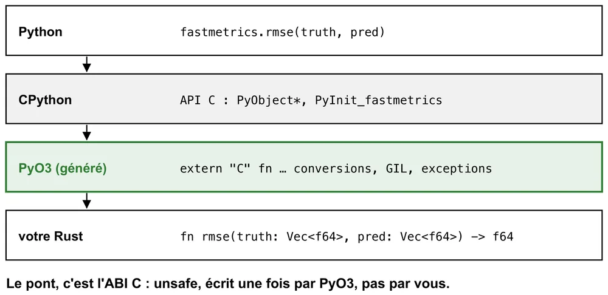
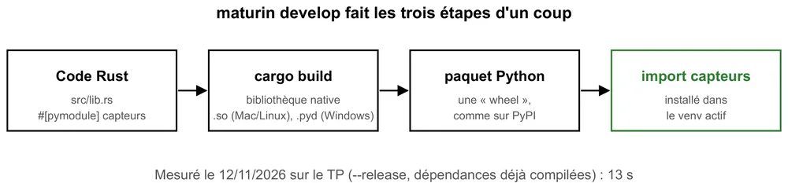
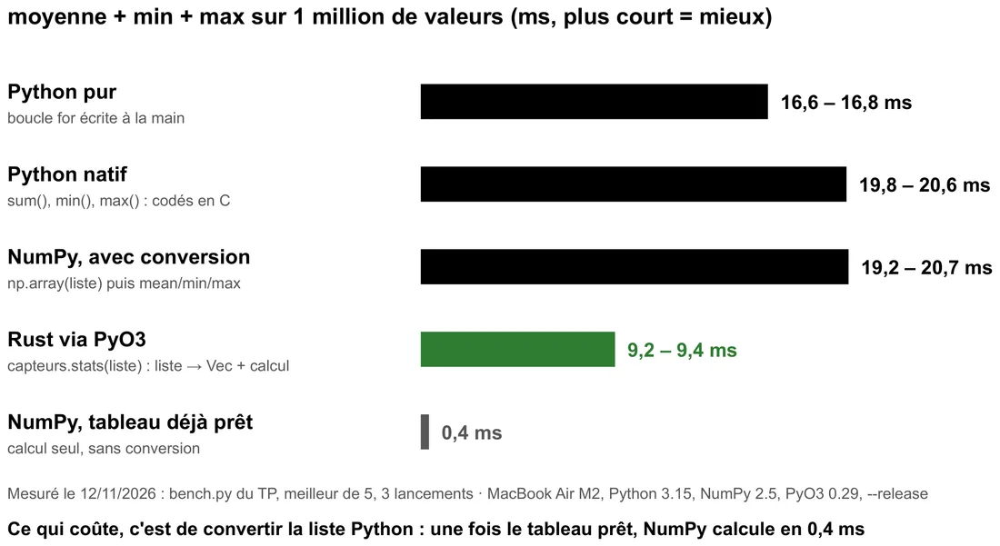

# Unsafe et FFI

## 1. Pourquoi `unsafe` existe

Le compilateur Rust vérifie beaucoup de choses : propriété, emprunts, types. Mais certaines opérations sont **impossibles à vérifier** automatiquement (parler à du code C, manipuler la mémoire à la main...). Pour ça, Rust propose le mot-clé `unsafe`.

> [!info] Ce que `unsafe` ne fait PAS
> Il ne désactive ni le vérificateur d'emprunts, ni les types. Il débloque seulement **5 opérations**. Le reste du code dans le bloc reste vérifié normalement.

Quand tu écris `unsafe`, tu dis au compilateur : « Je te promets que c'est correct, c'est moi qui vérifie. »

**Exemple résolu : ce qui reste vérifié dans un bloc `unsafe`**

```text
let texte = String::from("a");
unsafe {
    let nombre: i32 = texte;
}
```

1. Le bloc est `unsafe`, mais on essaie de mettre une `String` dans un `i32`.
2. Le compilateur refuse quand même : `mismatched types`. Les types sont vérifiés comme partout.
3. De même, déplacer une valeur puis la réutiliser, ou prendre deux `&mut` en même temps sur une variable, reste refusé dans un bloc `unsafe`.

**À retenir :** `unsafe` ajoute 5 permissions, il n'enlève aucune vérification.

## 2. Les 5 super-pouvoirs

Dans un bloc `unsafe`, tu peux :

1. **Déréférencer** un pointeur brut (lire ou écrire à travers lui).
2. **Appeler** une fonction ou une méthode `unsafe`.
3. **Lire ou modifier** un `static mut` (variable globale modifiable).
4. **Implémenter** un trait `unsafe`.
5. **Lire un champ** d'une `union`.

Hors de ces cinq cas, `unsafe` ne sert à rien.

**Exemple résolu : faut-il `unsafe` ?** On passe chaque opération au crible des 5 pouvoirs.

| Opération | Un des 5 pouvoirs ? | `unsafe` ? |
|---|---|---|
| `let p = &n as *const i32;` (créer un pointeur) | non, on ne lit rien | non |
| `let v = *p;` (lire à travers le pointeur) | oui, n°1 | **oui** |
| `p.is_null()` (tester le pointeur) | non, on ne lit pas ce qu'il désigne | non |
| appeler `strlen(...)` déclaré dans `extern "C"` | oui, n°2 | **oui** |
| `TOTAL += 1;` avec `static mut TOTAL` | oui, n°3 | **oui** |
| `unsafe impl MonTrait for u8 {}` | oui, n°4 (on écrit `unsafe impl`) | **oui** |
| écrire un champ d'union : `Nombre { flottant: 2.0 }` | non, seule la **lecture** compte | non |
| lire ce champ : `n.entier` | oui, n°5 | **oui** |

**À retenir :** avant d'écrire `unsafe`, demande-toi lequel des 5 pouvoirs tu utilises ; si aucun, `unsafe` est inutile.

## 3. Les pointeurs bruts

Un **pointeur brut** est une adresse mémoire sans aucune garantie. Il existe en deux versions : `*const T` (lecture) et `*mut T` (écriture).

```rust
let mut x = 10;
let p1 = &x as *const i32;
let p2 = &mut x as *mut i32;

println!("p1 est nul ? {}", p1.is_null());

// SAFETY: p2 vient de x, qui est encore en vie et n'est pas emprunté ailleurs
unsafe {
    *p2 += 5;
}
println!("x vaut {}", x);
```

Créer un pointeur est **sûr**. Le lire ou l'écrire demande `unsafe`.

**Exemple résolu : ligne par ligne**

1. `&x as *const i32` : on prend une référence vers `x`, puis `as` la **convertit** en pointeur brut de lecture. Aucune lecture n'a lieu : c'est sûr.
2. `&mut x as *mut i32` : même chose avec une référence modifiable, pour obtenir un pointeur d'écriture.
3. `p1.is_null()` : on teste l'adresse elle-même (est-elle 0 ?), pas la valeur pointée : sûr. Affiche `false`.
4. `*p2 += 5` : on lit **et** on écrit à travers le pointeur (pouvoir n°1) : il faut `unsafe`. `x` passe de 10 à 15.
5. Affichage : `x vaut 15`.

Quand on a **déjà** une référence (par exemple un paramètre `n: &mut i32`), on la convertit directement, sans remettre de `&` :

```rust
fn ajouter_dix(n: &mut i32) {
    let p = n as *mut i32;
    // SAFETY: p vient d'une référence &mut valide, utilisée seule ici
    unsafe {
        *p += 10;
    }
}

fn main() {
    let mut score = 5;
    ajouter_dix(&mut score);
    println!("{score}");
}
```

1. `n` est déjà un `&mut i32` : `n as *mut i32` suffit (écrire `&mut n` donnerait un pointeur vers la **référence**, de type `*mut &mut i32`).
2. `*p += 10` dans `unsafe` : `score` passe de 5 à 15.
3. La fonction `ajouter_dix` est **sûre** à appeler : l'`unsafe` est caché dedans, et il est correct car la référence reçue est forcément valide.

Une référence se transforme aussi **toute seule** en pointeur brut quand une fonction attend un pointeur : si `f` attend un `*mut i32`, on peut lui passer `&mut x` directement.

### Lire et écrire avec `std::ptr::read` et `std::ptr::write`

`*p` marche pour les types simples. La bibliothèque standard propose aussi deux fonctions `unsafe` :

- `std::ptr::read(p)` : **lit** la valeur pointée et en renvoie une copie ;
- `std::ptr::write(p, v)` : **écrit** `v` à l'adresse `p`, en écrasant l'ancienne valeur.

Exemple : faire tourner trois valeurs (`a` prend la valeur de `b`, `b` celle de `c`, `c` celle de `a`).

```rust
use std::ptr;

unsafe fn faire_tourner(a: *mut i32, b: *mut i32, c: *mut i32) {
    // SAFETY: l'appelant garantit que a, b et c sont valides
    unsafe {
        let ancien_a = ptr::read(a);
        ptr::write(a, ptr::read(b));
        ptr::write(b, ptr::read(c));
        ptr::write(c, ancien_a);
    }
}

fn main() {
    let mut x = 1;
    let mut y = 2;
    let mut z = 3;
    // SAFETY: x, y et z sont trois variables vivantes et distinctes
    unsafe {
        faire_tourner(&mut x, &mut y, &mut z);
    }
    println!("{x} {y} {z}");
}
```

| Étape | Code | `x` | `y` | `z` | `ancien_a` |
|---|---|---|---|---|---|
| départ | | 1 | 2 | 3 | |
| 1 | `ancien_a = read(a)` | 1 | 2 | 3 | 1 |
| 2 | `write(a, read(b))` | 2 | 2 | 3 | 1 |
| 3 | `write(b, read(c))` | 2 | 3 | 3 | 1 |
| 4 | `write(c, ancien_a)` | 2 | 3 | 1 | 1 |

Affichage : `2 3 1`. Sans la variable temporaire `ancien_a`, la valeur de départ de `x` serait perdue à l'étape 2.

Différences avec une référence :

| | Référence `&T` | Pointeur brut `*const T` |
|---|---|---|
| Peut être nul | non | oui |
| Garanti valide | oui | non |
| Règles d'emprunt | oui | non |
| Déréférencement | libre | `unsafe` |

> [!warning] Pièges classiques
> - Un pointeur **nul** : le lire plante le programme.
> - Un pointeur **périmé** (la donnée a été libérée) : comportement indéfini.
> - Deux `*mut` sur la même donnée : rien ne t'empêche de les utiliser en même temps.

Le **comportement indéfini** (UB) veut dire que tout peut arriver : plantage, résultat faux, ou programme qui « marche » par hasard. C'est la pire situation en Rust.

**À retenir :** `as *const T` / `as *mut T` pour créer (sûr), `*p`, `ptr::read`, `ptr::write` pour lire ou écrire (dans `unsafe`).

## 4. Le commentaire `// SAFETY:`

Par convention, chaque bloc `unsafe` est précédé d'un commentaire qui explique **pourquoi** il est correct.

```rust
let v: Vec<i32> = vec![1, 2, 3];
let p = v.as_ptr();

// SAFETY: v a 3 éléments, donc l'indice 2 est valide, et v vit jusqu'à la fin
let dernier = unsafe { *p.add(2) };
println!("{}", dernier);
```

Bonnes habitudes :

- Blocs `unsafe` **les plus petits possible**.
- Un commentaire `SAFETY` à chaque bloc.
- Ne jamais en mettre « pour faire taire le compilateur ».

**Exemple résolu : comment écrire la justification**

Pour un pointeur, on vérifie toujours la même liste, une condition après l'autre. Sur l'exemple ci-dessus :

| Question | Réponse pour `*p.add(2)` |
|---|---|
| Le pointeur est-il non nul ? | oui, `as_ptr()` d'un `Vec` n'est jamais nul |
| La case visée existe-t-elle ? | `p.add(2)` avance de 2 cases depuis le début : c'est l'indice 2, et `v` a 3 éléments (indices 0, 1, 2) |
| La donnée est-elle encore en vie ? | oui, `v` existe jusqu'à la fin de `main` |
| Quelqu'un d'autre la modifie-t-il ? | non, personne n'écrit dans `v` pendant la lecture |

Toutes les réponses sont bonnes : on les résume en une ligne dans le `// SAFETY:`. Le résultat lu est `3`. Avec `p.add(3)`, on sortirait du tableau : comportement indéfini.

`p.add(n)` avance de `n` **cases** (pas de `n` octets) : pour des `i32`, `add(1)` saute 4 octets.

**À retenir :** un `// SAFETY:` répond à « non nul, dans les bornes, encore en vie, pas modifié ailleurs ».

## 5. Fonctions `unsafe`

Une fonction peut elle-même être `unsafe` : cela veut dire que **l'appelant** doit respecter des conditions que le compilateur ne voit pas.

```rust
unsafe fn lire(p: *const i32) -> i32 {
    // SAFETY: l'appelant garantit que p est valide
    unsafe { *p }
}

fn main() {
    let x = 7;
    // SAFETY: &x est une adresse valide
    let v = unsafe { lire(&x) };
    println!("{}", v);
}
```

> [!info] Édition 2024
> Dans une `unsafe fn`, il faut quand même écrire un bloc `unsafe` autour des opérations dangereuses (sinon avertissement `unsafe_op_in_unsafe_fn`). Ainsi chaque opération risquée reste bien visible.

**Exemple résolu : qui vérifie quoi ?**

1. `lire` reçoit un pointeur brut : elle ne peut **pas** savoir s'il est valide. Elle est donc déclarée `unsafe fn` : « appelle-moi seulement avec un bon pointeur ».
2. Dans `lire`, le déréférencement `*p` est quand même entouré d'un bloc `unsafe { ... }` (règle de l'édition 2024).
3. Dans `main`, l'appel `lire(&x)` utilise le pouvoir n°2 (appeler une fonction `unsafe`) : il est dans un bloc `unsafe`. `&x` devient tout seul un `*const i32`.
4. C'est `main` qui porte la responsabilité : `&x` vient d'une vraie variable, donc le pointeur est valide. Affiche `7`.

Quand rendre une fonction `unsafe` ? Si **un seul** appel avec de mauvais arguments peut provoquer un comportement indéfini (pointeur brut reçu, indice non vérifié...). Si la fonction vérifie tout elle-même, elle reste une fonction normale.

**À retenir :** `unsafe fn` = « l'appelant doit garantir les conditions » ; on l'appelle dans un bloc `unsafe`, et son corps a lui aussi ses blocs `unsafe`.

## 6. `static mut` et traits `unsafe`

Une variable globale modifiable est dangereuse : deux threads pourraient la modifier en même temps (**course de données**).

```rust
static mut COMPTEUR: u32 = 0;

fn incrementer() -> u32 {
    // SAFETY: un seul thread utilise COMPTEUR dans ce programme
    unsafe {
        COMPTEUR += 1;
        COMPTEUR
    }
}

fn main() {
    incrementer();
    println!("{}", incrementer());
}
```

**Exemple résolu : que s'affiche-t-il ?**

1. `COMPTEUR` commence à 0. Une variable `static` existe pendant **tout** le programme, elle n'est pas remise à 0 entre deux appels.
2. Premier `incrementer()` : `COMPTEUR` passe à 1, la fonction renvoie 1 (on ignore ce résultat).
3. Second appel : `COMPTEUR` passe à 2, la fonction renvoie 2, qui est affiché.
4. La dernière ligne du bloc, `COMPTEUR` sans `;`, est la valeur renvoyée par le bloc, donc par la fonction. Elle est **copiée** (un `u32` se copie).

> [!warning] Pas de référence vers un `static mut`
> En édition 2024, `println!("{}", COMPTEUR)` est refusé : `println!` prend une **référence** vers son argument, et les références vers un `static mut` sont interdites (`static_mut_refs`). Copie d'abord la valeur : `let valeur = unsafe { COMPTEUR };`, puis affiche `valeur`.

La version sûre avec un **atomique** ne demande aucun `unsafe` :

```rust
use std::sync::atomic::{AtomicU32, Ordering};

static TOTAL: AtomicU32 = AtomicU32::new(0);

fn ajouter() -> u32 {
    TOTAL.fetch_add(1, Ordering::SeqCst) + 1
}

fn main() {
    ajouter();
    ajouter();
    println!("{}", ajouter());
}
```

`fetch_add(1, ...)` ajoute 1 et renvoie l'**ancienne** valeur, d'où le `+ 1`. Trois appels : 1, 2, puis 3 affiché.

> [!tip] À préférer
> Presque toujours, il vaut mieux utiliser `AtomicU32`, `Mutex` ou `OnceLock`, qui sont sûrs. `static mut` est un dernier recours (et prendre une *référence* vers un `static mut` est même refusé en édition 2024).

Un **trait `unsafe`** est un trait dont l'implémentation doit respecter une règle que le compilateur ne peut pas vérifier. L'exemple connu : `Send` et `Sync` (sécurité entre threads).

```rust
#[allow(clippy::missing_safety_doc)]
unsafe trait SansPointeur {}

unsafe impl SansPointeur for u32 {}
unsafe impl SansPointeur for bool {}

fn afficher<T: SansPointeur + std::fmt::Debug>(v: T) {
    println!("{:?}", v);
}

fn main() {
    afficher(5u32);
    afficher(true);
}
```

**Exemple résolu : un trait `unsafe` avec une méthode**

```rust
#[allow(clippy::missing_safety_doc)]
unsafe trait Taille: Copy {
    fn nb_octets(&self) -> usize;
}

unsafe impl Taille for u8 {
    fn nb_octets(&self) -> usize {
        1
    }
}

unsafe impl Taille for char {
    fn nb_octets(&self) -> usize {
        4
    }
}

fn decrire<T: Taille + std::fmt::Debug>(v: T) {
    println!("{:?} occupe {} octet(s)", v, v.nb_octets());
}

fn main() {
    decrire(7u8);
    decrire('z');
    println!("{} {}", u32::from(true), u32::from(false));
}
```

1. `unsafe trait Taille: Copy` : le trait est `unsafe` (celui qui l'implémente promet une règle : ici, donner la vraie taille), et `: Copy` veut dire que seuls les types copiables peuvent l'implémenter.
2. `unsafe impl Taille for u8` : implémenter un trait `unsafe` demande `unsafe impl` (pouvoir n°4). Le corps des méthodes est du code normal.
3. **Utiliser** le trait (`v.nb_octets()`) n'a besoin d'aucun `unsafe` : seule l'implémentation est une promesse.
4. Affichage : `7 occupe 1 octet(s)`, puis `'z' occupe 4 octet(s)`.
5. Au passage, `u32::from(true)` vaut `1` et `u32::from(false)` vaut `0` : c'est la conversion d'un `bool` en nombre.

**À retenir :** `static mut` se lit et s'écrit dans `unsafe` (par copie, jamais par référence) ; un trait `unsafe` s'implémente avec `unsafe impl` mais s'utilise normalement.

## 7. Les unions

Une **union** range plusieurs champs **au même endroit** de la mémoire. Lire un champ revient à réinterpréter les mêmes octets : c'est `unsafe`.

```rust
union Nombre {
    entier: u32,
    flottant: f32,
}

fn main() {
    let n = Nombre { flottant: 1.0 };
    // SAFETY: u32 et f32 font 4 octets et toute valeur est valide pour les deux
    let bits = unsafe { n.entier };
    println!("{:#x}", bits);
}
```

Les unions servent surtout pour parler à du code C.

**Exemple résolu : les bits de `2.0`**

```rust
union Octets {
    entier: u32,
    flottant: f32,
}

fn main() {
    let n = Octets { flottant: 2.0 };
    // SAFETY: les deux champs font 4 octets et tout motif de bits est un u32 valide
    let bits = unsafe { n.entier };
    println!("{bits} = {bits:#x}");
    println!("{}", 2.0f32.to_bits());
}
```

1. `Octets { flottant: 2.0 }` : on **écrit** le champ `flottant`. Écrire est sûr, il n'y a pas besoin d'`unsafe`.
2. Les 4 octets contiennent maintenant le codage de `2.0` dans le format des nombres à virgule (norme IEEE 754) : `0x40000000`.
3. `n.entier` **lit** les mêmes 4 octets comme un `u32` (pouvoir n°5, `unsafe`) : on obtient `0x40000000`, soit `1073741824` en décimal.
4. `2.0f32.to_bits()` donne le même nombre, de façon sûre : c'est la méthode à préférer hors exercice.

Une union n'a qu'**une** zone mémoire : elle fait la taille de son plus grand champ (ici 4 octets), pas la somme.

**À retenir :** écrire un champ d'union est sûr, le lire est `unsafe` car on réinterprète les mêmes octets avec un autre type.

## 8. Envelopper `unsafe` dans une API sûre

L'idée la plus importante du chapitre : on cache l'`unsafe` **à l'intérieur** d'une fonction dont l'interface est sûre. Les utilisateurs n'ont plus rien à vérifier.

Exemple : `split_at_mut` (de la bibliothèque standard) coupe un tableau en deux morceaux modifiables. Le compilateur refuse deux `&mut` sur le même tableau, même s'ils ne se touchent pas :

```text
let mut t = [1, 2, 3];
let a = &mut t[0];
let b = &mut t[2];
*a += *b;
```

Erreur : `cannot borrow t[_] as mutable more than once at a time`. Le compilateur ne regarde pas les indices, il voit seulement deux emprunts modifiables de `t`. Les indices 0 et 2 sont pourtant différents : c'est à nous de le garantir, avec des pointeurs bruts.

```rust
fn premier_et_dernier(t: &mut [i32]) -> Option<(&mut i32, &mut i32)> {
    let longueur = t.len();
    if longueur < 2 {
        return None;
    }
    let p = t.as_mut_ptr();
    // SAFETY: longueur >= 2, donc les indices 0 et longueur - 1 sont valides et différents
    unsafe { Some((&mut *p, &mut *p.add(longueur - 1))) }
}

fn main() {
    let mut t = [1, 2, 3, 4];
    if let Some((a, b)) = premier_et_dernier(&mut t) {
        *a += 100;
        *b += 200;
    }
    println!("{:?}", t);
    let mut seul = [7];
    println!("{}", premier_et_dernier(&mut seul).is_none());
}
```

**Exemple résolu : pourquoi cette fonction est sûre**

1. `t.len()` et `t.as_mut_ptr()` (pointeur vers la première case) se calculent **avant** le bloc `unsafe` : ce sont des opérations sûres.
2. La vérification `longueur < 2` rejette les tableaux trop courts. Avec 1 case, le premier et le dernier seraient **la même** case : deux `&mut` sur la même donnée, interdit. Avec 0 case, il n'y aurait rien à pointer.
3. Une fois ce test passé, `p` (indice 0) et `p.add(longueur - 1)` (dernier indice) sont dans le tableau et différents.
4. `&mut *p` transforme le pointeur en référence modifiable. Les références renvoyées ont la durée de vie de `t` : le compilateur empêche ensuite de toucher à `t` tant qu'on les utilise.
5. Résultat : `[101, 2, 3, 204]`, puis `true` pour le tableau à une case.

Celui qui appelle `premier_et_dernier` n'écrit jamais `unsafe` : la fonction vérifie elle-même tout ce qui rend le bloc correct. C'est ça, une **API sûre**.

### Reconstruire une tranche avec `from_raw_parts_mut`

`std::slice::from_raw_parts_mut(pointeur, longueur)` (fonction `unsafe`) fabrique un `&mut [T]` à partir d'une adresse de départ et d'un **nombre d'éléments** :

```rust
use std::slice;

fn main() {
    let mut t = [10, 20, 30, 40, 50];
    let p = t.as_mut_ptr();
    // SAFETY: les cases 1, 2 et 3 existent (t a 5 cases) et rien d'autre ne les utilise
    let milieu = unsafe { slice::from_raw_parts_mut(p.add(1), 3) };
    for x in milieu.iter_mut() {
        *x = 0;
    }
    println!("{:?}", t);
}
```

1. `p.add(1)` pointe sur la case d'indice 1 (la valeur 20).
2. La longueur `3` couvre les indices 1, 2 et 3. Il faut `1 + 3 <= 5` : c'est le cas, on reste dans le tableau.
3. `milieu` vaut `[20, 30, 40]`, on met ses cases à 0 : `t` devient `[10, 0, 0, 0, 50]`.

Règle de calcul : une tranche qui commence à l'indice `debut` avec `n` éléments est valide si `debut + n <= longueur`. Une tranche de longueur 0 est permise (elle est vide). C'est cette vérification qu'un `assert!` place **avant** le bloc `unsafe` : si elle échoue, on panique proprement au lieu de lire n'importe où.

**À retenir :** une fonction sûre qui contient de l'`unsafe` doit **vérifier elle-même** (test, `assert!`) tout ce que le bloc `unsafe` suppose.

## 9. FFI : appeler du C depuis Rust

**FFI** (*Foreign Function Interface*) = appeler du code écrit dans un autre langage. L'**ABI C** est la « langue commune » des langages : Rust, Python, Go... savent tous la parler.

On déclare les fonctions C dans un bloc `unsafe extern "C"` :

```rust
use std::ffi::{c_int, c_long};

unsafe extern "C" {
    safe fn abs(x: c_int) -> c_int;
    fn labs(x: c_long) -> c_long;
}

fn main() {
    println!("{}", abs(-42));
    // SAFETY: labs accepte tout entier
    println!("{}", unsafe { labs(-7) });
}
```

- `safe fn` : tu promets qu'aucun argument ne cause de comportement indéfini, donc on peut l'appeler sans `unsafe`.
- Sans `safe` : l'appel demande `unsafe`.

> [!warning] Édition 2024
> `extern "C" { ... }` seul ne compile plus : il faut `unsafe extern "C" { ... }`.

**Exemple résolu : lire la déclaration**

1. `unsafe extern "C" { ... }` : « voici des fonctions écrites en C, trouvées à l'édition des liens (ici dans la bibliothèque C du système) ». Le mot `unsafe` rappelle que Rust ne peut pas vérifier que la déclaration correspond vraiment à la fonction C.
2. `c_int`, `c_long` : les types C `int` et `long`, dont la taille dépend de la machine (`long` fait 4 octets sur Windows, 8 sur Linux). Les écrire évite de se tromper de taille.
3. `abs` est marquée `safe` : la valeur absolue d'un entier ne peut pas corrompre la mémoire. On l'appelle comme une fonction normale : `42`.
4. `labs` n'est pas marquée `safe` : l'appel est dans `unsafe` (pouvoir n°2) : `7`.

Une fonction qui reçoit un **pointeur** (comme `strlen`) ne doit jamais être `safe` : un mauvais pointeur ferait lire n'importe où.

Pour les textes, C attend une suite d'octets finie par `\0`. On utilise `std::ffi::CString` (texte possédé) et `CStr` (texte emprunté) :

```rust
use std::ffi::{CString, c_char};

unsafe extern "C" {
    fn strlen(s: *const c_char) -> usize;
}

fn main() {
    let texte = CString::new("bonjour").expect("pas de zéro dedans");
    // SAFETY: texte est terminé par un zéro et reste en vie pendant l'appel
    let n = unsafe { strlen(texte.as_ptr()) };
    println!("{}", n);
}
```

**Exemple résolu : les étapes d'un appel avec un texte**

1. `CString::new("bonjour")` copie les 7 octets et ajoute un octet `0` à la fin : 8 octets en mémoire.
2. `CString::new` renvoie un `Result` : il échoue si le texte contient déjà un `\0` au milieu (C croirait que le texte s'arrête là). D'où `.expect(...)`.
3. `texte.as_ptr()` donne un `*const c_char` vers le premier octet, le type qu'attend `strlen`.
4. `strlen` compte les octets jusqu'au `0`, sans le compter : `7`.

`strlen` compte des **octets**, pas des lettres. En UTF-8, une lettre accentuée prend 2 octets :

```rust
use std::ffi::CString;

fn main() {
    let mot = "été";
    println!("{} lettres, {} octets", mot.chars().count(), mot.len());
    let c = CString::new(mot).expect("pas de zéro dedans");
    println!("{} octets avec le zéro final", c.as_bytes_with_nul().len());
    println!("{:?}", CString::new("a\0b").ok());
    println!("{}", CString::new("").is_ok());
}
```

1. `"été"` : 3 lettres, mais `é` fait 2 octets, donc `2 + 1 + 2 = 5` octets. `strlen` donnerait 5.
2. Avec le zéro final, le `CString` occupe 6 octets.
3. `"a\0b"` contient un zéro au milieu : `CString::new` renvoie `Err`, et `.ok()` transforme ce `Result` en `Option` : `None`.
4. Le texte vide est accepté (`true`) : c'est juste un `0` final, et `strlen` donnerait 0.

`.ok()` est la façon simple de passer d'un `Result` (`Ok(v)` / `Err(e)`) à un `Option` (`Some(v)` / `None`) quand l'erreur ne t'intéresse pas.

Dans l'autre sens, `CStr::from_ptr` lit un texte C reçu :

```rust
use std::ffi::{CStr, CString};

fn main() {
    let c = CString::new("salut").expect("pas de zéro dedans");
    let p = c.as_ptr();
    // SAFETY: p pointe sur un texte C valide, vivant et terminé par zéro
    let lu = unsafe { CStr::from_ptr(p) };
    println!("{}", lu.to_string_lossy());
}
```

**Exemple résolu : d'un pointeur C à une `String`**

```rust
use std::ffi::{CStr, CString, c_char};

unsafe fn copier_texte(p: *const c_char) -> String {
    // SAFETY: l'appelant garantit que p pointe sur un texte terminé par zéro
    let emprunte = unsafe { CStr::from_ptr(p) };
    emprunte.to_string_lossy().into_owned()
}

fn main() {
    let c = CString::new("ciao").expect("pas de zéro dedans");
    // SAFETY: c est vivant pendant tout l'appel
    let copie = unsafe { copier_texte(c.as_ptr()) };
    drop(c);
    println!("{copie}");
}
```

1. `CStr::from_ptr(p)` (fonction `unsafe`) parcourt les octets jusqu'au `0` et donne un `&CStr` : un texte **emprunté**, qui dépend encore de la mémoire de `c`.
2. `to_string_lossy()` le transforme en texte Rust. Il renvoie un `Cow<str>` (soit un emprunt, soit une copie corrigée) : les octets qui ne sont pas de l'UTF-8 valide sont remplacés par `�` au lieu de faire échouer.
3. `into_owned()` transforme ce résultat en `String` **possédée** : une vraie copie indépendante.
4. Grâce à cette copie, on peut détruire `c` (`drop(c)`) puis afficher `copie` sans danger : `ciao`.
5. `copier_texte` est `unsafe fn` : elle ne peut pas vérifier elle-même que `p` est un bon pointeur, c'est à l'appelant de le garantir.

> [!warning] Piège : durée de vie
> `CString::new("a").unwrap().as_ptr()` sur une seule ligne est **faux** : le `CString` est détruit tout de suite et le pointeur devient périmé. Garde toujours le `CString` dans une variable.

**À retenir :** Rust vers C : `CString::new(texte)` puis `.as_ptr()` (en gardant le `CString` en vie) ; C vers Rust : `CStr::from_ptr(p)` puis `.to_string_lossy().into_owned()`.

## 10. FFI : exposer du Rust à C

Dans l'autre sens, on écrit une fonction Rust que C peut appeler :

```rust
#[unsafe(no_mangle)]
pub extern "C" fn multiplier(a: i32, b: i32) -> i32 {
    a * b
}

fn main() {
    println!("{}", multiplier(6, 7));
}
```

- `extern "C"` : la fonction suit les règles d'appel de C.
- `#[unsafe(no_mangle)]` : le nom reste `multiplier` dans le binaire (sinon le compilateur le transforme). C'est `unsafe` car deux fonctions du même nom feraient des conflits.
- `pub` : visible depuis l'extérieur.

**Exemple résolu : ce que voit le programme C**

1. Sans `no_mangle`, le compilateur Rust renomme la fonction en un nom long et unique (par exemple `_ZN6blocs10multiplier17h…E`) : c'est le **mangling**, qui permet d'avoir deux `multiplier` dans deux modules différents. Un programme C qui cherche `multiplier` ne la trouverait pas.
2. Avec `#[unsafe(no_mangle)]`, le nom dans le binaire est exactement `multiplier`. Le C la déclare alors comme `int multiplier(int a, int b);`.
3. `extern "C"` règle la façon de passer `a`, `b` et le résultat (dans quels registres, dans quel ordre), comme un compilateur C.
4. Depuis Rust, la fonction s'appelle toujours normalement : `multiplier(6, 7)` affiche `42`.

Pour échanger des structures, on impose la disposition mémoire de C avec `#[repr(C)]` :

```rust
#[repr(C)]
pub struct Rectangle {
    pub largeur: i32,
    pub hauteur: i32,
}

#[unsafe(no_mangle)]
pub extern "C" fn aire(r: Rectangle) -> i32 {
    r.largeur * r.hauteur
}

fn main() {
    println!("{}", std::mem::size_of::<Rectangle>());
    println!("{}", aire(Rectangle { largeur: 5, hauteur: 3 }));
}
```

Sans `#[repr(C)]`, Rust a le droit de réordonner les champs : C ne les retrouverait pas.

1. `#[repr(C)]` : les champs sont rangés **dans l'ordre écrit**, `largeur` aux octets 0 à 3, `hauteur` aux octets 4 à 7, comme `struct Rectangle { int largeur; int hauteur; };` en C.
2. `size_of::<Rectangle>()` : 2 champs de 4 octets, donc `8`.
3. `pub struct` et `pub` sur les champs : la structure fait partie de l'interface publique, au même titre que la fonction `pub extern "C"` qui la reçoit.
4. `aire(...)` : `5 * 3 = 15`.

Pour fabriquer une bibliothèque utilisable par C, on met dans `Cargo.toml` : `crate-type = ["cdylib"]`.

**À retenir :** exposer à C = `#[unsafe(no_mangle)] pub extern "C" fn` ; échanger une structure = `#[repr(C)]` dessus.

## 11. Aperçu : Rust dans Python avec PyO3

**PyO3** est une bibliothèque (crate) qui permet d'écrire des modules Python en Rust, par exemple pour accélérer un calcul. **maturin** compile le projet et l'installe dans Python.



Sur l'image : on lit de haut en bas. Python appelle une fonction ; CPython (l'interpréteur, écrit en C) passe par son API C ; PyO3 **génère** l'étage du milieu (`extern "C"`, conversions, erreurs) ; tout en bas, ta fonction Rust reçoit de simples `Vec<f64>`. La partie `unsafe` (le pont par l'ABI C), c'est PyO3 qui l'écrit, pas toi.

```text
#[pyfunction]  : expose une fonction à Python
#[pymodule]    : un module Rust devient un module Python
Vec<f64>       : une liste Python de flottants arrive directement
```

```text
use pyo3::prelude::*;

#[pymodule]
mod metriques {
    use pyo3::prelude::*;

    #[pyfunction]
    fn somme(valeurs: Vec<f64>) -> f64 {
        valeurs.iter().sum()
    }
}
```

```text
python -m venv .venv
pip install maturin
maturin init -b pyo3 --name metriques
maturin develop
python -c "import metriques; print(metriques.somme([1.0, 2.5]))"
```

`maturin develop` compile et installe dans l'environnement virtuel actif : la première fois c'est lent, ensuite quelques secondes.



**Exemple résolu : le trajet de `metriques.somme([1.0, 2.5])`**

1. Python appelle `somme` avec une liste.
2. PyO3 convertit la liste Python en `Vec<f64>` : `vec![1.0, 2.5]`.
3. Le code Rust calcule `1.0 + 2.5 = 3.5`.
4. PyO3 convertit le `f64` en nombre Python : le terminal affiche `3.5`.

**Est-ce vraiment plus rapide ?** Le cours a mesuré moyenne + min + max sur un million de valeurs :



Sur l'image : Rust via PyO3 est environ **deux fois** plus rapide que Python. Mais regarde la dernière ligne : NumPy sur un tableau déjà prêt ne met que 0,4 ms. Ce qui coûte cher, c'est surtout de **convertir** la liste Python (étape 2 ci-dessus), pas le calcul.


> [!info] Alternative simple
> Sans PyO3, une fonction `extern "C"` compilée en `cdylib` peut être appelée depuis Python avec le module `ctypes`.

**À retenir :** PyO3 fait les conversions Python ↔ Rust, maturin compile et installe le module.

## 12. À retenir

- `unsafe` = 5 pouvoirs, pas de vérifications désactivées.
- Un pointeur brut se crée librement, se déréférence dans `unsafe`.
- Petit bloc `unsafe` + commentaire `// SAFETY:` + API sûre autour.
- Appeler C : `unsafe extern "C" { ... }`, `CString` pour les textes.
- Exposer à C : `#[unsafe(no_mangle)] pub extern "C" fn`, et `#[repr(C)]` pour les structures.
- Python : PyO3 + maturin.
