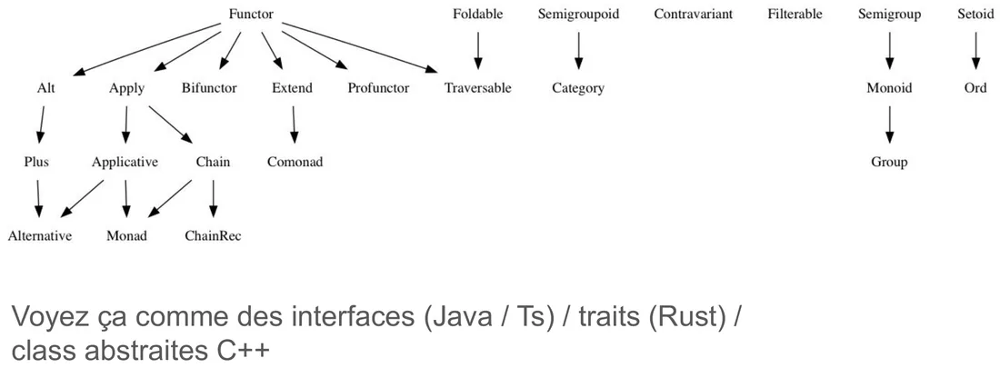

# Concepts fonctionnels

Ce chapitre prend du recul : pourquoi la programmation fonctionnelle (PF) existe, ce qu'elle apporte, et quelques techniques que le chapitre « Programmation fonctionnelle » du cours Rust n'a pas vues : curryfication, point-free, pipe, motifs sur les slices.

> [!info] Déjà vu ailleurs
> Fonctions pures, `fold` / `scan`, `Option` et `Result` en chaîne, récursion, itérateurs maison et immuabilité sont dans le chapitre « Programmation fonctionnelle » du cours Rust. Newtype, typestate et « états illégaux impossibles » sont dans « Programmation par les types ». Ici, on ne les répète pas.

## 1. Pourquoi la PF n'est pas la norme

- **Abstraction élevée** : elle vient des mathématiques, le vocabulaire (monade, foncteur) fait peur.
- **Courbe d'apprentissage** : il faut changer sa façon de penser, pas seulement la syntaxe.
- **Héritage** : C, C++, Java, Python sont impératifs ou objets, et l'industrie s'est construite dessus.
- **Peu de formations** : peu d'écoles l'enseignent, donc peu de développeurs la maîtrisent.

Pourquoi l'apprendre quand même ?

| Intérêt | Ce que ça veut dire |
|---|---|
| **Robustesse** | plus d'erreurs attrapées à la compilation, moins de bugs à l'exécution |
| **Vélocité** | code lisible, court, qui se documente par ses types ; ce qu'on apprend sert dans tous les langages |

## 2. D'où ça vient

- **Années 1930** : le *calcul lambda* d'Alonzo Church, une façon de calculer avec uniquement des fonctions, sans état qui change.
- **1958** : LISP, un des premiers langages à utiliser ces idées.
- **1973** : ML, qui apporte le typage fort.
- **1990** : Haskell, langage *purement* fonctionnel, fait pour explorer les idées de la PF.

Langages **purement** fonctionnels : Haskell, Elm, Idris, PureScript. Langages **multi-paradigmes** qui en prennent beaucoup : Scala, F#, OCaml, Clojure, Elixir, et Rust.

La PF est un **ensemble de pratiques**, applicable dans n'importe quel langage. Certains langages la rendent juste plus agréable que d'autres.

Attention à ne pas mélanger les noms : Alan Turing a inventé à la même époque (1936) la **machine de Turing**, un autre modèle de calcul, à base d'un ruban qu'on modifie (l'idée de l'impératif). Le calcul lambda, lui, est d'**Alonzo Church**. Les deux modèles savent calculer exactement les mêmes choses.

**À retenir :** calcul lambda (Church, années 1930) → LISP (1958) → ML (1973, typage fort) → Haskell (1990, pur). Rust est multi-paradigme : il emprunte beaucoup à ML et Haskell.

## 3. Impératif contre déclaratif

- **Impératif** : on décrit le **comment** (boucles, variables qu'on modifie, étapes dans l'ordre).
- **Déclaratif** : on décrit le **quoi** (ce qu'on veut obtenir), le « comment » est caché dans des fonctions réutilisables.

```rust
fn somme_carres_pairs_imperatif(nombres: &[i32]) -> i32 {
    let mut total = 0;
    for &n in nombres {
        if n % 2 == 0 {
            total += n * n;
        }
    }
    total
}

fn somme_carres_pairs(nombres: &[i32]) -> i32 {
    nombres.iter().filter(|n| *n % 2 == 0).map(|n| n * n).sum()
}

let donnees = [1, 2, 3, 4, 5, 6];
assert_eq!(somme_carres_pairs_imperatif(&donnees), 56);
assert_eq!(somme_carres_pairs(&donnees), 56);
```

La deuxième version se lit comme la consigne : « garde les pairs, mets au carré, additionne ».

**Pas à pas** sur `[1, 2, 3, 4, 5, 6]` :

| Élément | Pair ? (`filter`) | Carré (`map`) | Total (`sum`) |
|---|---|---|---|
| 1 | non, éliminé | | 0 |
| 2 | oui | 4 | 4 |
| 3 | non | | 4 |
| 4 | oui | 16 | 20 |
| 5 | non | | 20 |
| 6 | oui | 36 | **56** |

Les deux versions font exactement le même travail. La différence : dans la version impérative, c'est toi qui gères la variable `total` et la boucle ; dans la version déclarative, `filter`, `map` et `sum` s'en chargent.

### Traduire une boucle en pipeline

Un **pipeline** est une chaîne d'étapes où la sortie de l'une entre dans la suivante. Pour transformer une boucle, on repère chaque morceau et on le remplace par la méthode qui fait la même chose :

| Dans la boucle | Dans le pipeline |
|---|---|
| `for mot in texte.split_whitespace()` | `texte.split_whitespace()` (un itérateur de mots) |
| `if condition { ... }` | `.filter(\|x\| condition)` |
| transformer `x` avant de le ranger | `.map(\|x\| ...)` ou `.map(fonction)` |
| `let mut v = Vec::new(); ... v.push(...)` | `.collect()` (avec le type `Vec<...>` indiqué) |
| `let mut total = 0; ... total += ...` | `.sum()` (ou `.count()` pour compter) |

**Exemple résolu :** dans une phrase, garder les mots qui commencent par une majuscule, les mettre en minuscules, et compter leurs lettres.

```rust
fn noms_propres(phrase: &str) -> Vec<String> {
    phrase
        .split_whitespace()
        .filter(|mot| mot.starts_with(|c: char| c.is_uppercase()))
        .map(str::to_lowercase)
        .collect()
}

fn lettres_noms_propres(phrase: &str) -> usize {
    phrase
        .split_whitespace()
        .filter(|mot| mot.starts_with(|c: char| c.is_uppercase()))
        .map(str::len)
        .sum()
}

fn main() {
    let phrase = "hier Paul et Lea ont vu Lyon";
    println!("{:?}", noms_propres(phrase));
    println!("{}", lettres_noms_propres(phrase));
}
```

| Mot | Majuscule au début ? | En minuscules | Lettres |
|---|---|---|---|
| `hier` | non | | |
| `Paul` | oui | `paul` | 4 |
| `et` | non | | |
| `Lea` | oui | `lea` | 3 |
| `ont`, `vu` | non | | |
| `Lyon` | oui | `lyon` | 4 |

Résultat : `["paul", "lea", "lyon"]` et 4 + 3 + 4 = **11** lettres. Aucun `mut`, aucune boucle : chaque étape dit **quoi** faire.

> [!warning] Pièges
> - `collect()` doit connaître le type à fabriquer : il le lit ici dans le type de retour `Vec<String>`. Ailleurs, écris `let v: Vec<String> = ... .collect();`.
> - `str::len` compte les **octets** : une lettre accentuée (`é`) en compte 2. Pour compter les caractères, `mot.chars().count()`.

**À retenir :** impératif = le **comment** (boucle, `mut`, `push`) ; déclaratif = le **quoi** (`filter`, `map`, `collect`, `sum`). Pour traduire, remplace chaque morceau de la boucle par sa méthode.

## 4. Typage statique ou dynamique

| | Dynamique (Python, JavaScript, Ruby, PHP) | Statique (Rust, Java, C++, TypeScript) |
|---|---|---|
| Types vérifiés | à l'exécution | à la compilation |
| Avantage | écriture rapide, prototypes | erreurs trouvées tôt, optimisations, types qui documentent |
| Risque | une erreur de type peut n'apparaître qu'en production | il faut écrire (ou laisser deviner) les types |

La PF aime le typage statique : une fonction `fn(i32, i32) -> i32` est un **contrat** lisible. Ce qui entre, ce qui sort, rien d'autre.

**Exemple résolu :** une fonction `ajouter_tva(prix)` appelée par erreur avec le texte `"100"`.

| | Python (dynamique) | Rust (statique) |
|---|---|---|
| Écriture | `def ajouter_tva(prix): return prix * 1.2` | `fn ajouter_tva(prix: f64) -> f64 { prix * 1.2 }` |
| Appel fautif | `ajouter_tva("100")` | `ajouter_tva("100")` |
| Quand l'erreur apparaît | à l'**exécution**, seulement si cette ligne est atteinte (peut-être en production) : `TypeError` | à la **compilation** : « expected `f64`, found `&str` », le programme ne se construit même pas |

**À retenir :** typage statique = erreurs de type trouvées avant de lancer le programme, et une signature qui dit exactement ce qui entre et ce qui sort.

## 5. Fonctions d'ordre supérieur et closures

Une fonction **d'ordre supérieur** prend une fonction en paramètre, ou en renvoie une. `map`, `filter` et `fold` en sont. Une **closure** est une fonction anonyme qui peut **capturer** des variables autour d'elle.

```rust
fn creer_compteur() -> impl FnMut() -> i32 {
    let mut compte = 0;
    move || {
        compte += 1;
        compte
    }
}

let mut compteur = creer_compteur();
let mut autre = creer_compteur();
assert_eq!(compteur(), 1);
assert_eq!(compteur(), 2);
assert_eq!(autre(), 1);
assert_eq!(compteur(), 3);
```

`move` donne la variable `compte` à la closure : elle la garde même après la fin de `creer_compteur`. Chaque compteur a **sa propre copie**. Comme la closure modifie son état, son type est `FnMut` et la variable qui la contient doit être `mut`.

> [!info] Fn, FnMut, FnOnce
> `Fn` lit seulement ce qu'elle capture, `FnMut` le modifie, `FnOnce` le consomme (donc un seul appel).

**Pas à pas** des appels ci-dessus :

| Appel | `compte` de `compteur` | `compte` de `autre` | Valeur rendue |
|---|---|---|---|
| `compteur()` | 0 → 1 | 0 | 1 |
| `compteur()` | 1 → 2 | 0 | 2 |
| `autre()` | 2 | 0 → 1 | 1 |
| `compteur()` | 2 → 3 | 1 | 3 |

Chaque appel de `creer_compteur()` crée une **nouvelle** variable `compte` et une nouvelle closure qui l'emporte : les deux compteurs ne se mélangent jamais.

### Rendre la valeur actuelle, puis avancer

Ici, la closure augmente d'abord `compte`, puis le rend : le premier appel donne 1. Si on veut que le **premier** appel rende la valeur de départ, il faut mettre la valeur actuelle de côté, avancer, puis rendre ce qu'on a mis de côté.

**Exemple résolu :** une suite qui commence à `depart` et double à chaque appel.

```rust
fn suite_doubles(depart: u64) -> impl FnMut() -> u64 {
    let mut valeur = depart;
    move || {
        let actuelle = valeur;
        valeur *= 2;
        actuelle
    }
}

let mut s = suite_doubles(3);
assert_eq!(s(), 3);
assert_eq!(s(), 6);
assert_eq!(s(), 12);
let mut t = suite_doubles(1);
assert_eq!(t(), 1);
assert_eq!(s(), 24);
```

| Appel | `actuelle` | `valeur` après | Rendu |
|---|---|---|---|
| `s()` | 3 | 6 | 3 |
| `s()` | 6 | 12 | 6 |
| `s()` | 12 | 24 | 12 |
| `t()` (autre suite) | 1 | 2 | 1 |
| `s()` | 24 | 48 | 24 |

> [!warning] Pièges
> - Oublier `move` : la closure emprunterait `valeur`, qui disparaît à la fin de `suite_doubles`. Le compilateur refuse.
> - Oublier `mut` dans `let mut s = ...` : appeler une `FnMut` la modifie, il faut donc une variable modifiable.
> - Avancer **avant** de mettre de côté : la suite commencerait à 6 au lieu de 3.

**À retenir :** une fonction qui renvoie `impl FnMut` + une variable d'état emportée par `move` = un état privé, propre à chaque closure créée. Pour rendre « puis avancer », garde la valeur actuelle dans une variable avant de la modifier.

## 6. La boîte à outils des itérateurs

| Méthode | Rôle | Renvoie |
|---|---|---|
| `map(f)` | transforme chaque élément | un itérateur |
| `filter(p)` | garde ceux qui valident `p` | un itérateur |
| `fold(init, f)` | réduit tout à une seule valeur | la valeur |
| `for_each(f)` | exécute `f` pour chaque élément (effet de bord) | `()` |
| `find(p)` | premier élément qui valide `p` | `Option<élément>` |
| `position(p)` | **index** du premier qui valide `p` | `Option<usize>` |
| `any(p)` | au moins un valide `p` ? | `bool` |
| `all(p)` | tous valident `p` ? | `bool` |

```rust
let nombres = [3, 8, 5, 12, 7];

assert_eq!(nombres.iter().find(|n| **n % 2 == 0), Some(&8));
assert_eq!(nombres.iter().position(|n| *n % 2 == 0), Some(1));
assert!(nombres.iter().any(|n| *n > 10));
assert!(!nombres.iter().all(|n| *n > 3));

let mut vus = Vec::new();
nombres.iter().for_each(|n| vus.push(n * 10));
assert_eq!(vus, vec![30, 80, 50, 120, 70]);
```

> [!tip] Paresse
> `map` et `filter` ne calculent rien tant qu'un consommateur (`collect`, `sum`, `fold`, `for_each`...) ne réclame pas les valeurs.

**Pas à pas** sur `[3, 8, 5, 12, 7]` (index 0 à 4) :

| Appel | Éléments testés | Résultat |
|---|---|---|
| `find(pair)` | 3 (non), 8 (oui) : on s'arrête | `Some(&8)` : l'**élément** (une référence, car `iter()` donne des `&i32`) |
| `position(pair)` | 3 (non), 8 (oui, index 1) : on s'arrête | `Some(1)` : l'**index**, pas la valeur |
| `any(> 10)` | 3, 8, 5, 12 (oui) : on s'arrête | `true` |
| `all(> 3)` | 3 (non) : on s'arrête | `false` |

`find`, `position`, `any` et `all` s'arrêtent dès qu'ils connaissent la réponse. Si rien ne valide la condition, `find` et `position` rendent `None`.

Pourquoi `**n` dans `find` mais `*n` dans `position` ? `iter()` donne des `&i32`, et `find` passe une référence **vers** l'élément (`&&i32`, deux `*` pour revenir au nombre), alors que `position` passe l'élément lui-même (`&i32`, un seul `*`).

**À retenir :** `find` → la valeur (`Option<&T>`), `position` → l'index (`Option<usize>`), `any` / `all` → un `bool`. Tous s'arrêtent au premier élément qui tranche.

## 7. Curryfication et application partielle

Une fonction **curryfiée** ne prend qu'un argument à la fois : au lieu de `f(a, b)`, on écrit `f(a)(b)`. Appeler `f(a)` renvoie une **nouvelle fonction** qui attend `b`.

Rust ne le fait pas tout seul. On le **simule** avec une fonction qui renvoie une closure.

```rust
fn multiplier(x: i32) -> impl Fn(i32) -> i32 {
    move |y| x * y
}

let double = multiplier(2);
let triple = multiplier(3);
assert_eq!(double(5), 10);
assert_eq!(triple(5), 15);
assert_eq!(multiplier(4)(5), 20);
```

Fixer un argument pour obtenir une fonction plus simple s'appelle l'**application partielle**. `double` est `multiplier` appliquée partiellement avec 2.

**Pas à pas** de `multiplier(4)(5)` :

1. `multiplier(4)` s'exécute : `x = 4`. Elle ne calcule rien, elle **fabrique** la closure `move |y| 4 * y` et la renvoie (le `move` emporte `x = 4` dans la closure).
2. `(5)` appelle cette closure avec `y = 5` : elle calcule `4 * 5`.
3. Résultat : `20`.

Le type de retour `impl Fn(i32) -> i32` se lit « quelque chose qu'on appelle avec un `i32` et qui rend un `i32` ». On ne peut pas écrire le vrai type d'une closure (il n'a pas de nom), d'où le `impl`.

On peut aussi transformer n'importe quelle fonction à deux arguments. Ici, on fixe le **second** argument et la nouvelle fonction n'attend plus que le premier :

```rust
fn fixer_second<A, B: Clone, C>(f: impl Fn(A, B) -> C, b: B) -> impl Fn(A) -> C {
    move |a| f(a, b.clone())
}

let soustraire = |a: i32, b: i32| a - b;
let moins_un = fixer_second(soustraire, 1);
assert_eq!(moins_un(10), 9);
assert_eq!(moins_un(3), 2);

let repeter = |motif: &str, fois: usize| motif.repeat(fois);
let trois_fois = fixer_second(repeter, 3);
assert_eq!(trois_fois("ab"), "ababab");
```

| Morceau | Sens |
|---|---|
| `<A, B: Clone, C>` | trois types quelconques : 1er argument, 2e argument, résultat. Marche avec des `i32`, du texte… |
| `f: impl Fn(A, B) -> C` | la fonction à deux arguments à transformer |
| `-> impl Fn(A) -> C` | on rend une fonction qui n'attend plus que le `A` |
| `move \|a\| f(a, b.clone())` | la closure emporte `f` et `b` ; à chaque appel, elle passe une **copie** de `b` |

Pourquoi `b.clone()` et la borne `Clone` ? `f` reçoit `b` **par valeur** (elle le possède). Si on donnait `b` lui-même, il serait consommé au premier appel, et la closure ne pourrait plus servir : elle ne serait qu'une `FnOnce`. Avec une copie à chaque fois, on peut l'appeler autant qu'on veut.

Attention à l'ordre : `fixer_second(soustraire, 1)` donne `a - 1`, alors que fixer le **premier** argument à 1 donnerait `1 - a`.

**À retenir :** application partielle = une fonction qui prend `f` et une valeur, et rend `move |autre| f(…)` avec la valeur fixée à la bonne place, clonée si elle doit servir plusieurs fois.

> [!info] En Haskell
> Dans un langage purement fonctionnel, **toutes** les fonctions sont curryfiées. En Rust, on choisit : fonction classique, ou version curryfiée quand l'application partielle sert.

Même idée avec une collection : `map` curryfié renvoie une fonction « qui transforme une liste ».

```rust
fn appliquer_a_tous<T, U>(f: impl Fn(&T) -> U) -> impl Fn(&[T]) -> Vec<U> {
    move |liste| liste.iter().map(&f).collect()
}

let doubler_tout = appliquer_a_tous(|x: &i32| x * 2);
assert_eq!(doubler_tout(&[1, 2, 3]), vec![2, 4, 6]);
```

## 8. Le style point-free

Un code est **point-free** quand on ne nomme pas les arguments : on passe la fonction elle-même au lieu d'une closure qui l'appelle.

```rust
fn double(x: i32) -> i32 {
    x * 2
}

let nombres = [1, 2, 3];
let avec_parametre: Vec<i32> = nombres.iter().map(|x| double(*x)).collect();
let point_free: Vec<i32> = nombres.iter().copied().map(double).collect();
assert_eq!(avec_parametre, point_free);

let majuscules: Vec<String> = ["a", "b"].into_iter().map(str::to_uppercase).collect();
assert_eq!(majuscules, vec!["A", "B"]);
```

`|x| double(x)` et `double` font la même chose : la deuxième écriture est plus courte. Les méthodes aussi se passent ainsi : `str::to_uppercase`, `str::len`, `i32::abs`, `String::from`.

> [!warning] À ne pas pousser trop loin
> Le point-free est un outil de lisibilité. Si l'écriture demande de jongler avec les types ou les références, garde la closure.

**Pas à pas :** pourquoi `.copied()` dans la version point-free ? `nombres.iter()` donne des `&i32`, mais `double` attend un `i32`. Avec la closure, `*x` fait la conversion à la main. Sans closure, il n'y a pas d'endroit où écrire `*` : on transforme d'abord les `&i32` en `i32` avec `.copied()`, et alors `map(double)` reçoit exactement le type attendu.

| Écriture | Point-free ? | Pourquoi |
|---|---|---|
| `.map(\|x\| double(*x))` | non | l'argument est nommé `x` |
| `.copied().map(double)` | oui | on passe la fonction elle-même |
| `.map(\|x\| x * 2)` | non | closure avec un argument nommé (même si elle ne fait qu'un calcul) |
| `.map(i32::abs)` | oui | une méthode passée par son chemin `Type::methode` |

**À retenir :** point-free = passer `fonction` au lieu de `|x| fonction(x)` ; il faut que le type des éléments soit **exactement** celui que la fonction attend.

### Composer deux fonctions

**Composer** `f` puis `g`, c'est fabriquer une nouvelle fonction qui applique `f`, puis `g` au résultat : `(f puis g)(x) = g(f(x))`. On la construit comme la curryfication : une fonction qui reçoit des fonctions et rend une closure `move`.

**Exemple résolu :** appliquer **deux fois** la même fonction (c'est `f` composée avec elle-même).

```rust
fn deux_fois<T>(f: impl Fn(T) -> T) -> impl Fn(T) -> T {
    move |x| f(f(x))
}

fn ajouter_trois(x: i32) -> i32 {
    x + 3
}

let plus_six = deux_fois(ajouter_trois);
assert_eq!(plus_six(10), 16);

let crier = deux_fois(|s: String| s + "!");
assert_eq!(crier("ok".to_string()), "ok!!");
```

Pas à pas de `plus_six(10)` : `f(10)` = 13, puis `f(13)` = 16. Et `deux_fois(ajouter_trois)` est en point-free : on passe la fonction sans écrire `|x| ajouter_trois(x)`.

L'**ordre** compte. Avec `f = « +1 »` et `g = « ×3 »`, sur 5 :

| Composition | Calcul | Résultat |
|---|---|---|
| `f` puis `g` : `g(f(5))` | 5 + 1 = 6, puis 6 × 3 | 18 |
| `g` puis `f` : `f(g(5))` | 5 × 3 = 15, puis 15 + 1 | 16 |

Pour composer deux fonctions **de types différents** (`f : A → B`, `g : B → C`), il faut trois types génériques : la sortie de `f` doit être l'entrée de `g`.

**À retenir :** composer = rendre `move |x| g(f(x))` ; on lit « d'abord `f`, ensuite `g` », et la sortie de `f` doit avoir le type de l'entrée de `g`.

## 9. Pipe : enchaîner les transformations

Le **pipe** fait passer une valeur d'une fonction à la suivante : la sortie de l'une est l'entrée de l'autre. Rust n'a pas d'opérateur pipe, mais le **chaînage de méthodes** joue ce rôle :

```rust
fn ajouter_suffixe(suffixe: &str) -> impl Fn(String) -> String {
    move |s| s + suffixe
}

let entree: Option<&str> = Some("hello");
let resultat = entree
    .map(str::to_uppercase)
    .map(|s| format!("\"{s}\""))
    .map(ajouter_suffixe("!"))
    .unwrap();
assert_eq!(resultat, "\"HELLO\"!");
```

Pour avoir un pipe sur **n'importe quelle valeur**, on peut écrire un trait d'extension (un trait qu'on implémente pour tous les types) :

```rust
trait Pipe: Sized {
    fn pipe<R>(self, f: impl FnOnce(Self) -> R) -> R {
        f(self)
    }
}

impl<T> Pipe for T {}

let taille = "  cargo build  "
    .pipe(str::trim)
    .pipe(str::len)
    .pipe(|n| n * 10);
assert_eq!(taille, 110);
assert_eq!(3.pipe(|x| x * 10).pipe(|x| x - 1), 29);
```

On lit de haut en bas, dans l'ordre où les choses se passent. Chaque étape est une petite fonction testable seule.

Comment ça marche, morceau par morceau :

- `trait Pipe: Sized` : la méthode prend `self` **par valeur**, ce qui n'est possible que pour un type de taille connue (`Sized`).
- `fn pipe<R>(self, f: impl FnOnce(Self) -> R) -> R { f(self) }` : la méthode a un **corps par défaut** dans le trait. Elle se contente de donner `self` à `f` et de rendre ce que `f` rend. `FnOnce` suffit, car `f` n'est appelée qu'une fois.
- `impl<T> Pipe for T {}` : on implémente le trait pour **tous** les types d'un coup (c'est le « trait d'extension »). Comme le corps est déjà dans le trait, les accolades sont vides.

**Pas à pas** de `"  cargo build  ".pipe(str::trim).pipe(str::len).pipe(|n| n * 10)` :

| Étape | Entrée | Fonction | Sortie |
|---|---|---|---|
| 1 | `"  cargo build  "` | `str::trim` | `"cargo build"` (espaces du bord enlevés) |
| 2 | `"cargo build"` | `str::len` | `11` |
| 3 | `11` | `\|n\| n * 10` | `110` |

Chaque `pipe(f)` vaut `f(valeur)` : écrire `x.pipe(f).pipe(g)` revient à `g(f(x))`, mais on lit les fonctions **dans l'ordre** où elles s'appliquent. `str::trim` et `str::len` sont passées en point-free.

**À retenir :** `valeur.pipe(f)` = `f(valeur)` ; le trait `Pipe` a une méthode par défaut `f(self)` et s'implémente pour tout `T` avec `impl<T> Pipe for T {}`.

## 10. Pattern matching sur des slices

Un `match` peut décrire la **forme** d'une slice (`&[T]`) : vide, un élément, deux éléments, un premier suivi du reste...

```rust
fn decrire(liste: &[i32]) -> String {
    match liste {
        [] => "vide".to_string(),
        [seul] => format!("un seul : {seul}"),
        [a, b] => format!("deux : {a} et {b}"),
        [premier, .., dernier] => format!("de {premier} à {dernier}"),
    }
}

assert_eq!(decrire(&[]), "vide");
assert_eq!(decrire(&[4]), "un seul : 4");
assert_eq!(decrire(&[4, 5]), "deux : 4 et 5");
assert_eq!(decrire(&[4, 5, 6, 7]), "de 4 à 7");
```

`..` ignore le milieu, `reste @ ..` le **garde** sous le nom `reste`. On peut ajouter une **garde** (`if ...`) :

```rust
fn produit(liste: &[i32]) -> i32 {
    match liste {
        [] => 1,
        [premier, reste @ ..] => premier * produit(reste),
    }
}

fn est_croissante(liste: &[i32]) -> bool {
    match liste {
        [a, b, ..] if a > b => false,
        [_, reste @ ..] if reste.len() > 1 => est_croissante(reste),
        _ => true,
    }
}

assert_eq!(produit(&[2, 3, 4]), 24);
assert!(est_croissante(&[1, 2, 2, 5]));
assert!(!est_croissante(&[1, 3, 2]));
```

C'est la version fonctionnelle d'une boucle : un cas de base, un cas « premier + reste ». Le compilateur vérifie que **tous** les cas sont couverts.

**Pas à pas** de `produit(&[2, 3, 4])` : chaque appel coupe la slice en « premier » et « reste », jusqu'à la slice vide.

| Appel | Motif qui correspond | Calcul |
|---|---|---|
| `produit(&[2, 3, 4])` | `[premier, reste @ ..]` avec `premier = 2`, `reste = [3, 4]` | `2 * produit(&[3, 4])` |
| `produit(&[3, 4])` | `premier = 3`, `reste = [4]` | `3 * produit(&[4])` |
| `produit(&[4])` | `premier = 4`, `reste = []` | `4 * produit(&[])` |
| `produit(&[])` | `[]` : cas de base | `1` |

On remonte : `4 * 1 = 4`, puis `3 * 4 = 12`, puis `2 * 12 = 24`. Le cas de base vaut 1 pour un produit (multiplier par 1 ne change rien), comme il vaudrait 0 pour une somme.

Dans le motif, `premier` est une **référence** (`&i32`) vers l'élément : `premier * produit(reste)` marche car Rust sait multiplier un `&i32` par un `i32`. Pour ranger la valeur elle-même dans un `Some`, on écrit `*premier`.

### Quand le résultat peut ne pas exister

Certaines questions n'ont pas de réponse pour une liste vide (le plus grand, le dernier…) : on renvoie une `Option`. Le cas récursif demande alors la réponse pour le reste, puis la **combine** avec le premier élément.

**Exemple résolu :** le mot le plus long (le premier en cas d'égalité), ou `None` si la liste est vide.

```rust
fn plus_long<'a>(mots: &[&'a str]) -> Option<&'a str> {
    match mots {
        [] => None,
        [seul] => Some(*seul),
        [premier, reste @ ..] => match plus_long(reste) {
            Some(meilleur) if meilleur.len() > premier.len() => Some(meilleur),
            _ => Some(*premier),
        },
    }
}

assert_eq!(plus_long(&["chat", "elephant", "rat"]), Some("elephant"));
assert_eq!(plus_long(&["ours", "loup"]), Some("ours"));
assert_eq!(plus_long(&[]), None);
```

| Appel | Motif | Réponse du reste | Combinaison | Rendu |
|---|---|---|---|---|
| `plus_long(&["rat"])` | `[seul]` | | | `Some("rat")` |
| `plus_long(&["elephant", "rat"])` | `[premier, reste @ ..]` | `Some("rat")` | 3 lettres > 8 ? non | `Some("elephant")` |
| `plus_long(&["chat", "elephant", "rat"])` | `[premier, reste @ ..]` | `Some("elephant")` | 8 > 4 ? oui | `Some("elephant")` |

Ici, le cas `[seul]` rend surtout le code clair : sans lui, `plus_long(&["rat"])` irait dans le cas récursif, `plus_long(&[])` rendrait `None`, et la branche `_` donnerait quand même `Some("rat")`. Il devient **obligatoire** si on écrit la combinaison avec `map` : `plus_long(reste).map(|m| if m.len() > premier.len() { m } else { *premier })` rend `None` quand le reste est vide, et on perdrait le dernier mot.

> [!warning] Pièges
> - L'ordre des branches compte : `[seul]` doit venir **avant** `[premier, reste @ ..]`, qui accepte aussi une slice d'un seul élément (avec un `reste` vide). Dans l'autre ordre, `[seul]` ne serait jamais atteint.
> - Pas de boucle ni d'itérateur : c'est la récursion qui parcourt la liste.

**À retenir :** récursion sur slice = `[]` (cas de base) + éventuellement `[x]` + `[premier, reste @ ..]` qui combine `premier` avec l'appel sur `reste`. Pas de réponse pour la liste vide : rends une `Option`.

## 11. Option, la monade « Maybe »

Une **monade** est un type « boîte » qui possède une façon d'enchaîner des calculs en gérant l'effet à sa place. `Option<T>` est la monade **Maybe** : la boîte contient une valeur (`Some`) ou rien (`None`). Le contraste avec `panic!` :

```rust
fn diviser_panique(a: f64, b: f64) -> f64 {
    if b == 0.0 {
        panic!("division par zéro");
    }
    a / b
}

fn diviser(a: f64, b: f64) -> Option<f64> {
    if b == 0.0 { None } else { Some(a / b) }
}

assert_eq!(diviser_panique(10.0, 4.0), 2.5);
let moitie = diviser(10.0, 2.0);
let impossible = moitie.and_then(|x| diviser(x, 0.0));
assert_eq!(impossible, None);
assert_eq!(impossible.map(|x| x + 1.0).unwrap_or(-1.0), -1.0);
```

- La signature de `diviser_panique` **ment** : rien n'indique qu'elle peut planter, et on ne sait pas pourquoi.
- Avec `Option`, l'absence est dans le type : le compilateur t'oblige à la traiter.
- `map` transforme la valeur si elle existe, `and_then` enchaîne un calcul qui peut lui-même échouer, `unwrap_or` donne une valeur par défaut.

**Pas à pas** de la chaîne ci-dessus :

| Étape | Valeur | Explication |
|---|---|---|
| `diviser(10.0, 2.0)` | `Some(5.0)` | 2 n'est pas nul |
| `.and_then(\|x\| diviser(x, 0.0))` | `None` | `diviser(5.0, 0.0)` rend `None` ; `and_then` rend directement ce `None` |
| `.map(\|x\| x + 1.0)` | `None` | `map` sur `None` ne fait rien : la closure n'est pas appelée |
| `.unwrap_or(-1.0)` | `-1.0` | pas de valeur : on prend celle par défaut |

Pourquoi `and_then` et pas `map` pour la deuxième étape ? `diviser` rend déjà une `Option`. Avec `map`, on obtiendrait une boîte dans une boîte, `Option<Option<f64>>`. `and_then` « aplatit » : il rend directement l'`Option` produite par l'étape.

| Méthode | Sur `Some(v)` | Sur `None` | La fonction rend |
|---|---|---|---|
| `map(f)` | `Some(f(v))` | `None` | une valeur simple |
| `and_then(f)` | `f(v)` | `None` | une `Option` |
| `unwrap_or(d)` | `v` | `d` | |
| `unwrap_or_else(f)` | `v` | `f()` | (la valeur par défaut est **calculée** seulement si besoin) |

### Remplacer `liste[i]` par une chaîne d'`Option`

`liste[i]` panique si l'index n'existe pas. `liste.get(i)` rend `Some(&élément)` ou `None`. De même, `texte.chars().next()` rend `Some(premier caractère)` ou `None` si le texte est vide. Ces deux méthodes s'enchaînent avec `and_then`.

**Exemple résolu :** la dernière lettre du fichier numéro `i`, en minuscule, ou `"-"` si elle n'existe pas.

```rust
fn derniere_lettre(fichiers: &[&str], i: usize) -> String {
    fichiers
        .get(i)
        .and_then(|nom| nom.chars().last())
        .map(|c| c.to_lowercase().to_string())
        .unwrap_or_else(|| "-".to_string())
}

let fichiers = ["NOTES", "", "plan"];
assert_eq!(derniere_lettre(&fichiers, 0), "s");
assert_eq!(derniere_lettre(&fichiers, 2), "n");
assert_eq!(derniere_lettre(&fichiers, 1), "-");
assert_eq!(derniere_lettre(&fichiers, 9), "-");
```

| Appel | `get(i)` | `chars().last()` | `map` | Résultat |
|---|---|---|---|---|
| `i = 0` | `Some("NOTES")` | `Some('S')` | `Some("s")` | `"s"` |
| `i = 1` | `Some("")` | `None` (texte vide) | `None` | `"-"` |
| `i = 9` | `None` (pas d'index 9) | pas appelé | `None` | `"-"` |

Aucun `[]`, aucun `unwrap`, aucun `panic!` : chaque cas d'absence est géré par la chaîne. `c.to_lowercase()` rend un itérateur de caractères (une lettre peut en donner plusieurs) ; `.to_string()` le transforme en `String`.

Avec une fonction qui rend déjà une `Option`, comme `fn racine(x: f64) -> Option<f64>` (`None` pour un nombre négatif), `and_then` s'écrit en point-free : `.and_then(racine)` plutôt que `.and_then(|x| racine(x))`.

**À retenir :** `get(i)` au lieu de `[i]`, `chars().next()` / `last()` au lieu d'un index sur le texte ; `and_then` pour une étape qui peut échouer, `map` pour une étape qui réussit toujours, `unwrap_or_else` pour finir avec une valeur par défaut.

Pour savoir **pourquoi** ça a échoué, on utilise `Result<T, E>`, qui s'enchaîne avec les mêmes `map` et `and_then` (voir le chapitre « Programmation fonctionnelle »).

## 12. Un aperçu de la théorie des catégories

Les mots **foncteur** et **monade** viennent de la *théorie des catégories*, une branche des mathématiques qui décrit des structures par leurs opérations. Pas besoin des maths pour l'utiliser : pense **interfaces**.

| Mot | Ce qu'il promet | En Rust |
|---|---|---|
| Foncteur | on peut appliquer une fonction à ce qu'il contient (`map`) | `Option::map`, `Iterator::map` |
| Monade | on peut enchaîner des calculs qui renvoient la même « boîte » (`and_then`) | `Option::and_then`, `Result::and_then` |

En JavaScript, le projet **Fantasy Land** est une spécification qui nomme ces interfaces pour que les bibliothèques soient compatibles entre elles. L'équivalent en Rust ressemble à un **trait**, même si le langage ne permet pas (encore) d'écrire un trait « Monade » général.



Sur l'image : chaque mot est une interface, et une flèche relie une interface à une autre **plus riche** qui la contient. Suis le chemin de gauche : `Functor` (sait faire `map`) → `Apply` → `Chain` (sait faire `and_then`) → `Monad`. Donc toute monade est aussi un foncteur, comme `Option` qui a à la fois `map` et `and_then`. Pas besoin de retenir toute la carte !

**Exemple résolu :** reconnaître un foncteur et une monade dans du code Rust.

| Code | Ce qu'on fait | Vocabulaire |
|---|---|---|
| `Some(4).map(\|x\| x + 1)` → `Some(5)` | appliquer une fonction **simple** au contenu, la boîte reste une `Option` | foncteur (`map`) |
| `vec![1, 2].iter().map(\|x\| x * 10)` → `10, 20` | même promesse sur un itérateur | foncteur (`map`) |
| `Some(4).and_then(\|x\| if x > 0 { Some(x * 2) } else { None })` → `Some(8)` | enchaîner une étape qui rend **elle-même** une `Option` | monade (`and_then`) |
| `"12".parse::<i32>().and_then(\|n\| ...)` | même chose avec `Result` | monade (`and_then`) |

Le point commun : la boîte (`Option`, `Result`, itérateur) gère l'effet (absence, erreur, plusieurs valeurs) et toi, tu ne fournis que la fonction.

**À retenir :** foncteur = « je sais faire `map` » ; monade = « je sais faire `and_then` ». En Rust, pense « interface », comme un trait que `Option`, `Result` et les itérateurs respectent.

## 13. Pour continuer

- Livres : *Learn You a Haskell for Great Good* (gratuit en ligne), *Functional-Light JS*, *Mostly Adequate Guide*.
- Conférences de Scott Wlaschin sur la programmation fonctionnelle et le *type driven development* (YouTube).
- Liste de ressources *awesome-functional-programming* sur GitHub.
- En TypeScript : la bibliothèque *ts-belt* pour s'entraîner à la PF.

## À retenir

- La PF apporte robustesse et lisibilité ; elle vient du calcul lambda, de LISP, ML et Haskell.
- Déclaratif = le **quoi**, impératif = le **comment**.
- Closure capturante + `move` : un état privé par appel de la fonction fabrique (`FnMut`).
- Curryfication = `f(a)(b)`, simulée avec une fonction qui renvoie une closure ; l'application partielle fixe un argument.
- Point-free : passer `double` plutôt que `|x| double(x)`.
- Composer `f` puis `g` : une closure `move |x| g(f(x))`.
- Pipe : chaînage de méthodes, ou un petit trait `pipe`.
- Pipeline : `split_whitespace` / `iter`, puis `filter`, `map`, et `collect` ou `sum` à la place d'une boucle avec `mut`.
- Les motifs de slices (`[premier, reste @ ..]`) remplacent les boucles par des cas.
- `Option` est le « Maybe » : l'absence est dans le type, `map` / `and_then` / `unwrap_or` remplacent `panic!` ; `get(i)` remplace `liste[i]`.
