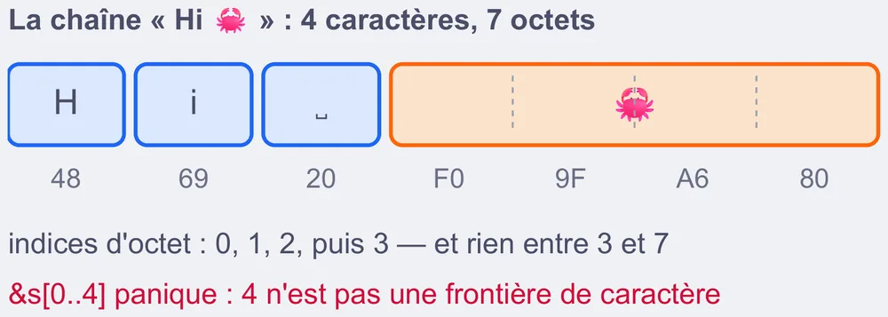
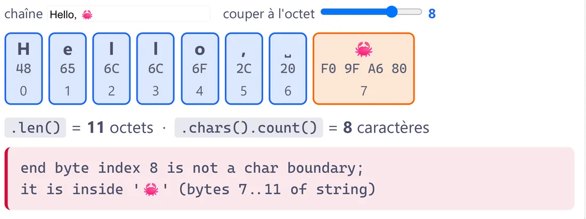

# Strings et mémoire

## 1. Deux grandes familles de texte

En C, `char *` sert à tout et ne dit rien : qui libère la mémoire ? quel encodage ? Rust met ces informations **dans le type**.

| Type | Qui possède le texte ? | Modifiable ? | Usage |
|---|---|---|---|
| `&str` | personne : on l'**emprunte** (on le regarde) | non | lire du texte, paramètre de fonction |
| `String` | la variable le **possède** (rangé sur le tas) | oui | construire, modifier, renvoyer du texte |
| `Box<str>` | possédé | non | texte figé, sans place en trop |
| `&[u8]` / `Vec<u8>` | emprunté / possédé | — | octets bruts (pas forcément du texte valide) |

Chaque ligne est une paire **emprunté / possédé** : `&str` / `String`, `&[T]` / `Vec<T>`, `&Path` / `PathBuf`.

**Emprunter**, c'est accéder à une valeur sans en devenir propriétaire : on la lit, puis on la « rend », et le propriétaire peut continuer à s'en servir. Le `&` devant un type ou une variable veut dire « emprunt » (on dit aussi **référence**).

> [!tip] La règle des signatures
> **Prendre l'emprunt, rendre le possédé.** Un paramètre `&str` accepte un texte écrit dans le code, une `String` (avec `&`) ou un morceau de texte. Une fonction qui fabrique un nouveau texte renvoie une `String`.

```rust
fn saluer(nom: &str) -> String {
    format!("Bonjour {nom} !")
}

fn main() {
    let prenom = String::from("Alice");
    println!("{}", saluer(&prenom));   // une String empruntée
    println!("{}", saluer("Bob"));     // un texte écrit dans le code
    println!("{prenom}");              // prenom est toujours là
}
```

Un texte entre guillemets (`"Bob"`) est un `&'static str` : ses octets sont rangés dans le programme lui-même et existent pendant toute l'exécution (c'est le sens de `'static`).

**Exemple résolu : pourquoi `&str` plutôt que `String` en paramètre ?** Prenons une fonction qui compte les voyelles d'un texte, écrite de deux façons.

| Appel | avec `fn compter(t: String)` | avec `fn compter(t: &str)` |
|---|---|---|
| `compter("arbre")` | refusé : `"arbre"` est un `&str`, pas une `String` (erreur E0308 *mismatched types*) | accepté |
| `compter(&mot)` avec `mot: String` | refusé : `&mot` est un emprunt, pas une `String` | accepté : `&String` se transforme tout seul en `&str` |
| `compter(mot)` avec `mot: String` | accepté, mais `mot` est **donné** à la fonction : on ne peut plus s'en servir après | refusé : il faut écrire `&mot` |
| `compter(&mot[0..2])` | refusé | accepté : un morceau est aussi un `&str` |

```rust
fn compter_voyelles(t: &str) -> usize {
    let mut total = 0;
    for c in t.chars() {
        if "aeiouy".contains(c) {
            total += 1;
        }
    }
    total
}

fn main() {
    let mot = String::from("ordinateur");
    println!("{}", compter_voyelles("arbre"));
    println!("{}", compter_voyelles(&mot));
    println!("{}", compter_voyelles(&mot[0..4]));
    println!("{mot}");
}
```

Pas à pas : `"arbre"` a 2 voyelles (a, e) ; `"ordinateur"` en a 5 (o, i, a, e, u) ; `&mot[0..4]` est `"ordi"`, qui en a 2 (o, i). Et `mot` s'affiche encore à la fin : on l'a seulement prêté.

**À retenir :** une fonction qui **lit** du texte prend `&str` ; une fonction qui **fabrique** un texte renvoie `String`.

### Créer et modifier une `String`

```rust
let vide = String::new();            // vide
let mut s = String::from("Salut");   // à partir d'un texte
let s2 = "Salut".to_string();        // pareil
s.push(' ');                         // ajoute UN caractère (char, guillemets simples)
s.push_str("à tous");                // ajoute un texte
let phrase = format!("{s} !");       // comme println!, mais renvoie une String
println!("[{vide}] [{s2}] [{phrase}]");
```

| Outil | Ajoute | S'écrit avec |
|---|---|---|
| `s.push(c)` | **un** caractère, à la fin | des guillemets **simples** : `'x'` |
| `s.push_str(t)` | un texte entier, à la fin | des guillemets **doubles** : `"xyz"` |
| `s.insert(0, c)` | un caractère au **début** (position 0) | `'x'` |
| `format!(...)` | fabrique une **nouvelle** `String` | comme `println!` |

`s` doit être déclarée `mut` pour être modifiée par `push` et `push_str`.

**Exemple résolu : fabriquer `"1+2+3+4"` avec une boucle.** Le piège : il faut un `+` **entre** les nombres, pas avant le premier ni après le dernier.

```rust
fn somme_ecrite(n: u32) -> String {
    let mut resultat = String::new();
    for i in 1..=n {
        if i > 1 {
            resultat.push('+');
        }
        resultat.push_str(&i.to_string());
    }
    resultat
}

fn main() {
    println!("[{}] [{}] [{}]", somme_ecrite(4), somme_ecrite(1), somme_ecrite(0));
}
```

| `i` | `i > 1` ? | On ajoute | `resultat` |
|---|---|---|---|
| 1 | non | `"1"` | `"1"` |
| 2 | oui | `'+'` puis `"2"` | `"1+2"` |
| 3 | oui | `'+'` puis `"3"` | `"1+2+3"` |
| 4 | oui | `'+'` puis `"4"` | `"1+2+3+4"` |

Avec `n = 1`, un seul tour, pas de `+` : `"1"`. Avec `n = 0`, aucun tour : la `String` reste vide, `""`. `i.to_string()` transforme le nombre en `String`, et le `&` devant la prête à `push_str`, qui attend un `&str`.

**Exemple résolu : `format!` pour assembler en une ligne.**

```rust
let ville = "Lyon";
let degres = 21;
let meteo = format!("{ville} : {degres} degrés");
println!("{meteo}");
```

`format!` remplace chaque `{nom}` par sa valeur, comme `println!`, mais au lieu d'afficher, il **renvoie** la `String` `"Lyon : 21 degrés"`.

**À retenir :** `push` = un `char` (`'x'`), `push_str` = un texte (`"xyz"`), `format!` = une nouvelle `String` assemblée d'un coup. Pour des séparateurs, ajoute-les seulement **à partir du deuxième** élément.

## 2. UTF-8 : un caractère = 1 à 4 octets

Le texte Rust est toujours en **UTF-8** : une façon de transformer chaque caractère en une suite d'octets.

| Caractères | Octets | Exemple |
|---|---|---|
| ASCII (lettres sans accent, chiffres, ponctuation, espace) | 1 | `H` |
| lettres accentuées, grecques... | 2 | `é` |
| autres symboles | 3 | `€` |
| émojis | 4 | `🦀` |

Sur l'image : chaque case est un caractère, et les nombres dessous sont ses octets (écrits en hexadécimal). `H`, `i` et l'espace prennent une case d'un octet chacun ; le crabe prend à lui seul **4 octets** (F0 9F A6 80).



```rust
assert_eq!("Hello, 🦀".len(), 11);           // nombre d'OCTETS
assert_eq!("Hello, 🦀".chars().count(), 8);  // nombre de CARACTÈRES
```

- `.len()` : nombre d'**octets**, instantané (la longueur est rangée dans la `String`).
- `.chars()` : parcourt les **caractères** un par un. `.chars().count()` doit lire tout le texte.
- `.char_indices()` : donne des paires (position en octets, caractère).

**Exemple résolu : octets et caractères de `"Noël à 5€"`.**

| Caractère | `N` | `o` | `ë` | `l` | espace | `à` | espace | `5` | `€` |
|---|---|---|---|---|---|---|---|---|---|
| Octets | 1 | 1 | 2 | 1 | 1 | 2 | 1 | 1 | 3 |

1. Caractères : on les compte un par un, il y en a **9**.
2. Octets : on additionne la ligne du bas : 1 + 1 + 2 + 1 + 1 + 2 + 1 + 1 + 3 = **13**.

```rust
let texte = "Noël à 5€";
println!("{} octets, {} caractères", texte.len(), texte.chars().count());
```

Le texte vide `""` a 0 octet et 0 caractère. Un texte seulement en ASCII a autant d'octets que de caractères.

**À retenir :** `len()` compte les octets, `chars().count()` compte les caractères ; ils diffèrent dès qu'il y a un accent, un symbole ou un émoji.

```rust
for (position, caractere) in "Hé!".char_indices() {
    println!("{position} : {caractere}");   // 0 : H   puis 1 : é   puis 3 : !
}
```

La **position** d'un caractère est le nombre d'octets qui le précèdent. Ici `H` commence à 0 ; `é` commence à 1 (après le `H`, 1 octet) ; `!` commence à 3, car `é` occupe les octets 1 et 2.

> [!info] Le type `char`
> Un `char` s'écrit entre guillemets simples : `'a'`, `'🦀'`. Il prend **toujours 4 octets**, alors que dans une `String` le même caractère prend de 1 à 4 octets. `c.len_utf8()` donne sa taille en UTF-8.

**Exemple résolu : positions et tailles dans `"çà€"`.** On avance caractère par caractère ; chaque position est la précédente plus la taille du caractère précédent.

```rust
fn main() {
    for (position, c) in "çà€".char_indices() {
        println!("{c} commence à l'octet {position} et prend {} octet(s)", c.len_utf8());
    }
}
```

| Caractère | Position | `len_utf8()` | Position suivante |
|---|---|---|---|
| `ç` | 0 | 2 | 0 + 2 = 2 |
| `à` | 2 | 2 | 2 + 2 = 4 |
| `€` | 4 | 3 | 4 + 3 = 7 (= la longueur totale) |

Les positions sont 0, 2 et 4 (pas 0, 1, 2 : elles sont en **octets**). Tous ces caractères prennent plus d'un octet (`len_utf8() > 1`).

Pour **garder** des positions dans une liste, on utilise un `Vec` : `Vec::new()` crée une liste vide, `liste.push(x)` ajoute `x` à la fin, et `{:?}` l'affiche (`[0, 2, 4]`).

**À retenir :** `char_indices()` donne (position en octets, caractère) ; `c.len_utf8()` donne la taille d'un caractère.

### Couper un texte

`&s[debut..fin]` donne un **morceau** (une *tranche*, ou *slice*) du texte. Les positions sont en **octets**, `debut` inclus et `fin` exclue. `&s[..fin]` part du début, `&s[debut..]` va jusqu'au bout.

```rust
let s = "Hello, 🦀";
let debut = &s[0..7];   // "Hello, "
let reste = &s[7..];    // "🦀"
println!("[{debut}] [{reste}]");
```

Une coupe juste au milieu du crabe (`&s[0..8]`) arrête le programme :

```text
thread 'main' panicked at src/main.rs:2:15:
byte index 8 is not a char boundary; it is inside '🦀' (bytes 7..11) of `Hello, 🦀`
```

Sur l'image : le crabe commence à l'octet 7 et occupe les octets 7, 8, 9 et 10. Couper à l'octet 8 tombe **au milieu** du crabe : Rust refuse et panique.



> [!warning] Piège
> Couper au milieu d'un caractère fait **paniquer** le programme : `byte index 8 is not a char boundary`. Outils sûrs :
> - `s.is_char_boundary(i)` : `true` si on peut couper à la position `i` ;
> - `s.get(0..8)` : renvoie `None` au lieu de paniquer ;
> - `s.chars()` et `s.char_indices()` pour avancer caractère par caractère.

**Exemple résolu : où peut-on couper `"€5"` ?** `€` occupe les octets 0, 1, 2 et `5` l'octet 3. La longueur est 4.

```rust
let s = "€5";
for i in 0..=s.len() {
    println!("{i} : {} {:?}", s.is_char_boundary(i), s.get(..i));
}
```

| Position `i` | `is_char_boundary(i)` | `s.get(..i)` | `&s[..i]` |
|---|---|---|---|
| 0 | `true` (début) | `Some("")` | `""` |
| 1 | `false` (dans le `€`) | `None` | panique |
| 2 | `false` (dans le `€`) | `None` | panique |
| 3 | `true` (début du `5`) | `Some("€")` | `"€"` |
| 4 | `true` (la fin du texte) | `Some("€5")` | `"€5"` |

La fin du texte (`i = s.len()`) est toujours une coupe valide. Au-delà (`i = 5`), `get` renvoie `None` et `&s[..5]` panique aussi (`byte index 5 is out of bounds`).

**Exemple résolu : renvoyer le texte avant le premier `:`.** On cherche la position du `:` avec `char_indices`, puis on coupe : une position donnée par `char_indices` est **toujours** le début d'un caractère, donc la coupe ne panique jamais.

```rust
fn avant_deux_points(s: &str) -> &str {
    for (position, c) in s.char_indices() {
        if c == ':' {
            return &s[..position];
        }
    }
    s
}

fn main() {
    println!("[{}] [{}]", avant_deux_points("clé:valeur"), avant_deux_points("rien"));
}
```

Pour `"clé:valeur"` : `c` en 0, `l` en 1, `é` en 2 (2 octets), `:` en **4**. On renvoie `&s[..4]`, soit `"clé"`. Pour `"rien"`, aucun `:` : la boucle finit sans `return`, et on renvoie tout le texte. Le résultat est un `&str` : un morceau du texte de départ, rien n'est copié.

**Exemple résolu : avancer jusqu'à une coupe valide.** Si une position tombe dans un caractère, on peut se déplacer d'un octet à la fois jusqu'à une frontière. Ici on **avance** (pour garder au moins `n` octets) :

```rust
fn au_moins(s: &str, n: usize) -> &str {
    if n >= s.len() {
        return s;
    }
    let mut fin = n;
    while !s.is_char_boundary(fin) {
        fin += 1;
    }
    &s[..fin]
}

fn main() {
    println!("[{}] [{}]", au_moins("€5", 1), au_moins("€5", 9));
}
```

Avec `n = 1` : 1 n'est pas une frontière, 2 non plus, 3 oui : on renvoie `&s[..3]`, `"€"`. Avec `n = 9`, plus grand que la longueur (4) : on renvoie tout, sans couper (sinon panique). On vérifie toujours la longueur **avant** de couper.

**À retenir :** coupe seulement à une position donnée par `char_indices`, ou vérifiée par `is_char_boundary` ; `get` renvoie `None` au lieu de paniquer ; une position au-delà de `len()` panique aussi.

### Traiter un texte caractère par caractère

Pour fabriquer un nouveau texte à partir d'un autre, on le parcourt avec `.chars()` (jamais octet par octet : un `é` coupé en deux n'est plus du texte valide) et on construit une `String`.

**Exemple résolu : doubler chaque caractère.** `"aé"` doit donner `"aaéé"`.

```rust
fn doubler(s: &str) -> String {
    let mut resultat = String::new();
    for c in s.chars() {
        resultat.push(c);
        resultat.push(c);
    }
    resultat
}

fn main() {
    println!("{}", doubler("aé🦀"));
}
```

`.chars()` donne `a`, puis `é`, puis `🦀` (chacun entier, quelle que soit sa taille) ; on pousse chacun deux fois : `"aaéé🦀🦀"`.

Pour ajouter un caractère **au début** plutôt qu'à la fin, `s.insert(0, c)` le place en position 0 :

```rust
let mut s = String::from("rs");
s.insert(0, 'é');
println!("{s}");
```

`s` devient `"érs"`.

**À retenir :** pour transformer un texte, parcours-le avec `.chars()` et construis une nouvelle `String` avec `push` (à la fin) ou `insert(0, ...)` (au début).

## 3. La pile et le tas

Un programme range ses données dans deux zones de mémoire :

| | Pile (*stack*) | Tas (*heap*) |
|---|---|---|
| Rapidité | très rapide | plus lent (il faut demander de la place) |
| Taille des données | connue à la compilation | décidée pendant l'exécution |
| Libération | à la fin du bloc | quand le propriétaire disparaît |
| Place disponible | petite (1 Mo sous Windows, 8 Mo sous Linux) | toute la mémoire |

En Rust, pas de `malloc` ni de `new` : c'est le **type** qui décide où va la valeur.

```rust
let sur_la_pile: u64 = 42;
let sur_le_tas: Box<u64> = Box::new(42);
let total = sur_la_pile + *sur_le_tas;   // * lit la valeur rangée dans la boîte
println!("{total}");
```

- `Box<T>` est une **boîte** : une adresse (8 octets sur la pile) qui pointe vers une valeur rangée sur le tas. La valeur est libérée automatiquement quand la boîte disparaît.
- `String` et `Vec<T>` rangent aussi leur contenu sur le tas.

**Exemple résolu : pourquoi l'étoile `*` ?** `sur_le_tas` n'est pas un nombre, c'est une **boîte** qui contient un nombre.

1. `println!("{sur_le_tas}")` marche : l'affichage sait ouvrir la boîte tout seul.
2. `sur_la_pile + sur_le_tas` ne compile pas : on additionne un `u64` et une `Box<u64>`, deux types différents (erreur E0308 *mismatched types*).
3. `*sur_le_tas` veut dire « la valeur **dans** la boîte » : c'est un `u64`, l'addition marche, 42 + 42 = 84.

**À retenir :** `Box::new(v)` range `v` sur le tas ; `*boite` lit la valeur dedans.

### Taille sur la pile (machine 64 bits)

| Type | Sur la pile | Sur le tas |
|---|---|---|
| `&str` | 16 octets (adresse + longueur) | rien, il emprunte |
| `String` | 24 octets (adresse + longueur + capacité) | le texte + de la place libre |
| `Box<u64>` | 8 octets (adresse) | la valeur |

Sur l'image : à gauche, ce qui est rangé sur la **pile** (petit et de taille fixe) ; à droite, le texte lui-même. Le `&str` n'a que 2 cases (adresse `ptr` + longueur `len`), la `String` en a 3 (avec en plus la capacité `cap`). Les flèches montrent que la case `ptr` « pointe » vers le texte. Petite précision : le texte d'un `&str` écrit entre guillemets dans le code vit dans le programme lui-même (« binaire »), pas vraiment sur le tas.

, String = un propriétaire (adresse + longueur + capacité)")

La **capacité** d'une `String` est la place réservée : le texte peut grandir sans redemander de la mémoire à chaque caractère. `std::mem::size_of::<T>()` donne la taille d'un type sur la pile.

**Exemple résolu : faire calculer les tailles par Rust.** Sur une machine 64 bits, une adresse fait 8 octets, un `usize` (longueur, capacité) aussi.

```rust
fn main() {
    println!("u8 : {}", std::mem::size_of::<u8>());
    println!("u64 : {}", std::mem::size_of::<u64>());
    println!("Box<u8> : {}", std::mem::size_of::<Box<u8>>());
    println!("Vec<u8> : {}", std::mem::size_of::<Vec<u8>>());
    println!("&[u8] : {}", std::mem::size_of::<&[u8]>());
}
```

| Type | Ce qu'il range sur la pile | Taille |
|---|---|---|
| `u8` | la valeur | 1 |
| `u64` | la valeur | 8 |
| `Box<u8>` | une adresse (même si la valeur ne fait qu'1 octet) | 8 |
| `Vec<u8>` | adresse + longueur + capacité, comme `String` | 3 × 8 = 24 |
| `&[u8]` | adresse + longueur, comme `&str` | 2 × 8 = 16 |

Le `::<T>` après `size_of` donne le type à mesurer (on l'appelle *turbofish*). La taille ne dépend **pas** du contenu : une `String` de 1 000 caractères fait toujours 24 octets sur la pile, le texte est sur le tas.

**À retenir :** adresse = 8 octets ; `&str` = adresse + longueur = 16 ; `String` = adresse + longueur + capacité = 24.

### Le débordement de pile

```text
let gros = [0u8; 9_000_000];       // 9 Mo sur la pile : CRASH
let gros = vec![0u8; 9_000_000];   // 9 Mo sur le tas : ok
```

`[valeur; nombre]` crée un **tableau** de taille fixe, rangé sur la pile. `vec![valeur; nombre]` crée un `Vec` avec les mêmes cases, mais rangées sur le tas. Les deux se parcourent et s'indexent de la même façon : changer `[...]` en `vec![...]` suffit.

> [!warning] Stack overflow = arrêt brutal
> `thread 'main' has overflowed its stack` : ce n'est pas une panique, le programme est tué immédiatement, sans rien nettoyer. Les gros tableaux vont sur le tas avec `vec!`.

**Exemple résolu : 2 millions de cases, pile ou tas ?**

1. Un tableau `[1u16; 2_000_000]` : 2 000 000 × 2 octets = 4 Mo, sur la pile.
2. Sous Windows, la pile du programme principal fait 1 Mo : 4 Mo ne rentrent pas, le programme est tué.
3. Avec `vec![1u16; 2_000_000]`, les 4 Mo vont sur le tas ; sur la pile, il ne reste que le `Vec` lui-même (24 octets).

```rust
fn main() {
    let cases = vec![1u16; 2_000_000];
    let mut total: u64 = 0;
    for x in &cases {
        total += u64::from(*x);
    }
    println!("{total}");
}
```

`for x in &cases` parcourt le `Vec` **sans le consommer** : `x` est une référence vers chaque case, et `*x` lit la valeur. `u64::from(*x)` convertit le `u16` en `u64` pour l'addition (pas de conversion automatique). Résultat : 2 000 000 cases valant 1, donc `2000000`.

**À retenir :** taille en octets = nombre de cases × taille d'une case ; au-delà de quelques centaines de Ko, utilise `vec![...]` au lieu de `[...]`.

## 4. Mesurer la vitesse

- Toujours mesurer en `--release` (le mode debug est 2 à 50 fois plus lent).
- Répéter la mesure : l'outil **hyperfine** lance le programme plusieurs fois et donne la moyenne et l'écart.
- Se méfier de l'**optimiseur** : en release, le compilateur peut calculer un résultat à l'avance et supprimer ta boucle. `std::hint::black_box(x)` l'empêche de « tricher ».

> [!tip] Se demander ce qu'on mesure
> Dans le cours, la somme sur la pile (0,65 ms) semblait 1 800 fois plus rapide que sur le tas (1,15 s). Fausse conclusion : le compilateur avait remplacé toute la boucle par le résultat final. Pour vérifier, on regarde l'assembleur (sur godbolt.org par exemple).

**Exemple résolu : pourquoi une boucle peut coûter 0 seconde.**

```rust
use std::hint::black_box;

fn main() {
    let mut total: u64 = 0;
    for i in 0..1_000_000u64 {
        total += black_box(i);
    }
    println!("{total}");
}
```

1. Sans `black_box`, tout est connu à la compilation (de 0 à 999 999) : en release, le compilateur peut calculer le résultat (499 999 500 000) lui-même et écrire directement ce nombre dans le programme. La boucle disparaît : on mesure « rien ».
2. `black_box(i)` dit au compilateur : « fais comme si tu ne savais pas ce que vaut `i` ». Il doit vraiment faire les additions.
3. Le temps mesuré est alors celui de la boucle.

**À retenir :** un temps presque nul en release veut souvent dire que le compilateur a supprimé le travail ; `black_box` force le calcul.

## À retenir

- Paramètre qui lit du texte : `&str`. Texte fabriqué renvoyé : `String`.
- `push` = un `char`, `push_str` = un texte, `format!` = une nouvelle `String`.
- `len()` = octets, `chars().count()` = caractères.
- Couper au milieu d'un caractère panique : utiliser `get`, `is_char_boundary`, `char_indices`.
- Pile : rapide mais petite. Tas : grand mais plus lent (`Box`, `Vec`, `String`).
- `&str` = 16 octets, `String` = 24, `Box` = 8 sur la pile ; `*boite` lit la valeur.
- Les gros tableaux se créent avec `vec![...]`.
- Mesurer en `--release`, avec `black_box`, et vérifier ce que le compilateur a gardé.
