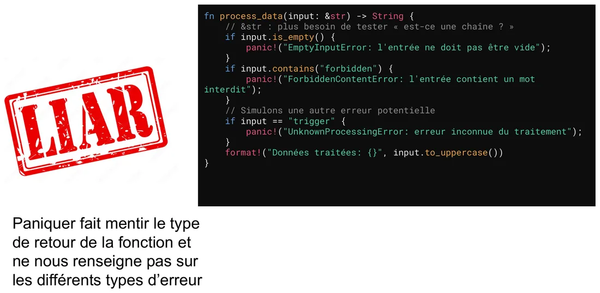

# Erreurs : `panic!` et `Result`

## 1. Deux sortes d'erreurs

| Sorte | Exemples | Outil |
|---|---|---|
| **irrécupérable** : un bug, une situation qui ne devrait jamais arriver | indice hors du tableau, état impossible | `panic!` |
| **récupérable** : un échec prévisible | saisie invalide, fichier absent, réseau coupé | `Result<T, E>` |

Rust n'a **pas d'exceptions** : une fonction qui peut échouer l'annonce dans son **type de retour**. Impossible d'oublier l'erreur sans que ça se voie.

**Exemple résolu : panique ou `Result` ?** Pour chaque situation, on se pose une seule question : « est-ce que ça peut arriver alors que le programme est **correct** ? »

| Situation | Peut arriver sans bug ? | Choix |
|---|---|---|
| L'utilisateur tape « douze » au lieu d'un nombre | oui, les gens se trompent | `Result` : on redemande |
| Le fichier de configuration n'existe pas | oui, il a pu être supprimé | `Result` : on affiche un message |
| On lit la case 5 d'un tableau de 3 cases qu'on vient de remplir | non, c'est une erreur dans le code | panique |
| Une fonction de tri renvoie une liste plus courte que l'entrée | non, c'est impossible si le code est juste | panique |

**À retenir :** échec possible avec un programme correct (saisie, fichier, réseau) → `Result` ; bug ou situation impossible → panique.

## 2. `panic!` : tout arrêter

```rust
panic!("ça ne devrait jamais arriver");
```

Le programme s'arrête avec le message. Certaines opérations paniquent toutes seules : lire `v[10]` dans un tableau de 3 cases, un débordement d'entier en debug, `unwrap()` sur un `None`.

> [!tip] Dans les tests
> `#[should_panic(expected = "message")]` au-dessus d'un test vérifie que le code panique bien avec ce message.

**Exemple résolu : une vérification qui panique**

```rust
fn pourcentage(part: u32, total: u32) -> u32 {
    if part > total {
        panic!("part ({part}) plus grande que le total ({total})");
    }
    part * 100 / total
}

fn main() {
    println!("{} %", pourcentage(3, 4));
    println!("{} %", pourcentage(1, 3));
}
```

1. `pourcentage(3, 4)` : 3 n'est pas plus grand que 4, on calcule 3 × 100 / 4 = **75**.
2. `pourcentage(1, 3)` : 100 / 3 = **33** (division entière, la partie après la virgule est perdue).
3. Si on appelait `pourcentage(5, 4)`, le programme s'arrêterait avec : `thread 'main' panicked at ...: part (5) plus grande que le total (4)`. Les lignes suivantes ne seraient jamais exécutées.

`panic!` accepte un message comme `println!` (avec `{variable}`). Il ne renvoie rien : après lui, la fonction ne continue pas, donc pas besoin d'`else`.

Pour un test, `expected = "..."` doit être un **morceau** du message de panique : `#[should_panic(expected = "plus grande que le total")]` réussit avec le message ci-dessus. Si le code ne panique pas, ou panique avec un autre message, le test échoue.

**À retenir :** `panic!("...")` arrête tout le programme ; réserve-le aux situations qui prouvent un bug, et teste-le avec `#[should_panic(expected = "morceau du message")]`.

## 3. `Result<T, E>` : réussir ou échouer avec une raison

Le problème de `panic!` pour un échec **prévisible** : la signature ment. Une fonction `-> String` promet de toujours rendre un texte, alors qu'elle peut aussi tout arrêter, et rien ne dit **quelles** erreurs sont possibles.



`Result` règle ça : l'échec est écrit **dans le type de retour**, visible par tous ceux qui appellent la fonction.

```rust
enum Result<T, E> {
    Ok(T),    // succès, avec la valeur de type T
    Err(E),   // échec, avec l'erreur de type E
}
```

```rust
fn diviser(a: i32, b: i32) -> Result<i32, String> {
    if b == 0 {
        Err(String::from("division par zéro"))
    } else {
        Ok(a / b)
    }
}

match diviser(10, 0) {
    Ok(resultat) => println!("Résultat : {resultat}"),
    Err(erreur) => println!("Erreur : {erreur}"),
}
```

> [!info] `Option` ou `Result` ?
> `Option` dit seulement « il n'y a rien ». `Result` dit « ça a échoué, **et voici pourquoi** ».

**Exemple résolu : retirer de l'argent**

```rust
fn retirer(solde: u32, montant: u32) -> Result<u32, String> {
    if montant > solde {
        return Err(format!("solde insuffisant : il manque {} €", montant - solde));
    }
    Ok(solde - montant)
}

fn main() {
    println!("{:?}", retirer(50, 20));
    println!("{:?}", retirer(50, 80));

    match retirer(50, 80) {
        Ok(reste) => println!("Il reste {reste} €"),
        Err(message) => println!("Refusé : {message}"),
    }
}
```

| Appel | `montant > solde` ? | Résultat |
|---|---|---|
| `retirer(50, 20)` | 20 > 50 : non | `Ok(30)` |
| `retirer(50, 80)` | 80 > 50 : oui | `Err("solde insuffisant : il manque 30 €")` |

- `return Err(...)` sort **tout de suite** de la fonction. On écrit ensuite le cas normal sans `else`.
- La dernière ligne `Ok(solde - montant)` n'a pas de `;` : c'est la valeur renvoyée. Renvoyer `solde - montant` tout seul ne compilerait pas, il faut l'emballer dans `Ok(...)`.
- Le type d'erreur est `String` : on fabrique le texte avec `"...".to_string()`, `String::from("...")` ou `format!(...)`. Un simple `"..."` est un `&str`, pas un `String` : il ne suffit pas.
- `{:?}` affiche l'enveloppe et les guillemets : `Ok(30)`, `Err("solde insuffisant : ...")`. Le `match` sort la valeur pour l'afficher proprement avec `{}`.

**À retenir :** une fonction qui peut échouer renvoie `Result<T, E>` : `return Err(...)` dès qu'un problème est détecté, `Ok(valeur)` à la fin.

## 4. Transformer du texte en nombre : `parse`

```rust
let ok = "42".parse::<i32>();     // Ok(42)
let ko = "abc".parse::<i32>();    // Err(ParseIntError { kind: InvalidDigit })
```

- `::<i32>` (surnommé **turbofish**) précise le type voulu. On peut aussi écrire `let n: i32 = texte.parse().unwrap();`.
- Le type de l'erreur est `std::num::ParseIntError`. Affichée avec `{}`, elle donne par exemple `invalid digit found in string`.
- Pense à `.trim()` pour enlever les espaces autour d'une saisie : `" 42 ".trim().parse::<i32>()`.

**Exemple résolu : quelles saisies donnent un `u8` ?**

Un `u8` va de 0 à 255, sans signe moins.

```rust
fn main() {
    for texte in ["7", " 8 ", "300", "-1", "", "x"] {
        match texte.trim().parse::<u8>() {
            Ok(n) => println!("{texte:?} -> nombre {n}"),
            Err(erreur) => println!("{texte:?} -> erreur : {erreur}"),
        }
    }
}
```

| Saisie | Après `trim()` | Résultat | Message de l'erreur (`{}`) |
|---|---|---|---|
| `"7"` | `"7"` | `Ok(7)` | |
| `" 8 "` | `"8"` | `Ok(8)` (sans `trim`, ce serait une erreur) | |
| `"300"` | `"300"` | `Err` : plus grand que 255 | `number too large to fit in target type` |
| `"-1"` | `"-1"` | `Err` : un `u8` n'a pas de signe moins | `invalid digit found in string` |
| `""` | `""` | `Err` : rien à lire | `cannot parse integer from empty string` |
| `"x"` | `"x"` | `Err` : pas un chiffre | `invalid digit found in string` |

- `{texte:?}` affiche le texte **avec ses guillemets** (`"7"`), ce qui rend visibles les espaces et le texte vide.
- Avec un `i32`, `"-1"` serait accepté. Le **type demandé** décide de ce qui est valide : demander un `u32` refuse tout nombre négatif.
- `parse` ne panique jamais : il renvoie toujours un `Result`. C'est à toi de choisir quoi faire du `Err`.

Le type peut aussi être **deviné** par le compilateur à partir de l'endroit où va le résultat :

```rust
fn lire_niveau(texte: &str) -> u8 {
    texte.trim().parse().unwrap_or(1)
}

fn main() {
    println!("{} {} {}", lire_niveau("4"), lire_niveau("beaucoup"), lire_niveau("999"));
}
```

La fonction renvoie un `u8`, donc `parse()` lit un `u8` sans turbofish. `unwrap_or(1)` marche sur un `Result` comme sur un `Option` : la valeur si c'est `Ok`, sinon `1`. Affichage : `4 1 1` (« 999 » ne tient pas dans un `u8`).

**À retenir :** `texte.trim().parse::<Type>()` renvoie `Ok(nombre)` ou `Err(ParseIntError)` ; le type demandé fixe les limites (signe, taille) ; `unwrap_or(defaut)` donne une valeur de secours.

## 5. L'opérateur `?` : propager l'erreur

```rust
use std::num::ParseIntError;

fn additionner(a: &str, b: &str) -> Result<i32, ParseIntError> {
    let x = a.parse::<i32>()?;
    let y = b.parse::<i32>()?;
    Ok(x + y)
}
```

Le `?` après un `Result` veut dire :

- si c'est `Ok(valeur)` → donne `valeur` et continue ;
- si c'est `Err(erreur)` → **arrête la fonction** et renvoie `Err(erreur)` à l'appelant.

C'est un raccourci pour :

```rust
let x = match a.parse::<i32>() {
    Ok(valeur) => valeur,
    Err(erreur) => return Err(erreur),
};
```

> [!warning] Où utiliser `?`
> Seulement dans une fonction qui renvoie elle-même un `Result` (ou un `Option` pour un `?` sur un `Option`). Dans `main`, il faut écrire `fn main() -> Result<(), ...>`.

**Exemple résolu : la surface d'un rectangle saisi en texte**

```rust
use std::num::ParseIntError;

fn surface(largeur: &str, hauteur: &str) -> Result<u32, ParseIntError> {
    let l = largeur.trim().parse::<u32>()?;
    let h = hauteur.trim().parse::<u32>()?;
    Ok(l * h)
}

fn main() -> Result<(), ParseIntError> {
    println!("{:?}", surface("4", "5"));
    println!("{:?}", surface("4", "cinq"));
    println!("{:?}", surface("quatre", "cinq"));

    let s = surface("3", "3")?;
    println!("Surface sûre : {s}");
    Ok(())
}
```

Suivons les trois premiers appels :

| Appel | Ligne `l` | Ligne `h` | Résultat |
|---|---|---|---|
| `surface("4", "5")` | `Ok(4)` → `l = 4` | `Ok(5)` → `h = 5` | `Ok(20)` |
| `surface("4", "cinq")` | `l = 4` | `Err` → **on sort** | `Err(ParseIntError { kind: InvalidDigit })` |
| `surface("quatre", "cinq")` | `Err` → **on sort** | jamais lue | l'erreur de « quatre » |

- Le premier `?` qui tombe sur une erreur arrête tout : on ne lit jamais la suite. Avec trois nombres, on écrit simplement trois lignes avec `?`.
- Le type d'erreur de la fonction (`ParseIntError`) est celui des erreurs propagées par `?`.
- `fn main() -> Result<(), ParseIntError>` autorise `?` dans `main`. À la fin, `Ok(())` dit « tout s'est bien passé » (`()` = aucune valeur). Si le `?` de `main` tombait sur une erreur, le programme s'arrêterait en affichant `Error: ...`.

**À retenir :** une ligne `let x = ...?;` par valeur à lire, puis `Ok(résultat)` ; le premier `Err` rencontré est renvoyé tel quel.

## 6. Ses propres erreurs avec une enum

```rust
#[derive(Debug, PartialEq)]
enum ErreurAge {
    Vide,
    PasUnNombre,
    TropGrand(u32),
}

fn lire_age(texte: &str) -> Result<u32, ErreurAge> { ... }
```

L'appelant peut faire un `match` sur chaque cas et réagir différemment (redemander, afficher un message précis...).

**Exemple résolu : valider un pseudo**

Règles : on ignore les espaces autour ; le pseudo ne doit pas être vide, ne doit pas dépasser 12 caractères, et ne contient que des lettres et des chiffres.

```rust
#[derive(Debug, PartialEq)]
enum ErreurPseudo {
    Vide,
    TropLong(usize),
    CaractereInterdit(char),
}

fn valider_pseudo(texte: &str) -> Result<String, ErreurPseudo> {
    let pseudo = texte.trim();
    if pseudo.is_empty() {
        return Err(ErreurPseudo::Vide);
    }
    let longueur = pseudo.chars().count();
    if longueur > 12 {
        return Err(ErreurPseudo::TropLong(longueur));
    }
    if let Some(c) = pseudo.chars().find(|c| !c.is_alphanumeric()) {
        return Err(ErreurPseudo::CaractereInterdit(c));
    }
    Ok(pseudo.to_string())
}

fn main() {
    for texte in ["  ferris ", "   ", "un_pseudo", "abcdefghijklmnop"] {
        match valider_pseudo(texte) {
            Ok(p) => println!("{texte:?} -> accepté : {p}"),
            Err(ErreurPseudo::Vide) => println!("{texte:?} -> écris quelque chose"),
            Err(ErreurPseudo::TropLong(n)) => println!("{texte:?} -> {n} caractères, 12 au plus"),
            Err(ErreurPseudo::CaractereInterdit(c)) => println!("{texte:?} -> {c:?} interdit"),
        }
    }
}
```

| Saisie | Après `trim` | Vide ? | Plus de 12 ? | Caractère interdit ? | Résultat |
|---|---|---|---|---|---|
| `"  ferris "` | `"ferris"` | non | non (6) | non | `Ok("ferris")` |
| `"   "` | `""` | **oui** | | | `Err(Vide)` |
| `"un_pseudo"` | `"un_pseudo"` | non | non (9) | **oui** : `'_'` | `Err(CaractereInterdit('_'))` |
| `"abcdefghijklmnop"` | idem | non | **oui** (16) | | `Err(TropLong(16))` |

- L'**ordre des vérifications** compte : chaque `return Err(...)` arrête la fonction. Le texte `"   "` est d'abord vidé par `trim`, puis attrapé par le test « vide » : il n'arrivera jamais au test de longueur.
- `let pseudo = texte.trim();` : on travaille ensuite sur la version **nettoyée** partout.
- `chars().count()` compte des **caractères** (é compte 1) ; `len()` compterait des octets.
- `chars().find(...)` renvoie `Some(premier caractère qui vérifie la condition)` ou `None` : avec `if let`, on récupère le caractère fautif pour le mettre dans l'erreur.
- Une variante peut **porter une donnée** (`TropLong(16)`) : l'appelant sait non seulement *ce qui* ne va pas, mais aussi *de combien*.
- `#[derive(Debug, PartialEq)]` sur l'enum d'erreur permet `{:?}` et `assert_eq!(valider_pseudo(""), Err(ErreurPseudo::Vide))` dans les tests.

**À retenir :** une variante par échec possible ; dans la fonction, nettoie d'abord, puis vérifie dans l'ordre demandé avec un `return Err(...)` par cas, et finis par `Ok(...)`.

## 7. Convertir entre `Option`, `Result` et les erreurs

| Méthode | Ce qu'elle fait |
|---|---|
| `option.ok_or(erreur)` | `Option` → `Result` : `None` devient `Err(erreur)` |
| `resultat.ok()` | `Result` → `Option` : l'erreur est jetée |
| `resultat.map_err(\|e\| autre)` | remplace l'erreur par une autre |
| `resultat.unwrap_or(defaut)` | la valeur, ou `defaut` en cas d'erreur |
| `resultat.is_ok()` / `is_err()` | `true` ou `false` |

Exemple très courant, `map_err` + `?` :

```rust
let age = texte.parse::<u32>().map_err(|_| ErreurAge::PasUnNombre)?;
```

`|_|` est une closure qui ignore son paramètre (l'erreur d'origine).

**Exemple résolu : réserver une salle**

```rust
#[derive(Debug, PartialEq)]
enum ErreurReservation {
    SalleInconnue,
    TropDeMonde(u32),
    NombreIllisible(String),
}

fn capacite(salle: &str) -> Option<u32> {
    match salle {
        "A" => Some(30),
        "B" => Some(12),
        _ => None,
    }
}

fn reserver(salle: &str, personnes: &str) -> Result<u32, ErreurReservation> {
    let places = capacite(salle).ok_or(ErreurReservation::SalleInconnue)?;
    let n = personnes
        .parse::<u32>()
        .map_err(|_| ErreurReservation::NombreIllisible(personnes.to_string()))?;
    if n > places {
        return Err(ErreurReservation::TropDeMonde(places));
    }
    Ok(places - n)
}

fn main() {
    println!("{:?}", reserver("A", "25"));
    println!("{:?}", reserver("C", "5"));
    println!("{:?}", reserver("B", "douze"));
    println!("{:?}", reserver("B", "20"));
    println!("{:?} {}", reserver("A", "1").ok(), reserver("Z", "1").is_err());
}
```

Suivons `reserver("B", "20")` :

1. `capacite("B")` renvoie `Some(12)`. `ok_or(...)` le transforme en `Ok(12)`, et `?` donne `places = 12`. (Pour la salle `"C"`, `capacite` renvoie `None`, `ok_or` en fait `Err(SalleInconnue)` et `?` le renvoie.)
2. `"20".parse::<u32>()` donne `Ok(20)` ; `map_err` ne touche pas un `Ok`, et `?` donne `n = 20`. (Avec `"douze"`, `parse` donne une `ParseIntError` ; `map_err` la **remplace** par `NombreIllisible("douze")`, puis `?` la renvoie.)
3. `20 > 12` : `return Err(TropDeMonde(12))`.

Affichage : `Ok(5)`, `Err(SalleInconnue)`, `Err(NombreIllisible("douze"))`, `Err(TropDeMonde(12))`, puis `Some(29) true`.

- Pourquoi `ok_or` ? `?` sur un `Option` dans une fonction qui renvoie un `Result` ne compile pas : il faut d'abord **choisir l'erreur** qui remplacera `None`.
- Pourquoi `map_err` ? `?` ne peut renvoyer qu'une erreur du type de la fonction (`ErreurReservation`), pas une `ParseIntError`. `map_err` fait la conversion.
- La closure de `map_err` peut utiliser les variables autour : ici `personnes`, pour garder le texte fautif dans l'erreur (`to_string()` en fait un `String`).
- `.ok()` jette l'erreur et donne un `Option` : `Ok(29)` → `Some(29)`. `.is_err()` répond seulement oui / non.

### Découper une saisie en morceaux

`texte.split_whitespace()` découpe un texte aux espaces. On prend les morceaux un par un avec `.next()`, qui renvoie `Some(morceau)` ou `None` quand il n'y en a plus. Combiné avec `ok_or` et `?`, on vérifie qu'il y a **exactement** le bon nombre de morceaux.

```rust
#[derive(Debug, PartialEq)]
enum ErreurRdv {
    FormatInvalide,
    JourInconnu(String),
    HeureIllisible(String),
    HeureImpossible(u32),
}

fn lire_rdv(texte: &str) -> Result<(String, u32), ErreurRdv> {
    let mut morceaux = texte.split_whitespace();
    let jour = morceaux.next().ok_or(ErreurRdv::FormatInvalide)?;
    let heure = morceaux.next().ok_or(ErreurRdv::FormatInvalide)?;
    if morceaux.next().is_some() {
        return Err(ErreurRdv::FormatInvalide);
    }

    let h = heure
        .parse::<u32>()
        .map_err(|_| ErreurRdv::HeureIllisible(heure.to_string()))?;

    match jour {
        "lundi" | "mardi" | "mercredi" | "jeudi" | "vendredi" if h > 23 => Err(ErreurRdv::HeureImpossible(h)),
        "lundi" | "mardi" | "mercredi" | "jeudi" | "vendredi" => Ok((jour.to_string(), h)),
        autre => Err(ErreurRdv::JourInconnu(autre.to_string())),
    }
}

fn main() {
    for texte in ["lundi 14", "mardi", "jeudi 9 h", "samedi 10", "lundi midi", "vendredi 25"] {
        println!("{texte:?} -> {:?}", lire_rdv(texte));
    }
}
```

| Saisie | Morceaux | Ce qui se passe | Résultat |
|---|---|---|---|
| `"lundi 14"` | `lundi`, `14` | 2 morceaux, 14 lisible, jour connu, 14 ≤ 23 | `Ok(("lundi", 14))` |
| `"mardi"` | `mardi` | le 2e `next()` donne `None` → `ok_or` → `?` | `Err(FormatInvalide)` |
| `"jeudi 9 h"` | `jeudi`, `9`, `h` | le 3e `next()` donne `Some("h")` : un morceau de trop | `Err(FormatInvalide)` |
| `"samedi 10"` | `samedi`, `10` | heure lisible, mais aucun jour de semaine ne correspond : `autre` | `Err(JourInconnu("samedi"))` |
| `"lundi midi"` | `lundi`, `midi` | `parse` échoue, `map_err` garde le texte | `Err(HeureIllisible("midi"))` |
| `"vendredi 25"` | `vendredi`, `25` | jour connu **et** garde `h > 23` vraie | `Err(HeureImpossible(25))` |

- `let mut morceaux` : chaque `next()` avance dans le découpage, la variable doit donc être `mut`.
- `morceaux.next().is_some()` après le dernier morceau attendu détecte les morceaux **en trop**.
- L'ordre du code donne l'ordre des erreurs : ici le format, puis l'heure, puis le jour. « samedi midi » donnerait donc `HeureIllisible`, pas `JourInconnu`.
- Dans le `match` sur un texte, une garde (`if h > 23`) s'ajoute à un motif, et `autre =>` attrape tout le reste en gardant la valeur.

**À retenir :** `ok_or` change un `None` en erreur, `map_err` change une erreur en **ton** erreur ; les deux préparent le terrain pour `?`.

## 8. `unwrap` et `expect` : quand les utiliser ?

- `unwrap()` : la valeur, ou **panique** avec un message peu clair.
- `expect("message")` : pareil, mais panique avec **ton** message.

| Acceptable | À éviter |
|---|---|
| dans les tests | saisie de l'utilisateur |
| dans un petit prototype | lecture de fichier, réseau |
| quand l'échec est vraiment impossible (avec `expect` qui explique pourquoi) | tout ce qui peut raisonnablement échouer |

> [!tip] Un bon `expect` documente
> `.expect("la configuration contient toujours un port")` explique au lecteur pourquoi l'échec est impossible.

**Exemple résolu : une valeur par défaut ou une panique claire**

```rust
fn lire_delai(texte: &str) -> u32 {
    texte.trim().parse().unwrap_or(30)
}

fn lire_delai_obligatoire(texte: &str) -> u32 {
    texte
        .trim()
        .parse()
        .expect("le délai doit être un nombre de secondes positif")
}

fn main() {
    println!("{}", lire_delai("45"));
    println!("{}", lire_delai("bientôt"));
    println!("{}", lire_delai_obligatoire("10"));
}

#[cfg(test)]
mod tests {
    use super::*;

    #[test]
    #[should_panic(expected = "le délai doit être un nombre")]
    fn delai_obligatoire_illisible() {
        lire_delai_obligatoire("jamais");
    }
}
```

| Appel | `parse` donne | Résultat |
|---|---|---|
| `lire_delai("45")` | `Ok(45)` | `45` |
| `lire_delai("bientôt")` | `Err(...)` | `30` (la valeur par défaut, pas de panique) |
| `lire_delai_obligatoire("10")` | `Ok(10)` | `10` |
| `lire_delai_obligatoire("jamais")` | `Err(...)` | panique : `le délai doit être un nombre de secondes positif: ParseIntError { kind: InvalidDigit }` |

- Le message de panique d'`expect` = **ton** texte, puis `: `, puis l'erreur d'origine. Avec `unwrap()`, on n'aurait que `called Result::unwrap() on an Err value: ParseIntError { kind: InvalidDigit }`, sans savoir ce qu'on essayait de lire.
- Le test `#[should_panic(expected = "...")]` réussit parce que le message de panique **contient** le texte attendu. (Il se lance avec `cargo test`, pas avec « Essayer ».)
- Les deux fonctions renvoient un `u32` : `parse()` lit un `u32` sans turbofish. Un texte trop grand ou négatif est aussi refusé par `parse`.
- Choisir entre les deux : si une valeur par défaut a du sens, `unwrap_or` (le programme continue) ; si continuer n'a aucun sens, `expect` avec un message clair.

**À retenir :** `unwrap_or(defaut)` quand on peut continuer ; `expect("pourquoi c'était censé marcher")` quand on ne peut pas ; `unwrap()` seul seulement dans les tests et les prototypes.

## À retenir

- Bug ou état impossible → `panic!`. Échec prévisible → `Result`.
- `Result<T, E>` = `Ok(T)` ou `Err(E)` ; on le traite avec `match`. `return Err(...)` dès qu'un problème est détecté, `Ok(valeur)` à la fin.
- `texte.trim().parse::<i32>()` renvoie un `Result` ; le type demandé fixe ce qui est valide (un `u32` refuse `-3`).
- `?` renvoie l'erreur à l'appelant ; seulement dans une fonction qui renvoie un `Result`.
- Une enum d'erreur décrit tous les échecs possibles ; l'ordre des vérifications décide de l'erreur renvoyée.
- `ok_or`, `map_err`, `ok`, `unwrap_or` pour convertir ; `split_whitespace` + `next` + `ok_or` pour découper une saisie.
- `unwrap` / `expect` : tests, prototypes, cas impossibles ; `#[should_panic(expected = "...")]` teste une panique.
